<p align="center">
  <a href="#plug-in-an-llm-it-asks-before-it-acts">
    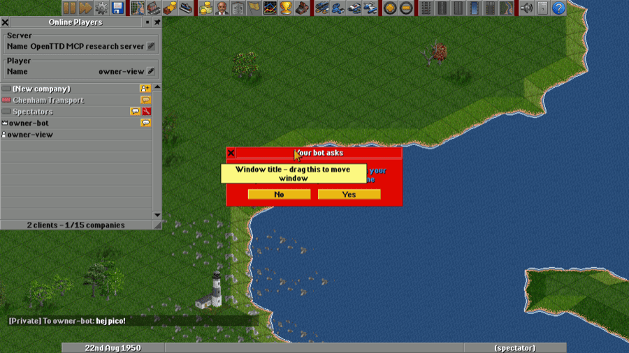
  </a>
</p>

<h1 align="center">OpenTTD &middot; LLM &amp; agent lab</h1>

<p align="center">
  <strong>An MCP server inside the engine, Rhai scripting over every game command, and AI players<br>
  that plan with the game's real prices and ask before they act.</strong><br>
  A personal research fork: every number below is counted from the repository, every claim links to its evidence.
</p>

<p align="center">
  <a href="https://korczis.github.io/OpenTTD/"></a>
  <a href="https://github.com/korczis/OpenTTD/actions/workflows/surfaces.yml"></a>
  <a href="https://github.com/korczis/OpenTTD/wiki"></a>
  <a href="COPYING.md"></a>
</p>

<p align="center">
  <a href="#plug-in-an-llm-it-asks-before-it-acts"><b>LLM over MCP</b></a> &nbsp;&middot;&nbsp;
  <a href="#script-a-live-game-in-rhai"><b>Rhai</b></a> &nbsp;&middot;&nbsp;
  <a href="#plans-in-a-sentence"><b>Plans in a sentence</b></a> &nbsp;&middot;&nbsp;
  <a href="#the-planner-against-itself"><b>Bot duels</b></a> &nbsp;&middot;&nbsp;
  <a href="#what-the-duels-have-taught-so-far"><b>Findings</b></a> &nbsp;&middot;&nbsp;
  <a href="#against-other-ais-the-lan-battle"><b>AI battle</b></a> &nbsp;&middot;&nbsp;
  <a href="#rail-lines-that-pay"><b>Rail</b></a> &nbsp;&middot;&nbsp;
  <a href="#every-event-on-a-bus-and-in-a-store"><b>Events</b></a> &nbsp;&middot;&nbsp;
  <a href="#a-real-place-as-the-map"><b>Real place</b></a> &nbsp;&middot;&nbsp;
  <a href="#a-real-game-over-the-internet"><b>Real game</b></a> &nbsp;&middot;&nbsp;
  <a href="#beyond-the-game"><b>Beyond the game</b></a> &nbsp;&middot;&nbsp;
  <a href="#counted-from-the-source"><b>Numbers</b></a> &nbsp;&middot;&nbsp;
  <a href="#how-it-compares"><b>How it compares</b></a> &nbsp;&middot;&nbsp;
  <a href="#quick-start"><b>Quick start</b></a> &nbsp;&middot;&nbsp;
  <a href="#00-about-this-fork"><b>Full story</b></a>
</p>

> [!IMPORTANT]
> **Not the official OpenTTD.** `korczis/OpenTTD` is a personal research fork. It sends nothing
> upstream (no issues, pull requests or patches), and it joins public servers only with the
> unmodified release client. The original README is kept from [1.0) About](#10-about) on;
> licence and credits are unchanged. Upstream is [OpenTTD/OpenTTD](https://github.com/OpenTTD/OpenTTD).

## What this fork is for

OpenTTD is a deterministic, lockstep simulation with a strict command system, a full economy and a
20-year-old C++ codebase. That makes it a hard, honest arena for AI: a model cannot fake a profit,
and a change that skips the rules desyncs the game. This fork opens the engine to AI in three
layers, each one usable on its own:

- **Any LLM is a player.** An MCP server compiled into the game serves its live state as
  resources and every game command and Script API function as a tool. Claude Code, MCP Inspector
  or any other MCP client connects over a stdio proxy and plays.
- **Rhai is the glue.** Every MCP tool, console command and control-panel route is a Rhai
  function the moment a script starts, so a few lines drive a whole game, a camera, a narrator or
  a conversation with the owner inside the game.
- **The game decides what is allowed.** Every change an agent makes is a normal game command,
  held until the operator approves its exact arguments. No script and no model approves itself.

On top of that sit:

- **a planner** (AlgoGlyph) that prices track tile by tile on the live map and picks a portfolio of
  lines with a knapsack over the company's money;
- **a company AI** ([PrismaticAI](tools/research/prismatic-ai/README.md)) that builds that plan with
  [rail lines a train can always run](#rail-lines-that-pay), and a Rhai steward that keeps each line
  paying;
- **an event bus and a store** in every control panel: each event goes out on ZeroMQ and into a
  DuckDB file, and planning decisions [read that history back](#every-event-on-a-bus-and-in-a-store);
- **recorded duels** that measure whether the plan helps, and
  [what they have taught so far](#what-the-duels-have-taught-so-far), negative results included;
- **a LAN tournament** against the best BaNaNaS AIs, with a derived leaderboard, a post-mortem of
  every loss and a genetic algorithm that tunes the bot's settings
  ([AI battle](#against-other-ais-the-lan-battle)).

How each idea carries over to the real world is [beyond the game](#beyond-the-game). The next step
is [a real game against real opponents over the internet](#a-real-game-over-the-internet).

## Three things to try

| | Your LLM in the game | A Rhai script | A bot duel |
|---|---|---|---|
| | [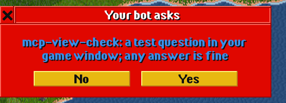](#plug-in-an-llm-it-asks-before-it-acts) | [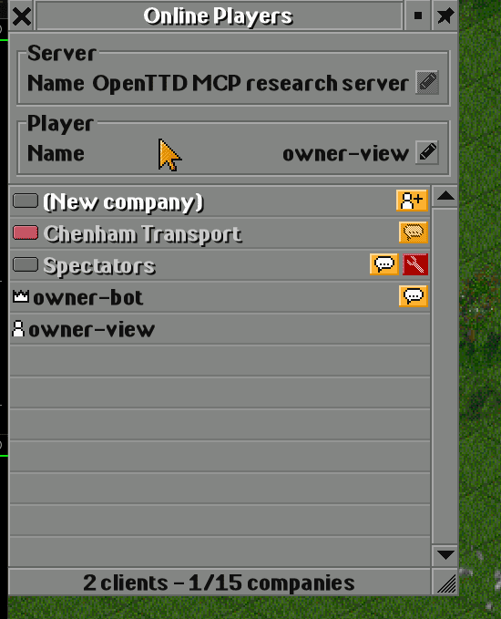](#script-a-live-game-in-rhai) | [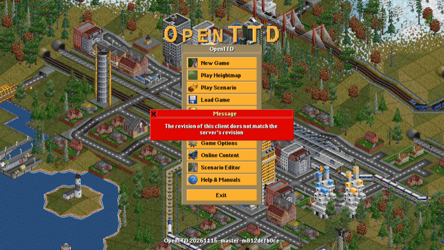](#the-planner-against-itself) |
| **What** | an MCP client reads the live game and proposes moves you approve | a script drives a running game through every tool, console command and panel route | two companies, same AI, one with the planner: watch who wins |
| **Start** | `tools/research/mcp-e2e`, then [connect your client](#plug-in-an-llm-it-asks-before-it-acts) | `mcp-rhai tools/research/mcp-panel/rhai/full_game.rhai` | `tools/research/mcp-duel --months 36` |
| **Needs** | a research build (`tools/gate.sh research`) and any MCP client | a research build and `cargo build --release` in [`mcp-rhai`](tools/research/mcp-rhai/) | a research build |

All three need this fork's research build: the MCP server is compiled into it, default OFF and
loopback only.

## Plug in an LLM: it asks before it acts

The game carries an MCP server of its own (compile-gated, default OFF, loopback only). An agent
reads live state through resources (map, towns, stations, vehicles, companies, finances) and
changes the world only through the game's own command system: every game command
(`openttd.cmd.<Command>`) and every Script API function (`openttd.api.<Class>.<Function>`) is a
tool, and so are the company AIs (`openttd.ai.*`) and the owner's window (`openttd.view.*`). A call
that changes the game waits until the operator approves those exact arguments, in the console
(`prismatic_mcp approve <id>`) or in the panel. The bot's yes/no questions appear in the game
itself, and the owner can let them confirm themselves after a countdown.

```bash
tools/gate.sh research    # once: the MCP-enabled build and its tests
tools/research/mcp-e2e    # game + MCP server + bot + panel (http://127.0.0.1:8800) + spectator client

# Claude Code; any other MCP client runs the same stdio command
claude mcp add openttd -- "$PWD/tools/research/mcp-auto/openttd-mcp-stdio"
```

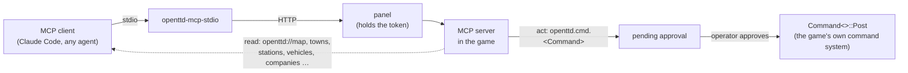

The proxy never sees the bearer token: the panel holds it and the proxy only forwards JSON-RPC
over loopback. Tool names reach the client with underscores (`openttd_game_set_pause`), because
some clients refuse dots. The panel's Swagger UI lists the whole catalogue, every route;
[`research/mcp-control.md`](research/mcp-control.md) covers the panel, the `~` console
(`mcp <tool>`), Rhai and the hub, and [`research/mcp-api.md`](research/mcp-api.md) the API.

## Script a live game in Rhai

[Rhai](https://rhai.rs/) is the fork's extension language: new extension logic is written in Rhai,
hosts and tools in Rust ([rule](.ai/repo/rules/project/tooling-language-preference.v1.md),
[mechanism](research/mechanisms/rhai-scripting.md)).
[`mcp-rhai`](tools/research/mcp-rhai/) runs a script against a live game, and nothing it calls is
listed by hand. At start-up it derives one function per MCP tool (`openttd_game_set_pause(#{pause:
true})`), one per OpenTTD console command (`con_companies()`) and one per operation of the panel's
OpenAPI document (`api_bots()`), so a tool added to the game is a Rhai function the next time a
script starts.

```rhai
import "ttd" as ttd;            // tools/research/mcp-panel/rhai/ttd.rhai

ttd::new_game(42);                              // a new world, waits until it runs
ttd::start_ai("PrismaticAI", "aggressiveness=75");
ttd::watch(6, 30);                              // a report every 30 s, six times
print(ttd::set_pause(true, 300));               // waits for the operator's approval, never approves itself
print(ttd::report());
```

Run one with `mcp-rhai <file.rhai>`, `mcp-rhai -e '<script>'` or `/rhai ...` in the panel's
developer console.

The panel's Scripts page (`/scripts`) is an editor for the whole library: CodeMirror 6 with Rhai
highlighting, the parser's error as a lint marker while you type, and completion and hover for
every function a script can call, from `GET /api/rhai/functions` (host functions, one per MCP
tool, OpenAPI route and console command, and every library function under the alias a script
imports it as). A script runs once with its output streamed, or as a service that reloads when its
file changes, or under the debugger: breakpoints in the gutter, step into, over and out, the
variables in scope and the call stack while it is paused. Scripts and services share keys through
`shared_set`, `shared_get` and `shared_cas`
(a write that names the revision it expects, so concurrent writers never lose an update), shown
live on the page, every write a `rhai.shared` event on the bus. Scripts also
call Prismatic on loopback (`prismatic_decision`, `prismatic_exec`, `prismatic_bb_get`, ...), every
answer checked against its contract and every failure a typed error
([`research/rhai-ide.md`](research/rhai-ide.md)).

Examples from [`tools/research/mcp-panel/rhai/`](tools/research/mcp-panel/rhai/):

| Script | What it does in the running game |
|---|---|
| [`full_game.rhai`](tools/research/mcp-panel/rhai/full_game.rhai) | plays a whole game for the owner: quarterly reports, a pause that waits for approval, the final result |
| [`steward.rhai`](tools/research/mcp-panel/rhai/steward.rhai) | the bot asks yes/no questions in the game's own dialog, and the answer steers what it does next |
| [`narrator.rhai`](tools/research/mcp-panel/rhai/narrator.rhai) | reports what the bot and the game do as chat messages and newspapers, derived from the event feed |
| [`director.rhai`](tools/research/mcp-panel/rhai/director.rhai) | moves the owner's camera like a hand moves a mouse, to where the bot works, and follows its vehicles |
| [`ask_relay.rhai`](tools/research/mcp-panel/rhai/ask_relay.rhai) | answers the questions asked from the fork's toolbar menu (*Ask the planner...*) inside the game |
| [`build_plan.rhai`](tools/research/mcp-panel/rhai/build_plan.rhai) | carries a plain-language plan out: sends its settings to the bot, each waiting for approval |
| [`rail_steward.rhai`](tools/research/mcp-panel/rhai/rail_steward.rhai) | keeps every rail line paying: reads the game each round, decides per line and hands the bot a target to reconcile |
| [`rail_monitor.rhai`](tools/research/mcp-panel/rhai/rail_monitor.rhai) | watches the bot's railway in the background and posts what is wrong to the Majordomus board |
| [`demo.rhai`](tools/research/mcp-panel/rhai/demo.rhai) | a game driven entirely from outside, from a new world to a final report |
| [`arena.rhai`](tools/research/mcp-panel/rhai/arena.rhai) | keeps a lineup of company AIs playing as desired state and reports the standings in chat and as a newspaper |

The libraries they import: [`ttd.rhai`](tools/research/mcp-panel/rhai/ttd.rhai) (high-level game
commands), [`rail_lib.rhai`](tools/research/mcp-panel/rhai/rail_lib.rhai) (rail lines as pure
data, shared by the steward and the monitor) and
[`director_lib.rhai`](tools/research/mcp-panel/rhai/director_lib.rhai) (the director's event logic);
`rail_lib` and `director_lib` are tested offline with `cargo test` in `tools/research/mcp-rhai`.

## Plans in a sentence

`POST /api/intent {text}` (Rhai `api_intent`, `mcp-intent "<sentence>"`, or `plan <text>` in the
game's `~` console) answers a sentence over the live game, in Czech or English:
*vystav trať mezi nejproduktivnějším lesem a pilou* (build a line between the most productive forest
and a sawmill) returns the pair and the bot settings that build it. No model is called and no noun
is typed by hand: industry and cargo names come from the game's own language files, and the
language is told from the sentence's spelling. A build is carried out only through approval-gated
tools, so a sentence lays no track until the owner approves it. Details:
[`research/mcp-control.md`](research/mcp-control.md#the-owners-sentences-plans-in-plain-language).

## The planner against itself

One game, one map, two companies running the **same** Company AI. Company A starts from the
AlgoGlyph planner's portfolio (track priced tile by tile on the live map, lines picked by a
knapsack over the company's money); company B starts without a plan. Every number below is
generated from the recorded runs in [`research/results/`](research/results/) by
[`tools/research/readme-scoreboard`](tools/research/readme-scoreboard) — nothing is typed by hand.

<!-- scoreboard:begin -->
<!-- generated by tools/research/readme-scoreboard; edit the results, not this block -->

> **Best run: 6,026,776 vs 4,971,339** company value, planned bot vs the same bot unplanned, one game, one map (seed 4242, 120 months) — [evidence](research/results/duel-20261119T124719-seed4242.md). The planned bot won **59 of 71** recorded duels.

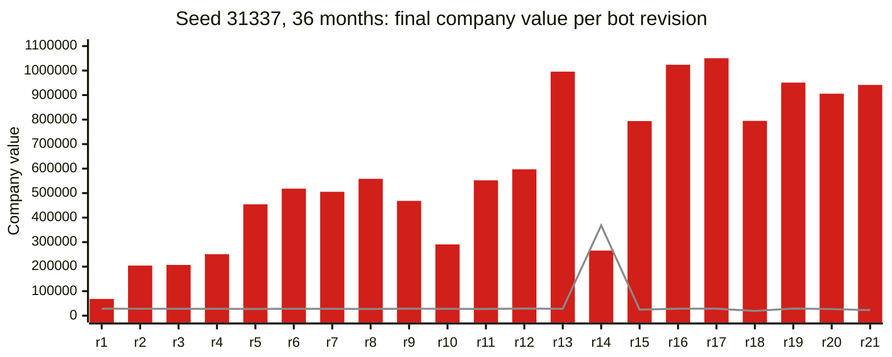

<details><summary>Every revision in the chart (red bar: planned, grey line: unplanned)</summary>

| Rev | Planned | Unplanned | What changed | Evidence |
|---|---:|---:|---|---|
| r1 | 68,229 | 28,293 | generalisation: a second seed with the same bot (bridge f598ede) | [duel-20261116T120701-seed31337](research/results/duel-20261116T120701-seed31337.md) |
| r2 | 204,356 | 28,129 | bot with bridges (bridge d3c39ba) | [duel-20261116T130634-seed31337](research/results/duel-20261116T130634-seed31337.md) |
| r3 | 206,995 | 27,716 | current bot: eight freight lines, line upkeep, bridges, tunnels (bridge 4cf4a62) | [duel-20261116T235622-seed31337](research/results/duel-20261116T235622-seed31337.md) |
| r4 | 250,716 | 27,768 | panel bot start with eight freight lines, 30 candidates, 8 priced per list (4d51c44497)... | [duel-20261117T003624-seed31337](research/results/duel-20261117T003624-seed31337.md) |
| r5 | 454,403 | 27,228 | diagonal track (a corner piece on a diagonal costs 2/3 of a straight one, heuristic 7/9... | [duel-20261117T012840-seed31337](research/results/duel-20261117T012840-seed31337.md) |
| r6 | 518,138 | 27,849 | re-plan around a refused rail piece (bridge f5f29d5) on top of diagonal track | [duel-20261117T024703-seed31337](research/results/duel-20261117T024703-seed31337.md) |
| r7 | 505,369 | 27,943 | station exits checked by the pathfinder's slope rule (bridge exit fix) on top of diagon... | [duel-20261117T032759-seed31337](research/results/duel-20261117T032759-seed31337.md) |
| r8 | 558,331 | 27,408 | rail lines in order of score, the passenger pair after better freight lines (rail_after... | [duel-20261117T041705-seed31337](research/results/duel-20261117T041705-seed31337.md) |
| r9 | 468,228 | 28,331 | two platforms side by side where two planned lines meet (transfer yard), on top of line... | [duel-20261117T045857-seed31337](research/results/duel-20261117T045857-seed31337.md) |
| r10 | 290,634 | 27,853 | transfer yards with a four-tile corridor and a fallback station (bridge 6f78532) | [duel-20261117T053732-seed31337](research/results/duel-20261117T053732-seed31337.md) |
| r11 | 552,182 | 27,247 | control: transfer yards reverted, cleanup fix (bridge aea2cd5); should match 558331 | [duel-20261117T061717-seed31337](research/results/duel-20261117T061717-seed31337.md) |
| r12 | 597,075 | 29,139 | up to sixteen freight lines (panel MAX_FREIGHT_LINES 5c04a120ac, bridge 2c01584), rerun... | [duel-20261117T100202-seed31337](research/results/duel-20261117T100202-seed31337.md) |
| r13 | 995,647 | 27,870 | script budget really 250000 opcodes (panel 1d8c45fa77; was 10000 in every earlier run),... | [duel-20261117T112500-seed31337](research/results/duel-20261117T112500-seed31337.md) |
| r14 | 265,599 | 368,425 | the bot plans its own next freight lines once the planner's are built (own_lines 8; bri... | [duel-20261117T123222-seed31337](research/results/duel-20261117T123222-seed31337.md) |
| r15 | 794,015 | 24,469 | own plan for the planned bot only (panel own_lines 8; bot default 0, bridge 19c2cbe), b... | [duel-20261117T131347-seed31337](research/results/duel-20261117T131347-seed31337.md) |
| r16 | 1,023,810 | 28,440 | A/B calibrated plan (research/calibration.json: bus 0.16, freight_rail 0.59, rail 0.15,... | [duel-20261117T183356-seed31337](research/results/duel-20261117T183356-seed31337.md) |
| r17 | 1,050,432 | 28,286 | A/B uncalibrated control, same code as the calibrated run | [duel-20261117T183400-seed31337](research/results/duel-20261117T183400-seed31337.md) |
| r18 | 794,737 | 19,132 | paired A/B 31337: corrected calibration (net profit, 7211c47e11) | [duel-20261117T193812-seed31337](research/results/duel-20261117T193812-seed31337.md) |
| r19 | 950,946 | 29,102 | paired A/B 31337: uncalibrated control (7211c47e11) | [duel-20261117T193920-seed31337](research/results/duel-20261117T193920-seed31337.md) |
| r20 | 905,692 | 26,945 | held-start A/B 31337: corrected calibration | [duel-20261117T223206-seed31337](research/results/duel-20261117T223206-seed31337.md) |
| r21 | 941,478 | 22,413 | held-start A/B 31337: uncalibrated control | [duel-20261117T223211-seed31337](research/results/duel-20261117T223211-seed31337.md) |

</details>

<!-- scoreboard:end -->

**Read it as an experiment, not a headline.** Most runs are one map (seed 31337) at 36 months,
and company value ignores the track a company owns. Two runs of one unchanged bot differ by about
1% one duel at a time and by 10% or more when several run side by side
([knowledge record](.ai/repo/knowledge/curated/duels-run-side-by-side-are-noisy.md)), so a gain
smaller than that is not told apart from noise. Each row links to the run's own write-up with
both bots' logs; [`tools/research/mcp-duel`](tools/research/mcp-duel) reproduces one.

## What the duels have taught so far

A duel is a measurement, and most of what it has measured is how easy it is to fool yourself.
Each finding below is a curated knowledge record that names its runs; the numbers are quoted from
those records, and the rule [`project.a-tuning-claim-needs-held-start-pairs`](.ai/repo/rules/project/a-tuning-claim-needs-held-start-pairs.v1.md)
decides when a measurement may change a default.

| Finding | What was measured | So |
|---|---|---|
| **A held start makes two runs comparable** | A duel runs in wall-clock time, so on a loaded machine the planner's minutes became a different start tick: the same unplanned rival ended 52% apart in the two arms of one run. With the game paused while the planner plans and both bots start (`PRISMATIC_START_PAUSED`), two identical 6-month duels ended 0.2% apart. | every duel since 2026-11-17 starts held; over 120 months even held repeats drift by -7.6% to +11.4%, so a ten-year A/B is read against its rival's spread ([record](.ai/repo/knowledge/curated/duels-run-side-by-side-are-noisy.md)) |
| **Rail a train can turn on pays** | The new rail geometry against the previous bot, held-start pairs on seeds 4242, 31337 and 20208, 24 months: +25%, +48% and +78%. It starts behind, because two-platform termini cost more, and overtakes by month 18. | the geometry is the default ([record](.ai/repo/knowledge/curated/rail-lines-a-train-can-turn-on.md), [rail steward](research/rail-steward.md)) |
| **The script budget was the hidden ceiling** | Every bot before r13 ran with 10,000 opcodes instead of the 250,000 the panel meant to give it; with the real budget, seed 31337 at 36 months went from 597,075 to 995,647. | rows r12 and r13 of the [scoreboard](#the-planner-against-itself) |
| **The planner overpredicts what a line earns** | Real over predicted profit per vehicle: freight rail median 0.5, bus 0.11. A plan calibrated on those readings, held-start pairs on three seeds: -2.7%, -3.8% and +6.8%. | calibration stays off until there are more readings ([record](.ai/repo/knowledge/curated/the-planner-overpredicts-what-a-line-earns.md)) |
| **Deriving the bot's own lines from stored duels did not beat the constant** | `own_lines` derived from earlier duel outcomes against the constant 8, held-start pairs, 120 months: -14.7%, -8.7% and +17.6%, each inside its rival's spread. | the derived rule stays off, `OWN_LINES` = 8 stays ([record](.ai/repo/knowledge/curated/own-lines-derived-from-stored-duels-did-not-beat-the-constant.md), I0087) |
| **Exposure is complete, exercise is not** | Every game command, console command and Script API function is routed as a tool (146/146, 87/87, 630/630), but live scenarios had called about 2% of the tools and resources, and none of `openttd.api.*` or `openttd.cmd.*`. | "exposed" is not "tested"; the coverage probe is the next piece of work ([record](.ai/repo/knowledge/curated/mcp-exercise-coverage-is-two-percent.md)) |

<details><summary>Every curated knowledge record (generated)</summary>

<!-- surfaces:begin docs-index dir=.ai/repo/knowledge/curated -->
| Document | What it is |
|---|---|
| [Curated notes](.ai/repo/knowledge/curated/README.md) | What this repository chose to write about itself, discovered as a knowledge source class. |
| [Rewriting history under an active task leaves finish nothing to accept](.ai/repo/knowledge/curated/a-history-rewrite-strands-the-active-task.md) | Before rewriting fork history while a Majordomus task is open, or when finish refuses with 'diverged from recorded head'. |
| [A panel announces itself before its game's MCP server is up, so a catalogue read once at discovery lacks every resource route](.ai/repo/knowledge/curated/a-panel-registers-before-its-game-is-up.md) | When a client caches what an instance offers (hub, Rhai, a bot): read it again, never only at discovery. |
| [In the shared checkout a peer's commit rides every push; whether it goes out is the owner's call](.ai/repo/knowledge/curated/a-peer-commit-rides-every-push-of-a-shared-checkout.md) | When local master holds a commit by another session whose own session refused to push it, and you are about to push your own work. |
| [Every PoolItem::Create must follow a CanAllocateItem for that pool; an assert build checks it, a release build dies with a FatalError when the pool is full](.ai/repo/knowledge/curated/a-pool-create-needs-can-allocate-item-first.md) | When creating a pooled object (vehicle, town, sign, station, company, ...) in a command handler, the game loop or research code. |
| [Game timers with the same period and priority run in pointer order, so a timer that draws Random() needs a Priority value of its own](.ai/repo/knowledge/curated/a-random-timer-needs-its-own-priority.md) | Before adding an IntervalTimer on TimerGameEconomy or TimerGameCalendar. |
| [Bash reads a running script by byte offset: edit it only by appending](.ai/repo/knowledge/curated/a-running-bash-script-is-read-by-offset.md) | Before editing a tools/research shell script (mcp-duel, mcp-e2e, gate.sh ...) while a run of it may be in progress. |
| [While a panel runs, no other process can open its DuckDB store, not even read-only](.ai/repo/knowledge/curated/a-running-panels-duckdb-store-is-locked-to-other-processes.md) | When a tool, agent or the duckdb CLI wants a panel's store (~/.local/state/prismatic-mcp/store/.duckdb) during a run. |
| [When this Mac is over its build limits, mcp-rhai is built and tested on lundra, with the owner's libduckdb in user space](.ai/repo/knowledge/curated/a-rust-build-goes-to-lundra-when-this-mac-is-over-its-limits.md) | Before a cargo build or test of tools/research/mcp-rhai while disk is under 35 GiB free or load is far above the core count; how the build is offloaded and what it can and cannot prove. |
| [A path search in an AI script spends game time: raise the opcode budget and weight the heuristic](.ai/repo/knowledge/curated/a-script-path-search-spends-game-time.md) | When a Squirrel AI (PrismaticAI) plans long rail or road lines, or an A/B run shows a bot idle for months. |
| [A station's name sign takes a click on the tiles beside the station](.ai/repo/knowledge/curated/a-station-name-sign-takes-the-click-beside-it.md) | When a person-like player (mcp-human) clicks a tile next to an existing station (a second platform, a depot) and nothing happens and the game says nothing. |
| [A task's scope must cover every path its commits touch; finish and the pre-push hook refuse anything outside it](.ai/repo/knowledge/curated/a-task-scope-must-cover-every-path-its-commit-touches.md) | When starting a Majordomus task for work that spans C++, tools/research, docs and the .ai layer. |
| [Auto-approve of MCP decisions is switched on only by the owner, never inferred by an agent](.ai/repo/knowledge/curated/auto-approve-is-the-owners-switch.md) | When launching tools/research/mcp-e2e, scripting the panel, or building an agent loop over the MCP approval flow. |
| [rcon reaches only server console commands, so the bridge steers a company by restarting its AI with new settings](.ai/repo/knowledge/curated/bridge-control-is-coarse-ai-restart.md) | When designing a new control path from an external agent into a running game. |
| [Income per delivery is distance times a time factor; ground vehicles cover about 0.036 tiles a day per km/h](.ai/repo/knowledge/curated/cargo-payment-and-vehicle-speed.md) | When a planner, bot or script estimates what a route earns, how long cargo is in transit, or which mode of transport pays. |
| [A check run against :8800 can test an old panel: mcp-e2e moves a new stack to a free port when 8800 is held](.ai/repo/knowledge/curated/checks-can-test-an-old-panel-when-a-stack-moves-port.md) | When restarting the main stack and then running mcp-panel-check, mcp-route-check or mcp-view-check against the default address. |
| [A dedicated server's console runs one line per select(): lines written together wait in the stream buffer](.ai/repo/knowledge/curated/dedicated-console-reads-one-buffered-line-per-select.md) | When a tool writes several console commands to a dedicated server's stdin in quick succession (the panel, a script, a ~ plan answer). |
| [The headless research run feeds console commands on stdin after a fixed delay, and a loaded machine can lose them](.ai/repo/knowledge/curated/dedicated-server-stdin-startup-race.md) | When a research run passes but its research_status line is missing, or when scheduling a run next to a heavy build. |
| [Duels run side by side on a loaded machine differ by 10% or more for the same bot](.ai/repo/knowledge/curated/duels-run-side-by-side-are-noisy.md) | Before reading an A/B duel result, or before running several duels at once; the 1% spread measured on a quiet machine does not hold under load. |
| [PauseModes is an 8-bit set whose bits are all used and it is saved as one byte, so a new pause reason needs a wider, version-gated field](.ai/repo/knowledge/curated/every-pause-bit-is-taken.md) | Before adding a pause reason (for example a research or MCP pause). |
| [A fixed loopback port can belong to another local service; a listener that binds only IPv6 then sends clients elsewhere](.ai/repo/knowledge/curated/fixed-loopback-ports-collide.md) | When starting an MCP server in an OpenTTD process, or picking a port for any local research service. |
| [Every fork commit names the issue it served in a Refs trailer](.ai/repo/knowledge/curated/fork-history-carries-issue-trailers.md) | When writing a commit on this fork, or tracing a commit to the plan. |
| [A default build and its 98/98 tests say nothing about research code; verify with the option ON](.ai/repo/knowledge/curated/gated-code-is-invisible-to-a-default-build.md) | When rebasing onto upstream, merging, or changing a header the gated code includes. |
| [Under set -o pipefail, producer \| grep -q reports a match as a failure](.ai/repo/knowledge/curated/grep-q-under-pipefail-is-a-false-negative.md) | When a gate or research script checks a binary or a log with strings/cat piped into grep -q. |
| [-g loads a heightmap, savegame or scenario headlessly; -G is the map-generation random seed](.ai/repo/knowledge/curated/heightmap-flag-is-lowercase-g.md) | When seeding a world from real elevation data, or reading a command line that passes -G. |
| [A link's capacity in the game's link graph is the capacity of the trips run over it, not of the vehicles assigned to it](.ai/repo/knowledge/curated/link-graph-capacity-counts-trips-not-vehicles.md) | Before judging a route's fleet from cargo_link capacity and usage (openttd://world/graph), or sizing a fleet from it. |
| [On macOS a missing base graphics set hangs every headless run instead of failing it](.ai/repo/knowledge/curated/macos-missing-baseset-hangs-headless-runs.md) | When a regression ctest case times out at 120 s, or a research run exits 124 with no research_status line. |
| [Every MCP tool is exposed, but about 2% are ever called, and a call counts as covered before its arguments are checked](.ai/repo/knowledge/curated/mcp-exercise-coverage-is-two-percent.md) | Before claiming MCP coverage, reading openttd://mcp/coverage, or extending tools/research/mcp-coverage-check; the measured gap and the smallest generic way to close it. |
| [A NewgameOnly setting is refused by the console in a running game: put it in openttd.cfg before the world is made, and read it back](.ai/repo/knowledge/curated/newgame-only-settings-are-refused-by-the-console-in-a-running-game.md) | When a tool (panel, duel, test stack) changes a game setting with the console's setting after the server started, or when a measurement depends on a server setting. |
| [own_lines derived from stored duel outcomes did not beat the constant 8 on three held-start ten-year pairs](.ai/repo/knowledge/curated/own-lines-derived-from-stored-duels-did-not-beat-the-constant.md) | Before turning PRISMATIC_BOT_FROM_DUELS on by default, changing the rule own-lines-by-handed-v1, or tuning own_lines again from duels. |
| [PrismaticAI run without the panel keeps one train per rail line and hoards its earnings, so its fleet shrinks](.ai/repo/knowledge/curated/prismatic-ai-without-a-steward-keeps-one-train-per-line.md) | Before reading any result of PrismaticAI started without the MCP panel (the LAN AI battle, a plain start_ai): its rail lines never grow and fleet.nut sells loss-making road vehicles without replacing them. |
| [A rail line holds no 90-degree turn, anywhere: pf.forbid_90_deg is on by default and a train meeting one is lost](.ai/repo/knowledge/curated/rail-lines-a-train-can-turn-on.md) | When building, re-planning or checking rail track for a bot, or reading why a bot's trains are lost or a rail line earns nothing. |
| [Forcing Homebrew LLVM on a current Xcode breaks the build; probe the system compiler first](.ai/repo/knowledge/curated/research-cli-keeps-the-system-compiler.md) | When a research-profile configure fails with hundreds of 'unknown type name size_t' errors, or when choosing a toolchain on macOS. |
| [A road depot or bay stop faces its front tile but is not connected to it; drive-through stops run along the road's axis](.ai/repo/knowledge/curated/road-stops-and-depots-need-their-entrance-road.md) | When a bot, a Rhai script or an MCP caller builds a road station, a road depot, a rail depot or a train station. |
| [PrismaticAI's rail pathfinder: land, level crossings, bridges and tunnels, each taken only as the game allows it](.ai/repo/knowledge/curated/the-bots-rail-pathfinder-lays-plain-track-only.md) | When choosing which planned rail line the owner's bot builds, or reading why a bot company has no trains. |
| [Multiplayer desync detection compares only random.state[0] at sync frames; a divergence that never feeds Random() goes unseen](.ai/repo/knowledge/curated/the-desync-check-compares-only-the-game-random-state.md) | When using 'no desync reported' as evidence that a hook or experiment left clients in step. |
| [The fork's openttd://map tile codes index a fixed string by TileType's numeric value; an upstream reorder mislabels tiles silently](.ai/repo/knowledge/curated/the-mcp-map-encoding-follows-tiletype-order.md) | When rebasing onto an upstream change to src/tile_type.h. |
| [Under the null sound driver no mixer channel is ever freed, so after eight effects every StartSound returns early](.ai/repo/knowledge/curated/the-null-sound-driver-never-frees-a-mixer-channel.md) | When instrumenting or counting sound effects in a headless (-s null) research or regression run. |
| [Under -v null, work queued with VideoDriver::QueueOnMainThread never runs, so an MCP screenshot writes no file](.ai/repo/knowledge/curated/the-null-video-driver-never-drains-the-main-thread-queue.md) | Before using a capture or any queued main-thread work in a null-video (regression or headless) run. |
| [The owner auto-answers the bot's questions with openttd.view.ask.auto, so no 'Your bot asks' dialog interrupts play](.ai/repo/knowledge/curated/the-owner-can-auto-answer-the-bots-questions.md) | When the bot asks yes/no questions through openttd.view.ask and the owner does not want to click each red dialog. |
| [The panel's bus carries game, company, decision, console, news, panel and plan events from one declared table; the hub's own audit and derived game events go to the hub's bus and store](.ai/repo/knowledge/curated/the-panel-bus-carries-these-event-kinds.md) | Before subscribing to a panel's or the hub's bus, its ZeroMQ socket or its DuckDB store (ADR 0033), or before a decision reads recorded history (ADR 0034): which event kinds exist (the table src/panel_events.rs declares, GET /api/bus kinds of each), who publishes each, what each carries, how often, what the plan. events carry, where the hub's events are stored, and what is not on any bus at all. |
| [The planner predicts more profit per vehicle than the running lines earn](.ai/repo/knowledge/curated/the-planner-overpredicts-what-a-line-earns.md) | Before trusting a plan's monthly_profit or score, or when choosing params for a new plan; read the game's own calibration first. |
| [The main toolbar's click and menu tables and its tooltips are indexed by widget id, so a new WID_TN value must be added at the same position everywhere](.ai/repo/knowledge/curated/toolbar-dispatch-tables-are-indexed-by-widget-id.md) | When adding, removing or reordering a main or scenario-editor toolbar button. |
| [On 2026-11-15 the fork moved from 317 commits behind upstream to a linear series on top of it](.ai/repo/knowledge/curated/upstream-rebase-2026-11-15.md) | When the next upstream sync needs a baseline, or when a hash from before 2026-11-15 does not resolve. |
<!-- surfaces:end docs-index -->

</details>

## Against other AIs: the LAN battle

A duel compares the bot with itself. The [LAN AI battle](research/ai-battle/README.md) compares it
with the best company AIs of BaNaNaS. It is a tournament that never stops: every machine on the
local network that answers SSH and has an OpenTTD build becomes an arena and plays headless
free-for-all matches (null video driver, 20 years from 1960). The contestants are PrismaticAI in
several configurations and four BaNaNaS AIs. A read-only referee Game Script logs every company
every quarter, and nothing under `src/` changes.

- **The leaderboard is a record, not a claim.** `battle.py report` derives it from the newest
  `research/results/battle-*.json`, and `battle.py check`, run by `tools/gate.sh change`, fails
  when it is stale. Some matches are replayed on a second arena to prove a result does not depend
  on the machine (rule [`project.battle-records-are-reproducible`](.ai/repo/rules/project/battle-records-are-reproducible.v1.md),
  ADR 0035).
- **The honest standing.** In the first air edition (record
  [`battle-20261119T060827-361b802f`](research/results/battle-20261119T060827-361b802f.md), 64
  matches, 4 of 4 replays identical), AAAHogEx won every match. The three PrismaticAI
  configurations ranked second to fourth on points per match, ahead of AdmiralAI, LuDiAI and
  CivilAI, and won none. The [live table](research/ai-battle/README.md#leaderboard) is the
  current one.
- **A post-mortem says why.** After every finished match a Rust tool
  ([`battle-postmortem`](research/battle-postmortem.md)) names why each contestant lost, shows year
  by year where PrismaticAI falls behind the winner, proposes the next round's settings and posts
  where PrismaticAI stands to the Majordomus board. Its first findings were a missing mode of
  transport (no aircraft while the winner flew from 1961) and scale: a fleet that peaked at about
  24 vehicles against the winner's hundreds.
- **A genetic algorithm tunes the bot inside the battle** (ADR 0036). Every strategy setting of
  PrismaticAI is a live AI setting, so the same knobs reach the `~` console, MCP, Rhai, the panel,
  a battle settings string and the genes. Variants meet the same maps on common seeds, the best
  one is kept, and the rest are bred into the next edition.
- **The live arena is the visible counterpart.** [`arena.rhai`](tools/research/mcp-panel/rhai/arena.rhai)
  keeps the same contestants playing in one game you watch in a window and the panel, and
  editing its lineup changes the running game within seconds. It makes no ranking claim
  ([`research/live-arena.md`](research/live-arena.md)).

## Rail lines that pay

The owner saw trains that could not turn around and lines that lost money, and the game's own
rules explained both. `pf.forbid_90_deg` is on by default, so two corner pieces on adjacent tiles
that turn the same way are two dead ends to a train: it finds no path, is flagged lost, turns at the
end of the track and earns nothing. The bot checked this only in the middle of a line, never right
after a station's exit, before the far station or at the first step of a re-plan, and it joined
depots on corners. One platform per station also limited a line to one train.

What runs now ([`research/rail-steward.md`](research/rail-steward.md)):

- **The bot builds rail a train can always run.** The 90-degree check runs at every step, at both
  ends and across a re-plan; depots stand behind a platform's dead end or beside a straight piece;
  termini have two platforms behind a throat with path signals; and the laid line is walked tile by
  tile with `AIRail.AreTilesConnected` before any train is bought. Closing a line removes only what
  the line owns, and on a level crossing only the rail, so the town keeps its road.
- **A Rhai steward sets each line's target.** [`rail_steward.rhai`](tools/research/mcp-panel/rhai/rail_steward.rhai)
  reads every line's record and decides what it should run: it closes a line that loses money,
  lengthens and adds trains where cargo waits, and renews old locomotives. The bot reconciles the
  line to that target, the way a controller reconciles desired state.
- **A Rhai monitor reports what is wrong.** [`rail_monitor.rhai`](tools/research/mcp-panel/rhai/rail_monitor.rhai)
  posts lost and broken trains to the Majordomus board, where agent sessions read them.
- **The scripts run as services.** The panel's Scripts page edits each script with a live parse
  check, runs it in the background and reloads it when its file changes.

Every number the steward uses comes from the game or the line's own record; the scripts name no
line, station or engine.

## Every event on a bus and in a store

Each control panel publishes every event it sees to two sinks
([ADR 0033](.ai/repo/adrs/0033-every-panel-event-goes-out-on-zeromq-and-into-a-duckdb-store.md)): a
ZeroMQ PUB socket any process on the machine can follow live, and a DuckDB file of its own instance
that keeps the history. Planning then reads that history instead of a hand-kept file
([ADR 0034](.ai/repo/adrs/0034-planning-decisions-read-recorded-history-and-emit-structured.md)):

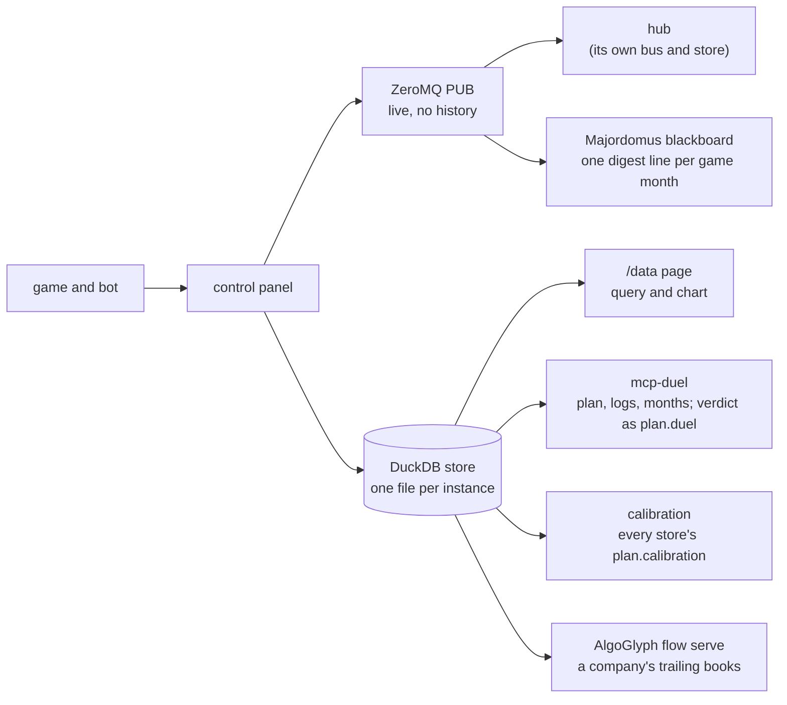

- **Decisions are data.** Each planning decision publishes a structured `plan.*` event beside its
  sentence, from one declared table of kinds (I0081).
- **A duel reads its own record.** `mcp-duel` takes its plan, logs and months from the store and
  publishes its verdict as `plan.duel` (I0083).
- **Calibration outlives its game.** The planner reads `plan.calibration` readings back from every
  store by query; `research/calibration.json` is retired (I0082).
- **AlgoGlyph can run as one long-lived flow serve** (`MCP_ALGOGLYPH_SERVE=1`): every kernel
  call of a planned bot start goes through one process (22 calls on `:8800`, 2026-11-19). Its kernels, and the panel's own
  action plan, take a company's books from the store's trailing samples (I0086).

A running panel holds its DuckDB file locked, so other processes query it through the panel
(`GET|POST /api/db/query`, read-only, also from Rhai) or follow the bus. Details:
[`research/mcp-control.md`](research/mcp-control.md#the-event-bus-on-zeromq-and-the-duckdb-store).

## The control panel and the hub

The panel is one Rust binary per stack (`mcp-panel`, built from
[`tools/research/mcp-rhai`](tools/research/mcp-rhai/)). It holds the MCP token in memory only and
serves one Flowbite Pro shell whose pages are declared once, in
[`static/shell.js`](tools/research/mcp-panel/static/shell.js): the overview with the companies'
history, the world with the map, the plan and transfer yards, every window of the game's interface,
the faceted MCP catalogue with a page per tool and resource, the duels with a page and a chart per
run, the event store, the Rhai scripts, and the API under Swagger UI. Every button is a declared
route of the OpenAPI document, and every page is driven end to end in a real browser by a
Playwright check (rule [`project.web-ui-is-covered-end-to-end`](.ai/repo/rules/project/web-ui-is-covered-end-to-end.v1.md)).

The [hub](research/mcp-hub.md) (`mcp-hub`) puts every running instance behind one WebSocket
JSON-RPC surface, derived from each panel's OpenAPI document and each MCP server's catalogue, and
its [world view](research/mcp-viz.md) draws the live world graph (ECharts) and the terrain in 3D
(three.js). Both are loopback only.

## A player with a mouse

The company AI acts through the command system directly, which is correct and governed, but nothing
visible happens on the way. [`mcp-human`](research/mcp-human.md) plays the way a person does: it
reads every window, widget, caption and tooltip from the game's window system
(`openttd.ui.windows`), finds buttons by what they say, moves the visible cursor with human motion,
drags roads with the game's own tools and glides the camera to its work. A click becomes a command
only where a person's click would, and the owner can pause it from the fork's toolbar menu and take
over at any moment. It has built a transfer yard, two lines into one station from platforms side by
side, proven on the map first.

## A real place as the map

A place name becomes a playable map ([`research/real-world-scenario.md`](research/real-world-scenario.md);
mechanism: [real-world scenario](research/mechanisms/real-world-scenario.md)).
`rw-scenario` ([`tools/research/real-world`](tools/research/real-world/), Rust) resolves "Brno,
Czech Republic" to ranked candidates with explicit bounds, and refuses an ambiguous name instead of
guessing. It acquires a bounded set of lawful open data (OpenStreetMap features through Nominatim
and Overpass, elevation from the Copernicus GLO-30 DEM) into a versioned snapshot, and compiles that
snapshot offline and deterministically into a heightmap and a GameScript.

- **The game is reached only through supported paths.** The heightmap loads headless through
  `-g`; the script founds the towns, builds the industries and signs the landmarks through the
  Script API, so no game state is written directly. Nothing is compiled into OpenTTD.
- **Every entity says how it is known.** Each town, industry and economy link is OBSERVED,
  DERIVED, INFERRED or HYPOTHETICAL, with its evidence, rule and confidence, also in its in-game
  window. A quarry with no temperate counterpart becomes a labelled HYPOTHETICAL stand-in, never
  named after its operator.
- **The committed Brno slice replays offline.** `rw-scenario replay` proves the compile is
  deterministic; the network is used only with `--live`, paced, cached and bounded. The panel
  previews a scenario on its own page.

```bash
tools/research/real-world/rw-scenario compile --snapshot tools/research/real-world/fixtures/brno/snapshot.json --out build-real-world/brno
tools/research/real-world/rw-scenario replay  --snapshot tools/research/real-world/fixtures/brno/snapshot.json --expect tools/research/real-world/fixtures/brno/SHA256SUMS
```

## A real game over the internet

OpenTTD multiplayer is deterministic lockstep: a client whose revision differs from the server's is
refused, because different code would desync. That decides the shape of a real game
([`research/real-game.md`](research/real-game.md)):

| Where you play | Client | Fork features |
|---|---|---|
| An official public server | the [vanilla client](research/vanilla-client.md): the release tag, built unmodified and checked to be | none: no MCP, no automation |
| A game the owner hosts | a dedicated server of this fork from one clean commit; opponents build the same commit | the owner's bot plays one company, watched and steered over the loopback MCP server |
| A loopback R&D game | both ends from one checkout, or a [research override](research/net-compat.md) that only widens what a server you run accepts | everything |

The fork never reports a revision it is not
([ADR 0030](.ai/repo/adrs/0030-public-servers-are-played-with-an-unmodified-official-client.md),
rule [`project.research-net-compat-is-local-and-non-spoofing`](.ai/repo/rules/project/research-net-compat-is-local-and-non-spoofing.v1.md)).
`tools/research/real-game-check <panel-url>` checks a hosted stack against the page before the game
starts: a clean-commit build, MCP on loopback, the bot installed from this checkout, a public or
invite-only server, auto-approve off so every change waits for the host, the bot's company
disclosed as an AI, and every web page covered.
Everything else is proven on loopback; a remote person joining over the internet is still
`NOT RUN`.

## Counted from the source

Each number is counted from the tracked files whenever the documents are regenerated
(`tools/surfaces/surfaces sync`, declared in [`surfaces.toml`](surfaces.toml)), so it cannot drift
from the code. The right-hand column says what was counted.

<!-- surfaces:begin facts -->
| Count | What | Counted from |
|---|---|---|
| **146** | [game commands, each an MCP tool an agent can call (`openttd.cmd.*`)](research/mcp-api.md) | `DEF_CMD_TRAIT\(Commands::` in `src/*_cmd.h` |
| **22** | [live MCP resources (`openttd://…`): map, towns, stations, vehicles, companies, …](research/prismatic-mcp/07-resource-catalog.md) | `^\s*\{"openttd://` in `src/prismatic_mcp/prismatic_mcp_server.cpp` |
| **27** | [unit test cases for the MCP server (Catch2, `[prismatic_mcp]`)](research/prismatic-mcp/09-testing.md) | `^TEST_CASE\(` in `src/tests/test_prismatic_mcp.cpp` |
| **71** | [recorded bot-vs-bot duels, each with its JSON and its write-up](tools/research/mcp-duel) | tracked files `research/results/duel-*.json` |
| **39** | [research tools and checks (`tools/research/*`, shell and Python)](research/tooling.md) | tracked files `tools/research/*` |
| **11** | [Rust programs: panel, hub, planner, Rhai runner, coverage, …](research/mcp-control.md) | tracked files `tools/research/mcp-rhai/src/bin/*.rs` |
| **14** | [Rhai scripts that drive a live game (director, narrator, steward, …)](research/mcp-control.md) | tracked files `tools/research/mcp-panel/rhai/*.rhai` |
| **35** | [architecture decisions (ADRs)](.ai/repo/adrs/README.md) | tracked files `.ai/repo/adrs/0*.md` |
| **93** | [planned issues, each with its evidence](.ai/repo/project/README.md) | tracked files `.ai/repo/project/issues/*.yaml` |
| **86** | [knowledge records (curated and candidates)](.ai/repo/knowledge/README.md) | tracked files `.ai/repo/knowledge/*/*.md` |
| **706** | published documents on the site and the wiki | published documents under `/` |
<!-- surfaces:end facts -->

## How it compares

Other people have connected OpenTTD to language models, and they are worth a look. As each
project describes itself (read 2026-11-17):

| Project | How it reaches the game | Runs on stock OpenTTD | Changes the game | Published results |
|---|---|---|---|---|
| **this fork** | MCP server inside the engine; every command and Script API function a tool; Rhai over all of it | no, a fork build | every change is a normal game command, held until the operator approves its exact arguments | yes, [the duels above](#the-planner-against-itself) |
| [willibrandon/openttd-mcp](https://lobehub.com/mcp/willibrandon-openttd-mcp) | MCP over the Admin Port (Go) | yes | through Admin Port commands | — |
| [OVER99K/openttd-directorate-mcp](https://glama.ai/mcp/servers/o8ze0w0kem) | MCP plus a GameScript (TypeScript), observe, plan, apply, verify | yes | through the GameScript; its page says spending limits and destructive-action gates are not handled | a public demo server |
| [jplattel/openttd-llm](https://jplattel.nl/post/2026-01-22-llm-plays-openttd/) | an LLM drives an in-game AI through logs and Squirrel | yes | through the AI script | write-ups, several LLMs competing |

## Beyond the game

OpenTTD is a complete economy that runs deterministically: towns grow, industries produce, cargo
pays by distance and time, money runs out. That makes it a safe place to test the hard part of
putting an AI agent to work, which is not the model. The hard part is everything around it:

- who approves what the agent does;
- whether its plan survives contact with reality;
- whether anyone can replay what happened;
- whether its tools are proven, or only claimed.

Each of these is a concept with a page of its own, and each concept is carried by working
mechanisms, each with a page as well.

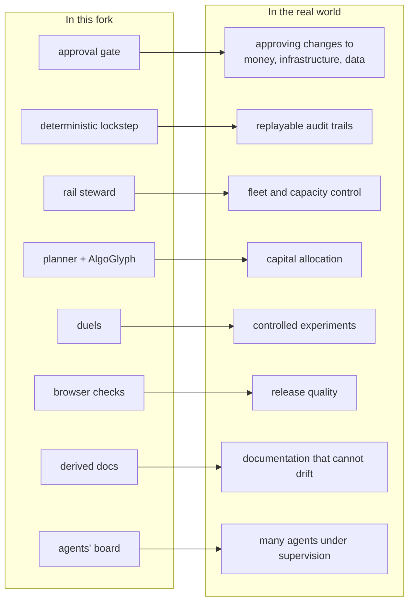

| Concept | In the game | In the real world | Mechanism |
|---|---|---|---|
| [Human in the loop](research/concepts/human-in-the-loop.md) | every change the agent proposes waits for the operator's approval of its exact arguments | payments, deployments, data changes | [approval gate](research/mechanisms/approval-gate.md) |
| [Deterministic lockstep](research/concepts/deterministic-lockstep.md) | every client computes the same state from one command stream | event sourcing, replayable audit | [MCP server in the engine](research/mechanisms/mcp-server-in-the-engine.md) |
| [Desired-state reconciliation](research/concepts/desired-state-reconciliation.md) | the steward sets each rail line's target, the bot makes it so | controllers, fleet management | [rail steward and monitor](research/mechanisms/rail-steward-and-monitor.md) |
| [Portfolio under a budget](research/concepts/portfolio-under-a-budget.md) | which lines to build and which trains to buy, chosen by a knapsack over spare money | capital allocation, deal pipelines | [planner and AlgoGlyph](research/mechanisms/planner-and-algoglyph.md) |
| [Calibration against reality](research/concepts/calibration-against-reality.md) | the planner's predictions checked against what each line earned | forecasting, model risk | [planner and AlgoGlyph](research/mechanisms/planner-and-algoglyph.md) |
| [Digital twin as a testbed](research/concepts/digital-twin-testbed.md) | two companies, one map, held starts: the plan against no plan; the map can be a real place, every entity labelled with its evidence | A/B tests, trials, site studies | [duels](research/mechanisms/duels.md), [real-world scenario](research/mechanisms/real-world-scenario.md) |
| [Evidence and validation status](research/concepts/evidence-and-validation-status.md) | PASS, FAIL, PARTIAL, NOT RUN: never a claim without a run | audits, compliance | [validation gate](research/mechanisms/validation-gate.md) |
| [End to end, or it does not exist](research/concepts/end-to-end-or-it-does-not-exist.md) | every web page driven in a real browser, enforced | release quality | [validation gate](research/mechanisms/validation-gate.md) |
| [Derived, not restated](research/concepts/derived-not-restated.md) | site, wiki, tables and charts generated from the sources | documentation that cannot drift | [published surfaces](research/mechanisms/published-surfaces.md) |
| [Agents and supervision](research/concepts/agents-and-supervision.md) | sessions share one board; the monitor posts lost trains to it | teams of agents | [Majordomus supervision](research/mechanisms/majordomus-supervision.md) |

All concepts: [`research/concepts/`](research/concepts/README.md) · all mechanisms:
[`research/mechanisms/`](research/mechanisms/README.md) · the next step, a real game against a real
opponent over the internet: [`research/real-game.md`](research/real-game.md).

<p align="center">
  <a href="research/rail-steward.md#the-scripts-page-an-editor-services-and-hot-reload">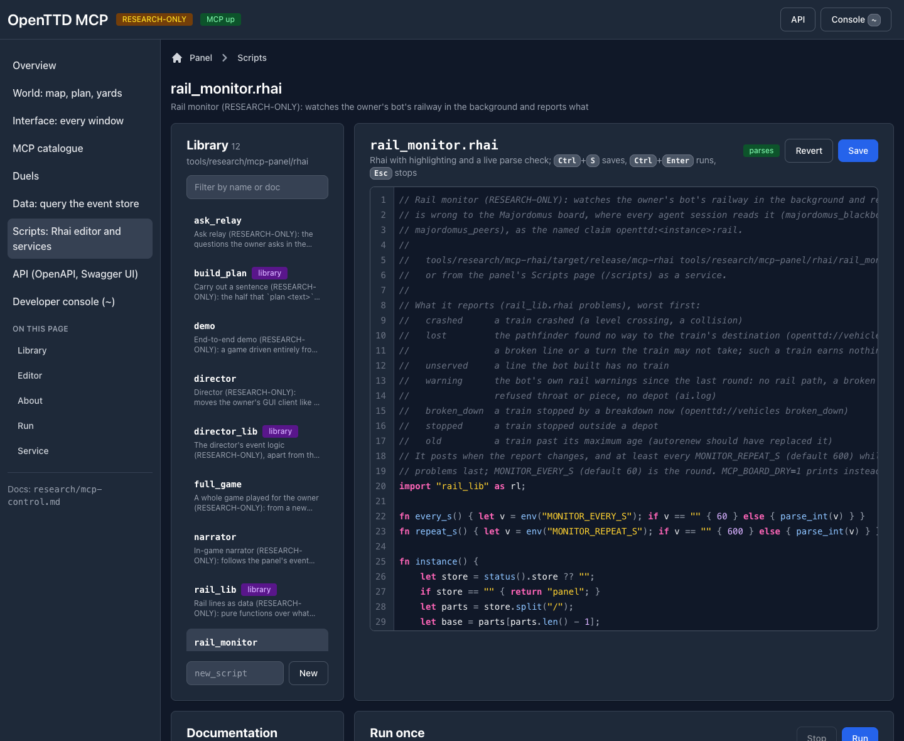</a><br>
  <sub>The panel's Scripts page: every Rhai script with its own documentation, an editor that checks as you type, and scripts that run as services and reload when you save.</sub>
</p>

## What's inside

<table>
<tr>
<td width="50%" valign="top">

**Embedded MCP server** &mdash; [`src/prismatic_mcp/`](src/prismatic_mcp/)<br>
Live game state as MCP tools and resources, inside the engine. Loopback only, compile-gated
(`OPTION_PRISMATIC_MCP_SERVER=ON`, default OFF, which requires `OPTION_RESEARCH_INSTRUMENTATION=ON`).
Mutations go through the game's own command system after an operator approves the exact arguments.
&rarr; [design](research/prismatic-mcp/README.md) &middot; [API](research/mcp-api.md)

</td>
<td width="50%" valign="top">

**Rhai over everything** &mdash; [`tools/research/mcp-rhai/`](tools/research/mcp-rhai/)<br>
A Rust host that turns every MCP tool, console command and panel route into a Rhai function,
plus scripts that play, narrate, direct the camera and talk with the owner in the game.
&rarr; [guide](research/mcp-control.md#rhai-toolsresearchmcp-rhai)

</td>
</tr>
<tr>
<td valign="top">

**Plan, then play** &mdash; [`research/mcp-hub.md`](research/mcp-hub.md)<br>
The AlgoGlyph planner reads the map, terrain, prices and bridges, prices every candidate rail line,
and hands a portfolio to [PrismaticAI](tools/research/prismatic-ai/README.md), which re-plans
around a refused piece of track, never lays a 90-degree turn and builds two-platform termini with
path signals. A Rhai steward closes losing lines, lengthens and adds trains where cargo waits, and
renews locomotives, and a monitor posts lost and broken trains to the agents' board
([`research/rail-steward.md`](research/rail-steward.md)). A human-style bot
([`mcp-human`](research/mcp-human.md)) plays through the UI instead, cursor and all.

</td>
<td valign="top">

**Control panel and hub** &mdash; [`research/mcp-control.md`](research/mcp-control.md)<br>
One Rust binary per stack with its `~` developer console, OpenAPI and Swagger UI, duels on a click,
a Rhai editor whose scripts run as hot-reloaded services, and an event bus on ZeroMQ with a DuckDB
store per instance; the hub puts every running instance behind one WebSocket.
&rarr; [panel and hub](#the-control-panel-and-the-hub) &middot; [events](#every-event-on-a-bus-and-in-a-store)

</td>
</tr>
<tr>
<td valign="top">

**Validation you cannot round up** &mdash; [`tools/gate.sh`](tools/gate.sh)<br>
`smoke` &middot; `change` &middot; `full` &middot; `research`, each at the cost the change needs.
Status is `PASS` &middot; `FAIL` &middot; `PARTIAL` &middot; `NOT RUN` &middot; `NOT APPLICABLE`,
and a report may only claim what actually ran ([`research/README.md`](research/README.md)).

</td>
<td valign="top">

**Reproducible experiments** &mdash; [`tools/research/research`](tools/research/research)<br>
Build profiles, toolchain, commands and results recorded into `manifest.json`; the summary is
generated from the record, never written after the fact ([`research/tooling.md`](research/tooling.md)).

</td>
</tr>
<tr>
<td valign="top">

**Derived surfaces** &mdash; [`tools/surfaces/`](tools/surfaces/README.md)<br>
The [site](https://korczis.github.io/OpenTTD/), the [wiki](https://github.com/korczis/OpenTTD/wiki)
and the index tables in these documents are generated from git and the `.ai/` layer, and a stale
table or a dead link fails the commit.

</td>
<td valign="top">

**A supervised AI layer** &mdash; [`.ai/`](.ai/README.md)<br>
Decisions (ADRs), rules, plan, intents and knowledge in tracked records that every agent reads the
same way, run under [Majordomus](https://majordomus.dev) task lifecycle and peer board.

</td>
</tr>
</table>

### How it fits together

One loopback machine runs the game and the agents; every arrow below is a governed, derived
channel, and nothing an agent does bypasses the game's own command system.

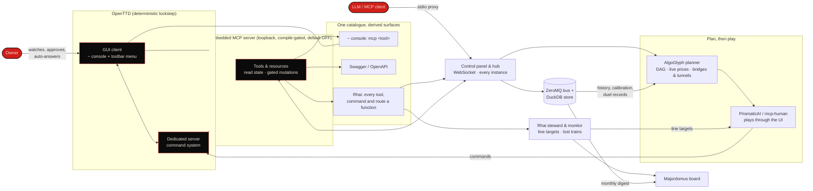

### The fork in action

| The research loop, live | The bot asks; the owner can auto-answer |
|---|---|
| [](docs/screenshots/game-finances.png) | [](docs/screenshots/your-bot-asks.png) |
| **Online players — owner-view (spectator) and owner-bot on one loopback server** | **The world the planner reasons over** |
| [](docs/screenshots/online-players.png) | [](docs/screenshots/world-view.png) |

> Screenshots are from a single-machine R&D game on `127.0.0.1`; the fork joins public servers only
> with the unmodified release client ([ADR 0029](.ai/repo/adrs/0029-a-research-gated-local-only-override-accepts-a-mismatched-pee.md)).

## How this was made

This fork is about AI coding agents, and nearly every commit since it left upstream was written
with one, under the owner's direction. Each such commit carries a `Co-Authored-By` trailer, so the
share is one command away:
`git rev-list --count --grep='Co-Authored-By: Claude' $(git merge-base HEAD upstream/master)..HEAD`. That is why nothing
here goes upstream: OpenTTD's [contribution policy](https://github.com/OpenTTD/OpenTTD/blob/master/CONTRIBUTING.md)
does not accept AI-generated contributions, and this fork respects it. What the agents may do is
written down and checked, not hoped for:

- **The command system is the only door.** An agent changes the world exactly as a player does,
  so every client stays bit-identical in lockstep.
- **Never claim what did not run.** A report says `PASS`, `FAIL`, `PARTIAL`, `NOT RUN` or
  `NOT APPLICABLE`, and the gates ([`tools/gate.sh`](tools/gate.sh)) record which ran.
- **Derive, never restate.** The scoreboard, the numbers, the [site](https://korczis.github.io/OpenTTD/)
  and the [wiki](https://github.com/korczis/OpenTTD/wiki) are generated from the repository, and a
  stale table, a dead link or a flag a tool would refuse fails the commit.
- **Savegames load forever, research code is gated.** No saved field is removed or renumbered, and
  everything research-only is behind a default-OFF build option and labelled `RESEARCH-ONLY`.

The full rules are in [`AGENTS.md`](AGENTS.md); the decisions behind them are the
[ADRs](.ai/repo/adrs/README.md).

## Built with

Every layer stands on a well-known library rather than a home-grown one. Versions live in the
manifests linked per row, not here.

| Layer | Libraries | Where |
|---|---|---|
| **Agent tooling (Rust)** | [Rhai](https://rhai.rs/) (scripting a live game) &middot; [ureq](https://github.com/algesten/ureq) &middot; [tungstenite](https://github.com/snapview/tungstenite-rs) (hub WebSocket) &middot; [serde](https://serde.rs/) / serde_json &middot; libc | [`mcp-rhai`](tools/research/mcp-rhai/Cargo.toml) &middot; [`mcp-human`](tools/research/mcp-human/Cargo.toml) |
| **Engine** | C++20 &middot; CMake &middot; [nlohmann/json](https://github.com/nlohmann/json) (MCP wire format) &middot; [Squirrel](http://squirrel-lang.org/) (AI / Game Scripts) &middot; [{fmt}](https://fmt.dev/) &middot; [Catch2](https://github.com/catchorg/Catch2) &middot; [Monocypher](https://monocypher.org/) &middot; [ICU](https://icu.unicode.org/) | [`src/3rdparty/`](src/3rdparty/) |
| **Control panel** | [Apache ECharts](https://echarts.apache.org/) (duel and economy charts) &middot; [D3](https://d3js.org/) (graphs) &middot; [three.js](https://threejs.org/) (3D map) &middot; [Flowbite](https://flowbite.com/) &middot; [Swagger UI](https://swagger.io/tools/swagger-ui/) (OpenAPI of the tool catalogue) &middot; [Playwright](https://playwright.dev/) (page checks) | [`mcp-panel`](tools/research/mcp-panel/package.json) |
| **Published surfaces** | [Tailwind CSS 4](https://tailwindcss.com/) + [Flowbite](https://flowbite.com/) / flowbite-typography &middot; [Mermaid](https://mermaid.js.org/) &middot; [Apache ECharts](https://echarts.apache.org/) &middot; [markdown-it-py](https://github.com/executablebooks/markdown-it-py) &middot; [PyYAML](https://pyyaml.org/) | [`package.json`](tools/surfaces/package.json) &middot; [`requirements.txt`](tools/surfaces/requirements.txt) |
| **Supervision** | [Majordomus](https://majordomus.dev) (task lifecycle, rules, decisions, peer board, MCP projection of `.ai/`) | [`.ai/`](.ai/README.md) |
| **Content** | [OpenGFX](https://github.com/OpenTTD/OpenGFX) &middot; [Kenney](https://kenney.nl/) CC0 models (NoirGFX) | [`tools/research/noirgfx/`](tools/research/noirgfx/README.md) |

## Quick start

```bash
# The research build (MCP server ON) and its gate: configure, build, every test
tools/gate.sh research

# The whole loop in one command: dedicated server + MCP + PrismaticAI + control panel
# (http://127.0.0.1:8800) + a spectator GUI client that follows the bot
tools/research/mcp-e2e

# An LLM in the game: register the stdio proxy with your MCP client (here Claude Code)
claude mcp add openttd -- "$PWD/tools/research/mcp-auto/openttd-mcp-stdio"

# Rhai: build the host once, then let a script play a whole game for you
cargo build --release --manifest-path tools/research/mcp-rhai/Cargo.toml
tools/research/mcp-rhai/target/release/mcp-rhai tools/research/mcp-panel/rhai/full_game.rhai

# The owner's company AI: point the game's personal ai/ folder at this checkout, then check it
tools/research/prismatic-ai/install
tools/research/prismatic-ai/install --check

# A duel: the planned bot against the same bot unplanned, written to research/results/
tools/research/mcp-duel --months 36
tools/research/readme-scoreboard                 # the scoreboard above, from the new result

# Every running instance behind one WebSocket, with the world view (http://127.0.0.1:8790/)
cargo build --release --manifest-path tools/research/mcp-rhai/Cargo.toml --bin mcp-hub
tools/research/mcp-rhai/target/release/mcp-hub --port 8790

# Public servers: the release tag built unmodified, proven so, then played
tools/research/vanilla-client build 15.3
tools/research/vanilla-client check 15.3
tools/research/vanilla-client run 15.3

# The documents: check them, regenerate their tables and numbers, build the site locally
tools/surfaces/surfaces check
tools/surfaces/surfaces sync
tools/surfaces/surfaces site                     # -> target/web/site
```

Every tool answers `--help` with its whole usage and refuses a flag it does not know (exit 2), and
`tools/surfaces/surfaces check` fails when a document shows a flag a tool would refuse.
Prerequisites: a C++20 toolchain, CMake 3.16+, Rust for the agent tooling, and a base graphics set
([`research/baseset-prerequisite-macos.md`](./research/baseset-prerequisite-macos.md)). Everything
research-only binds to loopback and is labelled `RESEARCH-ONLY`.

## NoirGFX: the game as a linocut

The fork also ships a complete base graphics set in the owner's red-black linocut style: strict
ink, paper and signal red, carved hatching, seamless across tiles at every zoom. It is the one part
of the fork that runs in stock OpenTTD: a `.obg` plus six GRFs in `baseset/`, never the default,
picked in *Game Options → Base graphics set* or with `openttd -I NoirGFX`.
**[Download NoirGFX 1](https://github.com/korczis/OpenTTD/releases/tag/noirgfx-1)** (one `.tar`,
about 150 MB); tested in the official OpenTTD 15.3 macOS build
([screenshot](research/noirgfx/stock-15.3.png)), Windows and Linux `NOT RUN`.

| Ground, rail, road and water (4x) | Trees from Kenney's CC0 models (4x) |
|---|---|
| [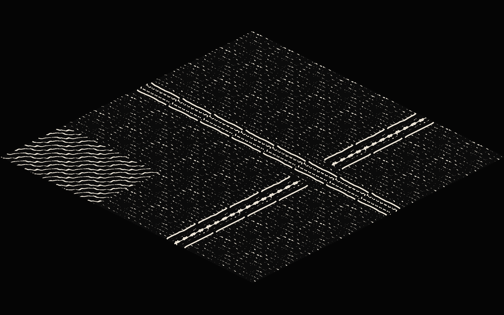](research/noirgfx/preview-ground-4x.png) | [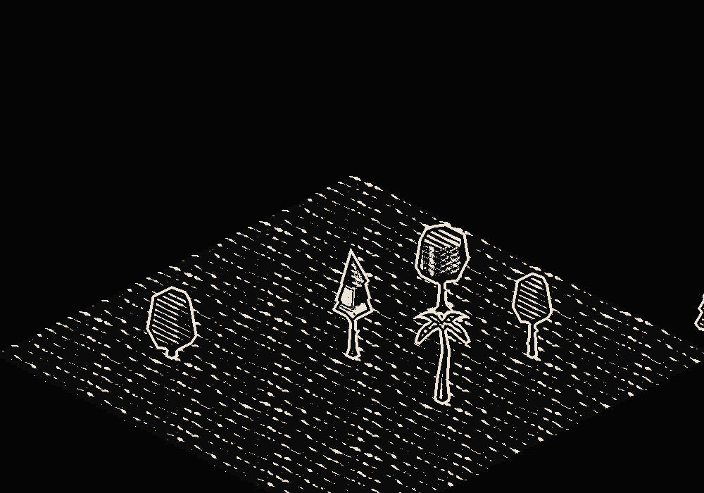](research/noirgfx/preview-kenney-trees-4x.png) |

The pipeline is deterministic and no image model touched the shipped set: grfcodec decodes
OpenGFX 8.0, a script restyles each sprite by palette material, headless Blender renders the mapped
sprites from CC0 [Kenney](https://kenney.nl/) models, and grfcodec encodes the result; every colour
and threshold lives in [`style.toml`](tools/research/noirgfx/style.toml). Build it yourself with
`tools/research/noirgfx/noirgfx bootstrap`, `build` and `install` (about 10 minutes); details in
[`tools/research/noirgfx/README.md`](tools/research/noirgfx/README.md) and
[`research/noirgfx/README.md`](research/noirgfx/README.md).

## Table of contents

- 0.0) [About this fork](#00-about-this-fork)
    - 0.1) [Purpose and goals](#01-purpose-and-goals)
    - 0.2) [Relationship to the Prismatic platform](#02-relationship-to-the-prismatic-platform)
    - 0.3) [What this fork is not](#03-what-this-fork-is-not)
    - 0.4) [What this fork adds on top of upstream OpenTTD](#04-what-this-fork-adds-on-top-of-upstream-openttd)
        - 0.4.1) [Getting started — Prismatic MCP for contributors](#041-getting-started--prismatic-mcp-for-contributors)
        - 0.4.2) [Published surfaces](#042-published-surfaces)
        - 0.4.3) [Research documents](#043-research-documents)
    - 0.5) [Validation / gating model](#05-validation--gating-model)
    - 0.6) [Ground rules (short version)](#06-ground-rules-short-version)
    - 0.7) [Relationship to upstream OpenTTD](#07-relationship-to-upstream-openttd)
        - 0.7.1) [Architecture decisions](#071-architecture-decisions)
    - 0.8) [Research questions](#08-research-questions)
    - 0.9) [Agent and cognition concepts under evaluation](#09-agent-and-cognition-concepts-under-evaluation)
    - 0.10) [Integration points](#010-integration-points)
    - 0.11) [Experiment lifecycle, outputs, and evidence policy](#011-experiment-lifecycle-outputs-and-evidence-policy)
    - 0.12) [Limitations](#012-limitations)
    - 0.13) [Where the work stands](#013-where-the-work-stands)
- 1.0) [About](#10-about)
    - 1.1) [Downloading OpenTTD](#11-downloading-openttd)
    - 1.2) [OpenTTD gameplay manual](#12-openttd-gameplay-manual)
    - 1.3) [Supported platforms](#13-supported-platforms)
    - 1.4) [Installing and running OpenTTD](#14-installing-and-running-openttd)
    - 1.5) [Add-on content / mods](#15-add-on-content--mods)
    - 1.6) [OpenTTD directories](#16-openttd-directories)
    - 1.7) [Compiling OpenTTD](#17-compiling-openttd)
- 2.0) [Contact and community](#20-contact-and-community)
    - 2.1) [Multiplayer games](#21-multiplayer-games)
    - 2.2) [Contributing to OpenTTD](#22-contributing-to-openttd)
    - 2.3) [Reporting bugs](#23-reporting-bugs)
    - 2.4) [Translating](#24-translating)
- 3.0) [Licensing](#30-licensing)
- 4.0) [Credits](#40-credits)

## 0.0) About this fork

`korczis/OpenTTD` is a **personal research fork**, public on GitHub, not the official OpenTTD
project and not staged for upstream contribution. It is owned by korczis and has two purposes:

- **An LLM and agent lab.** Language models, Rhai scripts and planners play the game through an
  embedded MCP server and the game's own command system, and recorded duels measure what they
  achieve.
- **A validation target for coding agents.** It is a real, long-lived C++ codebase on which the
  **Prismatic platform**'s agent workflows are tested: how agents plan and scope changes, and
  whether gating and reproducibility hold up against a substrate too large and too
  convention-heavy to fake.

Sections 1.0 onward are the **original upstream OpenTTD README**, kept intact for its technical
value and attribution. This section documents only what is specific to this fork.

### 0.1) Purpose and goals

- **Let AI play a real game honestly.** OpenTTD is deterministic lockstep: every client must
  compute bit-identical results from the same command stream. An agent that changes the world
  through anything but a registered command desyncs the game, so the game itself grades the
  integration.
- **Validate coding agents on code that was not shaped for them.** The command system
  (`src/command.cpp`), savegames that must load forever (`src/saveload/`), a pathfinder
  specialised per vehicle type and a warning-heavy Doxygen convention are invariants an agent has
  to respect. Breaking one compiles fine and still desyncs a game or corrupts a save, which is the
  "looks fine, is broken" failure this fork exists to catch.
- **Report only what ran.** The layered gate (`tools/gate.sh`) and the `PASS` / `FAIL` /
  `PARTIAL` / `NOT RUN` / `NOT APPLICABLE` taxonomy are themselves under evaluation: a gate too
  cheap to catch real problems, or too expensive to be used, is a result worth knowing.
- **Make every experiment reproducible.** Build profiles, toolchain, commands and results are
  recorded into a manifest, and the report is generated from that record.

Nothing here is meant to become an upstream OpenTTD feature. Every change is classified, before it
is made, as one of the four kinds of change in [`AGENTS.md`](./AGENTS.md):

| Kind | What it touches | Validated by |
|---|---|---|
| 1. Product change | OpenTTD's own code and docs (`src/`, `regression/`, `docs/`), under upstream's conventions | the matching `tools/gate.sh` tier (0.5) |
| 2. Experimental infrastructure | this fork's tooling (`tools/gate.sh`, `tools/surfaces/`, `tools/research/`, `research/`) | the matching `tools/gate.sh` tier |
| 3. Agentic tooling | the local `.claude/` and `.aiad/` | nothing: local only, never committed |
| 4. Documentation | `README.md`, `AGENTS.md`, `CLAUDE.md`, `.ai/` records | `tools/surfaces/surfaces check` and `tools/gate.sh change` |

### 0.2) Relationship to the Prismatic platform

**Prismatic** is a separate, private Elixir/Phoenix platform by korczis for decision-support and
OSINT work (due diligence, investigation, M&A research), with a large investment in its own
agent-engineering tooling. Its repository, `~/dev/prismatic-platform`, is never modified from here.
OpenTTD was picked to validate that tooling because it shares nothing with it: a 20-year-old C++
codebase with its own strict conventions and an independent CMake/CTest toolchain, so the tooling
under test cannot grade itself.

The relationship is one-directional and arm's-length. Generic, stack-independent principles (the
tiered `check` / `precommit` / `ci` model, the fail-closed completion taxonomy, the rule against a
self-authorised gate bypass) were read from specific Prismatic files, re-implemented against
OpenTTD's own toolchain and written once into `AGENTS.md`, `tools/gate.sh` and `research/`.
Prismatic-specific detail stayed behind. Nothing flows back automatically: findings inform
Prismatic by human judgement only.

**The bridge.** [`research/prismatic-bridge/ARCHITECTURE.md`](./research/prismatic-bridge/ARCHITECTURE.md)
documents a standalone sibling service, `~/dev/openttd-prismatic-bridge`, that speaks OpenTTD's
admin-network protocol and drives a Company AI (`PrismaticAI`). The decision contract with
Prismatic has a machine-checkable schema in this repository
(`research/prismatic-bridge/decision-contract.schema.json`, I0011); Prismatic answers it with a
Monte Carlo choice, and the MCP panel applies the answer at `POST /api/decision/pull`
(`tools/research/mcp-decision-check`). The panel offers each company's recorded history (the bus
endpoint and a store query of its samples) and records the fit a directive reports, or the fallback
it took (I0085); Prismatic itself still decides from a hand growth model. A native Rust bridge is decided (ADR 0032) but not yet
written, and broader Prismatic decisions are not built. A map from real data now exists apart from
the bridge: [a real place as the map](#a-real-place-as-the-map).

### 0.3) What this fork is not

- **Not affiliated with, or a contribution channel to, [OpenTTD/OpenTTD](https://github.com/OpenTTD/OpenTTD).**
  No issues, pull requests or patches go upstream; a change that turns out well stays here.
- **Not bound locally by upstream's contribution process.** `CONTRIBUTING.md`, the commit grammar,
  the PR templates and the policy against AI-generated contributions govern upstream's shared
  project; they are kept as technical background. This fork respects that policy by sending
  nothing upstream.
- **Not a product.** No change here is judged by whether it improves gameplay; it is judged by the
  evidence of how it was made and validated.

### 0.4) What this fork adds on top of upstream OpenTTD

| Path | Purpose |
|---|---|
| [`src/prismatic_mcp/`](./src/prismatic_mcp/) | The embedded MCP server, gated behind `OPTION_PRISMATIC_MCP_SERVER` (default OFF); research trail in [`research/prismatic-mcp/`](./research/prismatic-mcp/README.md). |
| [`tools/research/mcp-auto/openttd-mcp-stdio`](./tools/research/mcp-auto/openttd-mcp-stdio) | The stdio MCP proxy an LLM client (Claude Code, MCP Inspector, ...) runs; the panel holds the token. |
| [`tools/research/mcp-rhai/`](./tools/research/mcp-rhai/) | The Rust tooling: the Rhai host, the control panel, the hub, the planner and intent clients, the bus bridges, API coverage. |
| [`tools/research/mcp-panel/`](./tools/research/mcp-panel/) | The panel's pages and its Rhai scripts (`rhai/`): director, narrator, steward, full game, ... |
| [`tools/research/mcp-e2e`](./tools/research/mcp-e2e), [`mcp-duel`](./tools/research/mcp-duel), [`mcp-human`](./tools/research/mcp-human/) | The one-command stack, bot-vs-bot duels (results in [`research/results/`](./research/results/)), a bot that plays through the UI. |
| [`tools/research/prismatic-ai/`](./tools/research/prismatic-ai/README.md) | The owner's company AI (Squirrel content, not engine code; linked into the personal `ai/` folder by its `install`, which moves an old copy to `ai-backup/`): planned freight, passenger, air and bus lines, rail termini trains can always run, and line targets the Rhai steward sets — see [`research/rail-steward.md`](./research/rail-steward.md). |
| [`tools/research/mcp-panel/rhai/rail_steward.rhai`](./tools/research/mcp-panel/rhai/rail_steward.rhai), [`rail_monitor.rhai`](./tools/research/mcp-panel/rhai/rail_monitor.rhai) | The steward that sets each rail line's target and the monitor that posts lost and broken trains to the Majordomus board. |
| [`tools/research/vanilla-client`](./tools/research/vanilla-client), [`real-game-check`](./tools/research/real-game-check) | The unmodified release client for public servers ([`research/vanilla-client.md`](./research/vanilla-client.md)) and the readiness check for a hosted real game ([`research/real-game.md`](./research/real-game.md)). |
| [`tools/research/e2e-coverage`](./tools/research/e2e-coverage) and the `tools/research/mcp-*-check` family | Every web page driven in a real browser, and one live check per surface of the panel, the hub and the game. |
| [`tools/gate.sh`](./tools/gate.sh), [`tools/research/research`](./tools/research/research) | Layered local validation (0.5) and the research-mode CLI with its experiment manifest ([`research/tooling.md`](./research/tooling.md)). |
| [`tools/surfaces/`](./tools/surfaces/README.md), [`surfaces.toml`](./surfaces.toml), [`tools/knowledge/`](./tools/knowledge/README.md) | The published surfaces (0.4.2), and the checks that keep the `.ai/` records' citations true. |
| [`tools/research/noirgfx/`](./tools/research/noirgfx/README.md) | NoirGFX, the fork's base graphics set, and its deterministic build pipeline. |
| [`AGENTS.md`](./AGENTS.md), [`CLAUDE.md`](./CLAUDE.md), [`.ai/`](./.ai/README.md) | Ground rules for any agent, Claude Code notes, and the supervised AI layer (ADRs, rules, plan, intents, knowledge) under Majordomus. |
| `.claude/`, `.aiad/` *(not committed)* | Personal agent tooling, kept local through `.git/info/exclude`. |

Everything else (`src/` outside `prismatic_mcp/`, `regression/`, `docs/`, the build system,
`COPYING.md`, `CREDITS.md`) is upstream's and follows upstream's conventions.

<!-- BEGIN GENERATED: prismatic-mcp-getting-started (source: research/prismatic-mcp/contributor-catalog.json; generated by tools/research/generate_prismatic_docs.py — do not hand-edit between these markers; edit the JSON and rerun the generator instead) -->
#### 0.4.1) Getting started — Prismatic MCP for contributors

[**Get started: Prismatic MCP for contributors**](https://github.com/korczis/OpenTTD/blob/master/research/prismatic-mcp/README.md) — Research-only · loopback-only · compile-gated. Read AGENTS.md before touching anything.

A real, compiling, connectable read-only vertical, plus approval-gated mutations: openttd.game.set_pause, one openttd.cmd.<Name> tool per game command whose parameters convert from JSON, the company AIs (openttd.ai.*) and Script API calls with execute (openttd.api.*), each through a two-phase approval bound to its exact arguments. The fork's own toolbar button and menu are in the game. See 05-implementation-plan.md for the honest per-phase status. The Control Center window, per-client company scoping, SSE and full conformance evidence are staged, not implemented.

1. **Read the ground rules first** — AGENTS.md (vendor-neutral ground rules for any agent/contributor working in this fork), then CLAUDE.md.
2. **Read the MCP research trail** — research/prismatic-mcp/README.md is the entry point; 00-baseline.md through 19-continuation-runbook.md are phase-ordered.
3. **Configure with the feature gate ON** — OPTION_PRISMATIC_MCP_SERVER defaults OFF and requires OPTION_RESEARCH_INSTRUMENTATION=ON. The system compiler is used; only a macOS Command Line Tools install older than Xcode 15 needs Homebrew LLVM through CC/CXX (ADR 0006, research/tooling.md).
   ```bash
   cmake -S . -B build-mcp -DOPTION_RESEARCH_INSTRUMENTATION=ON -DOPTION_PRISMATIC_MCP_SERVER=ON
   ```
4. **Build**
   ```bash
   cmake --build build-mcp --target openttd -j$(sysctl -n hw.ncpu)
   ```
5. **Run the unit tests** — Catch2 tests tagged [prismatic_mcp] (security helpers, the approval state machine, command parameter conversion, the toolbar menu, the console family) are ctest-discoverable.
   ```bash
   cmake --build build-mcp --target openttd_test -j$(sysctl -n hw.ncpu) && ctest --test-dir build-mcp -R prismatic --output-on-failure
   ```
6. **Start the server and connect** — In the in-game console: prismatic_mcp start, then prismatic_mcp token to get the bearer token, and prismatic_mcp approve <id> or deny <id> for a pending mutation. Never share the token; it is never logged.
7. **Run the local validation gate before proposing a change**
   ```bash
   tools/gate.sh change
   ```

**Full doc index** (also generated from the same source):

| Doc | Kind |
|---|---|
| [`research/prismatic-mcp/README.md`](./research/prismatic-mcp/README.md) — Entry point: build/run/connect, boundaries | index |
| [`research/prismatic-mcp/00-baseline.md`](./research/prismatic-mcp/00-baseline.md) — Baseline (Phase 0): repo/toolchain state before implementation | phase |
| [`research/prismatic-mcp/01-openttd-system-map.md`](./research/prismatic-mcp/01-openttd-system-map.md) — OpenTTD system map (Phase 1): real call paths, file:line anchored | phase |
| [`research/prismatic-mcp/02-threat-model.md`](./research/prismatic-mcp/02-threat-model.md) — Threat model (Phase 2) | phase |
| [`research/prismatic-mcp/03-architecture-options.md`](./research/prismatic-mcp/03-architecture-options.md) — Architecture options considered (Phase 3) | phase |
| [`research/prismatic-mcp/04-architecture-decision-record.md`](./research/prismatic-mcp/04-architecture-decision-record.md) — Architecture decision record (Phase 4) | phase |
| [`research/prismatic-mcp/05-implementation-plan.md`](./research/prismatic-mcp/05-implementation-plan.md) — Implementation plan and honest per-phase status | phase |
| [`research/prismatic-mcp/07-resource-catalog.md`](./research/prismatic-mcp/07-resource-catalog.md) — MCP resource catalog | reference |
| [`research/prismatic-mcp/08-tool-catalog.md`](./research/prismatic-mcp/08-tool-catalog.md) — MCP tool catalog | reference |
| [`research/prismatic-mcp/09-testing.md`](./research/prismatic-mcp/09-testing.md) — Testing approach | reference |
| [`research/prismatic-mcp/10-in-game-runbook.md`](./research/prismatic-mcp/10-in-game-runbook.md) — In-game runbook and the verified vertical | runbook |
| [`research/prismatic-mcp/11-continuation-baseline.md`](./research/prismatic-mcp/11-continuation-baseline.md) — Continuation baseline (Phase 2 recovery) | phase |
| [`research/prismatic-mcp/12-continuation-plan.md`](./research/prismatic-mcp/12-continuation-plan.md) — Continuation plan and adversarial review (Phase 2) | phase |
| [`research/prismatic-mcp/16-decision-contract.md`](./research/prismatic-mcp/16-decision-contract.md) — Decision contract and approval workflow | reference |
| [`research/prismatic-mcp/18-continuation-testing.md`](./research/prismatic-mcp/18-continuation-testing.md) — Continuation testing | reference |
| [`research/prismatic-mcp/19-continuation-runbook.md`](./research/prismatic-mcp/19-continuation-runbook.md) — Continuation runbook | runbook |
| [`research/prismatic-mcp/determinism-ab.md`](./research/prismatic-mcp/determinism-ab.md) — Determinism A/B (I0026): the read-only MCP path does not perturb the simulation | reference |
| [`research/prismatic-mcp/exposure-coverage-matrix.md`](./research/prismatic-mcp/exposure-coverage-matrix.md) — Exposure coverage matrix (honest per-domain status) | matrix |
| [`research/prismatic-mcp/spec-compliance-matrix.md`](./research/prismatic-mcp/spec-compliance-matrix.md) — MCP spec compliance matrix (stable 2025-11-25) | matrix |
| [`research/prismatic-mcp/internal-surface-inventory.json`](./research/prismatic-mcp/internal-surface-inventory.json) — Machine-readable internal surface inventory | data |
| [`research/prismatic-mcp/continuation-gap-matrix.json`](./research/prismatic-mcp/continuation-gap-matrix.json) — Machine-readable continuation gap matrix | data |

Known limitations (also generated from the same source):
- The native Control Center window is not implemented; the toolbar button and its menu are (I0072).
- No autonomous multiplayer arena/lab exists; tools/research/mcp-duel runs a duel of two bots in one game.
- Every mutation needs an operator approval in the console ('prismatic_mcp approve <id>'). A command tool takes a company actor, but there is no per-client company-scoped authorization and no action budget.
- Saving a game is not an action type: it is not a game command, so it is not in the catalogue.
- This catalog itself has no automated freshness check against the actual doc_index file list beyond what tools/check-prismatic-docs.sh diffs -- new docs must be added here by hand.
<!-- END GENERATED: prismatic-mcp-getting-started -->

#### 0.4.2) Published surfaces

Everything this fork publishes is derived from what git tracks: its Markdown, its history and its
`.ai/` layer. `tools/surfaces/surfaces` renders every document to a GitHub Pages site and to the
GitHub wiki, and keeps the generated tables in these documents current; a stale table or a link to
nothing fails the commit, `tools/gate.sh change` and CI. Design: [`tools/surfaces/README.md`](./tools/surfaces/README.md), ADR 0012.

<!-- surfaces:begin surfaces -->
| Surface | Where | What it carries |
|---|---|---|
| Site | [https://korczis.github.io/OpenTTD/](https://korczis.github.io/OpenTTD/) | every published document, the .ai/ layer, charts, search |
| Wiki | [https://github.com/korczis/OpenTTD/wiki](https://github.com/korczis/OpenTTD/wiki) | the same documents as wiki pages |
| Markdown regions | this repository | tables like this one, regenerated by `tools/surfaces/surfaces sync` |
<!-- surfaces:end surfaces -->

What the fork delivers, from its `.ai/` feature records:

<!-- surfaces:begin ai-features -->
| Feature | Status | What it gives |
|---|---|---|
| [Validation gate](.ai/repo/features/layered-validation-gate.md) | stable | One script checks a change at the cost its size needs, and a report can only say what actually ran. |
| [Instrumentation](.ai/repo/features/research-instrumentation.md) | stable | Internal state becomes observable in research builds and provably absent from every other build. |
| [Research CLI](.ai/repo/features/research-experiment-cli.md) | stable | An experiment records its own build profile, toolchain, commands and results, and its report is generated from that record. |
| [Bridge](.ai/repo/features/prismatic-bridge.md) | draft | Prismatic decides, a standalone bridge relays over the admin network, and a normal Company AI acts in the game. |
| [AI battle](.ai/repo/features/lan-ai-battle.md) | draft | Every SSH-reachable machine runs headless free-for-all matches between PrismaticAI and BaNaNaS AIs, the leaderboard is a derived record, and a browser dashboard shows the run live. |
| [Battle post-mortem](.ai/repo/features/battle-postmortem.md) | draft | After each round, a Rust tool analyses every finished match in parallel, names why each contestant lost against fixed thresholds, counts PrismaticAI's last places, and proposes settings for the next edition. |
| [MCP server](.ai/repo/features/embedded-mcp-server.md) | draft | An agent reads live game state over MCP and changes it only with an operator's approval of the exact arguments, through the command system. |
| [Event bus and store](.ai/repo/features/event-bus-and-store.md) | draft | Any process on the machine follows a game live over ZeroMQ, and every decision can query what earlier games recorded. |
| [Surfaces](.ai/repo/features/published-surfaces.md) | stable | The site, the wiki and the Markdown index tables, all generated from what git tracks and the .ai/ layer, and checked on every commit. |
| [AI layer](.ai/repo/features/supervised-ai-layer.md) | stable | Decisions, rules, plan, intents and knowledge live in tracked records that every agent and provider reads the same way. |
<!-- surfaces:end ai-features -->

#### 0.4.3) Research documents

Every write-up under [`research/`](./research/README.md), with the summary each one gives of
itself (generated):

<!-- surfaces:begin docs-index dir=research depth=1 -->
| Document | What it is |
|---|---|
| [Research / validation layer](research/README.md) | This directory is part of this fork's own process scaffolding, not upstream OpenTTD material — see AGENTS.md for the full context (this repo is a personal research fork used as a validation target for the Prismatic... |
| [The agent loop: retrieve, coordinate, decide, approve, act, verify](research/agent-loop.md) | RESEARCH-ONLY. The owner asked (2026-11-19) for one real loop: an agent retrieves versioned evidence with citations, coordinates through a shared blackboard, forms a decision from observed bridge and game state,... |
| [Experiment report: baseset-prerequisite-macos](research/baseset-prerequisite-macos.md) | The four regression ctest cases (regression_regression, regression_stationlist, regression_gs, regression_gs_compat) require a base graphics set to be installed, even though they run headless (-vnull -snull -mnull).... |
| [Battle brain and live tuner](research/battle-brain.md) | RESEARCH-ONLY. Self-improvement in two loops, both fed from the LAN battle's recorded data: |
| [Battle post-mortem](research/battle-postmortem.md) | RESEARCH-ONLY. After each round of the LAN AI battle, the post-mortem answers where each contestant loses, and PrismaticAI above all. battle.py already writes a post-mortem per match into its machine store.... |
| [Experiment report:](research/experiment-template.md) | List the exact commands run and their outcome. Don't summarize away detail — "ran the tests" is not enough, "tools/gate.sh change -> exit 0, 98/98 tests" is. |
| [Live arena](research/live-arena.md) | RESEARCH-ONLY. The live arena is the visible counterpart of the LAN AI battle. It has the same contestants as the battle: PrismaticAI from this repository, its solo-max variant, and four AIs from BaNaNaS. They play... |
| [The public C++ API through MCP and OpenAPI](research/mcp-api.md) | RESEARCH-ONLY. Issue I0036, rule project.public-api-is-exposed. |
| [The MCP catalogue in the in-game console](research/mcp-console.md) | RESEARCH-ONLY, UNSTABLE. Issue I0067; rule project.mcp-surfaces-are-derived. |
| [Driving OpenTTD from outside: MCP panel, developer console and Rhai](research/mcp-control.md) | RESEARCH-ONLY. The embedded MCP server (ADR 0008, research/prismatic-mcp/) is the channel; this is the tooling that drives a running game through it. Everything binds to loopback. |
| [The MCP hub: every instance, every operation, every event over one WebSocket](research/mcp-hub.md) | RESEARCH-ONLY, UNSTABLE. Issue I0058; rule project.mcp-surfaces-are-derived. |
| [A person-like player: the interface as data, the mouse as input](research/mcp-human.md) | RESEARCH-ONLY. The embedded MCP server (ADR 0008, research/prismatic-mcp/) runs in every OpenTTD process: a dedicated server and each GUI client have their own. This document covers the part that lets a bot play the... |
| [World View: the game's world in the external console](research/mcp-viz.md) | RESEARCH-ONLY. The hub (research/mcp-hub.md) serves /viz, a page built only on tools/research/mcp-panel/static/components.js and the hub's WebSocket. Everything on it is read live from one instance's own MCP... |
| [A loopback R&D game across a revision mismatch](research/net-compat.md) | RESEARCH-ONLY, UNSTABLE. Issue I0070; ADR 0029; rule project.research-net-compat-is-local-and-non-spoofing. |
| [Play in the browser](research/play-in-browser.md) | RESEARCH-ONLY. The panel's Play page (/play) runs the game in your browser, fullscreen if you want. The browser does not get a video stream or screenshots. It runs the real OpenTTD client, compiled to WebAssembly by... |
| [Rail lines that pay: geometry, a steward and a monitor](research/rail-steward.md) | RESEARCH-ONLY. How the owner's bot builds rail that trains can always run, and what keeps each line paying afterwards. The parts: |
| [A real game: a real opponent, over the real internet](research/real-game.md) | RESEARCH-ONLY. The owner's goal (2026-11-18): play a real game, over the real internet, against a real opponent. This page covers: |
| [Real-world scenarios: a place as an OpenTTD map](research/real-world-scenario.md) | A place name becomes a playable OpenTTD map: resolved to explicit candidates, acquired from lawful open data into a versioned snapshot, compiled offline into a heightmap, towns, industries and an economy whose every... |
| [The Rhai IDE: edit, run, debug and inspect scripts in the panel](research/rhai-ide.md) | RESEARCH-ONLY. Milestone rhai-is-a-live-ide (issues I0088 to I0093). This page states what the panel's Scripts page is meant to become and what is built so far. The status table below is the only place a part is... |
| [Research-mode tooling](research/tooling.md) | This document is the detailed reference for tools/research/research, the canonical entry point that turns the policy in AGENTS.md §"Research-mode access to internals" and this directory's README.md into runnable,... |
| [Playing on official public servers: the vanilla client](research/vanilla-client.md) | RESEARCH-ONLY tooling, not a change to the game. Issue I0071; ADR 0030; complements net-compat.md (ADR 0029), which is about games you run. |
<!-- surfaces:end docs-index -->

### 0.5) Validation / gating model

Local validation is layered by cost, with one entry point for the build and test tiers. Each tier
wraps OpenTTD's own CMake/CTest toolchain; there is no lint gate because the codebase has no lint
tool, and this fork does not fake one. `tools/gate.sh --help` lists the exact commands per tier.

| Tier | Command | Cost | When to use it |
|---|---|---|---|
| Smoke | `tools/gate.sh smoke` | cheapest | fast feedback while iterating (incremental build, optional targeted tests) |
| Change | `tools/gate.sh change` | standard | before calling a change done: docs, surfaces, scoreboard and knowledge checks, build, the full suite |
| Research | `tools/gate.sh research` | standard+ | code behind `OPTION_RESEARCH_INSTRUMENTATION` or the MCP server option, which the other tiers never compile |
| Full | `tools/gate.sh full` | expensive | significant changes or a baseline: a clean-room build in `build-fullgate/` |
| Evaluation | `tools/research/research validate --gate research` | n/a | checks a generated `manifest.json` for completeness and honesty |

The taxonomy and the experiment report are in [`research/README.md`](./research/README.md); the
research CLI (profiles, instrumentation, manifest schema, evidence bundle) in [`research/tooling.md`](./research/tooling.md).

### 0.6) Ground rules (short version)

The full rules live in [`AGENTS.md`](./AGENTS.md) and, as the rules Majordomus resolves, under
[`.ai/repo/rules/project/`](./.ai/repo/rules/project/). The project rules in force, generated from
those files:

<!-- surfaces:begin ai-rules origin=project -->
| Rule | Class | Statement |
|---|---|---|
| [project.a-tuning-claim-needs-held-start-pairs](.ai/repo/rules/project/a-tuning-claim-needs-held-start-pairs.v1.md) | advisory | Change a default of the bot or the planner on the strength of a measurement only when held-start duel pairs on three seeds favour it beyond the rival's spread, and record the pairs; report anything less as inconclusive. |
| [project.battle-records-are-reproducible](.ai/repo/rules/project/battle-records-are-reproducible.v1.md) | blocking | Publish AI-battle results only as records written by battle.py report from a committed edition, never edit a record or its derived Markdown by hand, and keep battle.py check passing. |
| [project.docs-are-derived-and-current](.ai/repo/rules/project/docs-are-derived-and-current.v1.md) | blocking | Derive every number, table, list and chart from the sources; infer what can be inferred instead of declaring it; keep code generic (no instance named where data can give it); draw every Markdown diagram in Mermaid; and keep the gates that prove this, surfaces check, e2e-coverage, readme-scoreboard and diagrams-check, passing on every change. |
| [project.game-state-mutates-only-through-commands](.ai/repo/rules/project/game-state-mutates-only-through-commands.v1.md) | blocking | Change vehicles, companies, map tiles or any other persistent game state only through a registered command issued with Command<>::Post, never by writing a pool from a research hook, the MCP server or any other side channel. |
| [project.mcp-surfaces-are-derived](.ai/repo/rules/project/mcp-surfaces-are-derived.v1.md) | blocking | Derive every surface of the MCP integration from the live catalogue and the one route table; do not hand-list tools, routes, functions or settings in a second place. |
| [project.never-report-unrun-validation-as-pass](.ai/repo/rules/project/never-report-unrun-validation-as-pass.v1.md) | blocking | Report every validation layer with the command that ran and its exit status, mark a layer that did not run as NOT RUN, and never round PARTIAL or ambiguous up to PASS. |
| [project.no-commit-without-current-instruction](.ai/repo/rules/project/no-commit-without-current-instruction.v1.md) | blocking | Commit, push, rewrite history or force-push only on an explicit, current instruction from the owner that covers this change. |
| [project.no-upstream-interaction](.ai/repo/rules/project/no-upstream-interaction.v1.md) | blocking | Never push to, open an issue against, or open a pull request against OpenTTD/OpenTTD; keep every commit, branch and experiment in korczis/OpenTTD, and keep the upstream remote fetch-only. |
| [project.panel-charts-go-through-one-layer](.ai/repo/rules/project/panel-charts-go-through-one-layer.v1.md) | blocking | Create a panel chart only through components.js ecInit, register it with its parameters and drill target, keep its parameters in the address, make its card maximizable, and commit a static/app.css rebuilt from input.css and the current markup. |
| [project.panel-items-are-routable-pages](.ai/repo/rules/project/panel-items-are-routable-pages.v1.md) | blocking | Give every panel item its own stable page with a server-side title and description, link every mention of it, keep filters and views in the address, back every button by a declared panel route, and derive every grouping from the catalogue itself. |
| [project.personal-tooling-stays-uncommitted](.ai/repo/rules/project/personal-tooling-stays-uncommitted.v1.md) | blocking | Never commit .claude/, .aiad/, .agents/ or .codex/; exclude them through .git/info/exclude, and write any principle worth keeping from them once into AGENTS.md or .ai/. |
| [project.prismatic-ai-is-never-last](.ai/repo/rules/project/prismatic-ai-is-never-last.v1.md) | blocking | Keep every contestant in battle.json never_last above last place, in the newest battle record and in the fitness match. Fix the bot when it falls there, and never drop a contestant from the list to make a check pass. |
| [project.prismatic-ai-passes-the-headless-fitness-check](.ai/repo/rules/project/prismatic-ai-passes-the-headless-fitness-check.v1.md) | blocking | Do not commit a change under tools/research/prismatic-ai or tools/research/ai-battle unless battle.py fitness passes, or says NOT RUN because no arena cache exists on this machine and you say so. |
| [project.public-api-is-exposed](.ai/repo/rules/project/public-api-is-exposed.v1.md) | blocking | Expose every Commands enum entry as openttd.cmd.<Name> (<Name> its Cmd* function without the prefix, as its DEF_CMD_TRAIT declares), every Script API static function as openttd.api.<Class>.<Function>, and every console command through the derived console surface, each with its OpenAPI route; keep mcp-api-coverage at 100% in every dimension. |
| [project.published-surfaces-are-derived](.ai/repo/rules/project/published-surfaces-are-derived.v1.md) | blocking | Publish documentation only through tools/surfaces, edit the source document and never a generated region, page or wiki entry, and keep tools/surfaces/surfaces check passing (no stale region, no relative link or anchor to nothing). |
| [project.research-code-is-gated-and-labelled](.ai/repo/rules/project/research-code-is-gated-and-labelled.v1.md) | blocking | Put research-only code behind a default-OFF CMake option, label it RESEARCH-ONLY, UNSTABLE or DEBUG-ONLY where it is written, keep it to what the experiment needs, and keep default and release builds free of it. |
| [project.research-net-compat-is-local-and-non-spoofing](.ai/repo/rules/project/research-net-compat-is-local-and-non-spoofing.v1.md) | blocking | The research override of the network revision check may only make IsNetworkCompatibleVersion accept more peers; it must never alter GetNetworkRevisionString or the revision this build sends, must stay compile-gated and default-off, and must never be used to connect to a server the owner does not run. |
| [project.savegame-fields-are-version-gated](.ai/repo/rules/project/savegame-fields-are-version-gated.v1.md) | blocking | Never remove, reorder or renumber an existing saved field or chunk; give an obsolete field a version-gated load-and-discard path and add a new field behind a SaveLoadVersion check. |
| [project.tooling-language-preference](.ai/repo/rules/project/tooling-language-preference.v1.md) | advisory | Write new extension logic in Rhai, new hosts and tools in Rust, change OpenTTD itself in C++, and reach for C only where OpenTTD requires it; do not grow new capability in Python or shell. |
| [project.web-ui-is-covered-end-to-end](.ai/repo/rules/project/web-ui-is-covered-end-to-end.v1.md) | blocking | Cover every web UI page with a Playwright end-to-end check that drives it in a real browser against a live game, declare it with an `e2e-covers:` line, and keep tools/research/e2e-coverage passing; a page, button or flow no such check drives is treated as not built. |
<!-- surfaces:end ai-rules -->

A failing gate is reported plainly as `FAIL` or `NOT RUN`, with the reason. An agent never retries
with `--no-verify`, never narrows scope quietly to make a gate pass, and never commits now to "fix
it in a follow-up"; an override exists only at the owner's own request, with the stated reason.

### 0.7) Relationship to upstream OpenTTD

This fork tracks upstream OpenTTD as its technical foundation and does not modify its licence,
copyright or attribution: [3.0) Licensing](#30-licensing) and [4.0) Credits](#40-credits) are
unchanged, and `git log --oneline -- COPYING.md CREDITS.md` shows only upstream commits. Everything
the fork adds is in the paths listed in 0.4 and in this section of the README.

#### 0.7.1) Architecture decisions

Every decision behind the rules above, upstream's architecture recorded as it is and the fork's own
choices, with its status (generated from [`.ai/repo/adrs/`](./.ai/repo/adrs/README.md)):

<details><summary>All ADRs</summary>

<!-- surfaces:begin ai-adrs -->
| Decision | Status | Title |
|---|---|---|
| [adr-0001](.ai/repo/adrs/0001-this-fork-is-a-private-research-target-and-never-interacts-w.md) | proposed | This fork is a private research target and never interacts with upstream |
| [adr-0002](.ai/repo/adrs/0002-validation-runs-in-three-cost-tiers-behind-one-gate-script-a.md) | proposed | Validation runs in three cost tiers behind one gate script, and a report never claims a step that did not run |
| [adr-0003](.ai/repo/adrs/0003-principles-are-adapted-from-prismatic-into-this-fork-one-way.md) | proposed | Principles are adapted from Prismatic into this fork one way, and nothing flows back automatically |
| [adr-0004](.ai/repo/adrs/0004-research-access-to-internals-is-permitted-and-research-code-.md) | proposed | Research access to internals is permitted, and research code is compile-gated, labelled and removable |
| [adr-0005](.ai/repo/adrs/0005-an-experiment-is-driven-by-the-research-cli-and-its-build-pr.md) | proposed | An experiment is driven by the research CLI and its build profile, runtime flags and evidence are recorded in a versioned manifest |
| [adr-0006](.ai/repo/adrs/0006-the-research-cli-keeps-the-system-compiler-when-it-supports-.md) | proposed | The research CLI keeps the system compiler when it supports source_location and falls back to Homebrew LLVM only when it does not |
| [adr-0007](.ai/repo/adrs/0007-prismatic-steers-a-company-through-a-standalone-bridge-that-.md) | proposed | Prismatic steers a company through a standalone bridge that drives a Company AI over rcon, not through a Game Script relay |
| [adr-0008](.ai/repo/adrs/0008-an-agent-reaches-the-game-through-an-embedded-loopback-mcp-s.md) | proposed | An agent reaches the game through an embedded loopback MCP server whose mutations pass a digest-bound human approval and the command system |
| [adr-0009](.ai/repo/adrs/0009-the-fork-s-site-is-a-zola-project-published-to-github-pages-.md) | superseded | The fork's site is a Zola project published to GitHub Pages from a fork-only workflow |
| [adr-0010](.ai/repo/adrs/0010-majordomus-supervises-this-fork-and-the-ai-layer-is-its-trac.md) | proposed | Majordomus supervises this fork and the .ai/ layer is its tracked governance record |
| [adr-0011](.ai/repo/adrs/0011-the-fork-follows-upstream-by-rebasing-its-commits-onto-upstr.md) | proposed | The fork follows upstream by rebasing its commits onto upstream master, and upstream is a fetch-only remote |
| [adr-0012](.ai/repo/adrs/0012-every-published-surface-is-derived-from-tracked-markdown-git.md) | proposed | Every published surface is derived from tracked Markdown, git and the .ai layer by one generic generator |
| [adr-0013](.ai/repo/adrs/0013-every-openttd-process-may-run-its-own-mcp-server-and-its-vie.md) | proposed | Every OpenTTD process may run its own MCP server, and its view tools act on the local viewport only, with no command and no approval |
| [adr-0014](.ai/repo/adrs/0014-interface-input-from-an-agent-is-armed-per-process-by-the-ow.md) | proposed | Interface input from an agent is armed per process by the owner and yields to the owner's mouse, and every action it causes is an ordinary client command |
| [adr-0015](.ai/repo/adrs/0015-the-fork-does-not-run-upstream-s-ci-workflows-on-push-pages-.md) | proposed | The fork does not run upstream's CI workflows on push; Pages deploys from Surfaces alone |
| [adr-0016](.ai/repo/adrs/0016-multiplayer-is-deterministic-lockstep-every-peer-runs-the-sa.md) | proposed | Multiplayer is deterministic lockstep: every peer runs the same command stream and only commands cross the wire |
| [adr-0017](.ai/repo/adrs/0017-game-objects-live-in-typed-pools-addressed-by-strong-ids-nev.md) | proposed | Game objects live in typed pools addressed by strong IDs, never by persistent pointers |
| [adr-0018](.ai/repo/adrs/0018-every-savegame-ever-written-stays-loadable-saved-fields-are-.md) | proposed | Every savegame ever written stays loadable: saved fields are gated by SaveLoadVersion and old layouts are converted after load |
| [adr-0019](.ai/repo/adrs/0019-settings-are-declared-once-in-ini-tables-that-settingsgen-co.md) | proposed | Settings are declared once in ini tables that settingsgen compiles into the tables used by the config file, the savegame, the GUI and network sync |
| [adr-0020](.ai/repo/adrs/0020-player-facing-text-is-compiled-from-english-txt-by-strgen-an.md) | proposed | Player-facing text is compiled from english.txt by strgen, and translations arrive from eints and are never edited by hand |
| [adr-0021](.ai/repo/adrs/0021-ai-and-game-scripts-run-in-embedded-squirrel-against-a-gener.md) | proposed | AI and Game Scripts run in embedded Squirrel against a generated API, and old API versions are kept through compatibility scripts |
| [adr-0022](.ai/repo/adrs/0022-platform-backends-are-drivers-registered-in-factories-and-ch.md) | proposed | Platform backends are drivers registered in factories and chosen at runtime, so one binary can run with a window, headless or silent |
| [adr-0023](.ai/repo/adrs/0023-the-map-is-a-flat-array-of-tiles-whose-behaviour-is-dispatch.md) | proposed | The map is a flat array of tiles whose behaviour is dispatched by tile type through a table of tile procedures |
| [adr-0024](.ai/repo/adrs/0024-the-cargodist-link-graph-is-computed-in-background-threads-a.md) | proposed | The cargodist link graph is computed in background threads and joined at a fixed economy date, pausing the game rather than joining late |
| [adr-0025](.ai/repo/adrs/0025-game-time-runs-on-separate-tick-calendar-economy-and-real-ti.md) | proposed | Game time runs on separate tick, calendar, economy and real-time timers, and periodic work subscribes to the one that matches its meaning |
| [adr-0026](.ai/repo/adrs/0026-pathfinding-is-yapf-an-a-framework-composed-at-compile-time-.md) | proposed | Pathfinding is YAPF, an A* framework composed at compile time from policy templates and specialised per vehicle type |
| [adr-0027](.ai/repo/adrs/0027-cmake-is-the-only-build-system-and-every-directory-declares-.md) | proposed | CMake is the only build system, and every directory declares its sources with add_files under explicit conditions |
| [adr-0028](.ai/repo/adrs/0028-graphics-sounds-and-music-come-from-replaceable-base-sets-an.md) | proposed | Graphics, sounds and music come from replaceable base sets and NewGRFs, and the engine ships no proprietary data |
| [adr-0029](.ai/repo/adrs/0029-a-research-gated-local-only-override-accepts-a-mismatched-pee.md) | proposed | A research-gated, local-only override accepts a mismatched peer revision for a loopback R&D game, without spoofing the build's own revision |
| [adr-0030](.ai/repo/adrs/0030-public-servers-are-played-with-an-unmodified-official-client.md) | proposed | Public servers are played with an unmodified official client; fork features run only on the owner's own servers, on a client built on the same release |
| [adr-0032](.ai/repo/adrs/0032-the-bridge-s-admin-protocol-client-is-a-native-rust-service-.md) | proposed | The bridge's admin-protocol client is a native Rust service (axum + tokio), not the Python/FastAPI bridge |
| [adr-0033](.ai/repo/adrs/0033-every-panel-event-goes-out-on-zeromq-and-into-a-duckdb-store.md) | accepted | Every panel event goes out on a ZeroMQ PUB socket and into a DuckDB store, per instance, from one tap on the bus |
| [adr-0034](.ai/repo/adrs/0034-planning-decisions-read-recorded-history-and-emit-structured.md) | proposed | Planning decisions read recorded history from the store and publish each choice as a structured event |
| [adr-0035](.ai/repo/adrs/0035-company-ais-are-ranked-in-headless-null-driver-matches-on-ever.md) | accepted | Company AIs are ranked in headless null-driver matches on every reachable LAN machine, and the ranking is a derived record |
| [adr-0036](.ai/repo/adrs/0036-prismatic-ai-settings-are-tuned-by-a-deterministic-genetic-algorith.md) | accepted | PrismaticAI's settings are tuned by a deterministic genetic algorithm over the LAN battle, and a tuned setting reaches a default only through held-start duels |
<!-- surfaces:end ai-adrs -->

</details>

### 0.8) Research questions

Open questions, not conclusions:

- Does a plan help? The planned bot beats the same bot unplanned in most recorded duels, but is a
  given improvement larger than the noise between runs ([duels](#the-planner-against-itself),
  [findings](#what-the-duels-have-taught-so-far), rule `project.a-tuning-claim-needs-held-start-pairs`)?
- Can recorded history make a plan better? Calibration from measured earnings and own lines
  derived from stored duels have not yet beaten their constants; with more vehicles per line and
  more seeds, do they?
- Does the bot that wins against itself on loopback hold up against a person over the internet
  ([real game](#a-real-game-over-the-internet))?
- How well does an LLM play through MCP when every change waits for an approval of its exact
  arguments, and which of its proposals does the owner refuse?
- Can an agent classify a requested change into the right kind (0.1) and respect the invariants
  that actually break this codebase (commands only, savegame versioning), not merely compile?
- Does fail-closed reporting hold across many sessions and agents, or does it drift toward
  optimistic status over time?
- Do shared coordination state and derived context (0.9) measurably improve scoping and gate
  outcomes compared with sessions without them?

### 0.9) Agent and cognition concepts under evaluation

- **MCP as the agent's only door.** Reads are resources, changes are tools that become game
  commands after the operator's approval; the catalogue, the console surface, Rhai and the OpenAPI
  document are all derived from it (rule `project.mcp-surfaces-are-derived`).
- **Blackboard-style coordination.** The Majordomus peer board and blackboard are in use: agent
  sessions announce their intent and paths there, and `mcp-bus-blackboard` (with the Rhai rail monitor, [`research/rail-steward.md`](research/rail-steward.md)) posts a digest of every
  running game's event bus to it ([`research/mcp-control.md`](./research/mcp-control.md)). Whether
  shared state improves handoffs or just spreads a wrong assumption is an open question; its
  existence is not evidence of better coordination.
- **Retrieval with checked citations.** Sessions read the repository directly. `tools/knowledge/consult`
  gives an external model the context `majordomus context resolve` derives for a path and checks
  every file and symbol its answer cites ([`tools/knowledge/README.md`](./tools/knowledge/README.md));
  an answer becomes a record only after a worker verified it.
  The panel's `GET /api/evidence` and `mcp-evidence` rank passages of every tracked file at `HEAD`
  (BM25, lexical) with path, lines, source class, commit and a freshness check, and answer
  `insufficient evidence` when nothing covers the question; on its own benchmark (v1, 15 questions)
  recall@5 is 0.69 and MRR 0.60 ([`research/agent-loop.md`](./research/agent-loop.md) step 5).
- **Roles.** No named Prismatic agent roles are claimed here. A session plans, implements, validates
  and reports under the owner's oversight, whichever agent runs it.

### 0.10) Integration points

| Integration point | What it carries | Status |
|---|---|---|
| Embedded MCP server | live state as resources; every game command and Script API function as an approval-gated tool | Implemented, research build only ([`research/prismatic-mcp/`](./research/prismatic-mcp/README.md)) |
| LLM clients | any MCP client over the stdio proxy, the panel holding the token | Implemented |
| Rhai scripting | every MCP tool, console command and panel route as a function | Implemented ([`research/mcp-control.md`](./research/mcp-control.md)) |
| Control panel, hub, event bus | REST/OpenAPI, SSE, one WebSocket over every instance, ZeroMQ bus with a DuckDB store per instance, the hub's own bus and store | Implemented ([ADR 0033](./.ai/repo/adrs/0033-every-panel-event-goes-out-on-zeromq-and-into-a-duckdb-store.md)) |
| Planning from recorded history | structured `plan.*` events; duels, calibration and AlgoGlyph read the stores | Implemented ([ADR 0034](./.ai/repo/adrs/0034-planning-decisions-read-recorded-history-and-emit-structured.md), I0081-I0087) |
| Planner (AlgoGlyph) | rail lines priced on the live map, a portfolio chosen by knapsack, played by PrismaticAI | Implemented; measured by the duels |
| Rail steward and monitor | each rail line's target set by a Rhai service; lost and broken trains on the agents' board | Implemented ([`research/rail-steward.md`](./research/rail-steward.md)) |
| Person-like player | the game's interface as data, the visible cursor as input | Implemented ([`research/mcp-human.md`](./research/mcp-human.md)) |
| Admin-network bridge and Prismatic decisions | a decision from `prismatic_api` through the decision contract, kept on the running AI | Partial (0.2) |
| Majordomus blackboard | agent sessions' intents and a digest of every game's bus | Implemented, off by default for the bus |
| A real game over the internet | a hosted dedicated server of one clean commit; the vanilla client for public servers | Prepared; a remote opponent is `NOT RUN` ([`research/real-game.md`](./research/real-game.md)) |
| Build/test gates and experiment manifests | exit codes, test output, `manifest.json` and a generated `summary.md` | Implemented (0.5) |
| Published surfaces | site, wiki and generated Markdown tables, checked on every commit | Implemented (0.4.2) |
| Real-world scenarios | a place compiled from OpenStreetMap and Copernicus GLO-30 into a heightmap (`-g`) and a GameScript, every entity labelled with its evidence | Experimental: the Brno slice compiles, replays and loads headless ([`research/real-world-scenario.md`](./research/real-world-scenario.md)) |
| LAN AI battle | headless matches between PrismaticAI and BaNaNaS AIs on every SSH-reachable machine; a derived leaderboard, post-mortems and a genetic algorithm over the bot's settings | Implemented ([`research/ai-battle/README.md`](./research/ai-battle/README.md), ADR 0035, ADR 0036) |
| Human oversight | every commit, push, override and approval of a game change | Implemented |

### 0.11) Experiment lifecycle, outputs, and evidence policy

A session states the task and its kind of change (0.1), records the base revision and working tree,
makes a scoped change, runs the matching gate (0.5), records the exact commands with their exit
status and what remained uncovered, and classifies the result without rounding it up.
`tools/research/research init` → `configure` → `build` → `run` → `validate` → `report` automates
that into `manifest.json` and `summary.md`; [`research/experiment-template.md`](./research/experiment-template.md)
remains for a freeform note.

- A build shows the change compiles in the tested configuration, not that it behaves correctly.
- A passing test run supports only the behaviour those tests cover.
- An agent's confidence, a model's answer or a retrieval score is not independent validation.
- No result is `PASS` unless the validating command ran and succeeded.

### 0.12) Limitations

- Results are specific to the tasks, models, tools and revision they were produced with, and do
  not generalise beyond the tested configuration.
- OpenTTD is one codebase with its own conventions, not a representative sample of software.
- Most duels run on one map (seed 31337); company value ignores owned track, and runs side by side
  are noisy (see [the planner against itself](#the-planner-against-itself)).
- The gating and reporting model is itself under evaluation, not a proven baseline.
- Ten-year duels do not repeat closely even from a held start (-7.6% to +11.4% for the same
  arm), so a long A/B that does not clear its rival's spread is inconclusive.
- Every game command, console command and Script API function is exposed, but live scenarios
  have exercised only about 2% of the tools and resources, and a call with wrong arguments still
  counts as covered ([record](./.ai/repo/knowledge/curated/mcp-exercise-coverage-is-two-percent.md)).
- The planner's predictions are optimistic (real over predicted: freight rail about 0.5, bus about
  0.1), and the readings behind them come from lines with one vehicle each.
- The bot's opponents so far are other AIs on loopback; no remote person has played against it.
- The bridge's Company AI runs hand-written strategies, and the Prismatic decision it receives is
  one setting chosen by one Monte Carlo model.

### 0.13) Where the work stands

Milestones of the plan with the issues done and still open, derived from the issue records in
[`.ai/repo/project/`](./.ai/repo/project/README.md) (generated):

<!-- surfaces:begin ai-plan -->
| Milestone | Issues done | Open issues |
|---|---|---|
| [The fork states what it is, and one set of ground rules binds every agent](.ai/repo/project/milestones/the-fork-is-a-governed-research-target.yaml) | 2/2 | — |
| [A change is validated at the tier its size needs, and the report cannot round up](.ai/repo/project/milestones/a-change-is-validated-in-cost-tiers.yaml) | 4/4 | — |
| [Internal state is observable through gated instrumentation, and every experiment records how it ran](.ai/repo/project/milestones/internals-are-observable-with-recorded-provenance.yaml) | 8/8 | — |
| [Prismatic steers a company in a live game through the standalone bridge](.ai/repo/project/milestones/prismatic-steers-a-company-through-the-bridge.yaml) | 5/5 | — |
| [An agent reads and, with approval, changes the game over an embedded MCP server](.ai/repo/project/milestones/an-agent-reaches-the-game-over-mcp.yaml) | 53/53 | — |
| [The fork is published, supervised by Majordomus, and current with upstream](.ai/repo/project/milestones/the-fork-is-published-supervised-and-current.yaml) | 7/7 | — |
| [NoirGFX: the game in the owner's SIG NIHL noir, from OpenGFX and Kenney models](.ai/repo/project/milestones/the-game-wears-the-owners-noir-style.yaml) | 1/1 | — |
| [Planning decisions read recorded history from the store and publish what they chose as data](.ai/repo/project/milestones/planning-is-generated-from-recorded-history.yaml) | 7/7 | — |
| [Rhai is a live IDE: edited, run, debugged and inspected in the panel, and it reaches Prismatic's models and blackboard](.ai/repo/project/milestones/rhai-is-a-live-ide.yaml) | 6/6 | — |
<!-- surfaces:end ai-plan -->

## 1.0) About

OpenTTD is a transport simulation game based upon the popular game Transport Tycoon Deluxe, written by Chris Sawyer.
It attempts to mimic the original game as closely as possible while extending it with new features.

OpenTTD is licensed under the GNU General Public License version 2.0, but includes some 3rd party software under different licenses.
See the section ["Licensing"](#30-licensing) below for details.

## 1.1) Downloading OpenTTD

OpenTTD can be downloaded from the [official OpenTTD website](https://www.openttd.org/).

Both 'stable' and 'nightly' versions are available for download:

- most people should choose the 'stable' version, as this has been more extensively tested
- the 'nightly' version includes the latest changes and features, but may sometimes be less reliable

OpenTTD is also available for free on [Steam](https://store.steampowered.com/app/1536610/OpenTTD/), [GOG.com](https://www.gog.com/game/openttd), and the [Microsoft Store](https://www.microsoft.com/p/openttd-official/9ncjg5rvrr1c). On some platforms OpenTTD will be available via your OS package manager or a similar service.

## 1.2) OpenTTD gameplay manual

OpenTTD has a [community-maintained wiki](https://wiki.openttd.org/), including a gameplay manual and tips.

## 1.3) Supported platforms

OpenTTD has been ported to several platforms and operating systems.

The currently supported platforms are:

- Linux (SDL (OpenGL and non-OpenGL))
- macOS (universal) (Cocoa)
- Windows (Win32 GDI / OpenGL)

Other platforms may also work (in particular various BSD systems), but we don't actively test or maintain these.

### 1.3.1) Legacy support

Platforms, languages and compilers change.
We'll keep support going on old platforms as long as someone is interested in supporting them, except where it means the project can't move forward to keep up with language and compiler features.

We guarantee that every revision of OpenTTD will be able to load savegames from every older revision (excepting where the savegame is corrupt).
Please report a bug if you find a save that doesn't load.

## 1.4) Installing and running OpenTTD

OpenTTD is usually straightforward to install, but for more help the wiki [includes an installation guide](https://wiki.openttd.org/en/Manual/Installation).

OpenTTD needs some additional graphics and sound files to run.

For some platforms these will be downloaded during the installation process if required.

For some platforms, you will need to refer to [the installation guide](https://wiki.openttd.org/en/Manual/Installation).

### 1.4.1) Free graphics and sound files

The free data files, split into OpenGFX for graphics, OpenSFX for sounds and
OpenMSX for music can be found at:

- [OpenGFX](https://www.openttd.org/downloads/opengfx-releases/latest)
- [OpenSFX](https://www.openttd.org/downloads/opensfx-releases/latest)
- [OpenMSX](https://www.openttd.org/downloads/openmsx-releases/latest)

Please follow the readme of these packages about the installation procedure.
The Windows installer can optionally download and install these packages.

### 1.4.2) Original Transport Tycoon Deluxe graphics and sound files

If you want to play with the original Transport Tycoon Deluxe data files you have to copy the data files from the CD-ROM into the baseset/ directory.
It does not matter whether you copy them from the DOS or Windows version of Transport Tycoon Deluxe.
The Windows install can optionally copy these files.

You need to copy the following files:
- sample.cat
- trg1r.grf or TRG1.GRF
- trgcr.grf or TRGC.GRF
- trghr.grf or TRGH.GRF
- trgir.grf or TRGI.GRF
- trgtr.grf or TRGT.GRF

### 1.4.3) Original Transport Tycoon Deluxe music

If you want the Transport Tycoon Deluxe music, copy the appropriate files from the original game into the baseset folder.
- TTD for Windows: All files in the gm/ folder (gm_tt00.gm up to gm_tt21.gm)
- TTD for DOS: The GM.CAT file
- Transport Tycoon Original: The GM.CAT file, but rename it to GM-TTO.CAT

## 1.5) Add-on content / mods

OpenTTD features multiple types of add-on content, which modify gameplay in different ways.

Most types of add-on content can be downloaded within OpenTTD via the 'Check Online Content' button in the main menu.

Add-on content can also be installed manually, but that's more complicated; the [OpenTTD wiki](https://wiki.openttd.org/) may offer help with that, or the [OpenTTD directory structure guide](./docs/directory_structure.md).

### 1.5.1) Social Integration

OpenTTD has the ability to load plugins to integrate with Social Platforms like Steam, Discord, etc.

To enable such integration, the plugin for the specific platform has to be downloaded and stored in the `social_integration` folder.

See [OpenTTD's website](https://www.openttd.org), under Downloads, for what plugins are available.

### 1.6) OpenTTD directories

OpenTTD uses its own directory structure to store game data, add-on content etc.

For more information, see the [directory structure guide](./docs/directory_structure.md).

### 1.7) Compiling OpenTTD

If you want to compile OpenTTD from source, instructions can be found in [COMPILING.md](./COMPILING.md).

## 2.0) Contact and Community

'Official' channels

- [OpenTTD website](https://www.openttd.org)
- [OpenTTD official Discord](https://discord.gg/openttd)
- IRC chat using #openttd on irc.oftc.net [more info about our irc channel](https://wiki.openttd.org/en/Development/IRC%20channel)
- [OpenTTD on Github](https://github.com/OpenTTD/) for code repositories and for reporting issues
- [forum.openttd.org](https://forum.openttd.org/) - the primary community forum site for discussing OpenTTD and related games
- [OpenTTD wiki](https://wiki.openttd.org/) community-maintained wiki, including topics like gameplay guide, detailed explanation of some game mechanics, how to use add-on content (mods) and much more

'Unofficial' channels

- the OpenTTD wiki has a [page listing OpenTTD communities](https://wiki.openttd.org/en/Community/Community) including some in languages other than English


### 2.1) Multiplayer games

You can play OpenTTD with others, either cooperatively or competitively.

See the [multiplayer documentation](./docs/multiplayer.md) for more details.

### 2.2) Contributing to OpenTTD

We welcome contributors to OpenTTD.  More information for contributors can be found in [CONTRIBUTING.md](./CONTRIBUTING.md)

### 2.3) Reporting bugs

Good bug reports are very helpful.  We have a [guide to reporting bugs](./CONTRIBUTING.md#bug-reports) to help with this.

Desyncs in multiplayer are complex to debug and report (some software development skils are required).
Instructions can be found in [debugging and reporting desyncs](./docs/debugging_desyncs.md).

### 2.4) Translating

OpenTTD is translated into many languages.  Translations are added and updated via the [online translation tool](https://translator.openttd.org).

## 3.0) Licensing

OpenTTD is licensed under the GNU General Public License version 2.0.
For the complete license text, see the file '[COPYING.md](./COPYING.md)'.
This license applies to all files in this distribution, except as noted below.

The squirrel implementation in `src/3rdparty/squirrel` is licensed under the Zlib license.
See `src/3rdparty/squirrel/COPYRIGHT` for the complete license text.

The md5 implementation in `src/3rdparty/md5` is licensed under the Zlib license.
See the comments in the source files in `src/3rdparty/md5` for the complete license text.

The fmt implementation in `src/3rdparty/fmt` is licensed under the MIT license.
See `src/3rdparty/fmt/LICENSE.rst` for the complete license text.

The nlohmann json implementation in `src/3rdparty/nlohmann` is licensed under the MIT license.
See `src/3rdparty/nlohmann/LICENSE.MIT` for the complete license text.

The OpenGL API in `src/3rdparty/opengl` is licensed under the MIT license.
See `src/3rdparty/opengl/khrplatform.h` for the complete license text.

The catch2 implementation in `src/3rdparty/catch2` is licensed under the Boost Software License, Version 1.0.
See `src/3rdparty/catch2/LICENSE.txt` for the complete license text.

The icu scriptrun implementation in `src/3rdparty/icu` is licensed under the Unicode license.
See `src/3rdparty/icu/LICENSE` for the complete license text.

The monocypher implementation in `src/3rdparty/monocypher` is licensed under the 2-clause BSD and CC-0 license.
See `src/3rdparty/monocypher/LICENSE.md` for the complete license text.

The OpenTTD Social Integration API in `src/3rdparty/openttd_social_integration_api` is licensed under the MIT license.
See `src/3rdparty/openttd_social_integration_api/LICENSE` for the complete license text.

The atomic datatype support detection in `cmake/3rdparty/llvm/CheckAtomic.cmake` is licensed under the Apache 2.0 license.
See `cmake/3rdparty/llvm/LICENSE.txt` for the complete license text.

## 4.0) Credits

See [CREDITS.md](./CREDITS.md)
