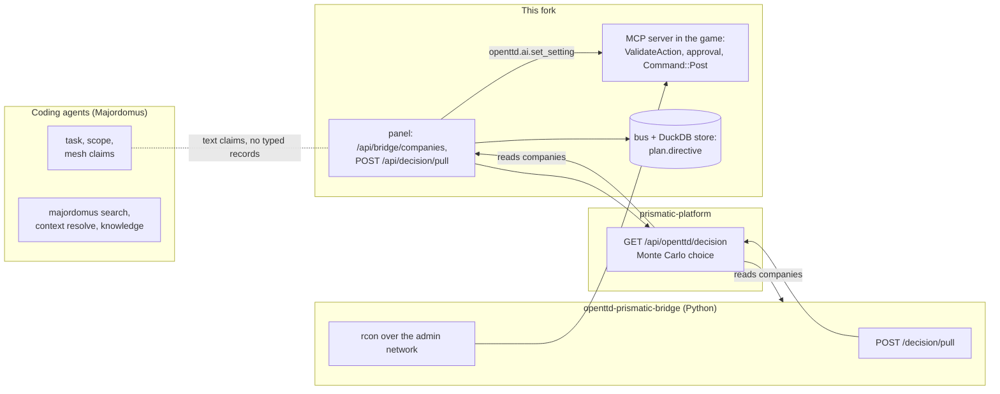

# The agent loop: retrieve, coordinate, decide, approve, act, verify

**RESEARCH-ONLY.** The owner asked (2026-11-19) for one real loop: an agent retrieves versioned
evidence with citations, coordinates through a shared blackboard, forms a decision from observed
bridge and game state, validates it, gets an approval bound to the exact arguments, sends the action
through Prismatic to the standalone bridge, which applies it through the game's command path, and
the result is observed and recorded. This page is the **baseline**: what exists today, read from the
code on 2026-11-19, and what is missing. Nothing below is a plan stated as a fact.

## Repositories read

| Repository | Branch | Head | Note |
|---|---|---|---|
| this fork | master | `cd1e7fdd2b` | clean |
| `~/dev/openttd-prismatic-bridge` | `feat/live-behaviour` | `513398c` | 1 ahead of and 17 behind its `origin/main` (`dd9119b`): the checked-out bridge lacks the decision fixes [`prismatic-bridge/ARCHITECTURE.md`](prismatic-bridge/ARCHITECTURE.md) describes (company id off by one, settings through `bot set`) |
| `~/dev/prismatic-platform` | read only | | survey in `research/rhai-ide.md` on branch `feature/rhai-ide` ("What Prismatic offers over HTTP today") |

## Stage by stage

| Stage | Status | What exists | What is missing |
|---|---|---|---|
| Retrieve | PARTIAL | `majordomus_search` (MCP): case-insensitive substring search over the `.ai/` layer and the Markdown under `docs/`, `research/` and the root, as declared in `.ai/repo/knowledge/sources.yaml`; `majordomus context resolve` with a sha256 per document; knowledge records with `provenance.derived_from`; `tools/knowledge/refs check` proves every cited path and `path:Symbol` exists | source code is not indexed; a hit carries no commit and no line; no semantic index; the CLI `majordomus search` reads only the unversioned `.ai/local/` records |
| Coordinate | PARTIAL | mesh claims (exclusive or advisory over paths, liveness by beats, a signed journal), handovers with front matter, the peer board's free-text announcements (`src/board.rs`), `mcp-bus-blackboard`'s monthly digest | typed records (observation, decision, blocker, ...), a revision or compare-and-swap on content; the typed bus (`panel_events.rs` `KINDS`) is local to one panel |
| Observe | IMPLEMENTED in the panel | every answer of the panel's `GET /api/bridge/companies` is recorded as an observation: its game tick and date and a digest of the companies' identities (`panel_decision.rs` `observe`, `identity_digest`), readable at `GET /api/bridge/observation` | the Python bridge's `/companies` still carries no tick or digest |
| Decide | PARTIAL | Prismatic's `GET /api/openttd/decision` (Monte Carlo over `aggressiveness`); the panel binds its directive to the observation Prismatic made during the pull | Prismatic does not echo `observed_digest` yet (the panel reads it when it does); a change in prismatic-platform |
| Validate | IMPLEMENTED | the panel's contract checks (`panel_decision.rs` `directive`, `fit_of`), its freshness check before any step (`freshness`: observed during the pull, the echoed digest, companies unchanged, at most 31 game days old, an AI company; 409 otherwise) and the game's `ValidateAction` | the bridge does not validate a directive |
| Authorize | PARTIAL | the game's approval: one-time, bound to the exact canonical arguments, with a TTL (`prismatic_mcp_server.cpp`, `prismatic_mcp_detail.h`) | who approved: the panel's `/api/approve` and its auto-approve need only loopback, and the bridge's `origin/main` approves its own request over rcon |
| Execute | IMPLEMENTED | `Command<>::Post` on the game's main thread, through the command system | the checked-out bridge still sends `reload_ai` with the off-by-one id |
| Verify | IMPLEMENTED in the panel | the game's verdict, read back (`AIConfig::GetSetting` for `ai.set_setting`), and the panel's step states follow it (`panel_decision.rs` `state_of`, `verdict_state`): `applied` only for `VERIFIED_SUCCESS` | a step with no verdict to read (an AI started through the console) is `sent`, not verified |
| Record | PARTIAL | `plan.directive` on the ZeroMQ bus and in the DuckDB store, with its inputs, observation, version and choice; a directive that waited is settled by `plan.directive_outcome` once the game's verdicts are in (or `expired` after an hour) | no idempotency key; the game's provenance lives in memory, capped |

## What the gaps mean

- **Nothing is fake, and nothing is joined up.** Validation, exact-argument approval, the command
  path and the verdict are real inside the game. They are absent from the decision contract and the
  bridge, which do not know the state a decision was made from.
- **The weakest link is authorization.** An approval proves the arguments, not the approver: the
  panel's auto-approve and the bridge's self-approval both turn the gate into a formality, by
  design for a research loop on loopback, and to be stated wherever the loop is described.
- **Retrieval is lookup, not RAG.** Substring search over documents plus checked citations is useful
  and honest; calling it retrieval-augmented generation would not be.

## The smallest next steps, in order

Each closes one row above without a new tracking record:

1. **Done** (2026-11-19): observations carry `{tick, date, digest}`, and the panel refuses a
   directive not decided from a current one. Evidence: `cargo test --release --bin mcp-panel`
   166/166 (the digest, every refusal reason, the age limit); live on a stack without the planner,
   a stand-in that behaves as `mcp-decision-check`'s does: decided without observing 409, a wrong
   `observed_digest` 409, the observed one 200 and the bot then reads `aggressiveness=100`, and the
   store's `plan.directive` names the observation (digest, tick, 4 ticks old) or the refusal
   (`stale`). `tools/research/mcp-decision-check`, extended with these cases: PASS 14/14 with
   `--no-plan-bot` (the decision path needs no plan); without it, FAIL `no bot` on a machine at load
   65, its planned bot not started within the 10-minute wait.
2. **Done** (2026-11-19): the panel reads the game's verdict for every step (`state_of`), and a
   directive that waited is settled by `plan.directive_outcome` (`on_decision`, from each
   `decision.*` event) or closed as `expired` when a denial leaves no verdict. Evidence: `cargo test
   --release --bin mcp-panel` 168/168; `tools/research/mcp-decision-check --no-plan-bot` PASS 15/15
   live: the approved directive's `plan.directive_outcome` says `applied`, `VERIFIED_SUCCESS`,
   decision 1.
3. A pull carries an idempotency key; a second pull with the same key answers the first result.
4. The checked-out bridge is brought to its `origin/main`; its self-approval is replaced by the
   panel's operator approval or recorded as an explicit policy.
