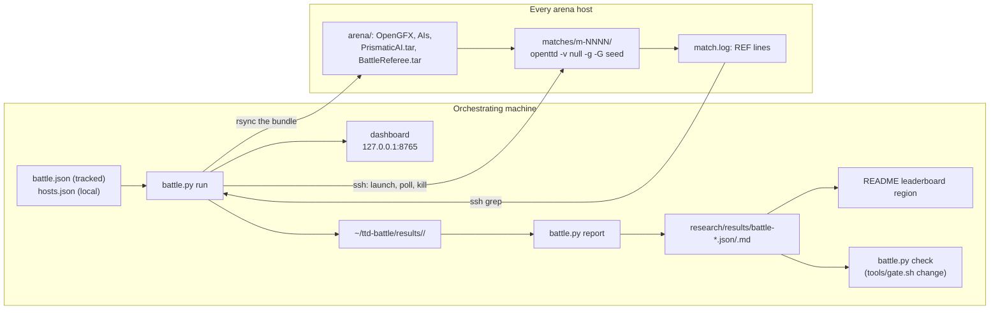

# LAN AI battle

**RESEARCH-ONLY.** A tournament between company AIs that never stops. Every machine on the local
network that answers SSH and has an OpenTTD build becomes an arena. The contestants are PrismaticAI
from this repository and four AIs from BaNaNaS. The orchestrator replays an occasional match on a
second arena to keep checking that a result does not depend on the machine. A live dashboard shows
the run.
Nothing under `src/` changes. The tournament uses existing interfaces only: the null video driver,
the per-game console script, the Game Script API and the BaNaNaS content client.

Decision: ADR 0035. Feature: `lan-ai-battle`. Rule: `project.battle-records-are-reproducible`.
Skill: `run-the-lan-ai-battle`. All are under `.ai/repo/`.

## Leaderboard

The table below is derived from the newest record under `research/results/battle-*.json`, by
`battle.py report`. `battle.py check`, which `tools/gate.sh change` runs, fails when the table
is stale.

<!-- battle:begin -->
No battle record yet: run `battle.py report`.
<!-- battle:end -->

## How it fits together



| Piece | Path | Role |
|---|---|---|
| Orchestrator | `tools/research/ai-battle/battle.py` | discover, fetch, prepare, run, report, check |
| Config | `tools/research/ai-battle/battle.json` | contestants, match parameters, paths; no host names or addresses |
| Hosts | `~/ttd-battle/hosts.json` (local, untracked) | written by `discover`; names, SSH targets, slots |
| Referee | `tools/research/ai-battle/referee/BattleReferee/` | read-only Game Script: one `REF` line per company per quarter |
| Dashboard | `tools/research/ai-battle/dashboard/index.html` | polls `/api/state` every 3 s |
| Tests | `tools/research/test_ai_battle.py` | offline; found by `tools/gate.sh change` |

## Running it

```bash
B=tools/research/ai-battle/battle.py
python3 $B discover   # scan the local /24 for SSH, probe each machine, write ~/ttd-battle/hosts.json
python3 $B fetch      # BaNaNaS contestants into ~/ttd-battle/content (loopback-only -D server)
python3 $B prepare    # arena bundle from HEAD; refuses uncommitted PrismaticAI or referee
python3 $B probe      # which arenas are usable now
python3 $B run        # tournament + dashboard on http://127.0.0.1:8765/ (SIGTERM / Ctrl-C stops)
python3 $B status     # leaderboard and replays of the current edition
python3 $B report     # research/results/battle-<utc>-<edition>.{json,md} + README leaderboard
python3 $B check      # every record valid, every derived file current (exit 10 / 11 otherwise)
```

`run` never stops on its own. It re-probes online hosts every `schedule_every_s` and offline ones
every `offline_probe_every_s`, so a machine that comes up joins without a restart. A machine
that fails stays out until a later probe. After `run` stops, matches already running keep going
on their hosts, and the next `run` of the same edition picks them up again.

Prerequisites. The orchestrating machine needs Python 3.9 or newer, `rsync`, a local build
(`fetch` uses it), and OpenGFX at the `baseset` path. Each arena needs SSH key access, `rsync`,
and an OpenTTD binary at `$HOME/dev/OpenTTD/build/openttd`. A headless `-DOPTION_DEDICATED=ON`
build is enough, so a Linux box without GUI libraries can be an arena. Arenas need no Python.

## Editions

The **edition** is the content hash of the arena bundle: the base set, every AI tar, PrismaticAI
and the referee. Matches, the leaderboard, replays and records all belong to exactly one edition,
and nothing is compared across editions. A new PrismaticAI commit, AI version or referee is a
new edition.

`prepare` exports PrismaticAI (`tools/research/prismatic-ai/PrismaticAI`) and the referee with
`git archive` at one commit. It strips the parent directories, so each tar has its script folder
at the top. The commit is written into `PROVENANCE.json`. `--allow-dirty` exports the working
tree instead and marks the edition dirty. `check` refuses every record from a dirty edition.

## How a match runs

1. **Isolation.** Each match runs in its own `$HOME/ttd-battle/matches/<id>/` with its own `HOME`.
   OpenTTD's personal directory is therefore `<match>/home/Documents/OpenTTD`, and it symlinks to
   the shared arena. The user's real `~/Documents/OpenTTD` is never touched; macOS TCC blocks it
   for SSH sessions anyway. With `-c battle.cfg`, the config directory is the match directory.
2. **Start.** The command is `openttd -c battle.cfg -x -v null:ticks=N -s null -m null -g -G <seed>
   -d script=1`. The per-match `scripts/game_start.scr` contains one `start_ai "<name>" [settings]`
   per contestant. Names go in double quotes, the only quoting the console tokenizer understands.
   The start order rotates every match. A `-g` game has no human company, so company id equals
   start order. That is how the orchestrator maps lines to contestants, and the company names in
   the referee's lines confirm it.
3. **Referee.** It uses `GSLog.Error` so it shows at `-d script=1` above the AIs' info chatter. It
   reports the last completed quarter's value, income and performance rating, and the current
   cash, vehicle count and station count. It never issues a command, so it cannot change a result.
4. **End.** `N = (years × 365.25 + 6) × 74`, so the final year's January report is printed.
   A match is `done` only when the binary exited 0 **and** that report exists. Otherwise it is
   `incomplete` and does not score.
5. **Watchdog.** A match with no new referee line for `stall_s` is killed through its `pid`.
   This catches, for example, the blocking error dialog macOS shows when the base set is missing.
6. **Replays.** Every `replay_every`-th match replays an earlier finished match that was not yet
   replayed, on a different arena, with the same seed, start order and length. The record lists
   each pair and whether the standings are identical. Replays do not score.

**Scoring.** Matches are ranked by final company value, which is OpenTTD's own figure: assets plus
cash minus loan, with a floor of 1. Last place gets 0 points and each place above gets one more.
Ties are broken by average final value. The leaderboard also counts Squirrel errors (`[S]` lines,
i.e. a script crashing).

## PrismaticAI as a contestant

PrismaticAI enters twice, under two labels, so each set of settings is its own contestant:

- `PrismaticAI`: the settings' defaults, the way a bot started without the panel runs.
- `PrismaticAI solo-max`: `aggressiveness=100,max_routes=30,intercity=1,own_lines=8,cash_reserve=5000`.
  It plans its own freight rail lines and intercity roads without the panel's planner.

Both go through the same control path the bridge uses: settings handed to `start_ai`
(feature `prismatic-bridge`). Neither gets the planner's lines. The battle therefore measures the
bot on its own, not the panel's plan, and its results are not duels in the sense of rule
`project.a-tuning-claim-needs-held-start-pairs`. A default changes on duels, not on this.

## What the battle can and cannot claim

- **Within an edition, a match is a pure function of its seed, start order, length and the arena's
  OpenTTD build.** The null driver runs on ticks, not wall-clock time, so the load on a machine
  changes how long a match takes, not how it ends. The replays test this between arenas with
  different builds. Their outcome is in each record; it is not restated here. Duels driven in
  wall-clock time do not have this property (knowledge `duels-run-side-by-side-are-noisy`).
- The arenas run different OpenTTD builds, and each match names its own (`host_version`). A
  replay that is not identical points at the builds, and the record shows which pair it was.
- Company value says nothing about how good a route is. Each contestant runs with its own
  defaults unless `settings` says otherwise.
- The map, climate, length and start year are the same for every match of an edition. A ranking
  holds for those parameters only.

## Files

| Path | Content |
|---|---|
| `~/ttd-battle/content/` | `fetch`'s download home (`content_download/ai`) |
| `~/ttd-battle/arena/` | the bundle and `PROVENANCE.json`, rsynced to every arena's `$HOME/ttd-battle/arena` |
| `$HOME/ttd-battle/matches/<id>/` (each arena) | `match.log`, `battle.cfg`, `pid`, `exit_code`, the isolated `home/` |
| `~/ttd-battle/results/<edition>/matches/<id>.json` | each match: arena, build, seed, lineup, quarterly series, standings |
| `research/results/battle-*.json` / `.md` | the tracked records; the `.md` is derived from the `.json` |

Removing `~/ttd-battle` on every machine removes everything the battle wrote outside this
repository.
