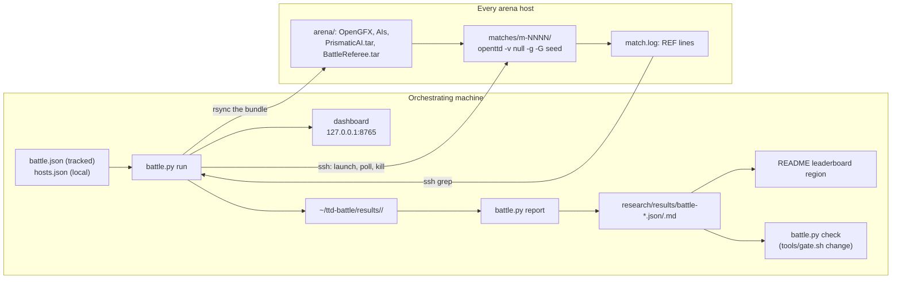

# LAN AI battle

**RESEARCH-ONLY.** A tournament between company AIs that never stops. Every machine on the local
network that answers SSH and has an OpenTTD build becomes an arena. The contestants are PrismaticAI
from this repository, in three configurations, and four AIs from BaNaNaS. The orchestrator replays an occasional match on a
second arena to keep checking that a result does not depend on the machine. A live dashboard shows
the run.
Nothing under `src/` changes. The tournament uses existing interfaces only: the null video driver,
the per-game console script, the Game Script API and the BaNaNaS content client.

Decision: ADR 0035. Feature: `lan-ai-battle`. Rule: `project.battle-records-are-reproducible`.
Skill: `run-the-lan-ai-battle`. All are under `.ai/repo/`.

The visible counterpart is [`research/live-arena.md`](../live-arena.md): the same contestants in
one live game that the MCP panel and Rhai scripts drive, in the browser. It makes no ranking
claim.

## Leaderboard

The table below is derived from the newest record under `research/results/battle-*.json`, by
`battle.py report`. `battle.py check`, which `tools/gate.sh change` runs, fails when the table
is stale.

<!-- battle:begin -->
<!-- derived from research/results/battle-20261119T143339-7930f86c.json by `battle.py report`; `battle.py check` fails when it is stale -->
Latest record: [`battle-20261119T143339-7930f86c`](../results/battle-20261119T143339-7930f86c.md) (0/0 replays identical).

- Edition `7930f86cd1ccaacb`: PrismaticAI and referee at `f695525d1f525c0604169e6016599b0639474419`, base set `opengfx-8.0.tar`
- 20-year free-for-all from 1960, map 256x256 temperate, breakdowns 1
- 48 scored match(es) on `imac` (20261119-master-gdf1e05e7d8), `mbp` (20261119-master-m0587d5c533), `mbp2` (20261119-master-gdf1e05e7d8), `ubuntu` (20261119-master-gdf1e05e7d8)
- Replays: 0 of 0 identical to their original on another arena

| # | Contestant | Played | Wins | Points | Points/match | Avg rank | Avg final value | Squirrel errors | Matches with anomalies |
|---|---|---|---|---|---|---|---|---|---|
| 1 | AAAHogEx | 48 | 48 | 192 | 4.0 | 1.0 | 100.1 M | 0 | 0 |
| 2 | PrismaticAI | 6 | 0 | 18 | 3.0 | 2.0 | 13.9 M | 0 | 1 |
| 3 | PrismaticAI GA g29.3 | 7 | 0 | 21 | 3.0 | 2.0 | 13.0 M | 0 | 4 |
| 4 | PrismaticAI pre-champion | 7 | 0 | 21 | 3.0 | 2.0 | 10.6 M | 0 | 0 |
| 5 | PrismaticAI GA g29.0 | 7 | 0 | 20 | 2.857 | 2.14 | 10.1 M | 0 | 6 |
| 6 | PrismaticAI GA g29.brainSafe | 7 | 0 | 19 | 2.714 | 2.29 | 11.4 M | 0 | 0 |
| 7 | PrismaticAI GA g29.brainSafe1 | 6 | 0 | 15 | 2.5 | 2.5 | 9.7 M | 0 | 5 |
| 8 | AdmiralAI | 48 | 0 | 110 | 2.292 | 2.71 | 7.0 M | 0 | 3 |
| 9 | PrismaticAI solo-max | 8 | 0 | 14 | 1.75 | 3.25 | 4.6 M | 0 | 8 |
| 10 | LuDiAI AfterFix | 48 | 0 | 43 | 0.896 | 4.1 | 1.8 M | 0 | 0 |
| 11 | CivilAI | 48 | 0 | 7 | 0.146 | 4.85 | 688.5 k | 0 | 8 |
<!-- battle:end -->

## How it fits together



| Piece | Path | Role |
|---|---|---|
| Orchestrator | `tools/research/ai-battle/battle.py` | discover, fetch, prepare, run, report, check |
| Config | `tools/research/ai-battle/battle.json` | contestants, match parameters, paths; no host names or addresses |
| Hosts | `~/ttd-battle/hosts.json` (local, untracked) | written by `discover`; names, SSH targets, slots |
| Referee | `tools/research/ai-battle/referee/BattleReferee/` | read-only Game Script: one `REF` line per company per quarter |
| Dashboard | `tools/research/ai-battle/dashboard/index.html` | polls `/api/state` every 3 s |
| Tests | `tools/research/test_ai_battle.py` | offline; found by `tools/gate.sh change` |

## Running it

```bash
B=tools/research/ai-battle/battle.py
python3 $B discover   # scan the local /24 for SSH, probe each machine, write ~/ttd-battle/hosts.json
python3 $B fetch      # BaNaNaS contestants into ~/ttd-battle/content (loopback-only -D server)
python3 $B prepare    # arena bundle from HEAD; refuses uncommitted PrismaticAI or referee
python3 $B probe      # which arenas are usable now
python3 $B run        # tournament + dashboard on http://127.0.0.1:8765/ (SIGTERM / Ctrl-C stops)
python3 $B status     # leaderboard and replays of the current edition
python3 $B report     # research/results/battle-<utc>-<edition>.{json,md} + README leaderboard
python3 $B check      # every record valid, every derived file current (exit 10 / 11 otherwise)
python3 $B fitness    # the working tree's PrismaticAI in one short local match (gate, on change)
python3 $B ablate --variant "base=..." --variant "x=setting=v" --years 10 --seed S --write
                      # one deterministic local match per settings variant, recorded in research/results
python3 $B reap       # stop running matches of older editions on every arena (run does it on start)
```

`run` never stops on its own. It re-probes online hosts every `schedule_every_s` and offline ones
every `offline_probe_every_s`, so a machine that comes up joins without a restart. A machine
that fails stays out until a later probe. After `run` stops, matches already running keep going
on their hosts, and the next `run` of the same edition picks them up again.

Prerequisites. The orchestrating machine needs Python 3.9 or newer, `rsync`, a local build
(`fetch` uses it), and OpenGFX at the `baseset` path. Each arena needs SSH key access, `rsync`,
and an OpenTTD binary at `$HOME/dev/OpenTTD/build/openttd`. A headless `-DOPTION_DEDICATED=ON`
build is enough, so a Linux box without GUI libraries can be an arena. Arenas need no Python.

## Editions

The **edition** is a content hash of two things. The first is the arena bundle: the base set,
every AI tar, PrismaticAI and the referee. The second is everything else that decides a match:
the contestants with their settings, and the match parameters (`edition_of`). Matches, the
leaderboard, replays and records all belong to exactly one edition, and nothing is compared
across editions. A new PrismaticAI commit, AI version, referee, contestant, setting or match
parameter is a new edition.

`prepare` exports PrismaticAI (`tools/research/prismatic-ai/PrismaticAI`) and the referee with
`git archive` at one commit. It strips the parent directories, so each tar has its script folder
at the top. The commit is written into `PROVENANCE.json`. `--allow-dirty` exports the working
tree instead and marks the edition dirty. `check` refuses every record from a dirty edition.

## How a match runs

1. **Isolation.** Each match runs in its own `$HOME/ttd-battle/matches/<edition>/<id>/` with its own `HOME`.
   OpenTTD's personal directory is therefore `<match>/home/Documents/OpenTTD`, and it symlinks to
   the shared arena. The user's real `~/Documents/OpenTTD` is never touched; macOS TCC blocks it
   for SSH sessions anyway. With `-c battle.cfg`, the config directory is the match directory.
2. **Start.** The command is `openttd -c battle.cfg -x -v null:ticks=N -s null -m null -g -G <seed>
   -d script=1`. The per-match `scripts/game_start.scr` contains one `start_ai "<name>" [settings]`
   per contestant. Names go in double quotes, the only quoting the console tokenizer understands.
   The start order rotates every match. A `-g` game has no human company, so company id equals
   start order. That is how the orchestrator maps lines to contestants, and the company names in
   the referee's lines confirm it.
3. **Referee.** It uses `GSLog.Error` so it shows at `-d script=1` above the AIs' info chatter. It
   reports the last completed quarter's value, income and performance rating, and the current
   cash, vehicle count and station count. It never issues a command, so it cannot change a result.
4. **End.** `N = (years × 365.25 + 6) × 74`, so the final year's January report is printed.
   A match is `done` only when the binary exited 0 **and** that report exists. Otherwise it is
   `incomplete` and does not score.
5. **Watchdog.** A match with no new referee line for `stall_s` is killed through its `pid`.
   This catches, for example, the blocking error dialog macOS shows when the base set is missing.
6. **Replays.** Every `replay_every`-th match replays an earlier finished match that was not yet
   replayed, on a different arena, with the same seed, start order and length. The record lists
   each pair and whether the standings are identical. Replays do not score.

**Scoring.** Matches are ranked by final company value, which is OpenTTD's own figure: assets plus
cash minus loan, with a floor of 1. Last place gets 0 points and each place above gets one more.
Ties are broken by average final value. The leaderboard also counts Squirrel errors (`[S]` lines,
i.e. a script crashing).

## PrismaticAI as a contestant

PrismaticAI enters three times, under three labels, so each set of settings is its own contestant.
They share `"group": "PrismaticAI"`, and a group plays **one member per match**, in turn
(`lineup_for`). Two copies of the same bot on one map take each other's best airport towns and
industries, and in the fitness match the second autopilot starved. Everyone else plays every match:

- `PrismaticAI`: no settings, the way a bot started without the panel runs. Since 2026-11-19 its
  `autopilot` (default 1) engages: in-bot steward, own lines, intercity roads, 30 routes, and its
  own **air routes first** (up to 6, between big towns 60-260 tiles apart, up to 8 planes each;
  `autopilot.nut`). The winner's lead opens in the first quarters, carried by aircraft.
- `PrismaticAI solo-max`: `aggressiveness=100,max_routes=30,intercity=1,own_lines=8,cash_reserve=5000,autopilot=0`,
  the control without any steward.
  It plans its own freight rail lines and intercity roads without the panel's planner.
- `PrismaticAI self-steward`: solo-max plus `self_steward=1`, the in-bot steward (see below).

Both go through the same control path the bridge uses: settings handed to `start_ai`
(feature `prismatic-bridge`). Neither gets the planner's lines. The battle therefore measures the
bot on its own, not the panel's plan, and its results are not duels in the sense of rule
`project.a-tuning-claim-needs-held-start-pairs`. A default changes on duels, not on this.

## Why PrismaticAI lost, and what changed

The first editions showed two failures. The battle now catches both by itself.

- **PrismaticAI with default settings stays small.** That is by design. Without the panel, the
  bot plans no rail lines (`own_lines` is 0) and runs a few bus routes (`max_routes`). It is
  built to be steered by the panel's planner and the Rhai steward.
- **`PrismaticAI solo-max` drops.** It plans its own rail lines and grows faster than everyone but
  AAAHogEx for two or three years. Then its fleet shrinks by a third to a half while its bank
  balance climbs. The cause is in the bot's design. A rail line runs what the Rhai steward sets
  (`line<N>_trains`, `line<N>_wagons`; `lines.nut`), and without the panel there is no steward, so
  every line keeps the one train it was built with. Once `own_lines` lines are planned, the
  earnings have nowhere to go. Meanwhile `fleet.nut` sells road vehicles that lose money and buys
  no replacements.
- **The fix is opt-in, so no default changes** (rule
  `project.a-tuning-claim-needs-held-start-pairs`). With `self_steward=1`, the bot applies the Rhai
  steward's policy (`rail_lib.rhai::target`) itself to every line without an external target:
  lengthen, add a train, shrink, or close. It also funds own lines beyond `own_lines` from money in
  the bank (`tools/research/prismatic-ai/PrismaticAI/steward.nut`). The contestant
  `PrismaticAI self-steward` is solo-max plus `self_steward=1`, in the same matches on the same
  seeds, so each record compares the two directly.

**Why no test caught it, and what catches it now:**

- `battle.py fitness` runs the working tree's PrismaticAI for six years on a fixed seed, against
  solo-max and AAAHogEx. It fails on a Squirrel error from any PrismaticAI, on an unfinished
  match, or on a collapsing fleet of a contestant named in `fitness.must_be_healthy`. The null
  driver is deterministic, so the verdict is stable. `tools/gate.sh change` runs it whenever
  `tools/research/prismatic-ai` or `tools/research/ai-battle` changes. Without an arena cache it
  says NOT RUN.
- **Self-monitoring while the battle runs.** The orchestrator attaches `anomalies` to every
  contestant of every match, live:
  - `fleet_drop:<peak>-><now>`: the fleet fell below `anomaly_rules.fleet_keep` of a peak of at
    least `fleet_min_peak` vehicles,
  - `squirrel_errors:<n>`,
  - `no_vehicles`.

  A new anomaly goes to the event log as an `ALERT` and onto the dashboard's alert panel. Records
  keep each standing's anomalies, and the leaderboard counts each contestant's anomalous matches.
  The same check flagged CivilAI crashing (thousands of Squirrel errors in one match).

## Self-tuning (genetic algorithm)

`tuning` in `battle.json` (ADR 0036) evolves PrismaticAI's settings inside the running battle:

- **Population and anchors.** `population` variants named `PrismaticAI GA g<gen>.<i>` (settings
  = `fixed` + genes from `space`, each gene `[min, max, step]`) play in the PrismaticAI group,
  beside the anchors `PrismaticAI` and `PrismaticAI solo-max`. The group's members take turns on
  the same seed, so each variant meets the same maps.
- **Fitness** = points per match (1 for a win, 0 for last) + 0.1 x log10(value / winner's value).
- **Generations.** Once every variant has `matches_per_variant` matches, the orchestrator:
  1. writes the round's record,
  2. keeps the best variant,
  3. breeds the rest (tournament selection, uniform crossover, step mutation; the RNG is seeded
     by the generation number),
  4. stops the generation's unfinished matches through their pid files,
  5. restarts itself into the next edition.
- **State and display.** `~/ttd-battle/tuning/state.json` holds the current variants and every
  past generation's genes, parents and fitness. `/api/tuning` serves it, and the dashboard's
  *Self-tuning* panel shows it.
- **Model-guided offspring.** Each new generation also takes the top `brain_offspring` proposals
  of `tools/research/battle-brain` (`~/ttd-battle/results/brain.json`, schema `battle-brain/v1`):
  an Axon/EXLA ensemble trained on every PrismaticAI result, scoring the gene space by UCB.
  Proposals join as `g<gen>.brainSafe` (best lower confidence bound) or `g<gen>.brainExplore`
  (best upper bound), clamped into the space. A missing, stale (older than
  `brain_max_age_s`) or invalid file adds nothing.
- **Candidates under test.** `PrismaticAI air10+catch` (`air_add_waiting=10,catchment_stops=8`,
  mechanisms learned from AAAHogEx) played in the group as an anchor. Paired on 36 common seeds
  over 20 years, it beat the default by +14.8% mean value and won 27 of 36. Its settings became
  the default, and the anchor was retired.
- **`PrismaticAI double-track`** (`rail_double=1`) played as an anchor, paired on 74 common seeds over
  20 years: +14.8% mean value, better in 56 of 74. Double track became the default and the anchor
  was retired; `solo-max` keeps single track. Its add rule now fills a
  free source platform (it used to wait until no train was loading, which almost never held under
  a full load). On 3 seeds at 10 years it gave -28.8%, +47.5% and +11.6%: too chaotic for a single
  seed to decide, so the battle pairs it over 20 years.
- **Champion to default.** The GA's elite g14.0/g15.0 (a brain proposal) beat the default on
  20 of 20 common seeds (+30.9%), and its genes became the bot's defaults. A paired comparison
  against the default decides this; a variant's GA score over 6-7 matches can rank wrongly.
- **`PrismaticAI pre-champion`** (the defaults before the champion, as settings; only the
  autopilot's own-lines floor of 10 cannot be set back to 8) plays as an anchor, so the pairing
  keeps confirming the switch and the battle brain keeps a fixed baseline across it.
- **New maps every generation.** A match's seed includes its edition, so each GA generation meets
  new maps. Before, every generation was judged, and tuned, on the same handful of seeds.
- **Promotion, detected automatically.** The orchestrator pairs every configuration (its settings, not
  its label: the GA's elite takes a new label each generation) with the default on common seeds,
  pooled over every edition of the same arena revision (`edition.json`) (`/api/promotions`, the dashboard's *Paired with the default* panel). A PrismaticAI
  configuration that beats it on at least `promotion.min_pairs` seeds, winning at least
  `min_win_share` of them, with a mean ratio above `min_ratio`, is announced as a `PROMOTE` event.
  It is a proposal: the default changes through a commit that passes the gate.
- **Last places cost.** The score subtracts `last_penalty` x the share of matches a variant
  ended last, so explorers that end last are culled fast.
- **Defaults.** A tuned variant is a candidate. It becomes a default only through held-start duel
  pairs (rule `project.a-tuning-claim-needs-held-start-pairs`).

## Double track

AAAHogEx's rail scales by double track; PrismaticAI's single-track line holds two trains. The
opt-in setting `rail_double=1` builds the bot's own freight lines with one one-way track each way
and path signals (`tools/research/prismatic-ai/README.md`, section *Double track*). It is off by
default. Recorded 10-year ablations against AAAHogEx and AdmiralAI, one per seed:
[`seed930967890`](../results/ablation-20261119T083455-seed930967890.md),
[`seed1814625749`](../results/ablation-20261119T083459-seed1814625749.md),
[`seed1251879686`](../results/ablation-20261119T083502-seed1251879686.md).

- **Value.** Lower on two seeds and higher on one.
- **Train count.** Rail trains did not grow. The steward adds a train only while half a trainload
  waits and no train loads at the source. With full load at the source and short trains (the
  platform follows demand), a train is nearly always loading, so the extra track is paid for and
  carries no extra trains.
- **Noise.** A bot edit that changes no decision still moves a 10-year result by a few percent.
  HEAD with one no-op expression added to `LineRecord` matched the edited tree's `rail_double=0`
  value exactly, and both differed from HEAD. A shift of a few Squirrel opcodes moves an action by
  one tick, and the match diverges from there. Read a single-seed difference of that size as noise.

## Never last

By the owner's order, `PrismaticAI` and `PrismaticAI self-steward` are never last
(`never_last` in `battle.json`, rule `project.prismatic-ai-is-never-last`). `battle.py check`
fails when one of them is last on the newest record's leaderboard. `battle.py fitness` fails
when one is last by final value on its seed. It runs one match per PrismaticAI
configuration, in parallel, each against AAAHogEx, LuDiAI AfterFix and AdmiralAI.

## Where we lose: post-mortems, store, throughput

- **Telemetry.** The referee (v3) adds these fields to each company's quarterly line:
  - vehicle counts by transport mode (`rail`, `road`, `air`, `water`),
  - each mode's profit last year (`prail` ... `pwater`),
  - cargo delivered and expenses.
- **Post-mortem after every match.** Every contestant that did not win gets:
  - `gap`: the winner's value divided by its own,
  - `behind_since`: the first quarter in which the winner was worth twice as much,
  - `findings`: fleet size, income per vehicle, cargo delivered, the profit deficit per transport
    mode, and anomalies.

  A post-mortem of a PrismaticAI contestant is also a `POSTMORTEM` line in the event log and on
  the dashboard. A cross-match layer (causes, last-place counts, settings proposals) is
  `tools/research/mcp-rhai`'s `battle-postmortem` (documented in `research/battle-postmortem.md`).
- **Store.** Everything is written to `~/ttd-battle/results/battle.sqlite`:
  - tables `matches` (with the lineup as `{key, ai, settings}`), `samples`, `standings`,
    `postmortems`, `host_perf` and `events`,
  - column names are only ever added, never renamed,
  - DuckDB reads it with `ATTACH '<file>' (TYPE sqlite)`,
  - `GET /api/query?sql=` runs one read-only `SELECT`/`WITH` on it.
- **Throughput.** `host_perf` and `/api/perf` give game years per wall-clock minute per arena.
  Every match is one single-threaded OpenTTD process, so the parallelism that pays is slots per
  core. Each arena runs about one match per core and keeps a few cores free on the machine the
  owner works at. A match takes about 90 MB, so memory is not the limit.

## API and dashboard

`battle.py run` serves a read-only HTTP API on loopback. The dashboard uses it, and so can any
other client (`curl`, the panel, a notebook):

| Path | What |
|---|---|
| `/` | the dashboard |
| `/docs` | Swagger UI over `/api/openapi.json` |
| `/api/stream` | server-sent events (`event: state`), the whole state every `stream_every_s` |
| `/api/state` | the same state, once |
| `/api/leaderboard`, `/api/hosts`, `/api/matches`, `/api/matches/{id}` | parts of it; a match with its full quarterly series |
| `/api/postmortems`, `/api/perf` | where each contestant lost, per finished match; throughput per arena |
| `/api/query?sql=` | one read-only SQL statement over the store |

The dashboard has these features:

- It follows `/api/stream` and falls back to polling. The connection indicator turns red after
  ten seconds without an update.
- Each live match draws every contestant's quarterly series. The metric is value, vehicles,
  income or rating, on a log or linear scale; the choice is kept per browser. Hovering or
  touching a chart shows every contestant's figures at that quarter.
- Contestants with an anomaly are drawn dashed and carry a badge.
- There are panels for the leaderboard (with points bars), alerts, recent results, replays and
  the event log.

## What the battle can and cannot claim

- **Within an edition, a match is a pure function of its seed, start order, length and the arena's
  OpenTTD build.** The null driver runs on ticks, not wall-clock time, so the load on a machine
  changes how long a match takes, not how it ends. The replays test this between arenas with
  different builds. Their outcome is in each record; it is not restated here. Duels driven in
  wall-clock time do not have this property (knowledge `duels-run-side-by-side-are-noisy`).
- The arenas run different OpenTTD builds, and each match names its own (`host_version`). A
  replay that is not identical points at the builds, and the record shows which pair it was.
- Company value says nothing about how good a route is. Each contestant runs with its own
  defaults unless `settings` says otherwise.
- The map, climate, length and start year are the same for every match of an edition. A ranking
  holds for those parameters only.

## Files

| Path | Content |
|---|---|
| `~/ttd-battle/content/` | `fetch`'s download home (`content_download/ai`) |
| `~/ttd-battle/arena/` | the bundle and `PROVENANCE.json`, rsynced to every arena's `$HOME/ttd-battle/arena` |
| `$HOME/ttd-battle/matches/<edition>/<id>/` (each arena) | `match.log`, `battle.cfg`, `pid`, `exit_code`, the isolated `home/` |
| `~/ttd-battle/results/<edition>/matches/<id>.json` | each match: arena, build, seed, lineup, quarterly series, standings |
| `research/results/battle-*.json` / `.md` | the tracked records; the `.md` is derived from the `.json` |

Removing `~/ttd-battle` on every machine removes everything the battle wrote outside this
repository.
