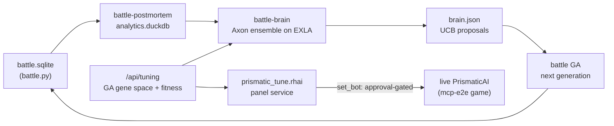

# Battle brain and live tuner

**RESEARCH-ONLY.** Self-improvement in two loops, both fed from the LAN battle's recorded data:

1. **Between rounds (the brain):** a learned model of the battle proposes the next settings to try.
   It is an ensemble of small neural networks (Axon) compiled by EXLA (Nx's XLA backend). They are
   trained on every recorded PrismaticAI result: the settings it ran with, mapped to its log value
   share of the winner. The model scores tens of thousands of candidates from the genetic
   algorithm's own gene space in one batched call. It proposes the best by upper confidence bound,
   UCB = mean + κ · spread of the ensemble. With little data the spread dominates, so the brain
   explores; with more data the mean dominates. The proposals are input for the battle's genetic
   algorithm, which adds them as offspring: evolution guided by a model as well as by mutation.
2. **During a game (the live tuner):** `rhai/prismatic_tune.rhai` keeps the live PrismaticAI on the
   best measured settings. It reads the genetic algorithm's standings (`/api/tuning`), takes the best
   variant with enough matches, and changes each knob that differs, one at a time. Every change goes
   through `openttd.ai.set_setting`, approval-gated like every MCP change.

Neither loop changes a default or a contestant by itself. The brain's proposals become contestants
only when the battle's owner (the genetic algorithm, ADR 0036) takes them. The tuner's changes wait
for the owner's Approve, or for auto-approve when the owner switches it on.



## Run

```bash
tools/research/battle-brain/brain                # once: writes ~/ttd-battle/results/brain.json
tools/research/battle-brain/brain --every 900    # the background loop (every 15 min)
```

And on the panel's Scripts page, start `prismatic_tune` as a service, or:

```bash
curl -X POST 127.0.0.1:8800/api/services/start -H 'content-type: application/json' \
  -H 'origin: http://127.0.0.1:8800' -d '{"name":"prismatic_tune"}'
```

The brain needs the duckdb CLI, the battle API on `:8765`, and Elixir with Nx, EXLA, Axon, Polaris
and Jason compiled. By default it uses the prismatic-platform checkout's `_build/dev/lib` with its
Elixir 1.19 / Erlang 28 (`$BRAIN_LIBS`, `ASDF_*_VERSION`), so XLA is not downloaded again.

The runner does not depend on the post-mortem watch running: before each fit it runs the
post-mortem for any of its editions that has no rows in `analytics.duckdb`. On 2026-11-20 the watch
was down for two hours, ten editions went unanalysed, and the brain read 0 rows and withdrew its
proposals until they were backfilled.

## The brain in detail (`tools/research/battle-brain/brain.exs`)

| Step | What |
|---|---|
| Data | `analyses JOIN contestants` from the post-mortem's `analytics.duckdb`, **paired**: every PrismaticAI variant's result with its settings, against the default `PrismaticAI` on the same edition and seed (`analyses.seed`, backfilled for every edition in the store) |
| Features | each gene of the GA's space scaled to [0, 1]; a gene the setting does not name takes the midpoint and a 0 "named" flag, so the net can tell a default from a value |
| Target | log of (the variant's value share of the winner / the default's on the same seed), clamped below at `$BRAIN_SHARE_FLOOR` (0.05) so that a bankruptcy (value 1, a ratio near 1e-7) scores as the worst outcome without dominating the squared loss; `brain.json` names it in `target` and counts `floored_rows`, and `predicted_share` is that ratio |
| Model | 5 members, each 2 × 32 tanh with dropout 0.1, trained by Adam (lr 0.01, 400 steps) on its own bootstrap sample |
| Search | 50,000 candidates on the GA's grid (min, max, step per gene), scored in one batched EXLA call per member: half uniform over the space, half local (one of the 5 best measured settings, with at least `$BRAIN_PARENT_MIN_ROWS` (4) rows each, with 1 to 3 genes moved) |
| Pick | 8 proposals, alternating `safe` (best lower confidence bound, mean − κ·spread) and `explore` (best upper confidence bound, mean + κ·spread, among candidates whose lower bound is at least `$BRAIN_EXPLORE_FLOOR` × the default, 0.9 by default), κ = 1, each with its kind, predicted share and spread |

`brain.json` (schema `battle-brain/v1`) records the data it had (`rows`, `distinct_settings`) and the
in-sample R² of the ensemble mean, which is a sanity figure and not a validation. `enough_data` is
false while there are fewer distinct settings than twice the number of genes. Until then the
proposals are exploration, and the record says so.

The first run, on 2026-11-19, had 364 rows but only 8 distinct settings for 17 genes, with an
in-sample R² of 0.19. It trained 5 nets in 15 s and scored 50,000 candidates in 208 ms on EXLA (CPU).
Its proposals are exploration, by design. Each GA generation adds distinct settings, and the
surrogate improves with them.

Tooling language: the repository's rule `project.tooling-language-preference` asks for Rust tools.
The owner asked for EXLA and Axon by name, and both are Elixir libraries, so the learned part is a
single Elixir script behind a thin runner. Its input and output are files (CSV in, JSON out), and
nothing else in the repository depends on Elixir.

### The champion, and why the target is paired

The brain's safe proposal in generation 13, `g13.brainSafe`, carried into the GA as `g14.0` and
`g15.0`, was paired with the default on 20 common seeds over 20 years. It won all 20, with a mean
value 30.9 % higher. Its genes became the bot's defaults (`1f3400b85d`): fewer air routes, and
investment that starts earlier, borrows and grows routes further. A variant with a higher GA
score over 6 to 7 matches, `g15.3`, lost its pairing (0.903). Short GA scores rank noisily, and
paired comparisons on the same seeds decide. The brain's target is therefore the paired ratio
against the default, not the raw share. On the first paired run (2026-11-19) the brain had 607
paired rows with 53 distinct settings for 19 genes, enough data for the first time. Its safe pick
predicted 1.48 × the default, with a spread of 0.09 in log terms.

### Only fresh maps teach it

Before `46dd8814f9`, every battle edition restarted its seed counter. Every GA generation, and so
every training row, therefore replayed the same 6 to 8 maps. On fresh maps the picture changed:
- In paired comparisons the champion was only even with the old default (pre-champion won 4 of
  10 pairs).
- Both safe picks of generation 30, `g30.brainSafe` and `g30.brainSafe1`, each ended last once.

The brain now trains only on the newest editions (`BRAIN_EDITIONS`, default 10, the editions since
seeds include the edition), and `target` says so. The first such run had 195 rows and 26 distinct
settings for 21 genes, so the brain explores again (`enough_data` false). That is honest: it has
not yet seen enough fresh maps.

### Why the explorer has a floor

In edition `69577ebe`, `GA g66.brainExplore` finished last in 1 of 7 matches. Its value share of the
winner was 0.017 and its fleet decayed from 49 to 31 (`fleet_decays`, `low_yield`). Unconstrained UCB
had picked it for its spread (0.47), not its mean: short air routes (`air_max_tiles=200`, `air_towns=10`)
with full load. The explorer now chooses only among candidates whose lower bound is at least 0.9 ×
the default, and falls back to the safe order when none qualifies. `brain.json` records the floor
as `explore_floor`. The first constrained run's explorer had a spread of 0.27.

### Why safe picks stay near measured settings while data is thin

In edition `1cff10c1`, the safe pick `GA g67.brainSafe` finished last in 1 of 3 matches (value
share 0.087, fleet 33). Its settings were far from anything measured: low growth caps
(`invest_road_cap=8`, `invest_air_cap=4`, `air_planes=1`, `max_routes=8`). The ensemble's
lower bound was confident there only because no data contradicted it. While `enough_data` is false,
safe picks now come only from the local candidates, a trust region around the best measured
settings. `brain.json` records `trust_region` and the number of `parents`. On the first such run, the
safe pick predicted 1.19 × the default with a spread of 0.05, down from 1.37 with 0.19.

### When the default changes

The target pairs every variant with the default `PrismaticAI` of its own edition, so a new default
moves the baseline. In `6111dc0fef` the GA's elite became the default (geometric mean 1.12 over the
former default on 40 new maps, 95 % CI 1.03 to 1.21), first played in edition `ad811447`. The
runner rebases rows from editions before `$BRAIN_BASELINE_SINCE` (default `ad8114473cb357a6`) by
1 / `$BRAIN_BASELINE_REBASE` (default 1.12), so old and new rows measure against the same default.
The rebase is a single measured factor, not a per-map one, and `target` in `brain.json` names it.
The first run after the change had 206 rows and 26 distinct settings for 20 genes, so it still
explores. On the next default change, set both variables to the new edition and measured ratio.
A behaviour change that interacts with the genes cannot be rebased by one factor. One example is a
fix that makes levelling cost more, which moves the best `air_level_max`. For such a change, set
`BRAIN_TRAIN_SINCE` to the first edition with it, and older editions are left out entirely.
The first such cut is the airport levelling fix (`f4fcbbfef8`, first edition `2d4e0173`). It also
changed the default (`air_level_max` 10 → 35), so `BRAIN_BASELINE_SINCE` is the same edition.
Until there are `BRAIN_MIN_ROWS` (20) paired rows since the cut, the runner writes no proposals and
moves `brain.json` aside to `brain.withdrawn.json`. While it is absent, the GA takes no brain
offspring.

The second cut is `fad8c1af62` (first edition `406a089b`). It levels airport sites only within
`air_level_step` height steps (default 2, before it about 8). The effect varies too much per seed for a
rebase: from 0.6× to about 10,000×, where a map that went bankrupt now reaches 9.9M. Ten minutes later `2cab9e0314` made
`air_level_step=0` the default (first edition `6590a606`): it levels at any height step until the game
refuses a levelled site, then only one-step sites. That is the third cut. Edition `406a089b` ran only a
few matches.

On 2026-11-20 the GA's `g150.0` became the default (`962699034c`, geometric mean 1.154 over 36 pairs,
CI lower bound 1.046), first edition `121f34cd`. That change touches only settings, so older rows
since the cut are rebased by 1/1.154 (`BRAIN_BASELINE_SINCE=121f34cd`, `BRAIN_BASELINE_REBASE=1.154`)
rather than cut.

The fourth cut is `61b2483618` (first edition `cd02f5e8`): when a hilly map has no flat site for a
double-track terminus, the bot now levels a sloped one instead of dropping the own line. The default's
20-year value moved 0.94× to 2.36× per seed (about +32% geometric), and the effect depends on the
`own_lines` genes, so older editions are cut, not rebased.

An hour later `ce3fcf5c29` (first edition `b7e14fbf`) fixed fleet-growth churn: Invest now keeps
unjudged vehicles below judged ones on a route. The default moved 0.94× to 1.16× per seed, about +7%
geometric. That spread is narrow, so rows since the `cd02f5e8` cut are rebased by 1/1.07
(`BRAIN_BASELINE_SINCE=b7e14fbf`, `BRAIN_BASELINE_REBASE=1.07`) rather than cut again.

The fifth cut is `05aa9a18c3` (first edition `5e5b9f93`): PickRailEngines now requires
`AIEngine.HasPowerOnRail`. It used to pick electric locomotives by `CanRunOnRail`, a plain depot
refused them, and finished lines stayed without trains (the restore loop failed up to 774 times a
game). The peer found it by replaying `g288.brainSafe`'s last place exactly (`ablate --match
20a48c81/m-0009`): its genes went from 1.02M to 1.89M. The default moved -5.7% to +27.5% over 7
real-lineup games (about +1.3% geometric), so the mean shift is small, but the effect falls only on
maps and genes that pick electric engines. Older rows understate exactly those rail genes, so they are
cut, not rebased. The rebase (`BRAIN_BASELINE_SINCE=b7e14fbf`) no longer touches any kept row.

Then `531922be7d` (first edition `000b3198`) made the own freight planner skip industries on water.
Oil rigs ranked first by output, every attempt failed for want of a rail station site, and each failure
counted against `own_lines` and `own_fail_pause`. Over 8 replayed matches (`ablate --match`, real
lineups, editions `5e5b9f93` to `799899b1`) the change moved value 0% to +9.5%, +5.3% geometric, with
no loss. The spread is narrow and no configuration lost, so rows since the `5e5b9f93` cut are rebased
by 1/1.053 (`BRAIN_BASELINE_SINCE=000b3198`, `BRAIN_BASELINE_REBASE=1.053`) rather than cut.

### Why trust-region parents need four rows

In edition `eb9cae38` the safe pick `g241.brainSafe` finished last on seed 199435860. The four other
PrismaticAI configurations on that seed, all from the same start slot, came second. Its genes sat next
to `g227.0`, which went bankrupt earlier (`own_lines=24`, `own_fail_pause=0`, `air_level_max=5`). A
parent with only two rows can rank high on one lucky slot, and the trust region then centres on it. Parents
now need at least four rows.

### Start slots and pairing

The start slot alone can swing a configuration's 20-year value about 4× on one map (seed 371319927:
g226.0 scored 11.8M from slot 0 and 2.9M from slot 2). Until `d60734cf23` (first edition `569322cd`) the
lineup rotated the slot with every match, so the configurations sharing a seed each started elsewhere.
Pairs from before then are noisier but not biased: each member sat a fixed offset from the default,
and the absolute slot cycled across seeds. From `569322cd` on, every PrismaticAI configuration on a seed
starts from the same slot, so the brain's join on (edition, seed) compares like with like. No cut was
made; the older rows only add noise, which the ensemble's spread and the bootstrap CI already carry.

### Why a safe pick comes first

Until 2026-11-19 the brain proposed by UCB only, so both of the GA's brain offspring were
explorers. In edition `508356ae`, `GA g10.brain0` finished last in 1 of 6 matches. In match m-0039
its fleet collapsed from 25 to 6 vehicles (`fleet_decays`, `low_yield`, `idle_stations`). Its
settings sat far from the data: `rail_double=1`, which the battle owner had measured as a loss,
`own_lines=22`, and `air_add_waiting=90`, which means almost no planes. Now the first proposal is
the best by lower confidence bound, where the ensemble agrees, and the second is the explorer.
The GA takes the first two, so each generation gets one of each. The GA's last-place penalty
culls an explorer that ends last.

## The live tuner in detail (`tools/research/mcp-panel/rhai/prismatic_tune.rhai`)

- Every `ROUND_S` (300 s) it calls `loopback_get("http://127.0.0.1:8765/api/tuning")` and picks the
  variant with the highest fitness score among those with at least `MIN_MATCHES` (4) matches.
- It compares that variant's settings with `api_bots().running` for `COMPANY` (0), only for genes in
  the GA's space and settings the bot has.
- For each difference it calls `ttd::set_bot` (`openttd.ai.set_setting`) and says the change in chat.
- Its constants can be edited while it runs, and the service reloads within a second.

First run on 2026-11-19: from `PrismaticAI GA g0.1` (score 0.618 over 6 matches) it submitted
`aggressiveness 50 -> 80`, `air_planes 2 -> 1`, `cash_reserve 20000 -> 10000` and
`line_budget 80000 -> 70000`. They showed as pending decisions 1 to 4 in the panel, waiting for the
owner.

## Related

[Battle post-mortem](battle-postmortem.md), [LAN AI battle](ai-battle/README.md), ADR 0036 (the
genetic algorithm), [Rhai scripting](mechanisms/rhai-scripting.md), [Live arena](live-arena.md).
