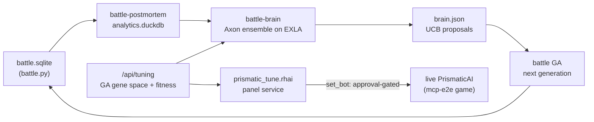

# Battle brain and live tuner

**RESEARCH-ONLY.** Self-improvement in two loops, both fed from the LAN battle's recorded data:

1. **Between rounds (the brain):** a learned model of the battle proposes the next settings to try.
   It is an ensemble of small neural networks (Axon) compiled by EXLA (Nx's XLA backend). They are
   trained on every recorded PrismaticAI result: the settings it ran with, mapped to its log value
   share of the winner. The model scores tens of thousands of candidates from the genetic
   algorithm's own gene space in one batched call. It proposes the best by upper confidence bound,
   UCB = mean + κ · spread of the ensemble. With little data the spread dominates, so the brain
   explores; with more data the mean dominates. The proposals are input for the battle's genetic
   algorithm, which adds them as offspring: evolution guided by a model as well as by mutation.
2. **During a game (the live tuner):** `rhai/prismatic_tune.rhai` keeps the live PrismaticAI on the
   best measured settings. It reads the genetic algorithm's standings (`/api/tuning`), takes the best
   variant with enough matches, and changes each knob that differs, one at a time. Every change goes
   through `openttd.ai.set_setting`, approval-gated like every MCP change.

Neither loop changes a default or a contestant by itself. The brain's proposals become contestants
only when the battle's owner (the genetic algorithm, ADR 0036) takes them. The tuner's changes wait
for the owner's Approve, or for auto-approve when the owner switches it on.



## Run

```bash
tools/research/battle-brain/brain                # once: writes ~/ttd-battle/results/brain.json
tools/research/battle-brain/brain --every 900    # the background loop (every 15 min)
```

And on the panel's Scripts page, start `prismatic_tune` as a service, or:

```bash
curl -X POST 127.0.0.1:8800/api/services/start -H 'content-type: application/json' \
  -H 'origin: http://127.0.0.1:8800' -d '{"name":"prismatic_tune"}'
```

The brain needs the duckdb CLI, the battle API on `:8765`, and Elixir with Nx, EXLA, Axon, Polaris
and Jason compiled. By default it uses the prismatic-platform checkout's `_build/dev/lib` with its
Elixir 1.19 / Erlang 28 (`$BRAIN_LIBS`, `ASDF_*_VERSION`), so XLA is not downloaded again.

## The brain in detail (`tools/research/battle-brain/brain.exs`)

| Step | What |
|---|---|
| Data | `analyses JOIN contestants` from the post-mortem's `analytics.duckdb`: every PrismaticAI non-winner match result with its settings and its value share of the winner |
| Features | each gene of the GA's space scaled to [0, 1]; a gene the setting does not name takes the midpoint and a 0 "named" flag, so the net can tell a default from a value |
| Target | log of the value share of the winner |
| Model | 5 members, each 2 × 32 tanh with dropout 0.1, trained by Adam (lr 0.01, 400 steps) on its own bootstrap sample |
| Search | 50,000 random candidates on the GA's grid (min, max, step per gene), scored in one batched EXLA call per member |
| Pick | 8 proposals, alternating `safe` (best lower confidence bound, mean − κ·spread) and `explore` (best upper confidence bound, mean + κ·spread), κ = 1, each with its kind, predicted share and spread |

`brain.json` (schema `battle-brain/v1`) records the data it had (`rows`, `distinct_settings`) and the
in-sample R² of the ensemble mean, which is a sanity figure and not a validation. `enough_data` is
false while there are fewer distinct settings than twice the number of genes. Until then the
proposals are exploration, and the record says so.

The first run, on 2026-11-19, had 364 rows but only 8 distinct settings for 17 genes, with an
in-sample R² of 0.19. It trained 5 nets in 15 s and scored 50,000 candidates in 208 ms on EXLA (CPU).
Its proposals are exploration, by design. Each GA generation adds distinct settings, and the
surrogate improves with them.

Tooling language: the repository's rule `project.tooling-language-preference` asks for Rust tools.
The owner asked for EXLA and Axon by name, and both are Elixir libraries, so the learned part is a
single Elixir script behind a thin runner. Its input and output are files (CSV in, JSON out), and
nothing else in the repository depends on Elixir.

### Why a safe pick comes first

Until 2026-11-19 the brain proposed by UCB only, so both of the GA's brain offspring were
explorers. In edition `508356ae`, `GA g10.brain0` finished last in 1 of 6 matches. In match m-0039
its fleet collapsed from 25 to 6 vehicles (`fleet_decays`, `low_yield`, `idle_stations`). Its
settings sat far from the data: `rail_double=1`, which the battle owner had measured as a loss,
`own_lines=22`, and `air_add_waiting=90`, which means almost no planes. Now the first proposal is
the best by lower confidence bound, where the ensemble agrees, and the second is the explorer.
The GA takes the first two, so each generation gets one of each. The GA's last-place penalty
culls an explorer that ends last.

## The live tuner in detail (`tools/research/mcp-panel/rhai/prismatic_tune.rhai`)

- Every `ROUND_S` (300 s) it calls `loopback_get("http://127.0.0.1:8765/api/tuning")` and picks the
  variant with the highest fitness score among those with at least `MIN_MATCHES` (4) matches.
- It compares that variant's settings with `api_bots().running` for `COMPANY` (0), only for genes in
  the GA's space and settings the bot has.
- For each difference it calls `ttd::set_bot` (`openttd.ai.set_setting`) and says the change in chat.
- Its constants can be edited while it runs, and the service reloads within a second.

First run on 2026-11-19: from `PrismaticAI GA g0.1` (score 0.618 over 6 matches) it submitted
`aggressiveness 50 -> 80`, `air_planes 2 -> 1`, `cash_reserve 20000 -> 10000` and
`line_budget 80000 -> 70000`. They showed as pending decisions 1 to 4 in the panel, waiting for the
owner.

## Related

[Battle post-mortem](battle-postmortem.md), [LAN AI battle](ai-battle/README.md), ADR 0036 (the
genetic algorithm), [Rhai scripting](mechanisms/rhai-scripting.md), [Live arena](live-arena.md).
