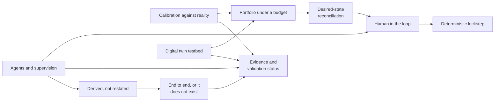

# Concepts: what the fork demonstrates

This fork is a testbed for AI agents that make and carry out decisions under human oversight. The
pages here describe the ideas it demonstrates. Each idea is shown in the game with links to the
code that implements it, then described outside the game, with its limits. The parts that
implement the ideas are described in [`../mechanisms/`](../mechanisms/).

## Why a game

A decision-making agent is hard to test on a real business. Results take months or years, a wrong
decision costs real money, and there is no second copy of the market to run a control arm in.
OpenTTD offers a substitute with useful properties:

- **Real economic structure.** Towns, industries, cargo, payment by distance and transit time,
  construction and running costs, loans and competitors. Good and bad decisions lead to different
  outcomes.
- **A record of outcomes.** The game reports what each vehicle and company earned, so a prediction
  can be compared with a result.
- **Repeatable runs.** Multiplayer is deterministic lockstep: the same commands give the same
  state. A run can be held at a known start and repeated on the same map.
- **A single, narrow way to change things.** Every change is a command. An agent's actions can be
  gated, recorded and checked in one place.
- **Nothing was built for agents.** The codebase and its rules are upstream's. An agent's tooling
  has to fit them, not the other way round (README section 0.2.2).

The fork's owner works on a decision-support and investigation platform (Prismatic, README
section 0.2). The game is its validation target. What transfers is the method, not the economics.

## The concepts

Read the arrows as "relies on" or "feeds": the testbed produces portfolios, the steward turns
choices into targets, targets pass the owner's gate, and the gate's actions are ordinary
commands. Evidence rules apply to every measurement and check.

| Concept | In one line | Page |
|---|---|---|
| Human in the loop | An agent proposes; the owner approves the exact arguments before anything changes. | [human-in-the-loop.md](human-in-the-loop.md) |
| Deterministic lockstep | One ordered command stream gives identical state everywhere and a replayable record. | [deterministic-lockstep.md](deterministic-lockstep.md) |
| Derived, not restated | Every published surface is generated from its source, and drift fails a check. | [derived-not-restated.md](derived-not-restated.md) |
| Evidence and validation status | PASS, FAIL, PARTIAL, NOT RUN, NOT APPLICABLE; an unrun check is never a pass. | [evidence-and-validation-status.md](evidence-and-validation-status.md) |
| Desired-state reconciliation | The steward sets each rail line's target; the bot moves the line to it. | [desired-state-reconciliation.md](desired-state-reconciliation.md) |
| Portfolio under a budget | Choose the set of investments with the highest total gain that fits the money. | [portfolio-under-a-budget.md](portfolio-under-a-budget.md) |
| Calibration against reality | Compare the planner's predictions with what lines earned, and correct the model. | [calibration-against-reality.md](calibration-against-reality.md) |
| End to end, or it does not exist | Every web page is driven in a real browser against a live game, or it counts as not built. | [end-to-end-or-it-does-not-exist.md](end-to-end-or-it-does-not-exist.md) |
| Digital twin testbed | A simulated economy for testing agents; duels as controlled experiments. | [digital-twin-testbed.md](digital-twin-testbed.md) |
| Agents and supervision | Many agent sessions working under written rules, claims, handovers and one board. | [agents-and-supervision.md](agents-and-supervision.md) |

## Shape of a page

Each page has the same sections: a definition, **In the game** (where the fork implements it, with
links), **In the real world** (where the idea matters, and what the game lets you test that is
hard to test for real), **A picture** (one diagram), **Limits** (what the game does not capture)
and **Related**.
