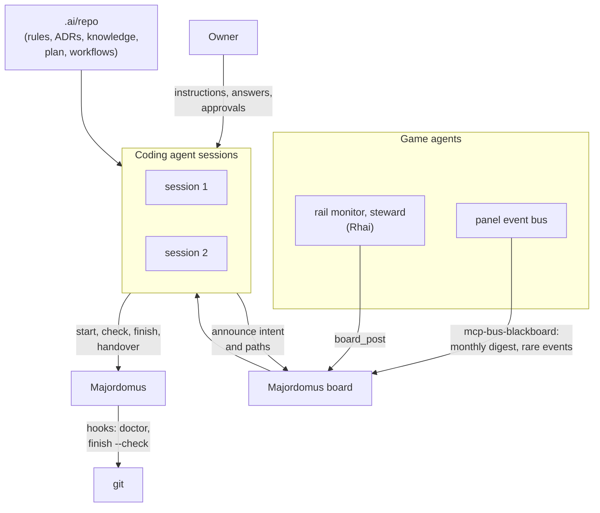

# Agents and supervision

Several agents work on the same thing at the same time. A supervisory layer gives them shared,
written rules, a way to say what each is doing, a record of what was decided, and a handover when
one stops and another continues. The layer does not do the work. It makes the work visible,
bounded and checkable, and it leaves the decisions that matter to a person.

## In the game

Two kinds of agents are supervised here: the coding agents that change the fork, and the game
agents (bots and Rhai scripts) that play it.

**The coding agents.** Majordomus supervises the repository
([mechanism: Majordomus supervision](../mechanisms/majordomus-supervision.md); ADR
[0010](../../.ai/repo/adrs/0010-majordomus-supervises-this-fork-and-the-ai-layer-is-its-trac.md)).
Its layer is the [`.ai/`](../../.ai/README.md) directory:

- **Shared and local are separate.** `.ai/repo/` is tracked and shared by every checkout: policy,
  profiles, rules, ADRs, curated knowledge, the plan (milestones, issues, intents) and workflows.
  `.ai/local/` is one checkout's state and is never published or read as policy
  ([`.ai/README.md`](../../.ai/README.md)).
- **Rules are written down and some are blocking.** For example
  [`never-report-unrun-validation-as-pass.v1.md`](../../.ai/repo/rules/project/never-report-unrun-validation-as-pass.v1.md),
  [`game-state-mutates-only-through-commands.v1.md`](../../.ai/repo/rules/project/game-state-mutates-only-through-commands.v1.md)
  and
  [`no-commit-without-current-instruction.v1.md`](../../.ai/repo/rules/project/no-commit-without-current-instruction.v1.md):
  commit, push or rewrite history only on an explicit, current instruction from the owner.
- **A task claims its scope.** The lifecycle in
  [`task-lifecycle.md`](../../.ai/repo/workflows/task-lifecycle.md) is `start` with the paths the
  task may touch, `check` before claiming progress, and `finish` with an outcome and a verify
  command. `check` and `finish` fail on a touched file outside the claimed scope. The outcomes
  include `partial`, `blocked`, `no_match` and `failed`, each with a note on what comes next.
- **Handovers.** A session that stops with work left writes a handover with the required
  sections: objective, current state, next action
  ([`continuity.md`](../../.ai/repo/workflows/continuity.md)).
- **The board.** Each session announces its intent and the paths it expects to touch, so others
  can avoid them. The pre-commit hook runs `majordomus doctor` and the pre-push hook runs
  `majordomus finish --check` (ADR 0010).
- **Owner answers are recorded.** When an agent asks the owner a question, the answer is written
  into the repository with the question. Examples are in
  [`auto-approve-is-the-owners-switch.md`](../../.ai/repo/knowledge/curated/auto-approve-is-the-owners-switch.md)
  and in [`research/mcp-control.md`](../mcp-control.md), "Who starts duels".

**The game agents report to the same board.**

- [`mcp-bus-blackboard`](../../tools/research/mcp-rhai/src/bin/mcp-bus-blackboard.rs) subscribes
  to each control panel's event bus and posts a digest to the Majordomus board: one line per
  instance per game month, plus rare events (company founded or removed, a new world, decisions,
  `plan.*`). It is off by default and only subscribes to the panels
  ([mechanism: event bus and store](../mechanisms/event-bus-and-store.md)).
- Rhai scripts post with `board_post(claim, text)`, the Rhai side of
  [`board.rs`](../../tools/research/mcp-rhai/src/board.rs)
  ([mechanism: Rhai scripting](../mechanisms/rhai-scripting.md)). The rail monitor posts problems
  as `openttd:<instance>:rail` and the steward posts its decisions as
  `openttd:<instance>:steward` ([`research/rail-steward.md`](../rail-steward.md);
  [mechanism: rail steward and monitor](../mechanisms/rail-steward-and-monitor.md)).
- A coding session that reads the board therefore sees the running games, without subscribing to
  ZeroMQ.

## In the real world

- **Teams with many automated workers.** Several agents (or people) change one codebase or one
  set of systems. Without a claim on what each is touching, two of them edit the same thing.
  Without handovers, the next one starts from nothing.
- **Operations centres.** Monitors post status to one shared board; responders claim incidents;
  a shift handover says what is open and what to do next.
- **Investigations.** Several analysts and tools work one case. The case file holds the rules of
  engagement, the decisions taken and by whom, and what each source contributed.
- **Governance of agents.** Rules written in the repository, enforced by hooks, and the same for
  every vendor's agent, are auditable in a way that instructions in a chat are not.

What the game lets you test:

- whether agents honour claims and scopes when the work is fast and the checkout is shared;
- whether game agents' reports on the board are useful to coding agents (does a session notice
  that a line is lost and fix the cause);
- how a supervisory layer behaves under failure: a session that leaves, a history rewrite, a
  commit that touches more than its scope.

## A picture

## Limits

- Supervision makes collisions visible; it does not prevent every one. The curated notes record
  cases:
  [`a-peer-commit-rides-every-push-of-a-shared-checkout.md`](../../.ai/repo/knowledge/curated/a-peer-commit-rides-every-push-of-a-shared-checkout.md),
  [`a-task-scope-must-cover-every-path-its-commit-touches.md`](../../.ai/repo/knowledge/curated/a-task-scope-must-cover-every-path-its-commit-touches.md),
  [`a-history-rewrite-strands-the-active-task.md`](../../.ai/repo/knowledge/curated/a-history-rewrite-strands-the-active-task.md).
- Whether shared state improves coordination has not been measured. README section 0.9 records
  that sessions share the board and keeps the question open: shared state can spread a wrong
  assumption as easily as a right one.
- The owner is one person. The layer has no roles, no separation of duties and no review by a
  second person, except where an agent asks for an independent review.
- The board digest is a summary. A session that reads only the board can miss what the digest
  leaves out (the console, the AI log, news).

## Related

- [Human in the loop](human-in-the-loop.md): the owner's approval, for game actions.
- [Evidence and validation status](evidence-and-validation-status.md): `finish` needs a verify
  command.
- [Derived, not restated](derived-not-restated.md): the `.ai/` layer is a source for the published
  surfaces.
- [Desired-state reconciliation](desired-state-reconciliation.md): the steward and the monitor that
  post to the board.
