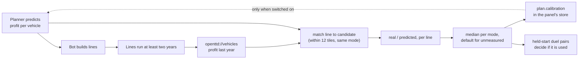

# Calibration against reality

A model that predicts outcomes should be compared with the outcomes it predicted. The ratio of
what happened to what was predicted is a correction factor. Fed back into the model, it makes the
next prediction start from what was observed. Deciding whether the corrected model is actually
better is a separate question that needs its own measurement.

## In the game

The planner ([Portfolio under a budget](portfolio-under-a-budget.md),
[mechanism: planner and AlgoGlyph](../mechanisms/planner-and-algoglyph.md)) predicts each
candidate line's monthly profit from the game's payment formula, vehicle speeds and some
assumptions (load factor, the share of supply a pair of stations catches). The game reports what
each vehicle really earned last year.

[`tools/research/mcp-rhai/src/calibrate.rs`](../../tools/research/mcp-rhai/src/calibrate.rs)
compares the two:

- A running line is a pair of stations that vehicles shuttle between (`openttd://vehicles`, two
  station orders).
- Only vehicles at least two years old count (`MIN_AGE_DAYS` = 730), so a line's first months do
  not read as a failure.
- A line is matched to the planner's candidate whose ends lie within 12 tiles of both stations
  (`REACH_TILES`), in a mode its vehicles can serve. A line nothing matches is listed with the
  reason.
- Per mode, the factor is the median of real over predicted profit per vehicle per month. A mode
  nobody measured gets `default`, the median over every line. Without it, an unmeasured mode kept
  factor 1 and won every comparison (comment in `factors`).

A reading is stored, not written to a file: `POST /api/calibration` publishes it as a
`plan.calibration` event into the panel's store, and later plans read the stored readings back by
query ([mechanism: event bus and store](../mechanisms/event-bus-and-store.md); ADR
[0034](../../.ai/repo/adrs/0034-planning-decisions-read-recorded-history-and-emit-structured.md)).
[`research/mcp-control.md`](../mcp-control.md), "What the lines really earn, fed back into the
plan", gives the routes and the bot's `PRISMATIC_PLAN_CALIBRATION` setting.

**What was found.** The curated note
[`the-planner-overpredicts-what-a-line-earns.md`](../../.ai/repo/knowledge/curated/the-planner-overpredicts-what-a-line-earns.md)
records the first reading (2026-11-17, one game, one AI company, 17 years). Real over predicted:
freight rail median 0.5, passenger rail 0.2, bus 0.11. Four train lines matched no candidate.
Every line ran a single vehicle, so the sample is small. The note says so.

**Whether it helps.** Calibration is off by default. The same note records the A/B runs:

- the first A/B ran with a defect (the factor scaled income alone, not net profit), found by an
  independent review, so its result says nothing about a correct calibration;
- after the fix, two seeds run side by side gave opposite signs, inside the noise of the rival bot;
- with the held start on three seeds the difference averaged about zero.

The note's conclusion is to collect more readings (games with several vehicles per line) before
another A/B. The rule
[`a-tuning-claim-needs-held-start-pairs.v1.md`](../../.ai/repo/rules/project/a-tuning-claim-needs-held-start-pairs.v1.md)
keeps calibration from becoming the default on less evidence.

## In the real world

- **Forecast review.** A capital project was approved on a forecast return. Years later, the
  actual return is compared with it. Systematic optimism in past forecasts is a reason to discount
  the next ones.
- **Deal models in M&A.** Projected synergies are compared with realised synergies after
  integration. A buyer that never looks back keeps paying for synergies it does not get.
- **Risk models.** Predicted default rates are compared with observed defaults, by segment. A
  segment with no observations should not be treated as the safest one, which is the same trap as
  the unmeasured mode above.
- **Agents that estimate.** An agent's estimates (effort, cost, probability) can be recorded and
  scored against outcomes, so its later estimates are weighted by its record.

What the game lets you test:

- the whole loop in weeks instead of years: predict, build, wait for a year of results, compare;
- how many observations a correction needs before it helps rather than adds noise;
- traps such as unmeasured categories or a factor applied to the wrong quantity, which in the game
  are found by a test and a review rather than by a loss.

## A picture

## Limits

- The sample is small: one game, single-vehicle lines, a handful of matches. The fork's own
  records say this is too little to steer the plan.
- Matching by distance can attach a line to the wrong candidate.
- The game's economy is stable and fully specified. Real outcomes depend on things a model cannot
  see, and the past may not predict the future.
- One correction factor per mode cannot fix a model whose error depends on distance, cargo or
  load.

## Related

- [Portfolio under a budget](portfolio-under-a-budget.md): what the corrected estimates feed.
- [Evidence and validation status](evidence-and-validation-status.md): why an A/B on one pair is
  inconclusive.
- [Digital twin testbed](digital-twin-testbed.md): duels as the test of whether a correction helps.
