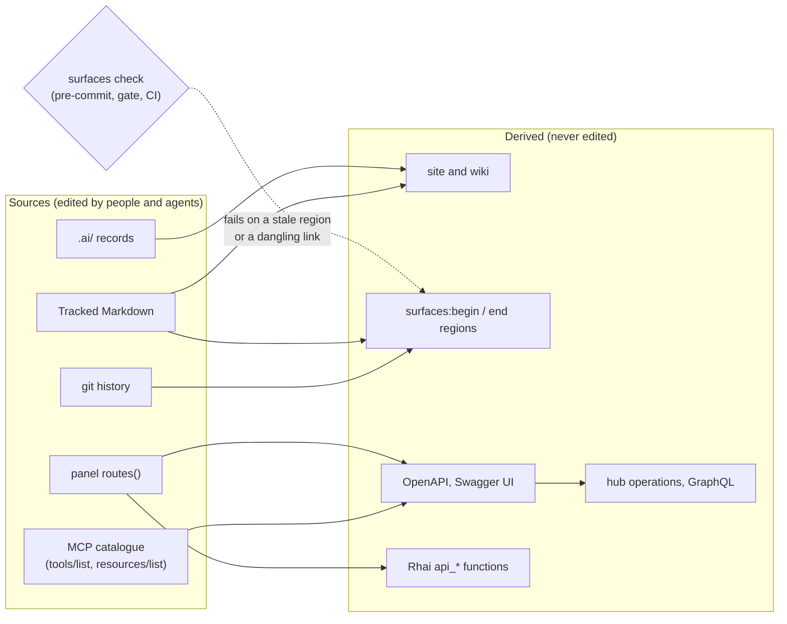

# Derived, not restated

A fact has one source. Every other place that shows the fact is generated from that source, and
a check fails when a generated copy is out of date. Nobody keeps a second copy in step by hand,
because a hand-kept copy is wrong as soon as the source changes.

## In the game

The fork applies this to two kinds of surface.

**Documentation** ([mechanism: published surfaces](../mechanisms/published-surfaces.md)):

- [`tools/surfaces/README.md`](../../tools/surfaces/README.md), section "Why", gives the
  reasoning: a hand-kept index misses the newest document, a status table says "planned" after the
  work merged, and each copy is a second source of truth.
- The site, the wiki and the tables between `surfaces:begin` and `surfaces:end` markers are built
  from tracked Markdown, git and the `.ai/` layer. `tools/surfaces/surfaces sync` regenerates the
  regions; `tools/surfaces/surfaces check` fails on a stale region or a relative link to nothing.
- The rule
  [`published-surfaces-are-derived.v1.md`](../../.ai/repo/rules/project/published-surfaces-are-derived.v1.md)
  makes the check blocking in three places: the pre-commit hook, `tools/gate.sh change`, and the
  workflow `.github/workflows/surfaces.yml`. It records the case that led to it: the earlier landing
  page called the repository private while GitHub reported it public (ADR
  [0012](../../.ai/repo/adrs/0012-every-published-surface-is-derived-from-tracked-markdown-git.md)).
- The README's "Getting started" region is generated by
  [`tools/research/generate_prismatic_docs.py`](../../tools/research/generate_prismatic_docs.py)
  from `research/prismatic-mcp/contributor-catalog.json`.

**The MCP integration** ([mechanism: control panel](../mechanisms/control-panel.md),
[mechanism: hub](../mechanisms/hub.md), [mechanism: Rhai scripting](../mechanisms/rhai-scripting.md)):

- The rule
  [`mcp-surfaces-are-derived.v1.md`](../../.ai/repo/rules/project/mcp-surfaces-are-derived.v1.md)
  requires that REST routes, OpenAPI operations, Swagger UI, Rhai functions, event kinds and the
  bot's settings form come from one declaration: the game's live `tools/list` and
  `resources/list`, the panel's route table, the console's command list and each AI's declared
  settings.
- The panel's routes are declared once in `routes()` in
  [`tools/research/mcp-rhai/src/panel.rs`](../../tools/research/mcp-rhai/src/panel.rs). The same
  row gives the HTTP route, the OpenAPI operation and the Rhai `api_*` function.
- The hub builds its operations from each panel's `/openapi.json` and each MCP server's lists, and
  its own OpenAPI and GraphQL schema from its method table
  ([`research/mcp-hub.md`](../mcp-hub.md)).
- The list of web pages that must have a browser check is read from the shell's registry
  (`APPS` in [`tools/research/mcp-panel/static/shell.js`](../../tools/research/mcp-panel/static/shell.js)),
  not from a second list ([End to end, or it does not exist](end-to-end-or-it-does-not-exist.md)).

The rule's rationale is short: a hand-written list goes stale the first time the game adds a tool,
and a stale surface claims a capability the game does not have.

## In the real world

- **API documentation** generated from the API definition, so the documented endpoints are the
  ones that exist.
- **Compliance reports** generated from the system of record. A control status typed into a
  spreadsheet drifts; a status computed from the evidence does not.
- **Due diligence files.** A summary of a company's filings is generated from the filings with a
  reference to each, so a reader can check any line against its source.
- **Configuration.** Infrastructure described once, with every environment generated from it,
  instead of each environment edited by hand.

What the game lets you test: whether agents keep a derived surface honest when they add things
quickly. The fork adds tools, routes and pages often, by several agent sessions, and the checks
show whether the derivation holds under that pace.

## A picture

## Limits

- Derivation only moves the problem to the source. If the source is wrong, every surface is
  wrong in the same way.
- Prose that explains a design (this page, for example) cannot be generated. It can only link to
  its sources and be checked for dangling links.
- The check sees structure: stale regions, broken links, missing pages. It does not check that a
  sentence is true.

## Related

- [Evidence and validation status](evidence-and-validation-status.md): a status is derived from
  what ran.
- [End to end, or it does not exist](end-to-end-or-it-does-not-exist.md): the page list is
  derived from the shell.
- [Agents and supervision](agents-and-supervision.md): the `.ai/` layer is the source many
  surfaces read.
