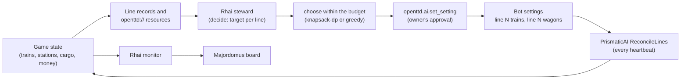

# Desired-state reconciliation

One component decides what should be true. Another compares that with what is true and takes the
steps that close the gap, again and again. The decider never acts on the world directly; it only
writes targets. The reconciler never decides; it only moves reality toward the target, and keeps
doing so when something drifts.

## In the game

The rail lines of the owner's bot work this way
([`research/rail-steward.md`](../rail-steward.md), "The steward: each line as desired state";
[mechanism: rail steward and monitor](../mechanisms/rail-steward-and-monitor.md)).

**The observed state.** Every rail line of the bot logs one record when it is built and again
every game month: slot, stations, cargo, platforms, length, depot, `trains_max`, `wagons_fit` and
state. The steward joins these records with `openttd://vehicles`, `openttd://stations` and
`openttd://engines`, and reads waiting cargo through the Script API in test mode, which changes
nothing (`rail_lib.rhai`).

**The decider.** The Rhai steward
[`rail_steward.rhai`](../../tools/research/mcp-panel/rhai/rail_steward.rhai), with the logic in
[`rail_lib.rhai`](../../tools/research/mcp-panel/rhai/rail_lib.rhai) (`target`, thresholds in
`policy()`), decides per line:

- close a line that lost money last year and again this year, once its oldest train is old enough
  to judge;
- lengthen the trains while a trainload or more waits and the platform has room;
- add a train once the trains are full length, up to `trains_max`;
- shrink by one train when almost nothing waits and the newest train lost money.

What costs money is chosen within a budget ([Portfolio under a budget](portfolio-under-a-budget.md)).

**The target.** Each decision becomes a setting of the bot: `line<slot>_trains` (0 closes the
line) and `line<slot>_wagons`. It is set with `openttd.ai.set_setting`, so it waits for the
owner's approval unless the owner switched auto-approve on
([Human in the loop](human-in-the-loop.md)).

**The reconciler.** The bot, PrismaticAI
([mechanism: PrismaticAI](../mechanisms/prismatic-ai.md)), calls `ReconcileLines` in
[`lines.nut`](../../tools/research/prismatic-ai/PrismaticAI/lines.nut) on every heartbeat
(from [`main.nut`](../../tools/research/prismatic-ai/PrismaticAI/main.nut)):

- a train with a different wagon count is sent to the depot, resized there and started again;
- a missing train is cloned with shared orders;
- a surplus train is sold;
- a closing line sells its trains, then demolishes its track, stations and depot.

A target is capped by what the line can hold (`wagons_fit`). The rail-steward page records a run
where a target above that cap was capped and caused no resizing loop.

**A separate observer.** The Rhai monitor
[`rail_monitor.rhai`](../../tools/research/mcp-panel/rhai/rail_monitor.rhai) does not decide or
act. It reports what is wrong (crashed, lost, unserved, warnings, broken down, stopped, old) to the
Majordomus board ([Agents and supervision](agents-and-supervision.md)).

`STEWARD_DRY=1` makes the steward decide and print without handing anything over.

## In the real world

- **Kubernetes controllers.** A deployment declares the number of replicas. A controller watches
  the running pods and creates or deletes pods until the count matches. The person edits the
  declaration, not the pods.
- **Fleet management.** A planner sets how many vehicles serve each route. Depots add, move or
  retire vehicles to match, and keep matching as vehicles break down.
- **Configuration management.** A desired configuration is declared, and agents on each machine
  correct drift.
- **Portfolio rebalancing.** A target allocation is set; trades move holdings back to it when
  prices move them away.

The split matters for agents with oversight. The person approves a target, which is short and
readable ("line 2: two trains"), not a stream of low-level actions. The reconciler's steps follow
from the target and can be checked against it.

What the game lets you test:

- whether the reconciler converges, or oscillates when the target is out of reach;
- what happens when the decider and the reconciler disagree on facts (the bot's own sell rule
  still runs next to the steward's close rule);
- how stale observations affect decisions, at no cost when a decision is wrong.

## A picture

## Limits

- The bot keeps its lines in memory. An AI restart forgets them, and only the records in the event
  store remain (rail-steward page, "Limits").
- The steward judges a line by its past profit per unit of capacity. A new line earns nothing in
  that measure, so it is lengthened only after a year.
- The loop runs at the pace of game time and the steward's round. Real controllers face partial
  failures, network partitions and concurrent writers that this single-company setup does not have.
- One decider and one reconciler. There is no conflict between several controllers writing the
  same target.

## Related

- [Portfolio under a budget](portfolio-under-a-budget.md): how the steward chooses what to pay for.
- [Human in the loop](human-in-the-loop.md): targets wait for the owner.
- [Calibration against reality](calibration-against-reality.md): the steward's gain is a line's
  own record, not a prediction.
- [Agents and supervision](agents-and-supervision.md): the monitor posts to the board.
