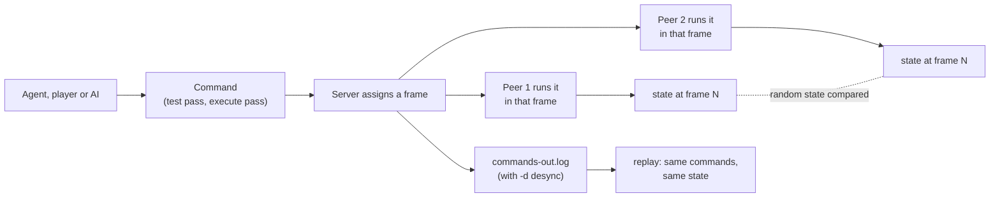

# Deterministic lockstep

Every participant starts from the same state and applies the same ordered list of commands. If
each step is deterministic, every participant ends in the same state, so only the commands need
to be shared, not the state. The list of commands is then a complete record: replay it and you get
the same result.

## In the game

This is upstream OpenTTD's design, not the fork's. The fork records it and builds on it.

- **Only commands change the game.** All persistent state changes go through registered commands
  (`src/command.cpp`, `src/command_type.h`, the `Cmd...` handlers in the `*_cmd.cpp` files). A
  command runs a test pass with no side effects, then an execute pass
  ([`CLAUDE.md`](../../CLAUDE.md), "The command system is the core invariant").
- **Only commands cross the wire.** A joining client receives a savegame. After that the server
  assigns each command a frame and sends it to every client, and each runs it in the same frame
  and order (ADR
  [0016](../../.ai/repo/adrs/0016-multiplayer-is-deterministic-lockstep-every-peer-runs-the-sa.md),
  citing `src/network/network_command.cpp` and [`docs/desync.md`](../../docs/desync.md)).
- **Divergence is detected.** The server samples the game's random state and clients compare it.
  The curated note
  [`the-desync-check-compares-only-the-game-random-state.md`](../../.ai/repo/knowledge/curated/the-desync-check-compares-only-the-game-random-state.md)
  states what that check does not see.
- **The fork's rule.** Research code, the MCP server and the bridge never write game state
  directly. They issue existing commands through `Command<>::Post`, on the main thread
  ([`game-state-mutates-only-through-commands.v1.md`](../../.ai/repo/rules/project/game-state-mutates-only-through-commands.v1.md)).
  This is why an approved MCP decision is an ordinary command
  ([mechanism: MCP server in the engine](../mechanisms/mcp-server-in-the-engine.md),
  [mechanism: approval gate](../mechanisms/approval-gate.md)).
- **Measured, once.** [`tools/research/determinism-ab`](../../tools/research/determinism-ab) runs
  one map seed three times on a headless server: idle, an idle control, and a run with constant
  read-only MCP reads. It compares the engine's per-day `sync:` lines and the `cmd:` lines of
  `commands-out.log`. The recorded result
  ([`research/prismatic-mcp/determinism-ab.md`](../prismatic-mcp/determinism-ab.md)) is PASS:
  16 shared game days, all matching, no commands issued. The page also states that this is a
  per-day comparison, not per tick.
- **Revisions must match.** A client whose code differs from the server's would desync, so the
  server refuses a different revision.
  [`research/net-compat.md`](../net-compat.md) describes a research-only, local-only override for
  the fork's own loopback games; it never changes the revision a build reports.

Upstream's [`docs/desync.md`](../../docs/desync.md) also describes replaying a recorded
`commands-out.log` to find where a desync started.

## In the real world

- **Event sourcing.** A system stores the events that changed it, not only the current state.
  The current state is a replay of the events. Bugs can be reproduced, and a past state can be
  rebuilt for an audit.
- **Replayable audit logs.** In a regulated process, the question "how did we get here" is
  answered by the ordered list of decisions and their inputs. If replaying that list does not give
  the same result, the log is not a complete record.
- **Replicated state machines.** Databases and consensus systems keep replicas in step by applying
  one agreed log in the same order.
- **Agent actions.** If every action an agent takes is a command in one log, an investigator can
  replay a session and see what each action did. An agent with a side channel breaks that.

What the game lets you test:

- whether an agent's tooling really stays on the command path. A read that changes nothing should
  leave the random state and the command stream unchanged, and `determinism-ab` checks exactly that;
- what a single side-channel write does: it shows up as a desync, which is loud and cheap to see.

## A picture

## Limits

- The desync check compares only the game's random state. A divergence that does not change a
  random draw goes unnoticed until it does.
- The `determinism-ab` result covers one seed, 16 game days, read-only MCP traffic, one build. It
  says nothing about mutations or other builds.
- The game is a closed world with one clock. Real systems have external inputs (prices, messages,
  people) that a replay must record as events too, or it will not reproduce.
- Lockstep requires the same code on every peer. Real systems change code over time, and a replay
  under new code may give a different result.

## Related

- [Human in the loop](human-in-the-loop.md): approved changes are ordinary commands.
- [Evidence and validation status](evidence-and-validation-status.md): how the determinism result
  is reported.
- [Digital twin testbed](digital-twin-testbed.md): repeatable runs depend on this property.
