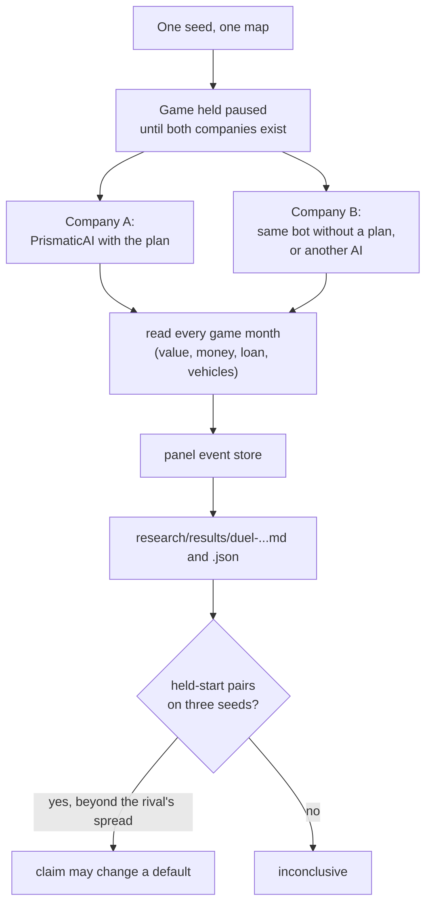

# Digital twin testbed

A simulated world in which an agent can make the same kind of decisions it would make for real,
with consequences that are measured but cost nothing. The world must be rich enough that good and
bad decisions lead to different outcomes, and repeatable enough that two runs can be compared.
"Digital twin" is used loosely here: the game is not a copy of any real system, it is a stand-in
with real economic structure.

## In the game

The twin can be a real place, not only a generated map. The
[real-world scenario](../mechanisms/real-world-scenario.md) turns a place name such as Brno into a
heightmap, towns and industries from OpenStreetMap and Copernicus GLO-30, and labels every entity
with how it is known. An agent then plans on a real geography, and a reader can tell which parts of
the map are observed and which are game stand-ins.

OpenTTD simulates an economy: towns that grow and produce passengers, industries that produce and
accept cargo, payment that depends on distance and transit time, construction and running costs,
loans, inflation and competing companies. The fork reads all of it through the MCP server's
resources (`openttd://towns`, `openttd://stations`, `openttd://vehicles`, `openttd://engines`,
`openttd://economy/prices` and others;
[mechanism: MCP server in the engine](../mechanisms/mcp-server-in-the-engine.md)) and acts only
through game commands ([Deterministic lockstep](deterministic-lockstep.md)).

**Duels are the controlled experiment**
([mechanism: duels](../mechanisms/duels.md)).
[`tools/research/mcp-duel`](../../tools/research/mcp-duel) runs one game on one map with two
companies competing for the same towns and industries:

- company A is the owner's bot, PrismaticAI, started from the planner's portfolio
  ([mechanism: PrismaticAI](../mechanisms/prismatic-ai.md),
  [Portfolio under a budget](portfolio-under-a-budget.md));
- company B is the same bot without a plan, or another installed AI (`--opponent`);
- both are read every game month, and after N months the higher company value wins;
- `--bot-settings` gives the planned bot extra settings, so a feature gets an A/B without a code
  change;
- by default the game is held paused until both companies exist (`PRISMATIC_START_PAUSED=2`), so
  two runs of one seed start from the same state.

Each duel writes a record to [`research/results/`](../results/): a Markdown page and a JSON file
with the plan, the months and both bots' logs, read from the panel's event store
([mechanism: event bus and store](../mechanisms/event-bus-and-store.md)). The earlier
[`tools/research/mcp-ab`](../../tools/research/mcp-ab) ran two separate games from one seed
instead. The panel's `/results` page lists and charts every duel
([`research/mcp-control.md`](../mcp-control.md), "Duels on a click").

**Noise was measured, not assumed.** The knowledge note
[`duels-run-side-by-side-are-noisy.md`](../../.ai/repo/knowledge/curated/duels-run-side-by-side-are-noisy.md)
records that without the held start, two runs of one bot on one seed ended 10% apart, and the same
rival 52% apart between two arms. With the held start, `research/mcp-control.md` records two
identical runs differing by 0.2%. The rule
[`a-tuning-claim-needs-held-start-pairs.v1.md`](../../.ai/repo/rules/project/a-tuning-claim-needs-held-start-pairs.v1.md)
turns that into a procedure: paired runs, held start, three seeds.

**Several worlds at once.** `tools/research/mcp-e2e --instances N` starts a cluster, and the hub
reaches every instance through one surface ([mechanism: hub](../mechanisms/hub.md),
[`research/mcp-hub.md`](../mcp-hub.md)).

**Plugging in real data** is planned, not done. README section 0.10 lists world seeding from real
elevation data as experimental, with the data pipeline not built, and Prismatic's decision
contract as partial ([`research/prismatic-bridge/ARCHITECTURE.md`](../prismatic-bridge/ARCHITECTURE.md)).

## In the real world

Testing a decision-making agent on a real business is slow, expensive and hard to repeat: a year
of results takes a year, a bad decision loses real money, and there is no second copy of the
market to run the control arm in. A simulation answers different questions:

- **Does the agent's loop work end to end?** Observe, decide, get approval, act, observe the
  effect. Failures of plumbing show up in minutes.
- **Is the agent better than a simple rule?** The unplanned bot is the baseline; the planned bot
  must beat it on the same map.
- **How noisy is the measurement?** Two runs of the same agent show the spread, before anyone
  claims an improvement.
- **What does the agent do in situations that are rare for real?** Bankruptcy of a rival, a line
  that loses money for two years, a budget that does not cover the best option.

For the Prismatic platform's domain (due diligence, investment decisions), the game offers the
same structure in miniature: limited capital, uncertain returns, competitors, and a record of what
each decision earned.

## A picture

## Limits

- The game is not the world. Its economy is stable, fully specified and has no fraud, no
  regulation, no information asymmetry and no people with motives.
- A game result transfers as a statement about the agent's method (does it observe, decide and
  check correctly), not about any real market.
- Duels take wall-clock minutes per game month, so only a few seeds are run. Most records in
  `research/results/` are 36-month duels on seeds 31337, 20208 and 4242; a few run 120 months, and
  one long duel ran about twenty game years.
- Opponents are other bots. A human competitor would behave differently.
- The real-data integrations listed above are not built yet.

## Related

- [Deterministic lockstep](deterministic-lockstep.md): why a run can be repeated.
- [Evidence and validation status](evidence-and-validation-status.md): how a duel result is
  reported.
- [Calibration against reality](calibration-against-reality.md): the game's outcomes correct the
  planner.
- [Portfolio under a budget](portfolio-under-a-budget.md): what the planned bot plays.
