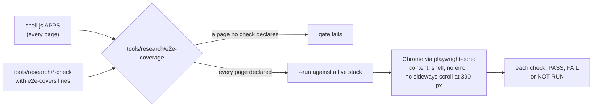

# End to end, or it does not exist

A feature counts as built only when a test has used it the way a person would, through the real
interface, against the real running system. Unit tests prove that the parts work. They do not
prove that the page shows them, that the button calls them, or that the pieces are connected.

## In the game

The fork's web UI is the control panel and the hub
([mechanism: control panel](../mechanisms/control-panel.md), [mechanism: hub](../mechanisms/hub.md)).
The rule
[`web-ui-is-covered-end-to-end.v1.md`](../../.ai/repo/rules/project/web-ui-is-covered-end-to-end.v1.md)
is blocking. It quotes the owner's order of 2026-11-18 and requires:

- **Pages are derived.** The pages are every page of every app in the one shell's registry,
  `APPS` in
  [`tools/research/mcp-panel/static/shell.js`](../../tools/research/mcp-panel/static/shell.js).
  A new page is covered by the rule the moment it joins the registry.
- **A check drives a real browser.** It launches the installed Chrome through `playwright-core`
  against a running stack and proves, for each page: the page answers, its own content renders,
  it sits in the shell with its sidebar entry current, it throws no page error, and it does not
  scroll sideways at 390 px. A flow the page offers (save, run, start, a form) is driven through
  its controls.
- **Coverage is declared where it is proven**, as a comment line in the check:
  `// e2e-covers: panel /scripts, hub /viz`.
- **Enforced.** [`tools/research/e2e-coverage`](../../tools/research/e2e-coverage) fails on a
  shell page no check declares, on a declaration in a file that drives no browser, and on a
  declared page the shell does not have. `tools/gate.sh change` runs it
  ([mechanism: validation gate](../mechanisms/validation-gate.md)).
- **Run, not only declared.** `e2e-coverage --run --panel <url> [--hub <url>]` runs every
  declaring check against a live stack. A check that needs the hub and gets no `--hub` is NOT RUN,
  and says so.

The browser checks today are
[`mcp-overview-check`](../../tools/research/mcp-overview-check),
[`mcp-pages-check`](../../tools/research/mcp-pages-check),
[`mcp-scripts-check`](../../tools/research/mcp-scripts-check),
[`mcp-hub-page-check`](../../tools/research/mcp-hub-page-check) and
[`mcp-viz-check`](../../tools/research/mcp-viz-check). Other `tools/research/mcp-*-check`
scripts check the API side against a live stack. For example `mcp-route-check` reads the panel's
own `/openapi.json` and calls every read-only operation in it
([`research/mcp-control.md`](../mcp-control.md), "Every route works").

The rule records why it exists: on the day it was written, the first run of `mcp-pages-check`
found the Interface page showing empty cards with no explanation on a game without a GUI client.
Every unit test had passed.

## In the real world

- **Web applications.** A form whose submit handler is unit-tested can still fail because the
  button is hidden on a phone, or the route is missing in production.
- **Integrations.** Two services, each tested on its own, can disagree on a field name. Only a
  call from one to the other finds it.
- **Agent tooling.** An agent that writes a feature and its unit tests can be fully green while
  the feature is unreachable. Requiring a browser run against a live system is a check the agent
  cannot satisfy by writing more unit tests.
- **Controls in regulated work.** "The control exists" is weaker evidence than "the control was
  operated and produced this record".

What the game lets you test: whether derived coverage keeps up when several agent sessions add
pages quickly. Because the page list comes from the shell, a page cannot be added without the gate
noticing that no check drives it.

## A picture

## Limits

- The gate checks declarations. Running the checks needs a live stack, so a change can pass the
  gate without a fresh browser run; the rule then requires the report to name the runs, and an
  unrun check is NOT RUN.
- Exposure is not exercise. The knowledge note
  [`mcp-exercise-coverage-is-two-percent.md`](../../.ai/repo/knowledge/curated/mcp-exercise-coverage-is-two-percent.md)
  records (2026-11-17) that every command, console command and Script API function is routed, but
  only a small share of tools and resources had ever been called on the measured servers.
- A check proves what it asserts. A page can render, sit in the shell and throw no error while
  still showing wrong numbers.
- The rule covers the pages of the panel and the hub. The game's own windows are not in the
  shell's page list, so this rule does not cover them.

## Related

- [Evidence and validation status](evidence-and-validation-status.md): an unrun check is NOT RUN.
- [Derived, not restated](derived-not-restated.md): the page list and the routes are derived.
- [Agents and supervision](agents-and-supervision.md): the rule is part of the `.ai/` layer every
  session reads.
