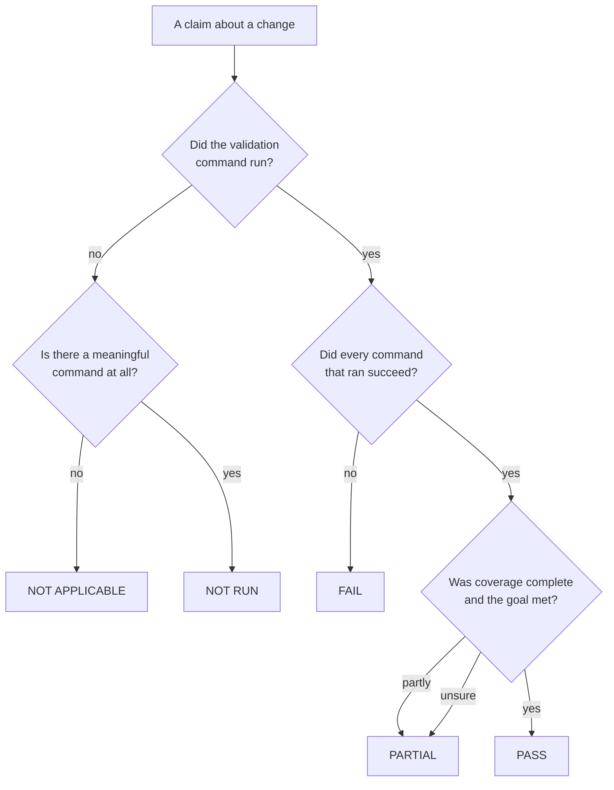

# Evidence and validation status

A claim about a change or an experiment carries the command that supports it and that command's
result. The result has one of five names, and the naming is fail-closed: when in doubt, the
weaker name applies. A check that did not run is reported as not run, never as passed.

## In the game

The same discipline applies to data, not only to validation. The
[real-world scenario](../mechanisms/real-world-scenario.md) labels every game entity it makes from a
real place OBSERVED, DERIVED, INFERRED or HYPOTHETICAL, with its evidence, rule and confidence, and
refuses an ambiguous place rather than guess. The validation statuses below say what ran; those
classes say what is known.

**The taxonomy** is defined in [`research/README.md`](../README.md), "Recording an experiment":

| Status | Meaning |
|---|---|
| PASS | every validation command that ran succeeded, and the stated goal was met |
| FAIL | a required command failed, or the goal was not met |
| PARTIAL | some validation ran and passed, but coverage was incomplete or the goal only partly met |
| NOT RUN | validation was not executed |
| NOT APPLICABLE | the change has no meaningful validation command |

**The rule**
[`never-report-unrun-validation-as-pass.v1.md`](../../.ai/repo/rules/project/never-report-unrun-validation-as-pass.v1.md)
is blocking: name the tier and its exit status, never present a debug or instrumented result as
release behaviour, and withdraw a claim that has no command behind it.

**The gate** ([mechanism: validation gate](../mechanisms/validation-gate.md)) follows the same
taxonomy in its exit codes. [`tools/gate.sh`](../../tools/gate.sh) has the tiers `smoke`,
`change`, `research` and `full`. When the regression cases cannot run because no base graphics set
is found, the tier reports them as NOT RUN and exits 3 (PARTIAL), not 0
([`research/baseset-prerequisite-macos.md`](../baseset-prerequisite-macos.md)).

**In the engine.** Each MCP decision ends with a verdict that keeps "the command ran" apart from
"the effect was observed": `VERIFIED_SUCCESS`, `VERIFIED_FAILURE` or `EXECUTED_UNVERIFIED`
(`src/prismatic_mcp/prismatic_mcp_server.cpp`; see [Human in the loop](human-in-the-loop.md)).

**For measurements of the bot.** The advisory rule
[`a-tuning-claim-needs-held-start-pairs.v1.md`](../../.ai/repo/rules/project/a-tuning-claim-needs-held-start-pairs.v1.md)
says a default of the bot or the planner changes on a measurement only when paired duels, started
from a held game, on three seeds favour it beyond the rival's spread. It exists because of a
recorded mistake: a +10.4% result for one setting turned out to be noise, and a re-measure with
the held start gave -1.0%
([`research/results/duel-20261117T234725-seed31337.md`](../results/duel-20261117T234725-seed31337.md),
knowledge
[`duels-run-side-by-side-are-noisy.md`](../../.ai/repo/knowledge/curated/duels-run-side-by-side-are-noisy.md)).
A result short of that is reported as inconclusive. See also
[mechanism: duels](../mechanisms/duels.md).

**Examples of honest status in the fork's own records:**

- [`research/prismatic-mcp/determinism-ab.md`](../prismatic-mcp/determinism-ab.md) reports PASS
  and states that the comparison is per game day, not per tick.
- [`research/rail-steward.md`](../rail-steward.md), "What was checked", reports one 12-month duel
  and says that it is one run and that the A/B against the previous geometry is still to run.
- The knowledge note
  [`the-planner-overpredicts-what-a-line-earns.md`](../../.ai/repo/knowledge/curated/the-planner-overpredicts-what-a-line-earns.md)
  records that an early A/B of calibration ran with a defect found by an independent review, and
  that its result therefore says nothing about a correct calibration.

## In the real world

- **Audit and assurance.** An auditor's working papers record what was tested, on what sample,
  and with what result. "Not tested" is a valid and necessary entry.
- **Release engineering.** A release note that says "tests pass" when the integration suite was
  skipped is the failure this taxonomy prevents.
- **Investigation reports.** A finding is labelled by how it is known: observed in a source,
  derived from observed facts, or inferred. A reader can then weigh it.
- **Agent reports.** An agent summarising its own work tends to round up. A fixed vocabulary and
  a rule that every claim names its command make the rounding visible.

What the game lets you test: whether an agent reports what it ran when the honest answer is
inconvenient. In this fork a full build and test run is long and a duel takes wall-clock minutes
per game month, so there is a real temptation to skip and claim.

## A picture

## Limits

- The taxonomy depends on the reporter knowing what "complete coverage" means for the change. A
  wrong idea of coverage still produces a confident PASS.
- The held-start rule is advisory and enforced by review, not by a tool: no gate runs a duel.
- A game measurement is a measurement of the game. A result on three seeds says little about a
  fourth map, and nothing about the real world.

## Related

- [Calibration against reality](calibration-against-reality.md): the measurement that this rule
  most often applies to.
- [End to end, or it does not exist](end-to-end-or-it-does-not-exist.md): a page counts only when
  a check ran against it.
- [Digital twin testbed](digital-twin-testbed.md): duels as experiments with a stated result.
- [Derived, not restated](derived-not-restated.md): status is derived from what ran.
