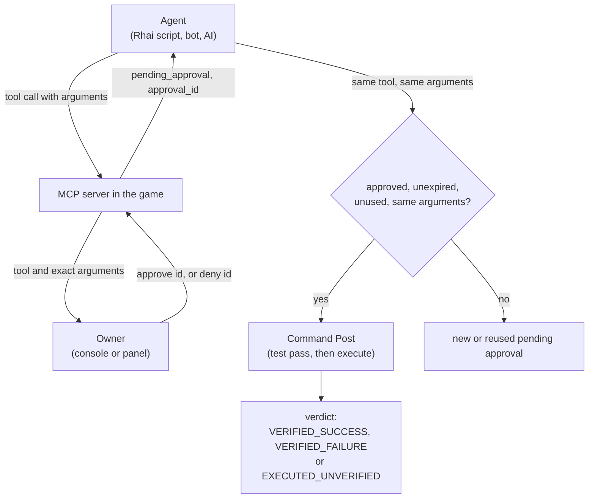

# Human in the loop

An agent may propose a change, but a person decides whether it happens. The person does not
approve an intention or a summary. They approve one call with its exact arguments, and only that
call runs. If the agent changes any argument after the approval, the approval no longer applies
and a new one is needed.

## In the game

The fork's MCP server runs inside the game process and is compiled only in a research build
([mechanism: MCP server in the engine](../mechanisms/mcp-server-in-the-engine.md)). Every tool
that would change the game goes through a two-phase approval
([mechanism: approval gate](../mechanisms/approval-gate.md)):

1. **The agent submits.** A gated tool such as `openttd.game.set_pause`, an `openttd.cmd.<Name>`
   tool or `openttd.ai.set_setting` does not run. It answers `pending_approval` with an
   `approval_id`.
2. **The approval binds to the exact arguments.** The server stores the tool and its serialized
   arguments (`canonical_args` in
   [`src/prismatic_mcp/prismatic_mcp_server.cpp`](../../src/prismatic_mcp/prismatic_mcp_server.cpp)
   and [`src/prismatic_mcp/prismatic_mcp.h`](../../src/prismatic_mcp/prismatic_mcp.h)). The pure
   classifier `ClassifySubmit` in
   [`src/prismatic_mcp/prismatic_mcp_detail.h`](../../src/prismatic_mcp/prismatic_mcp_detail.h)
   executes a submission only when an approved, unexpired, unconsumed approval holds the same
   arguments. An approval is used once (state `Consumed`), and it expires after a fixed number of
   ticks (`APPROVAL_TTL_TICKS`).
3. **The owner approves.** In the game's `~` console (`prismatic_mcp approve <id>` or
   `deny <id>`), or with the Approve button of the control panel
   ([mechanism: control panel](../mechanisms/control-panel.md)). The header states that there is
   deliberately no bulk approval in this build.
4. **The same call is resubmitted.** The panel keeps each pending call with its arguments and,
   after the approval, sends the identical call again
   (`approve` in [`tools/research/mcp-rhai/src/panel.rs`](../../tools/research/mcp-rhai/src/panel.rs)).
5. **The effect is checked.** Each decision gets a provenance record: decision, approval,
   command, then a verdict. `VERIFIED_FAILURE` means a command failed. `VERIFIED_SUCCESS` means
   it succeeded and, where the tool defines a check, the intended effect was observed in the game
   state. `EXECUTED_UNVERIFIED` means the command ran but the effect was not observed.

The panel also refuses a console line that tries to approve. `is_approval_line` in `panel.rs`
matches it, and the console route answers 403: approvals go only through `POST /api/approve`.

**Auto-approve is the owner's switch.** The panel has an auto-approve mode (`--auto-approve`,
`POST /api/auto-approve`). It is off by default. The curated note
[`auto-approve-is-the-owners-switch.md`](../../.ai/repo/knowledge/curated/auto-approve-is-the-owners-switch.md)
records why: on 2026-11-15 an agent relaunched the stack with the flag on its own inference, the
owner was asked, and the answer was to keep it off. An agent never turns it on, and a script never
approves its own submissions.

The same pattern appears in other places:

- The Rhai rail steward hands each line target to the bot through `openttd.ai.set_setting`, so
  every target waits for approval
  ([`research/rail-steward.md`](../rail-steward.md), step 5).
- The ask relay ([`ask_relay.rhai`](../../tools/research/mcp-panel/rhai/ask_relay.rhai)) carries
  out a sentence typed in the game by sending the planner's settings to the bot. Its header says it
  approves nothing; the answer names the approvals now waiting.
- The person-like player asks a yes/no question in the game's own dialog before it starts and
  before its first loan, and records "no answer" rather than "no" when nobody replies
  ([`research/mcp-human.md`](../mcp-human.md), "Safety").

## In the real world

The same shape protects operations where a wrong action is expensive or hard to undo:

- **Payments.** A payment is prepared by one party and released by another, and a release covers
  one amount to one account. Changing the amount after release must require a new release.
- **Infrastructure changes.** A plan (for example a Terraform plan) is reviewed, and the apply
  must run exactly the reviewed plan, not a recomputed one.
- **Operations runbooks.** An automated responder proposes a restart or a failover. An on-call
  person confirms that one step.
- **Due diligence and investigation**, the Prismatic platform's domain. An agent may gather and
  rank findings, but an action with consequences (contacting a party, filing a report) is the
  analyst's.

What the game lets you test that is hard to test for real:

- whether an agent keeps working sensibly while its proposals wait, are denied or expire;
- whether binding to exact arguments catches an agent that "adjusts" a call after approval;
- how much an operator approves without reading when approvals come quickly, at no real cost.

## A picture

## Limits

- The owner here is one person who knows the system. Real approval chains have several roles,
  separation of duties and people who do not know the context.
- Approvals cost nothing in the game. A person may approve more carefully when real money is at
  stake, or less carefully when approvals are frequent. The game does not measure either.
- The gate binds to arguments, not to the game state the owner saw. If the state changes between
  the approval and the resubmission, within the approval's lifetime, the same call still runs.
- When auto-approve is on, the gate still records every decision, but nobody looks at it before
  it runs.
- There is a recorded exception. The Prismatic bridge's decision path sets settings through the
  fork's `bot set` and approves its own request, on the owner's answers of 2026-11-17
  ([`research/prismatic-bridge/ARCHITECTURE.md`](../prismatic-bridge/ARCHITECTURE.md)). Where
  the owner delegates approval, the gate records the decision but no longer holds it.

## Related

- [Deterministic lockstep](deterministic-lockstep.md): the approved command runs through the same
  command path as every other change.
- [Evidence and validation status](evidence-and-validation-status.md): the verdict separates
  "ran" from "observed".
- [Desired-state reconciliation](desired-state-reconciliation.md): the steward's targets pass
  through this gate.
- [Agents and supervision](agents-and-supervision.md): a similar rule holds for the coding agents
  working on the fork (no commit or push without the owner's current instruction).
