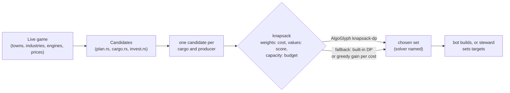

# Portfolio under a budget

There are more good options than money. Each option has a cost and an expected gain, and the task
is to pick the set with the highest total gain whose total cost fits the budget. Picking the best
options one by one is not the same thing: two cheaper options can beat one expensive one. This is
the 0/1 knapsack problem.

## In the game

The fork solves it in two places, with the same solver
([mechanism: planner and AlgoGlyph](../mechanisms/planner-and-algoglyph.md)).

**What to build (the planner).**

- The planner in [`tools/research/mcp-rhai/src/plan.rs`](../../tools/research/mcp-rhai/src/plan.rs)
  derives candidate routes from the running game: town pairs with their passenger supply, and (in
  `cargo.rs`) freight pairs with each cargo's production and payment rate, using the vehicles the
  game offers now. Each candidate gets a score: income minus running costs over a payback period,
  minus the cost of building it. Construction costs follow the game's current prices
  (`plan::with_prices`).
- `portfolio` in [`tools/research/mcp-rhai/src/cargo.rs`](../../tools/research/mcp-rhai/src/cargo.rs)
  turns the candidates into a knapsack: weights are investments in thousands, values are scores,
  capacity is the budget. It counts a producer's cargo once: only the best candidate of each
  cargo and producer enters, and the others are listed as `shadowed`.
- [`tools/research/mcp-rhai/src/invest.rs`](../../tools/research/mcp-rhai/src/invest.rs) hands the
  same facts to AlgoGlyph's `transport-investment` kernel, which can also consider two-leg routes
  through a hub. Its routes then go through the same portfolio knapsack.
- [`research/mcp-control.md`](../mcp-control.md), "Planner v4", describes the result on the
  panel's World page. The duel record
  [`research/results/duel-20261118T063729-seed4242.md`](../results/duel-20261118T063729-seed4242.md)
  shows one such line: "planner portfolio by algoglyph knapsack-dp: 4 investment(s), total score
  715672.0, 296k of 300k".

**What to pay for next (the rail steward).**

- `choose` in [`rail_lib.rhai`](../../tools/research/mcp-panel/rhai/rail_lib.rhai) takes the
  steward's targets. Closing and shrinking are always chosen, because they free money. The rest
  goes into a knapsack over the money above the bot's `cash_reserve`: cost is what the game asks
  now for the wagons or the train, gain is the line's own profit per unit of capacity times the
  capacity added.

**The solver.** AlgoGlyph is a separate algorithms project, reached through its flow CLI.
[`hub_algoglyph.rs`](../../tools/research/mcp-rhai/src/hub_algoglyph.rs) makes its kernels hub
methods (`algoglyph.kernels`, `algoglyph.kernel`, `algoglyph.track_plan`), and Rhai scripts call
a kernel with `kernel(id, input)` (registered in
[`tools/research/mcp-rhai/src/main.rs`](../../tools/research/mcp-rhai/src/main.rs)). Both callers
have a fallback, and both say which solver ran:

- the planner runs a built-in dynamic programme, pinned by a unit test to AlgoGlyph's answer on a
  known case (`mcp-control.md`);
- the steward falls back to greedy gain per cost, and its answer names `greedy gain per cost`.

## In the real world

- **Capital allocation.** A firm has more proposed projects than its capital budget. Each has a
  cost and an estimated return; the board picks a set.
- **M&A pipelines.** A buyer with limited capital and limited diligence capacity chooses which
  targets to pursue. Two targets can share a synergy or compete for the same market, which a plain
  knapsack does not capture (the planner's "count a producer once" is a simple case of this).
- **Maintenance and capacity planning.** Which assets to repair or expand this year, given a
  fixed maintenance budget.

The knapsack itself is solved. The hard part is the inputs: the cost estimates and, above all, the
gain estimates. A solver that picks perfectly on optimistic estimates picks the most optimistic
projects.

What the game lets you test:

- the whole chain from estimate to outcome. The game reports what each line really earned, so a
  portfolio's prediction can be compared with its result
  ([Calibration against reality](calibration-against-reality.md));
- a portfolio against a simpler rule (the unplanned bot) on the same map
  ([Digital twin testbed](digital-twin-testbed.md)).

## A picture

## Limits

- The score is a model. The fork's own calibration found that the planner predicts more profit per
  vehicle than running lines earn
  ([`the-planner-overpredicts-what-a-line-earns.md`](../../.ai/repo/knowledge/curated/the-planner-overpredicts-what-a-line-earns.md)).
- The knapsack is one period. It does not plan a sequence of investments, reinvest profits, or
  weigh risk.
- Options are treated as independent, except for the one de-duplication rule. Real projects
  interact.
- The steward's gain is past earnings per capacity, so a line with no profit yet gets no money.

## Related

- [Calibration against reality](calibration-against-reality.md): how good the gain estimates are.
- [Desired-state reconciliation](desired-state-reconciliation.md): the steward's choice becomes
  targets.
- [Digital twin testbed](digital-twin-testbed.md): a planned portfolio against an unplanned bot.
- [Evidence and validation status](evidence-and-validation-status.md): how a planner change is
  judged.
