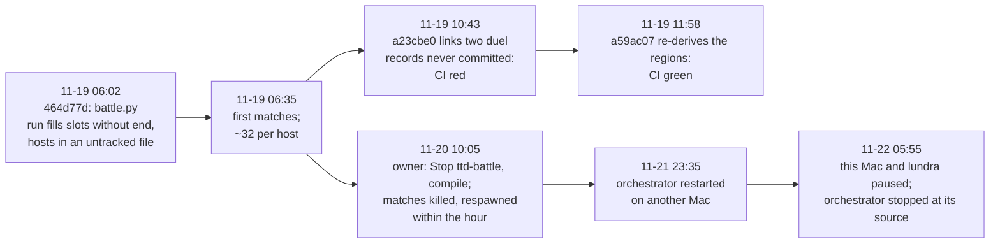

# Incident 2026-11-19 to 11-22: an unowned AI battle held three machines, and master's CI broke twice

**Post-mortem.** Two failures overlapped. For three days the AI battle tournament held this Mac
and the Linux build host at their limits, and nobody on either machine could tell whose processes
they were. In the same window, two derived regions on master linked records that were never
committed, so master's Surfaces CI was red until a re-sync. Neither failure was in the game. Both
came from research tooling that trusted its own machine. The fixes are guards that work on every
machine, and tests that fail without them.

## What happened

| When (CET) | Fact | Evidence |
|---|---|---|
| 11-19 06:02 | `battle.py` arrives with SSH discovery, an untracked hosts file and a `run` that never stops on its own. | 464d77d959 |
| 11-19 06:35 | First battle record. Each arena host runs as many matches as its `slots` (~32 on this Mac). | research/results/battle-20261119T053541-* |
| 11-19 10:43 | a23cbe0 regenerates the README scoreboard, the facts table and the research index with duel-20261119T103653/103654-seed4242. Neither record was ever committed. Every master commit fails Surfaces CI with 5 findings. | Surfaces run 44509695809 |
| 11-19 11:58 | a59ac07 re-derives the regions from what master tracks. CI is green. | Surfaces run 44511709093 |
| 11-20 10:05 | The owner answers "Stop ttd-battle, compile". 32 matches are killed. By 11:54 the run is back at 32. | 11eb50bb40, research/prismatic-mcp/owner-answers-event-bus.md |
| 11-20 to 11-22 | 51 more AI-battle commits land, 31 of them records. Nine new editions are prepared. | git log --grep AIBattle |
| 11-21 23:35 | The orchestrator, on another Mac (192.168.100.110), starts again. | PID 14474, up 6 h 37 min at 11-22 06:00 |
| 11-22 05:50 | This Mac and lundra are paused: the battle binary is no longer executable, so the probe reports `no-binary`. 7 matches on lundra are stopped. | ~/ttd-battle/PAUSED.txt on each host |
| 11-22 05:58 | The owner runs a stop script. `battle.py run` gets SIGTERM, and 27 matches on its own host stop. | the script's output |

The cost: load 60 to 86 on 18 cores, swap 35 of 37 GB, and free disk under the 35 GiB floor. Three
mcp-duel stacks broke when their planner failed under the load. A prismatic-platform push and the
builds of several sessions waited behind it. Five OpenTTD sessions on this Mac each said the run was
not theirs, and all five were right.

## Why it happened

1. **Nothing in `battle.py` looked at the machine.** Slots were fixed numbers in an untracked file.
   There was no check of load, memory, swap or disk anywhere, by design: ADR 0035 says machine load
   cannot change a match's result. That is true of the result, but it says nothing about the other
   work on the machine.
2. **No owner was visible on the targets.** Matches were started `nohup sh -c ... &` over SSH and
   reparented to launchd. No claim, lock or owner file named the orchestrator. Only its persistent
   SSH control connection pointed at its address.
3. **Killing a match was self-defeating.** A killed match writes an exit code, its slot frees, and
   the next scheduling pass refills it 30 s later. The only stop was SIGTERM on the orchestrator's
   own machine.
4. **The owner's order had no path to the run.** It was written as Markdown on this Mac. Nothing
   in the battle tooling reads it, and the sessions that ran the battle were on another machine.
5. **The CI breaks came from another clone.** a23cbe0 and 7f27b71 were committed on a tree that
   already had d0081f8 (index-only surfaces inside a hook). No hook carrying that check can pass
   a23cbe0, so the committing clone's hook did not run it. Hooks are per clone and are not
   versioned. A second generator, `readme-scoreboard`, read `research/results` from the disk, so
   even a working hook passed a scoreboard that linked unadded records. `battle.py check` and
   `tools/knowledge/refs.py` had the same flaw.

## What changed

| Guard | Where | Proof |
|---|---|---|
| A `PAUSED` file on an arena host takes it out of the tournament, and a `STOP` file next to the orchestrator stops all scheduling | `tools/research/ai-battle/battle.py` | `tools/research/test_ai_battle.py` |
| Before scheduling, each host's load per core and free disk are read. Over the ceiling or under the floor (35 GiB), the host is `busy` and gets no new match | `battle.py`, `battle.json` | `test_ai_battle.py` |
| Every arena host carries an `ORCHESTRATOR` file naming the orchestrator's host, pid, commit and how to stop it, and every match names its orchestrator in its environment | `battle.py` | `test_ai_battle.py` |
| `readme-scoreboard` counts only the index inside a git hook, so a scoreboard naming an unadded record fails the commit | `tools/research/readme-scoreboard` | `tools/research/test_readme_scoreboard_index.py` |
| The battle leaderboard and `battle.py check` read records the same way | `battle.py` | `test_ai_battle.py` |
| `refs check` resolves a citation only against the index inside a hook | `tools/knowledge/refs.py` | `tools/knowledge/test_refs.py` |
| The town-authority model derives only from source files the index holds inside a hook | `tools/research/town-model/derive.py` | `tools/research/test_town_model_index.py` |
| Master moves only to a commit whose Surfaces "Check and build" passed, admins included | GitHub branch protection, set by the owner 2026-11-22 | `gh api repos/korczis/OpenTTD/branches/master/protection` |
| A long-running job must be owned, bounded and stoppable | rule `project.long-runs-are-owned-bounded-and-stoppable` | review |

Each new test fails against the code before the fix.

## What is still open

- **Mesh-visible jobs in Majordomus.** A long-running process that is neither a build nor a session
  is invisible to every coordination layer. The generic fix belongs in Majordomus: a job record with
  machine, pid, budget, heartbeat and stop handle; one machine guard that jobs consult; and owner stop
  orders as typed records. The prismatic-majordomus landing seat accepted it as one owner-ordered
  issue on 2026-11-22. Its id is pending, because the issue allocator was unavailable.
- **The paused arenas.** This Mac and lundra stay out of the tournament until someone makes their
  battle binary executable again (`chmod +x ~/ttd-battle/openttd-src/build/openttd`). The reason
  is written in `~/ttd-battle/PAUSED.txt` on each machine. With the guards in place, a host comes
  back `busy` while it is over its floors.
- **Not run for these fixes:** `tools/gate.sh change`. Its full C++ build and ctest would have
  loaded a machine that was already over its floors (load 25 on 18 cores, 27 GiB free), and no
  C++ changed. The Python tests and the checks named above were run.

The orchestrator's own checkout, on the other Mac, was fast-forwarded to 28f104e on 2026-11-22, so
its next run carries the guards.
