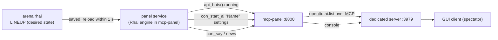

# Live arena

**RESEARCH-ONLY.** The live arena is the visible counterpart of the [LAN AI battle](ai-battle/README.md).
It has the same contestants as the battle: PrismaticAI from this repository, its `solo-max`
variant, and four AIs from BaNaNaS. They play one game that you watch in an OpenTTD window and in
the control panel. A Rhai service, [`arena.rhai`](../tools/research/mcp-panel/rhai/arena.rhai),
holds the lineup as desired state. Editing the file changes the running game within seconds,
without a restart. Nothing under `src/` changes.

The battle and the arena answer different questions:

| | LAN AI battle | Live arena |
|---|---|---|
| Question | which AI ranks higher on fixed match parameters | what the AIs actually do, watched as it happens |
| Where | every LAN arena, null video driver, headless | this machine: `mcp-e2e` stack with a GUI spectator |
| Time | ticks: a match ends the same way under any load | wall clock: the game runs at normal speed |
| Result | derived, gate-checked records (`research/results/battle-*`) | none: the arena makes no ranking claim |
| Changes while running | none within an edition | the lineup, live, by editing `arena.rhai` |

The arena's standings are a view, not evidence. A claim about which AI is better rests on a
battle record, never on the arena.

## Running it

```bash
tools/gate.sh research                     # once: build-gate-research/openttd with the MCP server
tools/research/prismatic-ai/install        # PrismaticAI -> ~/Documents/OpenTTD/ai (symlink)
cp ~/ttd-battle/content/content_download/ai/*.tar ~/Documents/OpenTTD/ai/            # battle.py fetch
cp ~/ttd-battle/content/content_download/ai/library/*.tar ~/Documents/OpenTTD/ai/library/
tools/research/mcp-e2e --no-browser        # server, MCP, PrismaticAI, panel :8800, GUI spectator
curl -s -X POST 127.0.0.1:8800/api/services/start -H 'content-type: application/json' \
  -d '{"name":"arena"}'                    # or Start on http://127.0.0.1:8800/scripts/arena
```

`mcp-e2e` builds the panel with cargo. If your `~/.cargo/config.toml` sets `-C lto` in a target's
`rustflags`, cargo's build scripts fail with "options `-C embed-bitcode=no` and `-C lto` are
incompatible". Running with `RUSTFLAGS="-C target-cpu=native"` replaces the config's flags for that
build and leaves the file unchanged.

Watch these during a run:

- the GUI client window: the game itself, with the arena's chat lines (`[arena] ...`) and a
  newspaper when the leader changes;
- `http://127.0.0.1:8800/`: the panel, with companies, charts and events;
- `http://127.0.0.1:8800/scripts/arena`: the script, its service state and its log;
- `http://127.0.0.1:8800/battle`: the headless battle inside the panel. It shows arenas, the
  leaderboard (PrismaticAI in blue, last place marked, unplayed contestants never "last"), the
  genetic algorithm with the brain's offspring marked, live matches and the event feed. It reads
  battle.py's own API (`/api/stream`, with `/api/state` as the fallback, CORS open) and edits nothing.
  `http://127.0.0.1:8765/` stays as the standalone fallback.
- `http://127.0.0.1:8800/play`: the game itself in the browser ([play-in-browser.md](play-in-browser.md)).

## How it works



Every 20 s (`ROUND_S`), the service:

1. reads the AI companies that run now from `api_bots().running`. The game itself names each
   company's AI there (`openttd.ai.list`), so the mapping never depends on start order;
2. compares them with `LINEUP` per AI name. Two entries with the same AI mean two companies. The
   service starts the first entry that is short, one per round, with `start_ai "<name>"
   <settings>`. The name goes in double quotes for an AI whose name has a space;
3. every sixth round, it ranks the companies by company value and says the ranking in chat, each
   AI with its company name, so the PrismaticAI variants can be told apart. When the leader changes,
   it shows a newspaper;
4. in the same report, it says the headless battle's top three by points in one line
   (`LAN battle <edition>: AI points/played, ...`). It reads them from `battle.py run`'s
   `http://127.0.0.1:8765/api/leaderboard` with the built-in `loopback_get`. That built-in reads JSON
   from a loopback URL only: it refuses another host, a URL with userinfo
   (`http://127.0.0.1:80@elsewhere/`) and redirects. A panel built before `loopback_get` existed
   lacks it. The script then prints `battle: ... Function not found` in its log and plays on. The
   line appears from the next start of the stack, which builds the panel anew.

The script never removes or stops a company. Removing an entry from `LINEUP` only stops it from
being restarted. Starting an AI goes through the server console, as the operator would type it,
and so goes through the command system like every other company action.

## Changing the game live

Edit `LINEUP` in `arena.rhai`, on the Scripts page or in any editor, and save. The panel's watcher
restarts the service within a second (`RELOAD_EVERY`), and the next round starts what is missing.
A save that does not parse leaves the old run going and says why in the log.

On 2026-11-19, the observed run went like this (seed 20261119, `build-gate-research` from master
`7ff3f09d7c`). `mcp-e2e` started PrismaticAI as company 0. The service started AAAHogEx,
LuDiAI AfterFix, CivilAI and AdmiralAI as companies 1 to 4, one per round. Then the
`solo-max` entry was added to the file while the game was running. The log showed
`== reloaded arena`, followed by `lineup of 6 AIs`. Company 5 appeared as PrismaticAI with
`aggressiveness=100, max_routes=30, own_lines=8`, as read back from `api_bots`. During a reload the
old run's end is logged after the new run's first line (`Script terminated`, `== exit 1`). That
does not mean the service stopped: `/api/services` still reported it `running`.

Later in the same game, the `PrismaticAI self-steward` entry was added: solo-max plus
`self_steward=1`, the opt-in in-bot steward from `ba51ba6022`. It started as company 6 with
`self_steward=1`, read back from `api_bots`. The game loads PrismaticAI through the symlink to this
checkout, and each company reads the bot's code when it starts. Companies 0 and 5 therefore still
run the code from before that commit, and only company 6 runs it.

## Limitations and observer effects

- **Company value** comes from the console's `companies` command. Until a company's first quarterly
  valuation it reads 1, so early standings are all 1 and the order is the API's.
- **Wall-clock time.** The game runs in real time next to the battle's arenas on the same machine.
  It slows the local battle matches down, but does not change their outcome (null driver,
  tick-based). Its own course depends on load, so two arena runs are not comparable.
- **The planner.** `mcp-e2e` starts company 0 with the panel's planner (the air pair), unless it gets
  `--no-plan-bot`. The battle's `PrismaticAI` runs without the planner. The arena's company 0 is
  therefore not the battle's contestant. Company 5 (`solo-max`) runs without the planner in both.
- **The AI files** come from the battle's `fetch` cache. They are copies in `~/Documents/OpenTTD/ai/`,
  and the next `fetch` does not update them.

## Files

| Path | What it holds |
|---|---|
| [`tools/research/mcp-panel/rhai/arena.rhai`](../tools/research/mcp-panel/rhai/arena.rhai) | the lineup and the reconciling service |
| [`tools/research/mcp-panel/rhai/ttd.rhai`](../tools/research/mcp-panel/rhai/ttd.rhai) | `start_ai`, `companies`, `state`, `news`, used by the arena |
| [`research/mechanisms/rhai-scripting.md`](mechanisms/rhai-scripting.md) | the engine, derived functions, services and hot reload |
| [`research/ai-battle/README.md`](ai-battle/README.md) | the headless battle with the same contestants |

## Related

- [Desired-state reconciliation](concepts/desired-state-reconciliation.md): `LINEUP` is the desired
  state, and each round reconciles toward it.
- [Rhai scripting](mechanisms/rhai-scripting.md), [Control panel](mechanisms/control-panel.md).
