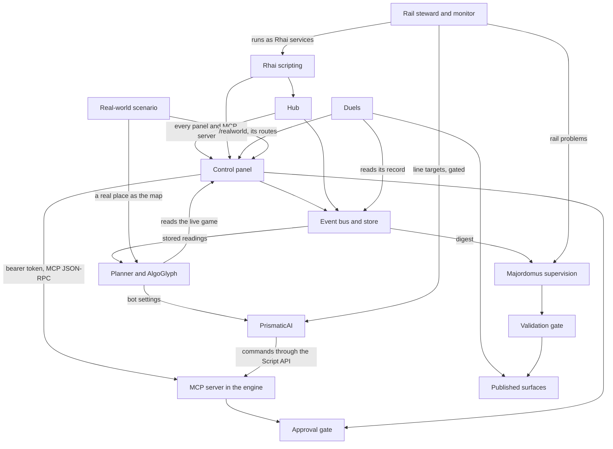

# Mechanisms

The working parts of this research fork, one page each. A mechanism here is something concrete
that runs: a server compiled into the game, a gate a change has to pass, a script that keeps a
railway paying. Each page says what it is, why it exists, how it works (with a diagram), where it
lives in the code, and how it is tested. Most of it is **RESEARCH-ONLY**: the engine parts compile
only with `OPTION_RESEARCH_INSTRUMENTATION=ON` and `OPTION_PRISMATIC_MCP_SERVER=ON`, and the tools
under `tools/research/` are never part of a default or release build. The ideas behind several
mechanisms are explained on their own in [`../concepts/`](../concepts/).

## How they connect

## The pages

| Mechanism | In one line |
|---|---|
| [MCP server in the engine](mcp-server-in-the-engine.md) | A compile-gated loopback MCP server inside the game: live resources, commands and the Script API as tools |
| [Approval gate](approval-gate.md) | Every change waits for the operator, bound to its exact arguments, then runs through the game's command system |
| [Control panel](control-panel.md) | One Rust binary that runs a game and serves its web window and HTTP API, every route declared once |
| [Hub](hub.md) | One WebSocket JSON-RPC surface over every instance, with fleet-wide events and a duplicate-building audit |
| [Event bus and store](event-bus-and-store.md) | Every panel event on a ZeroMQ socket and in a DuckDB file, decisions published as data |
| [Rhai scripting](rhai-scripting.md) | Scripts that drive a game, with functions derived from the live panel, run and hot-reloaded from the Scripts page |
| [Planner and AlgoGlyph](planner-and-algoglyph.md) | Route candidates priced from the game's formulas, a portfolio within a budget, AlgoGlyph kernels for the hard parts |
| [PrismaticAI](prismatic-ai.md) | The owner's company AI, steered by its settings, building rail lines a train can always run |
| [Rail steward and monitor](rail-steward-and-monitor.md) | Rhai services that set each rail line's target and report what is wrong to the board |
| [Duels](duels.md) | The planned bot against an unplanned one on the same map, from a held start, recorded as evidence |
| [Validation gate](validation-gate.md) | Four cost tiers behind `tools/gate.sh`, a fail-closed status vocabulary, every web page driven in a browser |
| [Published surfaces](published-surfaces.md) | Site, wiki and in-document tables generated from the repository, checked on every commit |
| [Majordomus supervision](majordomus-supervision.md) | The `.ai/` layer, scoped tasks, handovers, hooks and the board, as this fork uses them |
| [Real-world scenario](real-world-scenario.md) | A place name becomes a map from OpenStreetMap and Copernicus GLO-30, every entity labelled OBSERVED, DERIVED, INFERRED or HYPOTHETICAL |
