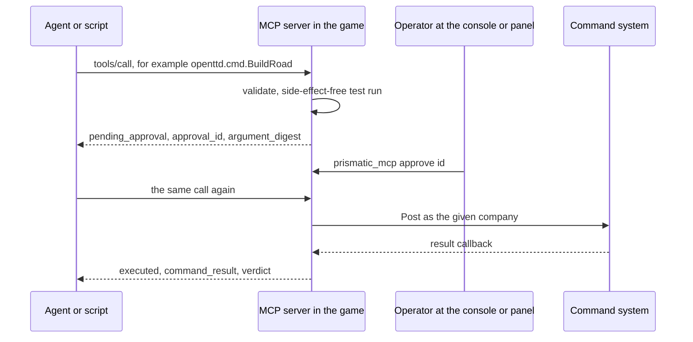

# Approval gate

**RESEARCH-ONLY.** Every change an agent asks the embedded MCP server for waits until the operator
approves it. The request is held as a pending approval bound to its exact arguments. Only after
the operator says yes does it run, and then only through the game's own command system. The
control panel can approve on the owner's behalf, but only when the owner turns on its auto-approve
switch.

## Why it exists

An agent can be wrong, can repeat itself, or can be steered by input it should not trust. A gate
keeps a person between the agent's intent and the game. It also keeps the game a valid substrate:
the change is a registered command, so a network game stays in lockstep. The real-world
counterpart is human-in-the-loop approval in automated trading (an order above a limit waits for a
desk sign-off) and in operations (a change request needs an approver before it is applied).

## How it works

- **Two phases.** A mutation never runs on its first submission. It answers `pending_approval`
  with an `approval_id` and the digest of its arguments.
- **Bound to the arguments.** The approval matches the exact canonical arguments, not only the
  64-bit digest (`detail::ClassifySubmit` in `prismatic_mcp_detail.h`). An approval for
  `pause: true` does not authorize `pause: false`.
- **One use, with a lifetime.** Executing consumes the approval; a replay is pending again.
  Approvals expire after `APPROVAL_TTL_TICKS` and the store holds at most `MAX_APPROVALS`
  (`prismatic_mcp_server.cpp`).
- **Named ids only.** The console takes `prismatic_mcp approve <id> [<id> ...]` and
  `deny <id>|all`. There is no `approve all` (`src/console_cmds.cpp`).
- **Through commands.** `ExecuteAction()` posts the command through the normal deterministic path,
  never a pool write (rule
  [`project.game-state-mutates-only-through-commands`](../../.ai/repo/rules/project/game-state-mutates-only-through-commands.v1.md)).
- **Honest verdict.** The answer separates dispatch from effect: `VERIFIED_SUCCESS`,
  `EXECUTED_UNVERIFIED` (ran, effect not observed, always the case for a Script API call on a
  network server) or `VERIFIED_FAILURE`. `openttd://decisions` keeps the trace.
- **What needs no approval.** Read-only tools, `openttd.decision.validate`, and an
  `openttd.api.*` call without `execute: true`, which runs in `GSTestMode` and changes nothing.

### In the control panel

The panel tracks every tool answer that says `pending_approval` and shows it with an Approve
button (`Game::tool` in `panel.rs`). `POST /api/approve {id}` types the approval into the game's
console and resubmits the same call. `POST /api/auto-approve {on}` is the owner's full-auto
switch: while it is on, a loop approves every pending id once a second. It starts off unless the
owner passes `--auto-approve`. `POST /api/console` refuses any line that would approve, so an agent
that can type console lines still cannot approve through them (`is_approval_line`). The convention
that only the owner turns auto-approve on, never an agent on an inference, is recorded in
[`auto-approve-is-the-owners-switch`](../../.ai/repo/knowledge/curated/auto-approve-is-the-owners-switch.md).

The full contract, with every field, is
[`16-decision-contract.md`](../prismatic-mcp/16-decision-contract.md).

## Where it lives

| File | What it holds |
|---|---|
| [`src/prismatic_mcp/prismatic_mcp_server.cpp`](../../src/prismatic_mcp/prismatic_mcp_server.cpp) | `ValidateAction`, the approval store, `ExecuteAction`, `Conclude`, the trace |
| [`src/prismatic_mcp/prismatic_mcp_detail.h`](../../src/prismatic_mcp/prismatic_mcp_detail.h) | `ACTION_TYPES`, the pure `ClassifySubmit` state machine |
| [`src/console_cmds.cpp`](../../src/console_cmds.cpp) | `prismatic_mcp approvals`, `approve`, `deny`, `decisions` |
| [`tools/research/mcp-rhai/src/panel.rs`](../../tools/research/mcp-rhai/src/panel.rs) | pending list, `/api/approve`, `/api/auto-approve`, the console refusal |
| [`tools/research/mcp-panel/rhai/ttd.rhai`](../../tools/research/mcp-panel/rhai/ttd.rhai) | `ttd::set_pause`, which waits for the approval and never approves itself |

## How it is tested

- Catch2 case "The approval state machine binds to canonical args, executes once, refuses replay
  and changed args" and "ArgDigest is deterministic and argument-binding" in
  [`src/tests/test_prismatic_mcp.cpp`](../../src/tests/test_prismatic_mcp.cpp), run by
  `tools/gate.sh research`.
- `tools/research/mcp-live-check` approves and denies real mutations over HTTP.
- `cargo test` in `tools/research/mcp-rhai` covers `is_approval_line` and that
  `--auto-approve` parses (`panel.rs` tests).
- `tools/research/mcp-carryout-check` checks that a planned change reaches the bot and that
  nothing is applied behind the owner's back.

## Related

- [MCP server in the engine](mcp-server-in-the-engine.md), [Control panel](control-panel.md),
  [Rail steward and monitor](rail-steward-and-monitor.md)
- [Human in the loop](../concepts/human-in-the-loop.md),
  [Deterministic lockstep](../concepts/deterministic-lockstep.md),
  [Agents and supervision](../concepts/agents-and-supervision.md)
