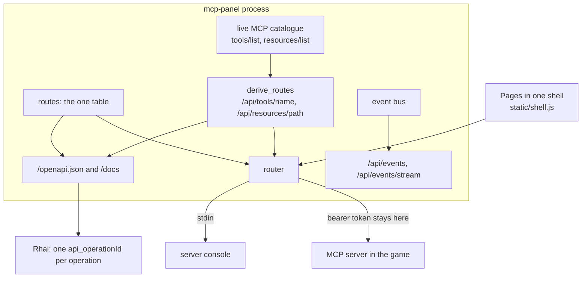

# Control panel

**RESEARCH-ONLY.** One Rust binary, `mcp-panel`, that starts a headless OpenTTD server from an
MCP-enabled build, owns its console, starts its MCP server and a company AI, and serves a local web
window on loopback (by default `http://127.0.0.1:8800/`). The window and its HTTP API are how the
owner, scripts and other programs drive one game. Every route is declared once and the OpenAPI
document, Swagger UI and the Rhai functions are derived from that declaration.

## Why it exists

The MCP server speaks JSON-RPC with a bearer token. A person wants buttons, charts and a console; a
script wants plain REST; neither should hold the token. The panel holds the token in its own
memory, redacts it from the console log it shows, and puts one documented surface in front of the
game. Its real-world counterpart is an operations console in front of a controlled system: one
place to see state, act, and approve.

## How it works

- **One table.** `routes()` in `panel.rs` declares each route: method, path, `operationId`,
  summary, whether it needs MCP, the body schema and the handler. The router dispatches from it,
  `GET /openapi.json` documents it, and every POST body is checked against its schema
  (`body_errors`) before a handler runs.
- **Derived routes.** On every request for the document the live catalogue is read again and
  `derive_routes` adds `POST /api/tools/<name>` per tool (its `inputSchema` as the body),
  `POST /api/client/<name>` per tool of an attached GUI client, and
  `GET /api/resources/<path>` per `openttd://` resource. A tool the game adds becomes a route, a
  Swagger operation and a Rhai function with no change to the panel.
- **The shell.** Every page is only its `<main>`. The Flowbite Pro navbar, sidebar and page header
  come from one script, `static/shell.js`, whose `APPS` registry lists the panel's pages and the
  hub's. The panel's pages today: Overview, World, Interface, MCP catalogue (with a page per tool
  and resource), Duels, Data, Scripts, Towns, API.
- **Towns.** `/towns` (`static/towns.html`, `static/towns.js`, `src/panel_town.rs`) shows the
  [town-authority model](town-authority.md) derived from the engine sources: what a town likes and
  dislikes (every rating change with its trigger, delta, limit and source), the gates (what the
  authority refuses below which rating, removal thresholds by tolerance), the town actions, the
  links (statue, exclusivity, noise, station service, growth table) and the relations, each rule
  with its source `path:line`. With a game connected it lists the live towns with one company's
  rating, band and the advice of `town_lib.rhai`'s `advice(town, tolerance)`, run in process; the
  company is a selector kept in the address. Routes: `GET /api/town/model` (the generated
  `town_model.json`) and `GET /api/town/live?company=N` (an empty list and a reason without a
  game, never an error); Rhai reaches them as `api_townModel` and `api_townLive`.
- **Approvals.** Pending decisions get an Approve button; auto-approve is the owner's switch (see
  [Approval gate](approval-gate.md)).
- **Developer console.** The `~` window runs console lines, `/mcp`, `/read`, `/rhai` and more.
- **Registry.** The panel writes an `mcp-instance/v1` record so the [hub](hub.md) and other tools
  find it; the record carries the Majordomus task it runs under when one is set.

The surface in full, with every route and page, is [`../mcp-control.md`](../mcp-control.md).

## Where it lives

| File | What it holds |
|---|---|
| [`tools/research/mcp-rhai/src/bin/mcp-panel.rs`](../../tools/research/mcp-rhai/src/bin/mcp-panel.rs) | the binary: command line, start-up, the modules it compiles in |
| [`tools/research/mcp-rhai/src/panel.rs`](../../tools/research/mcp-rhai/src/panel.rs) | `Game`, the MCP client, `routes()`, `derive_routes`, OpenAPI, the bus, the registry |
| [`tools/research/mcp-rhai/src/panel_bot.rs`](../../tools/research/mcp-rhai/src/panel_bot.rs) | the owner's bot: AIs, settings, the planned start |
| [`tools/research/mcp-rhai/src/panel_results.rs`](../../tools/research/mcp-rhai/src/panel_results.rs) | duel results, the duel form, the scoreboard routes |
| [`tools/research/mcp-rhai/src/panel_scripts.rs`](../../tools/research/mcp-rhai/src/panel_scripts.rs) | the Scripts page's library and services |
| [`tools/research/mcp-rhai/src/panel_town.rs`](../../tools/research/mcp-rhai/src/panel_town.rs) | the Towns page's routes: the derived town model and live towns with town_lib's advice |
| [`tools/research/mcp-rhai/src/panel_decision.rs`](../../tools/research/mcp-rhai/src/panel_decision.rs) | Prismatic's decision contract, pulled and applied |
| [`tools/research/mcp-panel/static/shell.js`](../../tools/research/mcp-panel/static/shell.js) | the one shell and the page registry `APPS` |
| [`tools/research/mcp-panel/static/`](../../tools/research/mcp-panel/static/) | the pages (`index.html`, `world.html`, `ui.html`, `tool.html`, `results.html`, `data.html`, `scripts.html`, `towns.html`) and their scripts |
| [`tools/research/mcp-panel/input.css`](../../tools/research/mcp-panel/input.css) | the Tailwind source of `static/app.css` |
| [`tools/research/mcp-e2e`](../../tools/research/mcp-e2e) | starts game, panel, bot and a spectator client in one command |

## How it is tested

- `cargo test` in `tools/research/mcp-rhai`: the `panel.rs` tests (the route table is unique,
  OpenAPI is derived from the table and the live catalogue, bodies are checked against their
  schema, the bus numbers and filters events, a registry record is `mcp-instance/v1`, a script
  runs in process) and those of `panel_bot.rs`, `panel_results.rs`,
  `panel_scripts.rs`, `panel_decision.rs`, `panel_town.rs`.
- `node --test tools/research/mcp-panel/test/*.test.mjs`: the shell, every page's pure parts and
  `e2e-coverage.test.mjs`. `tools/gate.sh change` runs them when the panel's pages change.
- Against a running panel: `tools/research/mcp-panel-check` (derived OpenAPI, routes, Swagger UI,
  events, bus and store), `tools/research/mcp-route-check` (every operation of `/openapi.json`),
  and the browser checks `mcp-overview-check`, `mcp-pages-check`, `mcp-scripts-check`,
  `mcp-towns-check`.
- `tools/research/mcp-view-check` and `mcp-cluster-panels-check` cover the GUI client proxy and
  several panels at once.

## Related

- [MCP server in the engine](mcp-server-in-the-engine.md), [Approval gate](approval-gate.md),
  [Hub](hub.md), [Event bus and store](event-bus-and-store.md), [Rhai scripting](rhai-scripting.md),
  [Validation gate](validation-gate.md)
- [Derived, not restated](../concepts/derived-not-restated.md),
  [End to end or it does not exist](../concepts/end-to-end-or-it-does-not-exist.md),
  [Human in the loop](../concepts/human-in-the-loop.md)
- Rules [`project.mcp-surfaces-are-derived`](../../.ai/repo/rules/project/mcp-surfaces-are-derived.v1.md),
  [`project.panel-items-are-routable-pages`](../../.ai/repo/rules/project/panel-items-are-routable-pages.v1.md),
  [`project.panel-charts-go-through-one-layer`](../../.ai/repo/rules/project/panel-charts-go-through-one-layer.v1.md)
