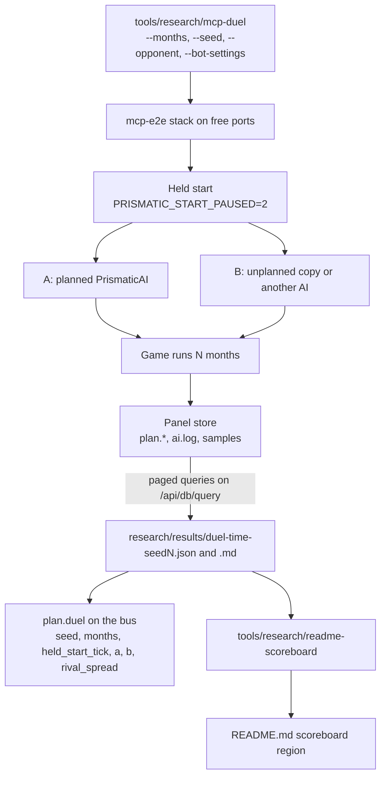

# Duels

**RESEARCH-ONLY.** A duel is one game with two companies on the same map competing for the same
towns and industries. Company A is the owner's bot started from the planner's portfolio. Company B
is, by default, the same bot started without a plan, or any installed AI. Each game month both are
read; after N months the higher company value wins. The record goes to `research/results/`, the
verdict goes onto the event bus, and the README scoreboard is regenerated from the records.

## Why it exists

A claim that the planner helps needs evidence from a game, not a feeling. Running the planned bot
against an unplanned copy of itself on the same map isolates the plan's effect. Because the game
is driven in wall-clock time, two duels on a loaded machine can drift apart; holding the start
paused until both bots exist removes most of that noise. The real-world counterpart is an A/B
test or a backtest with a control arm: same conditions, one variable changed, and a measured
spread before any difference is believed.

## How it works

- **Held start.** The game stays paused while the planner plans and both bots start, and runs once
  N AI companies exist. `mcp-duel` defaults to `PRISMATIC_START_PAUSED=2`; the record names the
  tick it started from (`held_start_tick`).
- **Read from the store.** The record's plan, AI logs and months come from the panel's DuckDB store
  by paged queries, and the record names the store file, instance, run and every query. Without a
  store it falls back to the panel's bounded HTTP lists and says why (`fallback`).
- **Rival spread.** Each verdict carries `rival_spread`: the spread of the unplanned rival's final
  value over recorded duels of the same seed, length, opponent, start and rival settings. A planned
  difference smaller than it says nothing. The record keeps B's live settings (`rival`, from
  `GET /api/bots`), because the opponent's name does not say which rival ran: since `df1e05e7d8`
  `PrismaticAI` with its defaults grows on autopilot. A record without them groups only with others
  without them.
- **From the panel.** `POST /api/duel` starts one in the background (one at a time),
  `GET /api/results` and `GET /api/result?name=` read the records, and the Duels page `/results`
  shows them. `GET /api/scoreboard` and `POST /api/scoreboard` read and regenerate the README
  region.
- **Scoreboard.** `readme-scoreboard` rewrites the region between `<!-- scoreboard:begin -->` and
  `<!-- scoreboard:end -->` in `README.md` from `research/results/duel-*.json`; `--check` writes
  nothing and exits 11 when the region would change.
- **Older A/B runs.** `tools/research/mcp-ab` ran two games side by side and wrote the `ab-*`
  records in `research/results/`.

Why side-by-side duels were noisy, and what the held start changed, is in
[`duels-run-side-by-side-are-noisy`](../../.ai/repo/knowledge/curated/duels-run-side-by-side-are-noisy.md).
The rule
[`project.a-tuning-claim-needs-held-start-pairs`](../../.ai/repo/rules/project/a-tuning-claim-needs-held-start-pairs.v1.md)
says when a measurement may change a default: held-start pairs on three seeds, beyond each pair's
rival spread. Duels in the panel are described in [`../mcp-control.md`](../mcp-control.md)
("Duels on a click").

## Where it lives

| File | What it holds |
|---|---|
| [`tools/research/mcp-duel`](../../tools/research/mcp-duel) | the duel driver: stack, held start, store reads, record, verdict |
| [`tools/research/readme-scoreboard`](../../tools/research/readme-scoreboard) | the README scoreboard from the records |
| [`research/results/`](../results/) | every duel and A/B record, JSON and Markdown |
| [`tools/research/mcp-rhai/src/panel_results.rs`](../../tools/research/mcp-rhai/src/panel_results.rs) | the panel's duel, results and scoreboard routes |
| [`tools/research/mcp-panel/static/results.html`](../../tools/research/mcp-panel/static/results.html), [`results.js`](../../tools/research/mcp-panel/static/results.js) | the Duels page |
| [`tools/research/mcp-ab`](../../tools/research/mcp-ab) | the earlier two-game A/B driver |
| [`.ai/repo/workflows/a-decision-reads-the-store.md`](../../.ai/repo/workflows/a-decision-reads-the-store.md) | the procedure for a decision that reads the store |

## How it is tested

- `python3 -B tools/research/test_mcp_duel.py`: the duel's reads offline against a fake panel whose
  query route runs DuckDB on the store's own schema (skipped without a `duckdb` CLI). `tools/gate.sh
  change` runs it through `unittest discover`.
- `tools/research/readme-scoreboard --check` runs in `tools/gate.sh change` and in the pre-commit
  hook (`scoreboard-on-commit` in [`.ai/repo/policy.yaml`](../../.ai/repo/policy.yaml)).
- `cargo test` in `tools/research/mcp-rhai`: the `panel_results.rs` tests.
- `node --test`: `results.test.mjs`; `tools/research/mcp-overview-check` drives `/results` and
  `/result/<name>` in a browser.
- The duels themselves are the evidence; each record names its seed, length and start.

## Related

- [Planner and AlgoGlyph](planner-and-algoglyph.md), [PrismaticAI](prismatic-ai.md),
  [Event bus and store](event-bus-and-store.md), [Published surfaces](published-surfaces.md),
  [Validation gate](validation-gate.md)
- [Evidence and validation status](../concepts/evidence-and-validation-status.md),
  [Calibration against reality](../concepts/calibration-against-reality.md),
  [Derived, not restated](../concepts/derived-not-restated.md)
