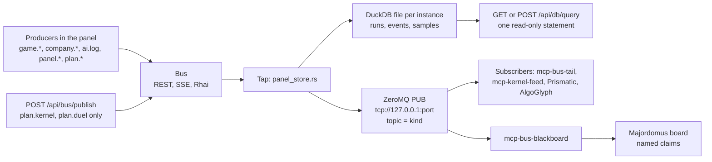

# Event bus and store

**RESEARCH-ONLY.** Every event a control panel raises goes onto one in-process bus. One tap on
that bus forwards each event, in bus order, to two sinks: a ZeroMQ PUB socket on loopback and a
DuckDB file for that panel instance. Any process on the machine can follow a game live over
ZeroMQ, and any later decision can query what earlier games recorded. A separate bridge forwards
a digest of the bus to the Majordomus board.

## Why it exists

The panel's REST and SSE feeds keep a bounded buffer and are gone when the panel stops. A duel
that lasts ten game years, a calibration across many games, or an agent in another process needs
the history, in order, after the fact. The store keeps it; the bus lets other programs react
without polling. The real-world counterpart is an event log beside an operational system: a
message bus for live subscribers plus an append-only analytic store for replay and audit.

## How it works

- **One table of kinds.** Every kind a bus carries is a row of `KINDS` in `panel_events.rs`, with
  its producer and payload. `GET /api/bus` lists the table, and a knowledge note holds it as a
  generated region
  ([`the-panel-bus-carries-these-event-kinds`](../../.ai/repo/knowledge/curated/the-panel-bus-carries-these-event-kinds.md)).
- **Envelope.** Two frames per message: the topic (the event kind, so a subscription is a kind
  prefix) and JSON of schema `prismatic-bus/v1` with `seq`, `ts_ms`, `instance`, `session`,
  `seed`, `game_tick`, `game_date`, `kind` and `data`.
- **Store.** `$PRISMATIC_STORE_DIR/<instance>.duckdb`, by default under
  `~/.local/state/prismatic-mcp/store/`, committed in batches at least twice a second. Tables:
  `runs`, `events`, `samples`. It is the cargo feature `store` and links the system libduckdb; a
  panel without it reports `"store": "off"`.
- **Read-only queries.** Only SELECT, WITH, DESCRIBE, SUMMARIZE or SHOW, one statement; the
  connection also runs without external access. While the panel runs it holds the file's lock, so
  outside readers go through the route or the bus
  ([`a-running-panels-duckdb-store-is-locked-to-other-processes`](../../.ai/repo/knowledge/curated/a-running-panels-duckdb-store-is-locked-to-other-processes.md)).
- **Decisions as data.** Each planning decision publishes a `plan.*` event with
  `{decision, version, inputs: {live, stored}, choice}`, beside its prose sentence. The
  calibration reads earlier readings back from the stores; the duel driver reads its record from
  the store ([Duels](duels.md)).
- **Board bridge.** `mcp-bus-blackboard` subscribes to each panel's bus and announces one line per
  game month and the rare events as named claims `openttd:<instance>:month` and
  `openttd:<instance>:events`. It is off unless started.
- **The hub** publishes the events it raises itself through the same sinks into a bus and store of
  its own ([Hub](hub.md)).

The endpoint, envelope, queries and subscription examples in full are in
[`../mcp-control.md`](../mcp-control.md) ("The event bus on ZeroMQ and the DuckDB store", "The bus on
the Majordomus blackboard"). The feature record is
[`event-bus-and-store`](../../.ai/repo/features/event-bus-and-store.md).

## Where it lives

| File | What it holds |
|---|---|
| [`tools/research/mcp-rhai/src/panel_events.rs`](../../tools/research/mcp-rhai/src/panel_events.rs) | `KINDS`, the `plan` payload, the external-kind check |
| [`tools/research/mcp-rhai/src/panel_store.rs`](../../tools/research/mcp-rhai/src/panel_store.rs) | the panel's tap and its read routes |
| [`tools/research/mcp-rhai/src/bus_sinks.rs`](../../tools/research/mcp-rhai/src/bus_sinks.rs) | the ZeroMQ and DuckDB sinks, the read-only guard |
| [`tools/research/mcp-rhai/src/bin/mcp-bus-tail.rs`](../../tools/research/mcp-rhai/src/bin/mcp-bus-tail.rs) | a SUB client that prints envelopes |
| [`tools/research/mcp-rhai/src/bin/mcp-bus-blackboard.rs`](../../tools/research/mcp-rhai/src/bin/mcp-bus-blackboard.rs) | the digest to the Majordomus board |
| [`tools/research/mcp-rhai/src/board.rs`](../../tools/research/mcp-rhai/src/board.rs) | the board client it shares with Rhai's `board_post` |
| [`tools/research/mcp-rhai/build.rs`](../../tools/research/mcp-rhai/build.rs) | finds libduckdb, stamps the git revision |
| [`tools/research/mcp-panel/static/data.html`](../../tools/research/mcp-panel/static/data.html), [`data.js`](../../tools/research/mcp-panel/static/data.js) | the Data page: a query, its rows, a chart |

## How it is tested

- `cargo test` in `tools/research/mcp-rhai`: `panel_events.rs` (the table is unique, no publish
  call names an undeclared kind, every kind has a producer, the knowledge note holds the table,
  only declared external kinds enter from outside), `bus_sinks.rs` (one read-only statement
  passes the guard, the envelope, events and samples go into DuckDB and come back),
  `panel_store.rs` and `mcp-bus-blackboard.rs`.
- `tools/research/mcp-panel-check` on a running panel: the endpoint, an envelope received by
  `mcp-bus-tail`, events in the store, INSERT and a second statement refused, `plan.portfolio` and
  `plan.bot_settings` found on the bus and in the store.
- `node --test`: `data.test.mjs` and `data-page.test.mjs`; `mcp-overview-check` drives `/data` in
  a browser.

## Related

- [Control panel](control-panel.md), [Hub](hub.md), [Duels](duels.md),
  [Planner and AlgoGlyph](planner-and-algoglyph.md),
  [Majordomus supervision](majordomus-supervision.md)
- [Calibration against reality](../concepts/calibration-against-reality.md),
  [Evidence and validation status](../concepts/evidence-and-validation-status.md),
  [Agents and supervision](../concepts/agents-and-supervision.md)
- ADRs [0033](../../.ai/repo/adrs/0033-every-panel-event-goes-out-on-zeromq-and-into-a-duckdb-store.md)
  and [0034](../../.ai/repo/adrs/0034-planning-decisions-read-recorded-history-and-emit-structured.md)
