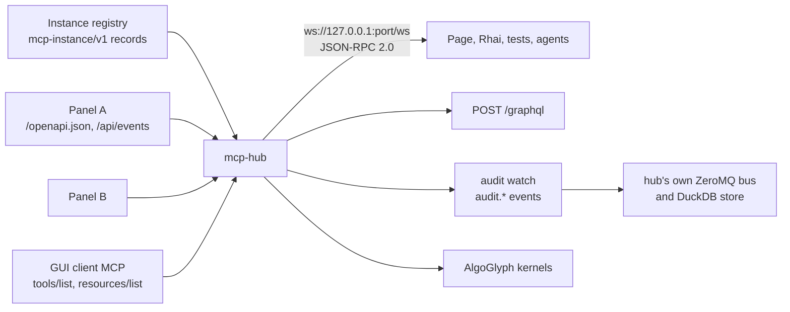

# Hub

**RESEARCH-ONLY, UNSTABLE.** `mcp-hub` puts every OpenTTD instance on the machine behind one
WebSocket JSON-RPC surface: every control panel, every MCP server of a GUI client, every stack of
a cluster. A page, a Rhai script, a test or another AI reaches any of them the same way, follows
their events in one stream, and runs one audit over all of them.

## Why it exists

A research run often has several games at once: a duel, a cluster from
`tools/research/mcp-e2e --instances N`, the owner's GUI client. Each has its own panel and its own
MCP server, on its own port. Without a hub every client would need to know every port and every
token file. The hub discovers them from the shared instance registry and derives their
operations, so nothing has to be configured or listed. The real-world counterpart is a fleet
gateway or service mesh control plane: one entry point, discovery from a registry, and fleet-wide
policy checks.

## How it works

- **Discovery.** Instances come from the registry (`$PRISMATIC_MCP_REGISTRY`, dead owners
  dropped) and `--panel URL`. The set refreshes every two seconds; changes go to subscribers as
  `hub.instances`.
- **Operations are derived.** A panel's operations come from its `/openapi.json`; a bare MCP
  server's from `tools/list` and `resources/list`. `hub.call {instance, id}` calls one, where `id`
  is an `operationId`, `tool:<name>` or `resource:<uri>`.
- **Events.** `hub.subscribe {instances?, kinds?}` streams each panel's bus, tagged with the
  instance. For an MCP server without a panel the hub derives `game.*` events from two reads of
  `openttd://game/state` five seconds apart, each marked `derived_from`.
- **Audit.** `hub.audit` judges every instance by one rule: two stations of one owner that share
  a facility and whose catchments overlap duplicate each other; depots are judged by the game's
  own service reach. A watch runs it every `--audit-every` seconds and announces each finding once
  as `audit.duplicate_station`, `audit.duplicate_depot`, `audit.over_capacity` or `audit.resolved`.
- **One method table, several surfaces.** The same table answers `rpc.discover`, is documented in
  `GET /openapi.json` with Swagger UI at `/docs`, is a GraphQL schema at `POST /graphql`, and
  becomes `hub_<method>` functions in Rhai.
- **Its own sinks.** Events the hub raises itself go to a ZeroMQ PUB socket and a DuckDB store of
  its own, through the panel's sink code (`bus_sinks.rs`). Relayed panel events are not stored
  twice.
- **AlgoGlyph.** `algoglyph.kernels`, `algoglyph.kernel` and `algoglyph.track_plan` forward to the
  planning engine (see [Planner and AlgoGlyph](planner-and-algoglyph.md)).
- **No authentication of its own.** It holds the tokens it reads from the registry, so it must
  stay on 127.0.0.1. Each panel's approval gate still applies behind it.

The full method list and limits are in [`../mcp-hub.md`](../mcp-hub.md).

## Where it lives

| File | What it holds |
|---|---|
| [`tools/research/mcp-rhai/src/bin/mcp-hub.rs`](../../tools/research/mcp-rhai/src/bin/mcp-hub.rs) | the binary, its HTTP and WebSocket server, its tests |
| [`tools/research/mcp-rhai/src/hub.rs`](../../tools/research/mcp-rhai/src/hub.rs) | discovery, derived operations, events, audit, `State::raise` |
| [`tools/research/mcp-rhai/src/hub_graphql.rs`](../../tools/research/mcp-rhai/src/hub_graphql.rs) | the GraphQL subset derived from the method table |
| [`tools/research/mcp-rhai/src/hub_algoglyph.rs`](../../tools/research/mcp-rhai/src/hub_algoglyph.rs) | AlgoGlyph kernels as hub methods |
| [`tools/research/mcp-rhai/src/bus_sinks.rs`](../../tools/research/mcp-rhai/src/bus_sinks.rs) | the ZeroMQ and DuckDB sinks it shares with the panel |
| [`tools/research/mcp-panel/static/hub.html`](../../tools/research/mcp-panel/static/hub.html), [`components.js`](../../tools/research/mcp-panel/static/components.js) | the hub page and its components (`HubClient`, `catalogueView`, `eventsView`, ...) |
| [`tools/research/mcp-panel/static/viz.html`](../../tools/research/mcp-panel/static/viz.html) | the World view served by the hub ([`../mcp-viz.md`](../mcp-viz.md)) |

## How it is tested

- `cargo test --offline --manifest-path tools/research/mcp-rhai/Cargo.toml --bin mcp-hub`:
  derived operations, registry records, filters, end to end against a fake panel, and the hub's
  own sinks.
- `node --test tools/research/mcp-panel/test/*.test.mjs`: `components.test.mjs` and
  `components-dom.test.mjs` for the page's parts.
- `tools/research/mcp-hub-check`: every instance discovered, every read-only operation without
  required input called over the WebSocket, one event streamed.
- `tools/research/mcp-hub-page-check` and `tools/research/mcp-viz-check`: the hub page and the
  World view in a real Chrome.
- `tools/research/mcp-dup-check`: no running instance holds a duplicate pair.
- `tools/research/mcp-cluster-check`: N servers and N clients announced, listed, withdrawn.

## Related

- [Control panel](control-panel.md), [Event bus and store](event-bus-and-store.md),
  [Rhai scripting](rhai-scripting.md), [Planner and AlgoGlyph](planner-and-algoglyph.md)
- [Derived, not restated](../concepts/derived-not-restated.md),
  [Agents and supervision](../concepts/agents-and-supervision.md),
  [Digital twin testbed](../concepts/digital-twin-testbed.md)
