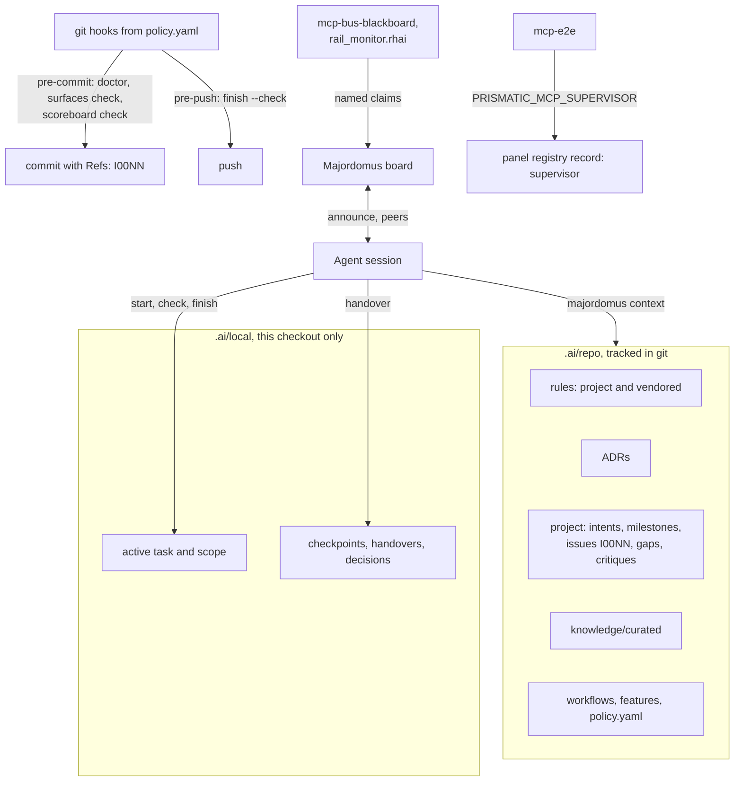

# Majordomus supervision

Majordomus is the owner's supervisory tool for repositories. In this fork it owns the `.ai/`
layer: the rules, decisions, plan, knowledge and workflows every agent reads, plus each checkout's
local task, checkpoint and handover records. Work runs as a task with a declared scope, git hooks
hold commits and pushes to the layer's rules, and a shared board lets concurrent agent sessions
and the game tools see each other. This page is about how this repository uses it; Majordomus
itself is documented in its own repository.

## Why it exists

Several agent sessions and the owner work in this fork, often at once and in separate worktrees.
Without a shared contract each session would re-derive the rules, collide on files, lose state
when its conversation ends, and claim results nobody can trace. The `.ai/` layer makes the rules
and decisions tracked records; a task's scope makes collisions visible before they happen; a
handover carries state across sessions; and trailers tie each commit to the issue it served. The
real-world counterpart is change management in an engineering organisation: tickets with scope
and acceptance criteria, an approver, a change log, and an on-call board.

## How it works

- **The layer.** `.ai/repo/` is the tracked contract: `policy.yaml`, rules under `rules/project/`
  (and vendored ones), ADRs, curated knowledge, features, workflows, and the plan under
  `project/` (intents, milestones, issues `I00NN.yaml` with scope, acceptance criteria and the
  validation that proves them). `.ai/local/` is the checkout's own state, ignored by git and never
  read as policy. Discovery starts from [`.ai/README.md`](../../.ai/README.md) and
  [`.ai/manifest.yaml`](../../.ai/manifest.yaml).
- **Tasks.** `majordomus start "<task>" --scope <paths>`, then `check`, then `finish --outcome
  completed --verify-command "<cmd>"`. `check` and `finish` fail on a touched file outside the
  scope ([`task-lifecycle.md`](../../.ai/repo/workflows/task-lifecycle.md),
  [`a-task-scope-must-cover-every-path-its-commit-touches`](../../.ai/repo/knowledge/curated/a-task-scope-must-cover-every-path-its-commit-touches.md)).
- **Continuity.** A handover has the sections Objective, Current State, Next Action; decisions
  are recorded with `majordomus decision`. Records are labelled by how far git has moved since,
  and git wins ([`continuity.md`](../../.ai/repo/workflows/continuity.md)).
- **Hooks** (`enforcement` in `policy.yaml`). Pre-commit runs `majordomus doctor`,
  `tools/surfaces/surfaces check` and `tools/research/readme-scoreboard --check`; pre-push runs
  `majordomus finish --check`.
- **Traceability.** Every fork commit ends with a `Refs: I00NN` trailer per issue it served
  ([`fork-history-carries-issue-trailers`](../../.ai/repo/knowledge/curated/fork-history-carries-issue-trailers.md)).
- **Projections.** The bootstrap regions in [`AGENTS.md`](../../AGENTS.md),
  [`CLAUDE.md`](../../CLAUDE.md) and [`GEMINI.md`](../../GEMINI.md) are generated from the
  policy; a rule that exists in one of them and not in `.ai/` is a bug.
- **Worktrees.** A branch's linked worktree lives at `<repository>-wt/<branch>` (see
  [`CLAUDE.md`](../../CLAUDE.md)).
- **The board and the game.** Sessions announce intent and paths on the board. The game tools
  post there too: `mcp-bus-blackboard` posts a monthly digest per instance and
  `rail_monitor.rhai` posts rail problems, both as named claims through `board.rs`. `mcp-e2e`
  sets `PRISMATIC_MCP_SUPERVISOR` to the Majordomus task it runs under, and every panel's registry
  record carries it as `supervisor`, so the [hub](hub.md) shows which task a game belongs to.

## Where it lives

| File | What it holds |
|---|---|
| [`.ai/README.md`](../../.ai/README.md) | the layer's protocol: ownership, discovery, scoped context |
| [`.ai/manifest.yaml`](../../.ai/manifest.yaml) | the section registry |
| [`.ai/repo/policy.yaml`](../../.ai/repo/policy.yaml) | profiles, enforcement hooks, projections |
| [`.ai/repo/rules/project/`](../../.ai/repo/rules/project/) | this fork's rules |
| [`.ai/repo/project/`](../../.ai/repo/project/) | intents, milestones, issues, gaps, critiques |
| [`.ai/repo/workflows/`](../../.ai/repo/workflows/) | task lifecycle, continuity, plan, research experiment |
| [`.ai/repo/features/supervised-ai-layer.md`](../../.ai/repo/features/supervised-ai-layer.md) | the feature record of this layer |
| [`tools/research/mcp-rhai/src/board.rs`](../../tools/research/mcp-rhai/src/board.rs) | the board client the game tools use |
| [`tools/research/mcp-rhai/src/bin/mcp-bus-blackboard.rs`](../../tools/research/mcp-rhai/src/bin/mcp-bus-blackboard.rs) | the bus digest on the board |
| [`tools/research/mcp-e2e`](../../tools/research/mcp-e2e) | sets `PRISMATIC_MCP_SUPERVISOR` |

## How it is tested

- `majordomus doctor` on every commit and `majordomus finish --check` on every push, wired by the
  hooks in `policy.yaml`.
- `tools/knowledge/refs check` (in `tools/gate.sh change`) fails when a file or symbol an `.ai/`
  record cites no longer exists; `tools/knowledge/test_refs.py` tests it.
- `cargo test` in `tools/research/mcp-rhai`: `board.rs` and `mcp-bus-blackboard.rs` tests, and the
  panel's `a_record_is_mcp_instance_v1` for the registry record's shape.

## Related

- [Validation gate](validation-gate.md), [Published surfaces](published-surfaces.md),
  [Event bus and store](event-bus-and-store.md), [Rail steward and monitor](rail-steward-and-monitor.md),
  [Hub](hub.md)
- [Agents and supervision](../concepts/agents-and-supervision.md),
  [Evidence and validation status](../concepts/evidence-and-validation-status.md),
  [Derived, not restated](../concepts/derived-not-restated.md)
- ADR [0010](../../.ai/repo/adrs/0010-majordomus-supervises-this-fork-and-the-ai-layer-is-its-trac.md)
