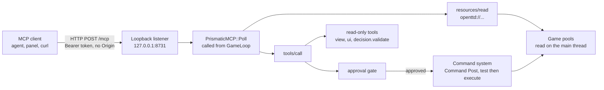

# The MCP server inside the engine

**RESEARCH-ONLY.** A [Model Context Protocol](https://modelcontextprotocol.io) server compiled into
the OpenTTD binary itself. It listens on loopback only, answers JSON-RPC over HTTP, and lets an
agent read the live game (resources `openttd://...`) and ask for changes (tools `openttd.cmd.*`,
`openttd.ai.*`, `openttd.api.Script<Class>.<Function>` and a few more). It exists only in a build
configured with `OPTION_RESEARCH_INSTRUMENTATION=ON` and `OPTION_PRISMATIC_MCP_SERVER=ON`; a default
build compiles none of it.

## Why it exists

An agent that plays or studies the game needs a way in that sees the real state and changes it
the way a player does. Screen scraping sees pixels, not pools. A side channel that writes memory
would break the game's deterministic lockstep. The server reads the game's own pools on the main
thread and routes every change through the game's own command system, so an agent gets the same
view and the same powers as a player, and nothing more. The real-world counterpart is an
instrumented system that exposes a read API plus a gated write API, as an exchange or a plant
control system does for automated clients.

## How it works

- **Lifecycle.** `PrismaticMCP::Init()` runs once from `openttd_main`, `Poll()` once per frame from
  `GameLoop()`, and `Shutdown()` from `ShutdownGame()` (`src/openttd.cpp`, each call marked
  `RESEARCH-ONLY`). The listener starts only when the operator types `prismatic_mcp start` in the
  console. Every handler runs on the main game thread.
- **Transport and security.** Streamable HTTP pinned to MCP `2025-11-25`, default port 8731. A
  bearer token in the `Authorization` header; any request with an `Origin` header is refused, and
  so is any non-loopback peer.
- **Resources.** Live, read-only views of the pools: game state, map and terrain, towns, stations,
  vehicles, companies, engines, depots, prices, rail types, the command table, the decision trace,
  the world graph and more. The catalogue is what the server answers to `resources/list`; the list
  is in [`07-resource-catalog.md`](../prismatic-mcp/07-resource-catalog.md).
- **Tools.** Derived, not listed by hand. One `openttd.cmd.<Name>` per entry of the `Commands`
  enum whose parameters convert from JSON (`prismatic_mcp_commands.cpp`,
  `prismatic_mcp_params.hpp`). One `openttd.api.Script<Class>.<Function>` per static function the
  build publishes to Game Scripts and AIs, read back from two private script engines and called
  through the game's own script binding (`prismatic_mcp_api.cpp`, see
  [`../mcp-api.md`](../mcp-api.md)). Plus `openttd.ai.*`, `openttd.decision.*`,
  `openttd.game.set_pause`, and, on a process with a window, `openttd.view.*`, `openttd.ui.*` and
  `openttd.input.*`. The families and their approval rules are in
  [`08-tool-catalog.md`](../prismatic-mcp/08-tool-catalog.md).
- **Annotations.** Every tool declares `readOnlyHint`; the panel and the route check use it to
  decide what may be called without asking.
- **Toolbar menu.** A research build adds one toolbar button whose dropdown is one table
  (`prismatic_mcp_menu.cpp` `ITEMS`); the same table is `openttd://ui/menu` over MCP.

The full design trail, threat model and phase status start at
[`research/prismatic-mcp/README.md`](../prismatic-mcp/README.md).

## Where it lives

| File | What it holds |
|---|---|
| [`cmake/Options.cmake`](../../cmake/Options.cmake) | the two options; MCP refuses to configure without research instrumentation |
| [`src/prismatic_mcp/CMakeLists.txt`](../../src/prismatic_mcp/CMakeLists.txt) | adds the module only under `OPTION_PRISMATIC_MCP_SERVER` |
| [`src/prismatic_mcp/prismatic_mcp.h`](../../src/prismatic_mcp/prismatic_mcp.h) | lifecycle API: `Init`, `Poll`, `Start`, `Stop`, token |
| [`src/prismatic_mcp/prismatic_mcp_server.cpp`](../../src/prismatic_mcp/prismatic_mcp_server.cpp) | HTTP and JSON-RPC, resources, approvals, decision trace |
| [`src/prismatic_mcp/prismatic_mcp_commands.cpp`](../../src/prismatic_mcp/prismatic_mcp_commands.cpp) | one tool per game command, derived from the command table |
| [`src/prismatic_mcp/prismatic_mcp_params.hpp`](../../src/prismatic_mcp/prismatic_mcp_params.hpp) | JSON to command parameter conversion by declared type |
| [`src/prismatic_mcp/prismatic_mcp_api.cpp`](../../src/prismatic_mcp/prismatic_mcp_api.cpp) | the Script API as tools, through private script engines |
| [`src/prismatic_mcp/prismatic_mcp_ai.cpp`](../../src/prismatic_mcp/prismatic_mcp_ai.cpp) | `openttd.ai.*`: company AIs and their settings |
| [`src/prismatic_mcp/prismatic_mcp_world.cpp`](../../src/prismatic_mcp/prismatic_mcp_world.cpp), [`prismatic_mcp_graph.cpp`](../../src/prismatic_mcp/prismatic_mcp_graph.cpp), [`prismatic_mcp_entities.cpp`](../../src/prismatic_mcp/prismatic_mcp_entities.cpp) | map, terrain, entities and the world graph as resources |
| [`src/prismatic_mcp/prismatic_mcp_view.cpp`](../../src/prismatic_mcp/prismatic_mcp_view.cpp), [`prismatic_mcp_ui.cpp`](../../src/prismatic_mcp/prismatic_mcp_ui.cpp), [`prismatic_mcp_menu.cpp`](../../src/prismatic_mcp/prismatic_mcp_menu.cpp) | the local window, interface as data, armed input, the toolbar menu |
| [`src/prismatic_mcp/prismatic_mcp_console.cpp`](../../src/prismatic_mcp/prismatic_mcp_console.cpp) | the `mcp` console command family over the same catalogue |
| [`src/openttd.cpp`](../../src/openttd.cpp) | the three call sites: `Init`, `Poll`, `Shutdown` |

## How it is tested

- **Catch2 unit tests** tagged `[prismatic_mcp]` in
  [`src/tests/test_prismatic_mcp.cpp`](../../src/tests/test_prismatic_mcp.cpp): bearer parsing,
  constant-time compare, parameter conversion, the approval state machine, the toolbar menu, the
  console family, read-only annotations. `tools/gate.sh research` builds the research binary and
  runs them.
- **`tools/research/mcp-live-check`** starts a dedicated server, starts MCP, and checks bearer
  auth, `Origin` refusal, live reads and approve and deny over real HTTP.
- **`tools/research/mcp-coverage-check --probe [--exercise]`** calls the read-only tools (and,
  with `--exercise`, the others once on a throwaway game).
- **`mcp-api-coverage`** (`tools/research/mcp-rhai/src/bin/mcp-api-coverage.rs`) compares the
  commands, console commands and Script API functions the sources declare with what a running
  game exposes ([`../mcp-api.md`](../mcp-api.md)).
- **`tools/research/determinism-ab`** shows the read-only path does not change the simulation
  ([`determinism-ab.md`](../prismatic-mcp/determinism-ab.md)).
- **`tools/research/mcp-console-check`** drives the `mcp` console family on a headless server.

## Related

- [Approval gate](approval-gate.md), [Control panel](control-panel.md), [Hub](hub.md)
- [Deterministic lockstep](../concepts/deterministic-lockstep.md),
  [Human in the loop](../concepts/human-in-the-loop.md),
  [Derived, not restated](../concepts/derived-not-restated.md),
  [Digital twin testbed](../concepts/digital-twin-testbed.md)
- ADR [0008](../../.ai/repo/adrs/0008-an-agent-reaches-the-game-through-an-embedded-loopback-mcp-s.md),
  rule [`project.research-code-is-gated-and-labelled`](../../.ai/repo/rules/project/research-code-is-gated-and-labelled.v1.md)
