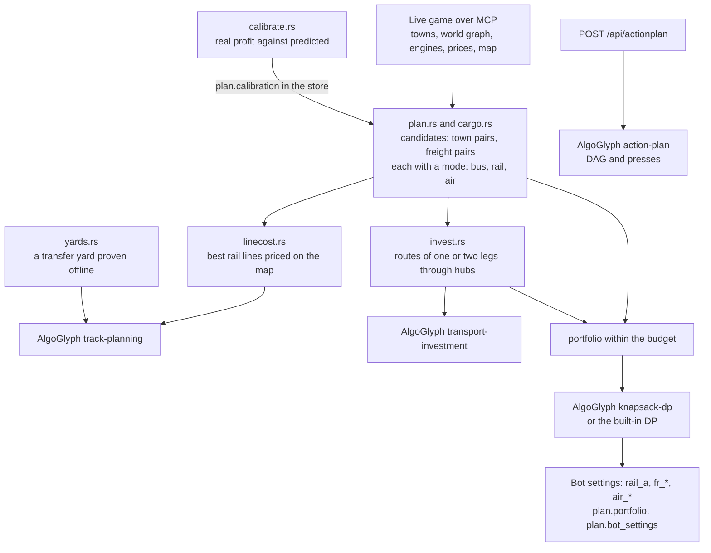

# Planner and AlgoGlyph

**RESEARCH-ONLY.** The planner decides what the owner's bot should build. It reads the live game
over MCP, prices every candidate route with the game's own payment formula and the vehicles on
offer now, and picks a portfolio within a budget. AlgoGlyph is a separate planning engine (its own
repository) whose kernels answer the hard parts: the knapsack that picks the portfolio, the rail
route on the real map, investments through hubs, and an action plan as a dependency graph. The
planner also turns a sentence from the owner into a query, and measures what running lines really
earn to correct its own predictions.

## Why it exists

A company AI that picks routes by fixed rules leaves money on the table and cannot explain why it
chose what it did. The planner makes every assumption a parameter, every price come from the
game, and every choice a recorded decision. Pricing a rail line on the real map rather than as a
straight line, and checking a prediction against what the game paid, keep the plan tied to the
world it plans for. The real-world counterpart is capital budgeting in a transport network:
candidate projects, a cost model, a budget constraint, and post-investment review.

## How it works

- **Candidates and prices** (`plan.rs`, `cargo.rs`). Town pairs and freight pairs from
  `openttd://towns` and `openttd://world/graph`, priced with the cargo payment formula cited from
  `src/economy.cpp` and vehicle speeds from `openttd://engines`. Every number is a parameter with a
  default; `?params=JSON` overrides any of them and the answer echoes the effective set.
- **Portfolio.** A 0/1 knapsack over the best option of every candidate. AlgoGlyph's `knapsack-dp`
  solves it when its runner is available, otherwise the same dynamic programme built in; the
  answer names the solver.
- **Line cost on the map** (`linecost.rs`). For the best rail candidates, AlgoGlyph's
  `track-planning` lays the route on the game's map, ways, terrain, prices and bridges. Its money
  replaces the straight-line estimate; a candidate with no route loses its rail option.
- **Transfer yards** (`yards.rs`). Before any bot builds one, the yard is proven offline: the
  better line's tiles are blocked and the second line is laid from a platform beside it.
- **Investment** (`invest.rs`). The same facts handed to `transport-investment`, which also
  considers routes through a hub, ranked by return on investment.
- **Action plan.** `POST /api/actionplan` turns a set of actions with dependencies into a
  validated DAG and executable steps through `action-plan`, refused if it would overdraw.
- **Calibration** (`calibrate.rs`). Running lines with a whole year of profit are matched to the
  planner's candidate for the same ends; the median ratio per mode becomes the `calibration`
  parameter. `POST /api/calibration` stores the reading as `plan.calibration`; a planned bot reads
  every stored reading back when `PRISMATIC_PLAN_CALIBRATION` is `all` or `seed` (off by default).
- **Sentences** (`intent.rs`). "find the most productive coal mine" or a Czech sentence becomes a
  query: nouns from the game's own language files, orderings nearest, most productive, most
  profitable; `POST /api/intent`, the console's `plan` verb.
- **How AlgoGlyph is reached** (`hub_algoglyph.rs`). Through its flow CLI
  (`npm run flow -- kernel <id> -`), found at `$MCP_ALGOGLYPH_DIR` or two default checkouts.
  `flow_serve.rs` keeps one long-lived `flow serve` per process when `MCP_ALGOGLYPH_SERVE` is on.
  `kernel_feed.rs` and `mcp-kernel-feed` complete a kernel's input from the store's trailing
  samples (only `action-plan` has a feed today).

The planner's model, its versions, measurements and every route are in
[`../mcp-control.md`](../mcp-control.md) (from "A route planner with modes of transport" on), and
the AlgoGlyph hub methods in [`../mcp-hub.md`](../mcp-hub.md) ("AlgoGlyph: the planning engine").

## Where it lives

| File | What it holds |
|---|---|
| [`tools/research/mcp-rhai/src/plan.rs`](../../tools/research/mcp-rhai/src/plan.rs) | passenger candidates, the payment model, defaults |
| [`tools/research/mcp-rhai/src/cargo.rs`](../../tools/research/mcp-rhai/src/cargo.rs) | freight candidates and the portfolio knapsack |
| [`tools/research/mcp-rhai/src/linecost.rs`](../../tools/research/mcp-rhai/src/linecost.rs) | rail line cost from track-planning |
| [`tools/research/mcp-rhai/src/yards.rs`](../../tools/research/mcp-rhai/src/yards.rs) | transfer yards proven on the map |
| [`tools/research/mcp-rhai/src/sites.rs`](../../tools/research/mcp-rhai/src/sites.rs) | where a rail station and its depot can go |
| [`tools/research/mcp-rhai/src/invest.rs`](../../tools/research/mcp-rhai/src/invest.rs) | transport-investment over the live game |
| [`tools/research/mcp-rhai/src/calibrate.rs`](../../tools/research/mcp-rhai/src/calibrate.rs) | real against predicted profit, the stored readings |
| [`tools/research/mcp-rhai/src/intent.rs`](../../tools/research/mcp-rhai/src/intent.rs) | sentences to queries |
| [`tools/research/mcp-rhai/src/graph.rs`](../../tools/research/mcp-rhai/src/graph.rs) | the road network as a graph |
| [`tools/research/mcp-rhai/src/hub_algoglyph.rs`](../../tools/research/mcp-rhai/src/hub_algoglyph.rs), [`flow_serve.rs`](../../tools/research/mcp-rhai/src/flow_serve.rs), [`kernel_feed.rs`](../../tools/research/mcp-rhai/src/kernel_feed.rs) | how kernels are called and fed |
| [`tools/research/mcp-rhai/src/panel_bot.rs`](../../tools/research/mcp-rhai/src/panel_bot.rs) | the planned bot start: portfolio to settings |
| [`tools/research/mcp-rhai/src/bin/mcp-plan.rs`](../../tools/research/mcp-rhai/src/bin/mcp-plan.rs), [`mcp-intent.rs`](../../tools/research/mcp-rhai/src/bin/mcp-intent.rs), [`mcp-kernel-feed.rs`](../../tools/research/mcp-rhai/src/bin/mcp-kernel-feed.rs) | the command-line front ends |

## How it is tested

- `cargo test` in `tools/research/mcp-rhai`: tests in `plan.rs`, `cargo.rs`, `linecost.rs`,
  `yards.rs`, `sites.rs`, `invest.rs`, `calibrate.rs`, `intent.rs`, `hub_algoglyph.rs`,
  `flow_serve.rs`, `kernel_feed.rs` and `panel_bot.rs`.
- `tools/research/mcp-intent-check`: the owner's plan sentences typed into the game's console and
  answered end to end. `tools/research/mcp-carryout-check`: an answered sentence's settings reach
  the bot, through the approval gate.
- `mcp-hub intent-check`: the same sentences through the hub against every instance.
- Duels measure whether a plan wins; see [Duels](duels.md). The finding that the model
  over-predicts is
  [`the-planner-overpredicts-what-a-line-earns`](../../.ai/repo/knowledge/curated/the-planner-overpredicts-what-a-line-earns.md).

## Related

- [PrismaticAI](prismatic-ai.md), [Duels](duels.md), [Event bus and store](event-bus-and-store.md),
  [Hub](hub.md), [Rail steward and monitor](rail-steward-and-monitor.md)
- [Portfolio under a budget](../concepts/portfolio-under-a-budget.md),
  [Calibration against reality](../concepts/calibration-against-reality.md),
  [Derived, not restated](../concepts/derived-not-restated.md)
