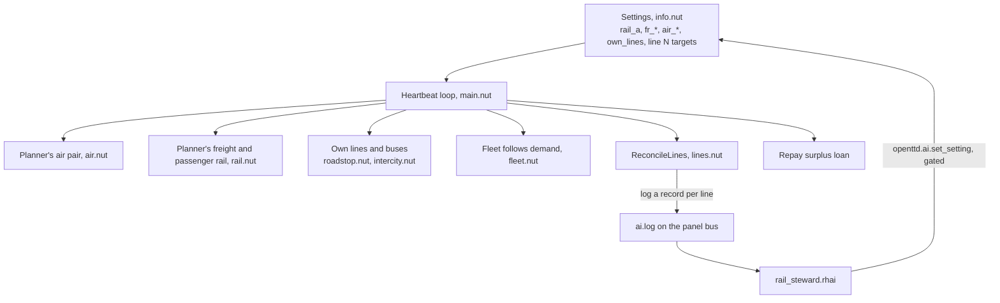

# PrismaticAI

**RESEARCH-ONLY.** PrismaticAI is the owner's company AI: a Squirrel script that OpenTTD loads like
any AI from BaNaNaS and that plays one company. It builds bus routes, intercity roads, airports,
freight rail and passenger rail. What it builds first comes from its settings, which the control
panel fills from the planner's portfolio. Its rail lines are kept as desired state that an outside
steward sets and the bot reconciles. It is content, not engine code: no CMake option builds or
ships it, and it stays out of the `bin/ai/` folder upstream ships.

## Why it exists

The planner decides; something in the game has to carry the decision out with the game's own
rules. An AI script is the game's supported way to act as a company: it issues the same commands a
player issues, through the Script API, so it needs no special access and stays deterministic. Its
settings are the steering wheel from outside, and because they are `CONFIG_INGAME`, a change
reaches a running bot through `openttd.ai.set_setting`, which waits for the owner's approval. The
real-world counterpart is an execution agent under a planning system: the planner sets targets, the
agent executes them on the ground and reports back.

## How it works

- **Heartbeat** (`main.nut` `Start`). Every round reads the settings again (`Behaviour`), then:
  the planner's air pair, freight lines (`fr_*` to `fr16_*`) and passenger rail first, then the
  bot's own lines and buses, the fleet, line reconciliation and the loan. Old vehicles are renewed
  by the game's own autorenew.
- **Rail a train can always run** (`rail.nut`). No 90-degree turn anywhere (`Turns90`, because
  `pf.forbid_90_deg` is on by default). Termini with two platforms joined by a throat with path
  signals. The laid line is walked (`VerifyRailLine`) before a train is bought. The depot stands
  behind a platform. Platform length and wagons follow demand (`PlatformPlan`).
- **Lines as desired state** (`lines.nut`). Each line has a slot and logs a record
  (`PrismaticAI: rail line <slot>: label=...|a=...|...|state=...`) when built and every game month.
  The settings `line<N>_trains` and `line<N>_wagons` are targets; the bot clones, resizes, sells, or
  closes a line to match, removing only what the line owns: its track (a level crossing keeps its
  road), its own platforms (`AIRail.RemoveRailStationTileRectangle`, never a whole joined station)
  and its throats and depot. The bot never decides there; it reconciles.
- **Every build step checks the game's answer.** A step that fails is logged and skipped; the
  API's return values are the source of truth (header of `main.nut`).

Install, the settings table and the rail rules in full are in
[`tools/research/prismatic-ai/README.md`](../../tools/research/prismatic-ai/README.md); the rail
reasoning is in [`../rail-steward.md`](../rail-steward.md).

## Where it lives

| File | What it holds |
|---|---|
| [`PrismaticAI/info.nut`](../../tools/research/prismatic-ai/PrismaticAI/info.nut) | name, API version, every setting |
| [`PrismaticAI/main.nut`](../../tools/research/prismatic-ai/PrismaticAI/main.nut) | the heartbeat and the starter route |
| [`PrismaticAI/rail.nut`](../../tools/research/prismatic-ai/PrismaticAI/rail.nut) | termini, the A* line search, laying, the walk check, depots, trains |
| [`PrismaticAI/lines.nut`](../../tools/research/prismatic-ai/PrismaticAI/lines.nut) | line slots, the record, `ReconcileLines` |
| [`PrismaticAI/fleet.nut`](../../tools/research/prismatic-ai/PrismaticAI/fleet.nut) | road and air capacity from waiting cargo and the link graph |
| [`PrismaticAI/roadstop.nut`](../../tools/research/prismatic-ai/PrismaticAI/roadstop.nut), [`intercity.nut`](../../tools/research/prismatic-ai/PrismaticAI/intercity.nut), [`air.nut`](../../tools/research/prismatic-ai/PrismaticAI/air.nut) | bus stops and depots, intercity roads, airports |
| [`install`](../../tools/research/prismatic-ai/install) | links the bot into the personal `ai/` folder; `--check` verifies it |
| [`tools/research/mcp-rhai/src/panel_bot.rs`](../../tools/research/mcp-rhai/src/panel_bot.rs) | the panel side: planned start, settings, running bots |

## How it is tested

- There are no unit tests of the Squirrel code. It is exercised by games.
- `tools/research/mcp-duel --months 12 --seed 4242` plays a game with the bot against an
  unplanned copy of itself or another AI ([Duels](duels.md)); the records are under
  [`research/results/`](../results/).
- `cargo test` in `tools/research/mcp-rhai` runs the Rhai side that reads the bot's records
  (`rail_*` tests on fixtures in `main.rs`).
- `tools/research/prismatic-ai/install --check` exits 0 when the game loads this checkout's bot.
- `tools/research/mcp-carryout-check` checks that proposed settings reach the running bot only
  through the gate.

## Related

- [Planner and AlgoGlyph](planner-and-algoglyph.md),
  [Rail steward and monitor](rail-steward-and-monitor.md), [Duels](duels.md),
  [Approval gate](approval-gate.md)
- [Desired-state reconciliation](../concepts/desired-state-reconciliation.md),
  [Deterministic lockstep](../concepts/deterministic-lockstep.md),
  [Human in the loop](../concepts/human-in-the-loop.md)
- Knowledge
  [`rail-lines-a-train-can-turn-on`](../../.ai/repo/knowledge/curated/rail-lines-a-train-can-turn-on.md),
  [`the-bots-rail-pathfinder-lays-plain-track-only`](../../.ai/repo/knowledge/curated/the-bots-rail-pathfinder-lays-plain-track-only.md)
