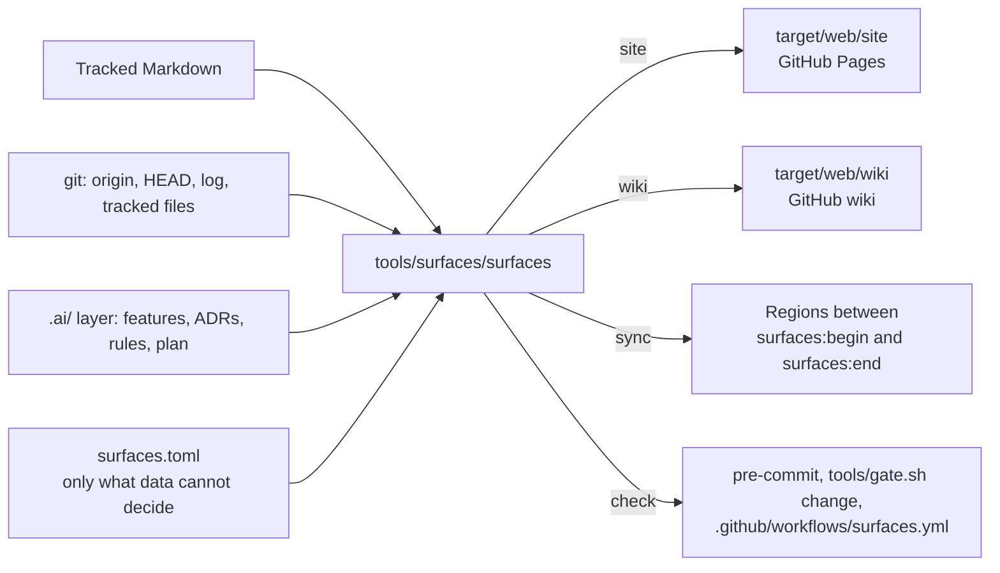

# Published surfaces

`tools/surfaces/surfaces` is one generator that turns what the repository already states into
everything it publishes: a GitHub Pages site, the GitHub wiki, and generated tables inside the
Markdown documents themselves. Its `check` command fails a commit while a generated region is
stale, a relative link or anchor leads nowhere, front matter does not parse, or a tool's flags and
its usage text disagree. Nothing published is written by hand.

## Why it exists

Documentation drifts the moment it restates something. A hand-kept index misses the newest page, a
status table says "planned" after the work merged, and links point at renamed files. The generator
publishes only what is derived from a source, so the published copy has no content of its own to
go stale, and a check turns drift into a failing commit with a file and line. The real-world
counterpart is docs-as-code with generated reference pages and a link checker in CI.

## How it works

- **Sources.** Tracked Markdown, git, and the `.ai/` manifest sections. `surfaces.toml` declares
  only the choices data cannot make: which documents to publish, which to exempt from the link
  check, and which numbers to count (`[[facts.items]]`).
- **Regions.** A pair of HTML comments whose contents the generator owns: `docs-index`,
  `ai-features`, `ai-adrs`, `ai-rules`, `ai-plan`, `surfaces`, and `facts` (numbers counted from
  tracked files, rewritten in the same commit that changes them). Edit around a region, never
  inside it.
- **Titles and summaries** come from front matter or the first heading and first paragraph, so a
  better first paragraph improves every index that lists the document.
- **Site.** The Flowbite admin shell, Mermaid for diagrams and ECharts for charts, copied from
  `node_modules` and never fetched from a CDN at view time. Every page ends with what links to it
  and what it links to.
- **Wiki.** The same documents as wiki pages; each sync replaces the whole wiki.
- **Tool flags.** A document that shows `tool --flag` is checked against the tool's parser, like
  a link.
- **Other generated text** in this fork follows the same idea with its own generator: the README
  scoreboard (`tools/research/readme-scoreboard`, see [Duels](duels.md)), the contributor blocks
  checked by `tools/check-prismatic-docs.sh`, and the event-kinds region written by
  `mcp-panel --write-event-kinds`.

The generator's full reference is [`tools/surfaces/README.md`](../../tools/surfaces/README.md).

## Where it lives

| File | What it holds |
|---|---|
| [`tools/surfaces/surfaces`](../../tools/surfaces/surfaces) | entry point; creates the virtual environment and runs the generator |
| [`tools/surfaces/surfaces.py`](../../tools/surfaces/surfaces.py) | discovery, rendering, regions, check |
| [`tools/surfaces/assets/`](../../tools/surfaces/assets/) | the site's stylesheet source and client script |
| [`surfaces.toml`](../../surfaces.toml) | the declared choices and the counted facts |
| [`.github/workflows/surfaces.yml`](../../.github/workflows/surfaces.yml) | check, site and wiki on every push; deploy from the default branch |
| [`.ai/repo/policy.yaml`](../../.ai/repo/policy.yaml) | `surfaces-on-commit` and `scoreboard-on-commit` in `enforcement` |
| [`tools/check-prismatic-docs.sh`](../../tools/check-prismatic-docs.sh) | the contributor docs match their catalogue |

## How it is tested

- `tools/surfaces/surfaces check` runs in the pre-commit hook, in `tools/gate.sh change` and in
  `.github/workflows/surfaces.yml`. Exit codes: 0 ok, 2 usage, 10 findings, 11 drift.
- `tools/surfaces/surfaces sync --check` writes nothing and exits 11 when a region would change.
- There is no unit test suite for the generator in `tools/surfaces/`; it is checked by running it
  over this repository.

## Related

- [Validation gate](validation-gate.md), [Majordomus supervision](majordomus-supervision.md),
  [Duels](duels.md)
- [Derived, not restated](../concepts/derived-not-restated.md),
  [Evidence and validation status](../concepts/evidence-and-validation-status.md)
- Rule [`project.published-surfaces-are-derived`](../../.ai/repo/rules/project/published-surfaces-are-derived.v1.md),
  ADR [0012](../../.ai/repo/adrs/0012-every-published-surface-is-derived-from-tracked-markdown-git.md),
  feature [`published-surfaces`](../../.ai/repo/features/published-surfaces.md)
