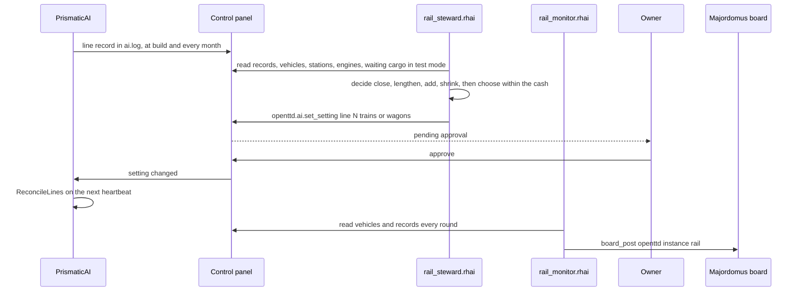

# Rail steward and monitor

**RESEARCH-ONLY.** Two Rhai scripts that look after the owner's railway once PrismaticAI has built
it. The steward decides, per line, how many trains and wagons it should run, or whether it should
close, and hands each decision to the bot as a setting. The monitor reports what is wrong (crashed,
lost, unserved, broken-down, stopped or old trains, and the bot's rail warnings) to the Majordomus
board. Both run as services from the panel's Scripts page. The deep explanation is
[`research/rail-steward.md`](../rail-steward.md); this page is the short mechanism view.

## Why it exists

A line that is built and then left alone either runs short of trains while cargo piles up, or keeps
paying maintenance on trains that lose money. The bot alone cannot judge that well from inside one
heartbeat. A steward outside the game reads the whole picture, decides, and lets the bot carry the
change out. Its real-world counterpart is a capacity planner beside an operations team: it sets
targets, operations reconcile to them, and a separate monitor raises alarms.

## How it works

- **Read** (`rail_lib.rhai`). Line records joined with `openttd://vehicles`, `openttd://stations`
  and `openttd://engines`; waiting cargo through the Script API in test mode, which changes
  nothing.
- **Decide and choose.** Close a line that lost money two years running; lengthen trains while a
  trainload waits; add a train when trains are full length; shrink when little waits. Closing and
  shrinking are always chosen; the rest goes through AlgoGlyph `knapsack-dp` over the cash above
  the reserve, or a greedy choice without AlgoGlyph, and the answer names the solver.
- **Hand over.** Each target is a bot setting, so it passes the [approval gate](approval-gate.md)
  unless the owner switched auto-approve on. `STEWARD_DRY=1` decides and prints only.
- **Renew.** A faster buildable locomotive on the same rails is handed to the game's own
  autoreplace through the Script API.
- **Monitor.** Every `MONITOR_EVERY_S` it ranks problems worst first and posts the named claim
  `openttd:<instance>:rail` when the report changes. `MCP_BOARD_DRY=1` prints instead.

## Where it lives

| File | What it holds |
|---|---|
| [`tools/research/mcp-panel/rhai/rail_lib.rhai`](../../tools/research/mcp-panel/rhai/rail_lib.rhai) | pure functions: records, lines, targets, choices, renewals, problems |
| [`tools/research/mcp-panel/rhai/rail_steward.rhai`](../../tools/research/mcp-panel/rhai/rail_steward.rhai) | the steward's round |
| [`tools/research/mcp-panel/rhai/rail_monitor.rhai`](../../tools/research/mcp-panel/rhai/rail_monitor.rhai) | the monitor's round |
| [`tools/research/prismatic-ai/PrismaticAI/lines.nut`](../../tools/research/prismatic-ai/PrismaticAI/lines.nut) | the bot side: records and `ReconcileLines` |
| [`tools/research/mcp-rhai/src/board.rs`](../../tools/research/mcp-rhai/src/board.rs) | the board client behind `board_post` |
| [`tools/research/mcp-rhai/src/panel_scripts.rs`](../../tools/research/mcp-rhai/src/panel_scripts.rs) | services and hot reload |

## How it is tested

- `cargo test` in `tools/research/mcp-rhai`: the `rail_*` tests in `main.rs` run `rail_lib.rhai` on
  fixtures (records, targets, choices within a budget, renewals, the monitor's ranking).
- `tools/research/mcp-scripts-check` drives the Scripts page that runs them.
- Duels on seed 4242 with the new geometry and with line targets are recorded in
  [`research/results/`](../results/) and read in [`../rail-steward.md`](../rail-steward.md)
  ("What was checked"), which also says what is still to run: a held-start A/B against the earlier
  geometry.

## Related

- [PrismaticAI](prismatic-ai.md), [Rhai scripting](rhai-scripting.md),
  [Approval gate](approval-gate.md), [Majordomus supervision](majordomus-supervision.md),
  [Planner and AlgoGlyph](planner-and-algoglyph.md)
- [Desired-state reconciliation](../concepts/desired-state-reconciliation.md),
  [Portfolio under a budget](../concepts/portfolio-under-a-budget.md),
  [Human in the loop](../concepts/human-in-the-loop.md)
