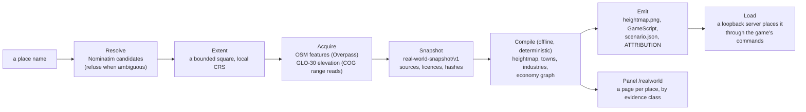

# Real-world scenario

A place name becomes a playable OpenTTD map. "Brno, Czech Republic" is resolved to explicit
candidates and fetched from lawful open data into a versioned snapshot. The snapshot is compiled
offline into a heightmap, towns, industries and a GameScript. Every game entity and economy link
says how it is known: OBSERVED, DERIVED, INFERRED or HYPOTHETICAL. The deep document is
[`research/real-world-scenario.md`](../real-world-scenario.md); this page is the mechanism view.

**RESEARCH-ONLY, UNSTABLE.** Nothing of it is compiled into OpenTTD. The tool runs outside the game
(`tools/research/real-world`, Rust), and the game consumes only its artifacts, through supported
paths: a heightmap loaded with `-g` and a GameScript that acts through the Script API.

## Why it exists

A game map invented by a generator tests an agent against a world that resembles nothing. A map
made from a real place tests it against a real geography: the towns, the terrain, the industries
that are actually there. The scenario also keeps a strict record of what is real and what is a
game stand-in.

That record is the same discipline an investigation needs: every claim labelled with its evidence,
its rule and its confidence, and nothing guessed when the input is ambiguous. An ambiguous place
("Springfield") is refused, never guessed.

## How it works

| Evidence class | Means |
|---|---|
| OBSERVED | the source records it (every snapshot feature) |
| DERIVED | a deterministic rule made a game construct of the same kind (a settlement with a population becomes a town) |
| INFERRED | a judgement under uncertainty (a gas-fired plant becomes the power station; every proximity edge) |
| HYPOTHETICAL | no source supports it as it is in the game: a gameplay stand-in, named as one and never after its operator; confidence 0 |

The network is used only when asked (`--live`), paced, cached and bounded. By default the
committed Brno snapshot is compiled offline, and the replay is checked for determinism. Google
Maps is excluded, because its terms forbid making terrain models from it.

## Where it lives

| File | Role |
|---|---|
| [`tools/research/real-world/`](../../tools/research/real-world/) | the pipeline (`rw-scenario`): resolve, acquire, snapshot, compile, emit, load |
| [`tools/research/schema/real-world-scenario.v1.schema.json`](../../tools/research/schema/real-world-scenario.v1.schema.json) | the scenario contract every artifact is checked against |
| [`tools/research/mcp-rhai/src/panel_realworld.rs`](../../tools/research/mcp-rhai/src/panel_realworld.rs) | the panel's routes (`GET /api/realworld`, `GET /api/realworld/scenario`, `POST /api/realworld/compile`), derived into OpenAPI, Swagger UI, the hub and Rhai |
| [`tools/research/mcp-panel/static/realworld.html`](../../tools/research/mcp-panel/static/realworld.html), [`realworld.js`](../../tools/research/mcp-panel/static/realworld.js) | `/realworld`, and a page per place on one ECharts map by evidence class |
| [`research/real-world-scenario.md`](../real-world-scenario.md) | the flow, the evidence rules, sources and terms, limits, the Brno slice |

## How it is tested

- `cargo test` in `tools/research/real-world`: `tests/pipeline.rs` covers determinism, replay,
  licensing, provenance, the evidence rules and the landmark test, and `tests/schema.rs` covers
  the contract.
- `tools/research/mcp-realworld-check <panel-url>` drives `/realworld` in a real Chrome:
  - the list of places;
  - a place's map with data;
  - the contract tiles and the evidence badges;
  - maximize and Escape;
  - a 404 for an unknown place.

  It declares `panel /realworld`, so rule `project.web-ui-is-covered-end-to-end` counts the page
  as covered (`tools/research/e2e-coverage`).
- The loopback load check (`src/loadcheck.rs`): the heightmap loads headless, and the GameScript
  places what the scenario says.

## Related

- Mechanisms: [planner and AlgoGlyph](planner-and-algoglyph.md) (it plans on whatever map it is
  given), [control panel](control-panel.md), [validation gate](validation-gate.md),
  [MCP server in the engine](mcp-server-in-the-engine.md).
- Concepts: [digital twin as a testbed](../concepts/digital-twin-testbed.md),
  [evidence and validation status](../concepts/evidence-and-validation-status.md),
  [derived, not restated](../concepts/derived-not-restated.md).
- A real game on a real place against real opponents: [`research/real-game.md`](../real-game.md).
