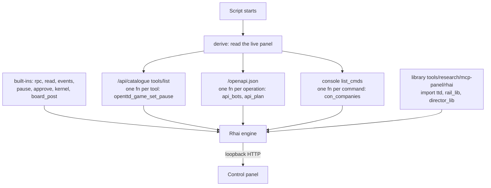

# Rhai scripting

**RESEARCH-ONLY.** [Rhai](https://rhai.rs) is a small embedded scripting language for Rust. Here it
is the language for scripts that drive a running game from outside: `mcp-rhai` runs a script
against a control panel, the panel runs scripts in its own process, and the panel's Scripts page
edits them and runs them as background services that reload when their file changes. A script
gets one function per MCP tool, per panel route and per console command, derived from the live
game when it starts.

## Why it exists

Driving a game through raw JSON-RPC or curl is slow to write and easy to get wrong. A scripting
layer lets the owner and agents write a whole game, a narrator, a steward or a monitor in a few
dozen lines. Deriving the functions from the live catalogue means a tool or route added to the game
or panel is callable from Rhai without editing the host. A script talks to the panel's loopback
API, so it never sees the MCP bearer token. The real-world counterpart is the scripting console of
an operations or automation platform (runbooks as code), whose bindings follow the platform's API.

## How it works

- **Built-ins.** `rpc`, `read`, `overview`, `status`, `console`, `pause`, `approve`,
  `auto_approve`, `events`, `mcp_call`, `mcp_read`, `world_plan`, `world_graph`, `kernel`,
  `kernels`, `board_post`, `env`, `sleep`, `to_json`, and `tools()`, `commands()`, `help()` to list
  what was derived (header of `main.rs`).
- **Derived functions** (`derive` in `main.rs`): a tool name with dots turned into underscores, an
  `api_<operationId>` per operation of the panel's OpenAPI document (streaming routes left out), a
  `con_<name>` per console command. With `--hub URL`, one `hub_<method>` per hub method.
- **The library.** `import "ttd" as ttd;` loads `ttd.rhai`, the high-level commands. Its
  `set_pause` waits for the operator's approval and never approves itself. `$MCP_RHAI_PATH`
  overrides the folder.
- **In the panel.** `POST /api/rhai` and `POST /api/rhai/stream` run a script in the panel's
  process, in the same engine (`host` in `main.rs`, compiled into `mcp-panel` as `rhai_host`).
- **The Scripts page.** `/scripts` lists every `.rhai` file with its header comment, imports and
  importers. The editor checks the text with the Rhai parser as you type; Save writes only text that
  parses (otherwise 422), in place, so the diff shows it and committing stays the owner's. A script
  can run once (streamed) or as a service. A watcher looks every second
  (`RELOAD_EVERY`) and restarts a service whose own file or any imported library changed; a change
  that does not parse leaves the old run going and says why in its log.

The scripts in the library today:

| Script | What it does |
|---|---|
| [`ttd.rhai`](../../tools/research/mcp-panel/rhai/ttd.rhai) | high-level commands: state, new game, start an AI, gated pause, report, watch |
| [`demo.rhai`](../../tools/research/mcp-panel/rhai/demo.rhai), [`full_game.rhai`](../../tools/research/mcp-panel/rhai/full_game.rhai) | a game driven from a new world to a final report |
| [`rail_lib.rhai`](../../tools/research/mcp-panel/rhai/rail_lib.rhai), [`rail_steward.rhai`](../../tools/research/mcp-panel/rhai/rail_steward.rhai), [`rail_monitor.rhai`](../../tools/research/mcp-panel/rhai/rail_monitor.rhai) | rail lines as data, the steward, the monitor ([Rail steward and monitor](rail-steward-and-monitor.md)) |
| [`director_lib.rhai`](../../tools/research/mcp-panel/rhai/director_lib.rhai), [`director.rhai`](../../tools/research/mcp-panel/rhai/director.rhai) | moves the owner's camera to where the bot works |
| [`narrator.rhai`](../../tools/research/mcp-panel/rhai/narrator.rhai) | reports the bot's actions as in-game chat |
| [`steward.rhai`](../../tools/research/mcp-panel/rhai/steward.rhai) | the bot asks the owner yes/no questions in the game |
| [`ask_relay.rhai`](../../tools/research/mcp-panel/rhai/ask_relay.rhai), [`build_plan.rhai`](../../tools/research/mcp-panel/rhai/build_plan.rhai) | answers "Ask the planner..." requests; carries out a planned sentence |

Usage and the built-in list in full: [`../mcp-control.md`](../mcp-control.md) ("Rhai"), and the
Scripts page in [`../rail-steward.md`](../rail-steward.md) ("The Scripts page").

## Where it lives

| File | What it holds |
|---|---|
| [`tools/research/mcp-rhai/src/main.rs`](../../tools/research/mcp-rhai/src/main.rs) | the `mcp-rhai` binary and the engine `host`: built-ins, `derive`, `derive_hub` |
| [`tools/research/mcp-rhai/src/panel_scripts.rs`](../../tools/research/mcp-rhai/src/panel_scripts.rs) | the library, parse check, save, services, hot reload |
| [`tools/research/mcp-rhai/src/panel.rs`](../../tools/research/mcp-rhai/src/panel.rs) | `/api/rhai`, `spawn_script`, the script routes in `routes()` |
| [`tools/research/mcp-panel/rhai/`](../../tools/research/mcp-panel/rhai/) | the script library |
| [`tools/research/mcp-panel/static/scripts.html`](../../tools/research/mcp-panel/static/scripts.html), [`scripts.js`](../../tools/research/mcp-panel/static/scripts.js) | the Scripts page: editor, highlighting, outline, services |

## How it is tested

- `cargo test` in `tools/research/mcp-rhai`: `main.rs` tests run `rail_lib.rhai` and
  `director_lib.rhai` on fixtures (`rail_*`, the director), check that every hub method but streams
  is a Rhai function, and that a kernel refusal is an error; `panel_scripts.rs` tests cover names,
  docs, imports, the parse check, and a service that hot-reloads on a library edit.
- `node --test tools/research/mcp-panel/test/scripts.test.mjs`: tokens, the outline, stream frames.
- `tools/research/mcp-scripts-check <panel-url>` drives the Scripts page in a real Chrome.

## Related

- [Control panel](control-panel.md), [Hub](hub.md),
  [Rail steward and monitor](rail-steward-and-monitor.md), [Approval gate](approval-gate.md)
- [Derived, not restated](../concepts/derived-not-restated.md),
  [Desired-state reconciliation](../concepts/desired-state-reconciliation.md),
  [End to end or it does not exist](../concepts/end-to-end-or-it-does-not-exist.md)
