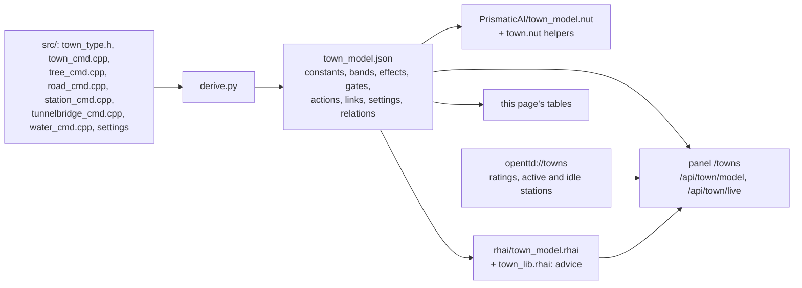
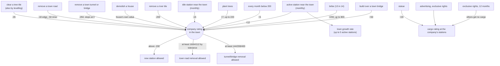

# Town authority model

**RESEARCH-ONLY.** What a town's local authority rewards, what it punishes, what it then allows or
refuses, and what a company can do about it, derived from the engine's own source rather than
written by hand. One generator reads `src/` and writes the model once as JSON. The same model then
goes to the bot as a Squirrel table, to scripts as a Rhai map, to the control panel's Towns page,
and to the tables on this page. Every rule carries the file and line it came from.

## Why it exists

A town decides whether a company may build a station, remove a road or level a site, and its
mood depends on things the company does far from the town hall: clearing trees, leaving a station
idle, removing a town bridge. PrismaticAI lost games to it without knowing why. On 1425f2c3 m-0015
the company levelled an airport site, and the trees it cleared made the town refuse the airport
just paid for. The game ended without a single aircraft
([knowledge record](../../.ai/repo/knowledge/curated/levelling-an-airport-site-clears-trees-and-costs-town-rating.md)).

The rules are spread over a dozen engine files. Copying their numbers into a bot or a script by
hand goes stale silently, so the model is derived: an engine change reaches every reader by
re-running the generator, and `--check` fails while the committed outputs disagree with the
sources. The real-world counterpart is a permitting authority whose rules are published as data.
An applicant reads the rules from the data, never from a memo.

## How it works

How the parts connect in the game:

The numbers on the arrows come from the model, as of the revision in the tables below.

- **The generator** (`tools/research/town-model/derive.py`). It reads every `RATING_*` constant of
  `src/town_type.h`, resolving aliases. It reads every `ChangeTownRating` call and every direct
  write to `Town::ratings` in `src/` (scripts, MCP server, saveload, tests and GUI excluded) and
  names each one by the enclosing function and that function's Doxygen brief. It also reads:
  - every comparison of a rating with a constant;
  - the per-tolerance table of `CheckforTownRating`;
  - the rating bands `ScriptTown::GetRating` returns, by enum value;
  - the `TownAction` enum with its cost factors and what each action procedure sets;
  - the rules that tie a town to stations: the statue cargo bonus, exclusivity, airport noise,
    the monthly station service and the growth table;
  - the defaults of the settings involved.

  From these it builds `relations`: event to rating, rating to gate, action to effect. Each rule
  keeps `source` (file:line) and the model keeps every source file's blob id.
- **The outputs.** `town_model.json` is the model. `PrismaticAI/town_model.nut` is the `TOWN_MODEL`
  table, and `rhai/town_model.rhai` is one function per part plus `model()`. This page's tables
  between the markers are generated as well. All four are generated; `derive.py --check` reports
  any that is stale.
- **The Rhai library** (`tools/research/mcp-panel/rhai/town_lib.rhai`). It holds pure functions
  over the model and a live town record:
  - `band_of`, `allows_station` and `allows_removal`;
  - `changed`, which follows `ChangeTownRating`'s step-towards-limit rule;
  - `after_month` (`UpdateTownRating`) and `months_until_above`;
  - `after_clearing_trees` and `trees_to_get_above`;
  - `likes_and_dislikes`;
  - `advice(town, tolerance)`: what to do, why and which rule, most urgent first.

  No threshold in it is a literal.
- **The bot** (`tools/research/prismatic-ai/PrismaticAI/town_model.nut`). An AI sees only the
  band (`AITown.GetRating`; `GetDetailedRating` is game-script only), so its helpers work from the
  band's lowest value. Nothing in the bot's decisions reads the model yet: two decisions built on
  it lost in replays (the knowledge record above), and the next one is A/B-tested like any change.
- **The panel.** The Towns page shows the model and, with a game connected, each town's rating,
  band and advice for a chosen company (`/api/town/model`, `/api/town/live`).

## The rules

<!-- town-model:begin -->

Generated from the engine sources by `tools/research/town-model/derive.py` (model `81f5749da8c7`); do not edit between the markers.

**What raises and lowers a company's rating** (one row per place in the engine):

| Trigger | Function | Change | Stops at | Source |
|---|---|---|---|---|
| Change the ownership of all the items of a company. | `ChangeOwnershipOfCompanyItems` | set to 500 |  | `src/economy.cpp:385` |
| Is it allowed to remove the given road bits from the given tile? | `CheckAllowRemoveRoad` | -18 or -50 | -100 | `src/road_cmd.cpp:304` |
| A town tile is cleared (ClearTileProc). | `ClearTile_Town` | hs->remove_rating_decrease | -1000 | `src/town_cmd.cpp:714` |
| Actually create a town. | `DoCreateTown` | set to 500 |  | `src/town_cmd.cpp:2042` |
| Perform the "bribe" town action. | `TownActionBribe` | set to -50 |  | `src/town_cmd.cpp:3694` |
| Perform the "bribe" town action. | `TownActionBribe` | +200 | 800 | `src/town_cmd.cpp:3698` |
| Monthly callback to update town and station ratings. | `UpdateTownRating` | +5 | 200 | `src/town_cmd.cpp:3826` |
| Monthly callback to update town and station ratings. | `UpdateTownRating` | +12 |  | `src/town_cmd.cpp:3833` |
| Monthly callback to update town and station ratings. | `UpdateTownRating` | -15 |  | `src/town_cmd.cpp:3838` |
| Plant a tree. | `CmdPlantTree` | +7 | 220 | `src/tree_cmd.cpp:610` |
| A trees tile is cleared (ClearTileProc). | `ClearTile_Trees` | -35 | -1000 | `src/tree_cmd.cpp:737` |
| Build a Bridge | `CmdBuildBridge` | +50 | 1000 | `src/tunnelbridge_cmd.cpp:440` |
| Remove a tunnel from the game, update town rating, etc. | `DoClearTunnel` | -250 | 0 | `src/tunnelbridge_cmd.cpp:887` |
| Remove a bridge from the game, update town rating, etc. | `DoClearBridge` | -250 | 0 | `src/tunnelbridge_cmd.cpp:968` |
| A water tile is cleared (ClearTileProc). | `ClearTile_Water` | -200 | -1000 | `src/water_cmd.cpp:620` |

**Where the engine compares a rating with a threshold** (the gates are the authority's refusals):

| Guarded | Function | Condition | Tolerance | Source |
|---|---|---|---|---|
| Perform the "bribe" town action. | `TownActionBribe` | > -50 |  | `src/town_cmd.cpp:3693` |
| Get a list of available town authority actions. | `GetMaskOfTownActions` | >= 800 |  | `src/town_cmd.cpp:3747` |
| Monthly callback to update town and station ratings. | `UpdateTownRating` | < 200 |  | `src/town_cmd.cpp:3825` |
| Checks whether the local authority allows construction of a new station (rail, road, airport, dock) on the given tile | `CheckIfAuthorityAllowsNewStation` | > -200 |  | `src/town_cmd.cpp:3985` |
| RoadRemove | `CheckforTownRating` | >= 16 | lenient | `src/town_cmd.cpp:4143` |
| TunnelBridgeRemove | `CheckforTownRating` | >= 144 | lenient | `src/town_cmd.cpp:4143` |
| RoadRemove | `CheckforTownRating` | >= 64 | neutral | `src/town_cmd.cpp:4144` |
| TunnelBridgeRemove | `CheckforTownRating` | >= 208 | neutral | `src/town_cmd.cpp:4144` |
| RoadRemove | `CheckforTownRating` | >= 112 | hostile | `src/town_cmd.cpp:4145` |
| TunnelBridgeRemove | `CheckforTownRating` | >= 400 | hostile | `src/town_cmd.cpp:4145` |
| RoadRemove | `CheckforTownRating` | >= -1000 | permissive | `src/town_cmd.cpp:4146` |
| TunnelBridgeRemove | `CheckforTownRating` | >= -1000 | permissive | `src/town_cmd.cpp:4146` |
| A town tile is cleared (ClearTileProc). | `ClearTile_Town` | >= hs->remove_rating_decrease |  | `src/town_cmd.cpp:698` |

**Town actions** (cost = the town-action base price x factor / 256):

| Action | Factor | What it does | Source |
|---|---|---|---|
| AdvertiseSmall (Small advertising campaign.) | 2 | cargo ratings to 64 within 10 tiles | `src/town_cmd.cpp:3469` |
| AdvertiseMedium (Medium advertising campaign.) | 4 | cargo ratings to 112 within 15 tiles | `src/town_cmd.cpp:3483` |
| AdvertiseLarge (Large advertising campaign.) | 9 | cargo ratings to 160 within 20 tiles | `src/town_cmd.cpp:3497` |
| RoadRebuild (Rebuild the roads.) | 35 | needs `economy.fund_roads`; `road_build_months` = 6 | `src/town_cmd.cpp:3511` |
| BuildStatue (Build a statue.) | 48 | `statues` = company | `src/town_cmd.cpp:3548` |
| FundBuildings (Fund new buildings.) | 53 | needs `economy.fund_buildings`; `fund_buildings_months` = 3 | `src/town_cmd.cpp:3607` |
| BuyRights (Buy exclusive transport rights.) | 117 | needs `economy.exclusive_rights`; `exclusive_counter` = 12; `exclusivity` = _current_company; cargo ratings to 130 within 17 tiles | `src/town_cmd.cpp:3640` |
| Bribe (Try to bribe the council.) | 175 | fails with chance 1/14; `unwanted` = 6; `ratings` = RATING_BRIBE_DOWN_TO; rating +200 up to 800; `exclusivity` = CompanyID::Invalid(); `exclusive_counter` = 0 | `src/town_cmd.cpp:3671` |

**Other rules tying a town to a company's stations:**

| Rule | Effect | Source |
|---|---|---|
| `airport_noise` | with station_noise_level on, an airport is refused when the nearest town's noise would exceed its MaxTownNoise | `src/station_cmd.cpp:2667` |
| `statue_cargo_rating` | +26 cargo rating (of 255) at every station of the company in a town with its statue | `src/station_cmd.cpp:4060` |
| `exclusivity_blocks_others` | while a town's exclusive rights run, other companies' stations in it receive no cargo | `src/station_cmd.cpp:4577` |
| `station_service_monthly` | each month, every company station near the town that loaded or unloaded within 20 rating periods raises the rating by RATING_STATION_UP_STEP, every other one lowers it by RATING_STATION_DOWN_STEP | `src/town_cmd.cpp:3831` |
| `active_stations_counted` | a company station near the town that loaded or unloaded within 20 rating periods counts as active for the town's growth rate | `src/town_cmd.cpp:3878` |
| `growth_by_active_stations` | town ticks between growth steps by the number of active stations (0..5+); fewer is faster; funded buildings use the first row (normal [320, 420, 300, 220, 160, 100], funded [120, 120, 120, 100, 80, 60]) | `src/town_cmd.cpp:3898` |
| `terraform_clears_trees` | terraforming a tree tile clears it (LandscapeClear), which costs the tree-removal rating | `src/tree_cmd.cpp:1040` |

<!-- town-model:end -->

## What a company should do, in short

Derived from the tables above:

- **What a town likes:** stations near it that load or unload regularly (+12 a month each, and up
  to five of them make it grow faster). It also likes planted trees (up to 220) and successful
  bribes (up to 800). Below 200 a rating recovers by itself (+5 a month).
- **What a town dislikes:** every cleared tree tile (-35, including those levelling clears), idle
  stations (-15 a month each), removing its roads, bridges, tunnels, rivers and houses, and a
  caught bribe (rating set to -50 and six months unwanted).
- **What it refuses:** a new station at -200 or below, and road, bridge or tunnel removal below
  the tolerance's threshold.
- **What helps a company's stations without touching the rating:** a statue (+26 cargo rating),
  advertising, and exclusive rights (rivals' stations get no cargo for 12 months).

## Where it lives

| Part | Path |
|---|---|
| Generator | [`tools/research/town-model/derive.py`](../../tools/research/town-model/derive.py) |
| Model | [`tools/research/town-model/town_model.json`](../../tools/research/town-model/town_model.json) |
| Rhai | [`town_model.rhai`](../../tools/research/mcp-panel/rhai/town_model.rhai), [`town_lib.rhai`](../../tools/research/mcp-panel/rhai/town_lib.rhai) |
| Bot | [`town_model.nut`](../../tools/research/prismatic-ai/PrismaticAI/town_model.nut) |

## How it is tested

- `python3 tools/research/town-model/derive.py --check`: the committed outputs match the sources.
- `cargo test town_` in `tools/research/mcp-rhai` (run with `RUSTFLAGS="-C target-cpu=native"` on
  a machine whose global cargo config sets LTO) checks town_lib against the engine's rules:
  - the thresholds and bands;
  - a change stopping at its limit;
  - the monthly update;
  - trees needed;
  - the advice for a town that refuses stations.
