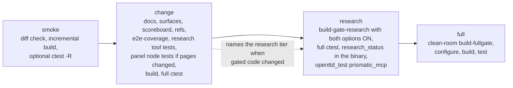

# Validation gate

`tools/gate.sh` is the fork's one entry point for checking a change. It has four tiers of rising
cost: `smoke`, `change`, `research` and `full`. Each wraps the repository's own CMake and CTest
plus the fork's own checks. Results are reported in a fail-closed vocabulary: PASS, FAIL, PARTIAL,
NOT RUN (and NOT APPLICABLE for a change with no behaviour to check). Beside the gate, a rule says
every web page must be driven in a real browser, and `tools/research/e2e-coverage` enforces it.

## Why it exists

A check that is too expensive is skipped; a check that is too cheap passes broken work. Tiers let
the cost match the change. Research code behind `OPTION_RESEARCH_INSTRUMENTATION` or
`OPTION_PRISMATIC_MCP_SERVER` is invisible to a default build, so it needs a tier that turns those
options on. A fixed status vocabulary stops a run that skipped something from being reported as a
pass. The real-world counterpart is a staged CI pipeline with quality gates, where a skipped stage
is reported as skipped, never green.

## How it works

- **smoke.** `git diff --check`, an incremental build of `build/`, and `ctest -R` when asked.
- **change.** Before calling a task done: diff hygiene, `tools/check-prismatic-docs.sh`,
  `tools/surfaces/surfaces check`, `tools/research/readme-scoreboard --check`,
  `tools/knowledge/refs check`, `tools/research/e2e-coverage`, the research tools' Python tests
  (`unittest discover -s tools/research -p 'test_*.py'`), the panel's node tests when its pages
  changed, then build and the full ctest suite. It lists any research-gated file the change
  touches and names the research tier.
- **research.** Configures `build-gate-research/` with both research options, builds, runs ctest,
  proves `research_status` is in the binary, and runs the `[prismatic_mcp]` Catch2 tests.
- **full.** Wipes and rebuilds `build-fullgate/` from scratch.
- **PARTIAL on a missing base set.** Without OpenGFX or the original data the `regression_*` cases
  hang on macOS, so every tier that runs ctest checks first, reports them NOT RUN and exits 3.
- **The gate never commits or pushes**, and never writes outside the repository.

### Every web page, end to end

Rule
[`project.web-ui-is-covered-end-to-end`](../../.ai/repo/rules/project/web-ui-is-covered-end-to-end.v1.md):
every page of the panel and the hub has a Playwright check that opens it in Chrome against a live
game and proves its content, its shell, no page error and no sideways scroll at 390 px.
`tools/research/e2e-coverage` reads the pages from `static/shell.js` `APPS` and each check's
`// e2e-covers:` line, and fails on a page no check declares, a declaration in a file that drives
no browser, or a declared page the shell lacks. `--run --panel URL [--hub URL]` also runs every
declaring check; one that needs the hub and gets none is NOT RUN.

The tier table and the taxonomy are in [`research/README.md`](../README.md); the research CLI that
records an experiment's build and runtime configuration is in [`../tooling.md`](../tooling.md).

## Where it lives

| File | What it holds |
|---|---|
| [`tools/gate.sh`](../../tools/gate.sh) | the four tiers, the base-set check, the PARTIAL exit |
| [`research/README.md`](../README.md) | the gating model and the PASS, FAIL, PARTIAL, NOT RUN, NOT APPLICABLE taxonomy |
| [`tools/research/e2e-coverage`](../../tools/research/e2e-coverage) | pages from the shell against checks' declarations |
| [`tools/research/mcp-overview-check`](../../tools/research/mcp-overview-check), [`mcp-pages-check`](../../tools/research/mcp-pages-check), [`mcp-scripts-check`](../../tools/research/mcp-scripts-check), [`mcp-hub-page-check`](../../tools/research/mcp-hub-page-check), [`mcp-viz-check`](../../tools/research/mcp-viz-check) | the browser checks that declare `e2e-covers` |
| [`tools/research/research`](../../tools/research/research) | the research CLI: init, configure, build, validate, report ([`../tooling.md`](../tooling.md)) |
| [`tools/check-prismatic-docs.sh`](../../tools/check-prismatic-docs.sh) | the generated contributor docs are current |
| [`tools/knowledge/refs`](../../tools/knowledge/refs) | every file and symbol the `.ai/` records cite still exists |

## How it is tested

- The gate is itself the test runner; its own correctness is checked by running it. Report the
  tier actually run and its result, never a tier that was not run.
- `node --test tools/research/mcp-panel/test/e2e-coverage.test.mjs` runs the coverage rule inside
  the panel's node tests.
- `tools/research/test/research_test.sh` tests the research CLI.
- `tools/knowledge/test_refs.py` tests the refs checker.

## Related

- [Published surfaces](published-surfaces.md), [Control panel](control-panel.md),
  [Majordomus supervision](majordomus-supervision.md), [Duels](duels.md)
- [Evidence and validation status](../concepts/evidence-and-validation-status.md),
  [End to end or it does not exist](../concepts/end-to-end-or-it-does-not-exist.md)
- Rule [`project.never-report-unrun-validation-as-pass`](../../.ai/repo/rules/project/never-report-unrun-validation-as-pass.v1.md),
  ADR [0002](../../.ai/repo/adrs/0002-validation-runs-in-three-cost-tiers-behind-one-gate-script-a.md)
