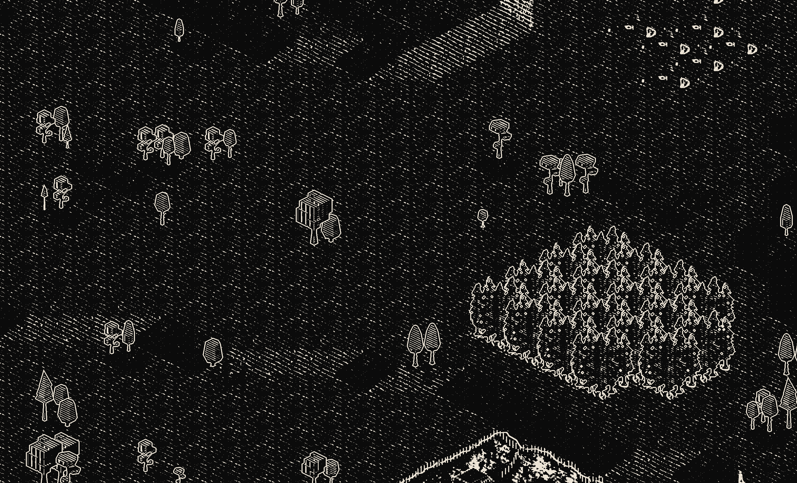
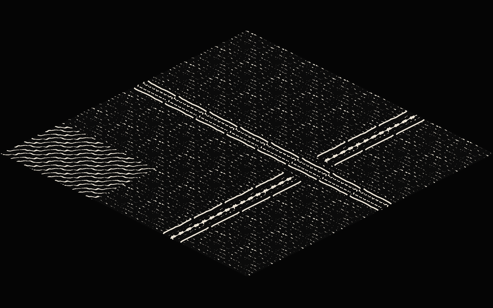
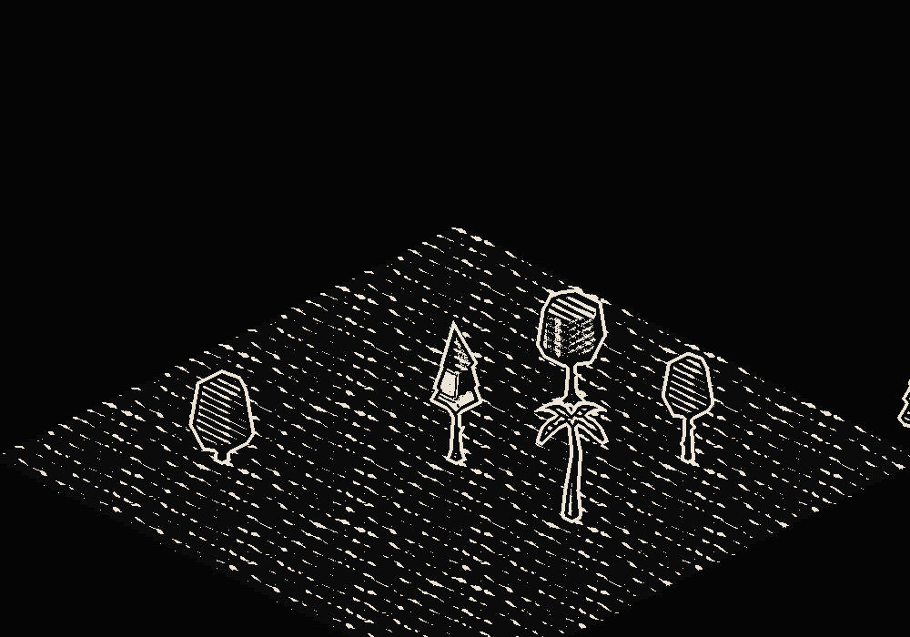

# NoirGFX: the SIG NIHL noir base graphics set

A base graphics set that recuts every OpenGFX sprite as a red-black linocut in the owner's SIG
NIHL style, 32bpp at 1x, 2x and 4x zoom, seamless across tiles, with Kenney's CC0 models
replacing original assets. Issue [I0079](../../.ai/repo/project/issues/I0079.yaml); tool and
method in [`tools/research/noirgfx/`](../../tools/research/noirgfx/README.md).

The owner asked for every tile in their dark-noir style (strict black / cream / signal red, sharp
linocut), high resolution, seamless, automated and pluggable, with Kenney's CC0 models replacing
most of the original assets. NoirGFX is a base graphics set built from the OpenGFX 8.0 release:
every sprite keeps its number, size and offsets and gains 32bpp alternatives at 1x, 2x and 4x.
Trees are rendered from Kenney models; everything else is restyled from OpenGFX for now.

*OpenTTD (this fork's master build) running NoirGFX, title game, `screenshot big` (4x).*

| Ground, rail, road and water (offline preview, 4x) | Kenney trees through the renderer (4x) |
|---|---|
|  |  |

## What was built

- `noirgfx-1.tar`: `noirgfx.obg` plus six GRFs (container version 2), selectable as *NoirGFX*
  in Game Options or with `openttd -I NoirGFX`. 10,126 OpenGFX sprites restyled, 371 of them
  (53 tree types x 7 growth stages) replaced by Kenney renders; the three sprite fonts (680
  sprites) are left as OpenGFX draws them.
- The Kenney models are not in git (GitHub refuses LFS objects on a public fork; owner answer 8):
  `noirgfx curate` extracts them from the two Kenney bundles and verifies them against the
  committed `kenney-curated.sha256`.
- Never the default: the `.obg` carries `fallback = 1`, so OpenTTD's automatic choice
  (`DetermineBestSet` in `src/gfxinit.cpp`) prefers OpenGFX or any other non-fallback set. NoirGFX
  is used only when chosen in Game Options (stored as `[graphicsset] name = NoirGFX`) or with `-I`.
- Build from scratch: about 10 minutes on this machine (Blender renders about 4 of them, grfcodec
  encoding most of the rest); renders are cached, so a style-only rebuild skips Blender.

## Validation

| Step | Result |
|---|---|
| `tools/research/noirgfx/noirgfx build` | exit 0 (the trailing `syntax error` in that run's log came from editing the wrapper while bash was still reading it; the tar had been written) |
| `tools/research/noirgfx/noirgfx check` | all checks passed: obg checksums equal OpenTTD's data-section md5 for all six GRFs; every OpenGFX sprite kept with number, size and offsets; one 32bpp alternative per zoom per restyled sprite; sprites 3981 (grass), 1011 (rail) and 1333 (road) invariant under tile-lattice shifts at 1x, 2x and 4x |
| OpenTTD loads the set | `dbg: [grf:1] Using the NoirGFX base graphics set`, blitter `32bpp-anim` |
| Not the default, still selectable | fresh config, OpenGFX and NoirGFX installed: no choice gives `Using the OpenGFX base graphics set`; `-I NoirGFX` and `[graphicsset] name = NoirGFX` both give `Using the NoirGFX base graphics set` (`-v null:ticks=5 -d grf=1`) |
| In-game screenshot | `ingame-title-4x.png` above, via `noirgfx shot` |
| `noirgfx check --rebuild` | PASS: a build from scratch into an empty temporary cache, Blender re-rendering all 1,113 Kenney sprites, gives a byte-identical tar (md5 `f50545e170c9381873c82dfff1c6f84a`, the set with `fallback = 1`), models from `noirgfx curate` verified against `kenney-curated.sha256` |

Configuration: `build/openttd` built from master at the time (`OpenTTD 20261115-master`), macOS 26
arm64, cocoa video driver, null sound and music, OpenGFX 8.0, grfcodec `4c71c0a`, Blender 5.3.0,
`style.toml` sha256 `9334a5fc45be3d68aff3b01f73b529c56ce5b24f0c16298f966f98e9375e8070`.

## In-game screenshots: what works

OpenTTD queues screenshots to the main thread, so a console script that ends with `exit` races
them; a `schedule` issued from inside a scheduled script fires in the same pass; a second
screenshot request replaces a pending one; under `-v null` the queue is never drained at all
(knowledge `the-null-video-driver-never-drains-the-main-thread-queue`); and without a `zoomto`
first no screenshot was written. `noirgfx shot` therefore takes the 4x shot when the title game
loads, the 1x shot a game month later, and ends the process itself once the files stop growing.
It is still flaky: in the last run only the 4x shot landed.

## Limits

- Palette animation is not reproduced (water and lights are static images).
- Window chrome comes from engine palette colours, not sprites; a base set cannot restyle it.
- Sprite classification is geometric; a misclassified sprite gets the other treatment.
- Only trees are Kenney replacements so far; houses (City Kit Suburban / Commercial, Modular
  Buildings), road vehicles (Car Kit) and ships (Watercraft) are the next mappings.
- The AI refinement step the owner chose (img2img by category) is designed, not implemented.
- Observer effects: none on the game; the set changes only pixels, never game state.
