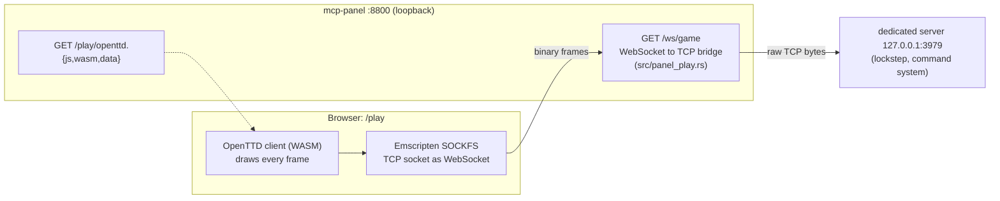

# Play in the browser

**RESEARCH-ONLY.** The panel's Play page (`/play`) runs the game in your browser, fullscreen if you
want. The browser does not get a video stream or screenshots. It runs the real OpenTTD client,
compiled to WebAssembly by upstream's Emscripten port (`os/emscripten`), which draws every frame
itself. The client joins the panel's dedicated server over the normal network protocol, so only the
game's own packets cross the wire. In OpenTTD's deterministic lockstep, those packets are the
command stream: a few kilobytes a second instead of megabytes of pictures.



## Why not screenshots

A screenshot of the GUI client (`/api/view/screenshot`, `openttd.view.screenshot`) is a 1.58 MB PNG at
2560 × 1378. It took 0.32 to 0.67 s on the stack measured on 2026-11-19, so the live view ran at about
3 frames a second, and a click cost several game ticks of MCP round trips. The WebAssembly client
has neither cost. The browser renders locally at the browser's frame rate, the interface answers
locally, and a command reaches the server with the same latency as a native client's. The
screenshot path stays where it is useful: the overview's thumbnail, agents, and the `openttd.input.*`
tools.

Two independent design reviews asked for this session recommended the same split. The WASM client
is the primary path, and the screenshot path is the fallback.

## Build the client

Use upstream's Docker image (`os/emscripten/README.md`), into `build-wasm/` (git ignores it):

```bash
cd os/emscripten && docker build -t emsdk-openttd . && cd ../..
mkdir -p build-wasm-host build-wasm/baseset build-wasm/.dockhome
cp ~/Documents/OpenTTD/baseset/opengfx-8.0.tar build-wasm/baseset/   # preloaded: no download from the internet
printf '[safe]\n\tdirectory = *\n' > build-wasm/.dockhome/.gitconfig
G=(-e "HOME=$PWD/build-wasm/.dockhome" -e GIT_CONFIG_COUNT=1 -e GIT_CONFIG_KEY_0=safe.directory -e 'GIT_CONFIG_VALUE_0=*')
D=(docker run --rm "${G[@]}" -v "$PWD:$PWD" -u "$(id -u):$(id -g)")
"${D[@]}" --workdir "$PWD/build-wasm-host" emsdk-openttd cmake .. -DOPTION_TOOLS_ONLY=ON
"${D[@]}" --workdir "$PWD/build-wasm-host" emsdk-openttd make -j8 tools
"${D[@]}" --workdir "$PWD/build-wasm" emsdk-openttd emcmake cmake .. -DHOST_BINARY_DIR=../build-wasm-host -DCMAKE_BUILD_TYPE=Release -DOPTION_USE_ASSERTS=OFF
"${D[@]}" --workdir "$PWD/build-wasm" emsdk-openttd emmake make -j8
```

Two traps of a macOS host:
- **Colima mounts only your home directory.** A file under `/private/tmp` is empty inside the
  container, so the git configuration lives under `build-wasm/`.
- **git refuses the mounted repository** ("dubious ownership"). The version script then cannot read
  the revision, and the build fails in `FindVersion.cmake`. `emmake` does not keep `HOME`, so the
  exception also goes in through `GIT_CONFIG_*`. In those variables the `*` must be quoted, or the
  shell expands it.

The page asks `/api/play` whether `openttd.js`, `.wasm` and `.data` exist. `$MCP_PLAY_DIR` points the
panel at another build.

## Revisions must match

Lockstep only works when the client and the server run the same code, so the server refuses a client
whose revision string differs. Build the WebAssembly client and the research server
(`build-gate-research`) from the same commit. A dirty working tree reports `-m<hash>` on both, as
long as `HEAD` is the same.

When `HEAD` moved between the two builds and the C++ did not change, the research server may accept
the client's revision explicitly, from its console. This is only for a game you run (rule
`project.research-net-compat-is-local-and-non-spoofing`, `research/net-compat.md`): it widens what the
server accepts and never changes the revision either side reports.

```
research_net_compat whitelist
research_net_compat allow <the client's revision, from its "revision does not match" message>
```

## Play

1. Start the stack: `tools/research/mcp-e2e` (add `--arm-input` if agents should also drive the
   native GUI client).
2. Open `http://127.0.0.1:8800/play`. The client loads, then joins as a spectator (company 255).
3. Press **Fullscreen** (or `F`). The stage takes the whole screen and SDL follows its size. `Esc`
   leaves fullscreen.
4. To play, open the company window in the game and start a new company. AI companies cannot be
   joined. The server needs a free company slot.

Every command the browser's player gives is executed by the server like any client's command
(`src/command.cpp`), so determinism and the command system are untouched. The MCP approval gate
covers agents' MCP tool calls, not a human client's commands. A human company makes a match unfair.
Play on an `mcp-e2e` stack, never in an AI battle round.

The page measures frames drawn per second on its own animation frames and shows them in the HUD. A
hidden tab throttles the client's main loop. Lockstep then leaves it behind and the server may drop
it, so the HUD says so when the tab is hidden.

## Two traps of the web client

- **The data package resolves against the page.** Emscripten fetched `/openttd.data` (404) instead
  of `/play/openttd.data`: the package loader resolves against the document, not the script.
  `Module.locateFile` sends both `.data` and `.wasm` to `/play/`.
- **No player name, no join, no message.** A fresh web profile has no `client_name`, and
  `NetworkClientConnectGame` returns at `NetworkValidateOurClientName()` without opening a socket
  (seen with `/play?debug=net=9`: the call is logged and nothing follows). The page writes its own
  config, `/play/openttd.cfg`, outside the persistent IDBFS profile and with a `browser-xxxx` name,
  and starts the client with `-c` pointing at it.

`/play?debug=<levels>` hands the client a `-d` value, for example `net=9`, and its log goes to the
browser console.

## The bridge

`GET /ws/game` (`tools/research/mcp-rhai/src/panel_play.rs`) is a WebSocket upgrade:

- The panel tells it apart before reading the request (`TcpStream::peek`), because the handshake
  needs the request unread.
- The Origin must be the panel's own (`http://127.0.0.1:<port>` or `http://localhost:<port>`), or no
  Origin from a non-browser client on loopback. Anything else gets 403.
- It echoes the `binary` subprotocol that Emscripten's SOCKFS asks for. Without the echo the browser
  closes the socket.
- One WebSocket opens one TCP connection to `127.0.0.1:<game port>`. The panel fixes the target and
  the client cannot choose it, so this is not an open proxy.
- Frames are raw TCP bytes both ways, because OpenTTD packets carry their own lengths. `TCP_NODELAY`
  is on, the poll timeouts are 2 ms in both directions, and messages are at most 1 MiB. At most four
  bridges run at once, and a fifth gets 503.

The page points the client at the bridge without changing upstream code. `os/emscripten/pre.js` sets
`Module.websocket.url` when the script loads. SOCKFS reads that function each time a socket connects
(the `createPeer` polyfill at the end of `pre.js`). A `Module.preRun` function of the page wraps it:
TCP to the game port on loopback becomes `ws://<panel>/ws/game`, and everything else falls through to
upstream's function (`bridgeUrl` in `static/play.js`).

## Surfaces and checks

| Surface | What |
|---|---|
| `GET /play` | the page, in the one shell (sidebar entry "Play") |
| `GET /api/play` | `built`, `dir`, `game_port`, `bridge`, `max_bridges` |
| `GET /play/{file}` | `openttd.js`, `openttd.wasm` (`application/wasm`), `openttd.data` |
| `GET /ws/game` | the bridge (101, or 403 for a foreign origin, or 503 when full) |

Every one of these is in the panel's OpenAPI document, so Swagger UI and the Rhai `api_*` functions
derive from it.

| Check | Proves |
|---|---|
| `cargo test --bin mcp-panel panel_play` | Origin rules; only the three client files are served; bytes round-trip through a real bridge to an echo server with `binary` echoed; a foreign Origin is refused |
| `node --test tools/research/mcp-panel/test/play.test.mjs` | the socket mapping (`bridgeUrl`), the join arguments with `-c`, the player-name config, the status lines |
| `tools/research/mcp-play-check <panel-url>` (`e2e-covers: panel /play`) | the page in the shell, no page error, no sideways scroll at 390 px; with the client built, it runs, and the server's `clients` list grows by one through the bridge |

## Verified

On 2026-11-19, `tools/research/mcp-play-check http://127.0.0.1:8800` passed 9 of 9 checks. The stack was
an `mcp-e2e --arm-input` stack whose server was `build-gate-research` at `m4f710a8881`, with the WASM
client at `ma4c793ff11` admitted through `research_net_compat whitelist`. The server's `clients` list
went from 2 to 3. In Chrome the client drew at 60 frames a second, and the game's own Online Players
window listed `browser-ms89` next to the native GUI client and the bot.
