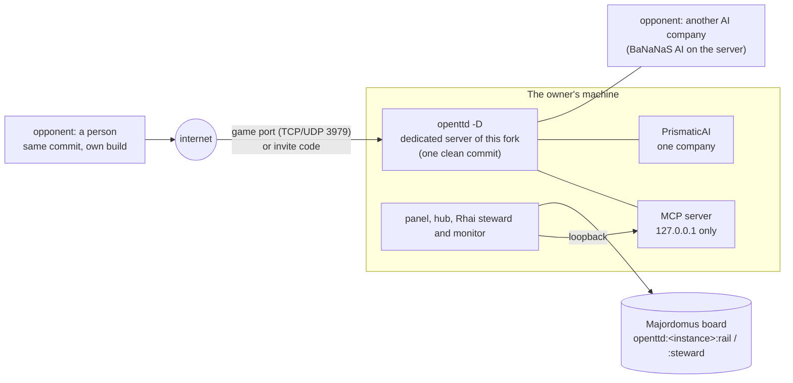

# A real game: a real opponent, over the real internet

**RESEARCH-ONLY.** The owner's goal (2026-11-18): play a real game, over the real internet,
against a real opponent. This page covers:

- what is ready for that;
- what the fork's rules allow and why;
- the one honest way to set it up;
- what each part was proven by.

`tools/research/real-game-check` (below) checks a setup against this page before the game starts.

## The honest shape of a real game

OpenTTD multiplayer is deterministic lockstep (ADR 0016): every client must run the same code as
the server. A client whose revision differs is refused ("The revision of this client does not match
the server's revision"). Two consequences decide everything below:

- **This fork's build cannot join a stock public server**, and it must never pretend it can. The
  research override only widens what a server **you run** accepts. It never changes the revision
  this build reports, so it cannot impersonate a stock client (rule
  `project.research-net-compat-is-local-and-non-spoofing`, [`net-compat.md`](net-compat.md)).
  Joining someone else's server with a bot-driven client is out of scope by design.
- **The real game is hosted by the owner.** The owner runs a dedicated server of this fork, and
  the opponents join it with a build of the same clean commit. The owner's bot plays as one
  company, and the owner's tooling watches and steers it over the loopback MCP server.

## What stays on the owner's machine

| Interface | Bound to | Why |
|---|---|---|
| MCP server (`src/prismatic_mcp/`) | 127.0.0.1 and ::1 only (`prismatic_mcp_server.cpp`) | Rule `project.research-code-is-gated-and-labelled`: a diagnostic interface stays on loopback |
| Panel, hub, Scripts page | 127.0.0.1 (the panel refuses a POST from a foreign `Origin`) | They hold the MCP bearer token and can approve changes |
| Admin port (`network.server_admin_port`) | the bridge's admin connection; a password login is refused while `network.admin_password` is empty (`network_admin.cpp`) | Keep it closed to the internet; it can run console commands |
| The game port (`network.server_port`, default 3979) | the internet | Upstream's own multiplayer, nothing added by this fork |

The owner's bot has no side channel: PrismaticAI is a company AI, so it issues the same commands
as a human player through the game's command system
(rule `project.game-state-mutates-only-through-commands`). Its decisions are visible in the game's
AI debug window and in the panel's log.

## Fairness and disclosure

A real opponent deserves to know what they play against. Before a game:

- start the bot with `disclose_name=1`. Once the game has named the company after its first
  station's town, PrismaticAI appends " (AI)" to the name (`main.nut` `DiscloseName`). It is off by
  default, so duel records keep the game's own names;
- say in the server name or the welcome message that one company is run by an AI the host steers;
- keep auto-approve **off** unless the opponent agreed. Auto-approve lets the host's tooling act
  without the host's per-change approval (knowledge `auto-approve-is-the-owners-switch`).

None of this is enforced by the game. It is the owner's choice, written down here so a real game
is a fair one.

## Setup, step by step

1. **Build from one clean commit**, so the revision is `-g<hash>`, not `-m<hash>` (knowledge
   `a-build-from-a-modified-tree-cannot-join-a-clean-build`). Opponents check out the same commit
   and build it; the README's quick start and `COMPILING.md` cover the build.
2. **Install the bot:** `tools/research/prismatic-ai/install`.
3. **Host:**
   - set `network.server_game_type` to `invite-only` (an invite code through the game
     coordinator, no port forwarding) or `public` (listed);
   - set `network.server_password` for a closed game and `network.max_clients` as needed;
   - start the stack (`tools/research/mcp-e2e`, the panel's own config, or `openttd -D` with your
     config) and let the panel start the bot.
4. **Watch and steer:**
   - the Scripts page (`/scripts`) runs `rail_monitor` (problems to the board) and `rail_steward`
     (line targets, gated) as services;
   - the panel and the hub show the game;
   - every change waits for the host's approval.
5. **Check before inviting anyone:** `tools/research/real-game-check <panel-url>`.

## What was proven, and what is not yet

| Part | Proven by | Status |
|---|---|---|
| The bot builds rail trains can run, two-platform termini, line targets | duels on seed 4242, the line-close duel ([`rail-steward.md`](rail-steward.md)) | proven on loopback |
| The new geometry earns more than the old one | held-start A/B on seeds 4242, 31337 and 20208: +25%, +48%, +78% at 24 months | proven on loopback, against the same AI, not a person |
| The bot against another AI in one game | `tools/research/mcp-duel --opponent <AI>` | proven on loopback (duel records in [`results/`](results/)) |
| A human-style client playing through the UI | [`mcp-human.md`](mcp-human.md) | proven on loopback |
| Every web UI page in a real browser | `tools/research/e2e-coverage --run` (rule `project.web-ui-is-covered-end-to-end`) | proven on loopback |
| A remote human joining over the internet | none yet | **NOT RUN**: needs a second machine and a person |
| An invite-only game through the coordinator | none yet | **NOT RUN** |

A NOT RUN row is not a claim (rule `project.never-report-unrun-validation-as-pass`). The first real
game is also the first run of those rows, and its record belongs in [`results/`](results/) like
any duel.

## Related

The map of a real game can be a real place: [`real-world-scenario.md`](real-world-scenario.md) turns
a place name into a heightmap and a GameScript that a dedicated server loads.

[`net-compat.md`](net-compat.md), [`vanilla-client.md`](vanilla-client.md), [`mcp-control.md`](mcp-control.md),
[`rail-steward.md`](rail-steward.md), [`mechanisms/`](mechanisms/README.md), [`concepts/`](concepts/README.md).
