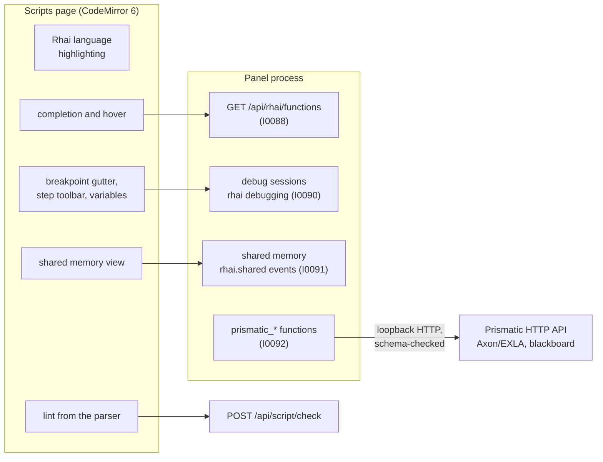

# The Rhai IDE: edit, run, debug and inspect scripts in the panel

**RESEARCH-ONLY.** Milestone `rhai-is-a-live-ide` (issues I0088 to I0093). This page states what
the panel's Scripts page is meant to become and what is built so far. The status table below is the
only place a part is claimed: a part without a passing check there is not built.

## What exists before this milestone

The Scripts page (`/scripts`, [`static/scripts.js`](../tools/research/mcp-panel/static/scripts.js),
[`src/panel_scripts.rs`](../tools/research/mcp-rhai/src/panel_scripts.rs)) already has:

- a library of every script with its header comment, imports and importers;
- a hand-written editor with its own tokenizer, line numbers, an outline and a live parse check;
- Save (only text that parses), Run once (streamed), and Start/Stop as a background service that
  reloads when its file or a library it imports changes.

Scripts run in the panel's own process, in the engine `mcp-rhai` builds
([`src/main.rs`](../tools/research/mcp-rhai/src/main.rs) `host`), with one function per MCP tool,
console command and OpenAPI operation derived at start ([mechanism](mechanisms/rhai-scripting.md)).

## What the milestone adds

| Issue | Part | How it is proven |
|---|---|---|
| I0088 | `GET /api/rhai/functions`: every function a script can call, with signature and doc, derived from the engine and the library | cargo test; the route check |
| I0089 | CodeMirror 6 editor: Rhai language, lint, completion and hover from I0088 | node tests; `mcp-scripts-check` in a browser |
| I0090 | Debugger: breakpoints, step in/over/out, continue, scope and call stack | cargo tests; `mcp-scripts-check` |
| I0091 | Shared memory between scripts and services, inspectable, on the bus; a session console | cargo tests; the page |
| I0092 | Rhai calls Prismatic over loopback HTTP: Axon/EXLA inference and the blackboard | contract tests on a fixture server; 100% line coverage enforced by `tools/gate.sh change`; a live check |
| I0093 | Documentation, the site, the wiki, and the merge to master | `tools/surfaces/surfaces check` |

## Status

| Issue | Status |
|---|---|
| I0088 | **done**: `GET /api/rhai/functions` answers 1,866 functions on a live panel (24 host, 786 tool, 876 route, 87 console, 93 library), signatures as Rhai reads them (`rpc(string) -> Dynamic`); `mcp-route-check` 835 passed, 0 failed; `cargo test --release --bin mcp-panel` 139/139 |
| I0089 | **done**: CodeMirror 6 on the Scripts page; `tools/research/mcp-scripts-check` against a live panel 19/19 (CodeMirror loads, colours, numbers lines, marks and underlines a parse error, completes `rpc`, saves, reloads a service, runs once, no horizontal scroll at 390 px); `node --test` 265/265 |
| I0090 | **done**: `src/rhai_debug.rs` on rhai's debugging interface; `POST /api/rhai/debug`, `GET /api/rhai/debug`, `POST /api/rhai/debug/command`; a breakpoint gutter, the paused line highlighted, Continue/Step/Over/Out/Stop and F5/F10/F11 keys, the scope and the call stack on the page; `cargo test` 153/153 (7 new: breakpoint, into, out, over, stop, breakpoints changed while paused, run-through); live: `mcp-scripts-check` 29/29 (gutter click, pause at line 6, highlight, scope `x = 1`, Step into `add`, Continue to the end), `mcp-route-check` 841 passed 0 failed |
| I0091 | **done**: `src/rhai_shared.rs`, `GET/POST /api/rhai/shared`, `POST /api/rhai/shared/delete`, Rhai `shared_get`, `shared_entry`, `shared_set`, `shared_cas`, `shared_delete`, `shared_keys`; the Scripts page's live Shared memory table; `cargo test` 146/146 (7 new, among them 8 threads × 50 compare-and-swap increments losing none); live: `mcp-scripts-check` 23/23, `mcp-route-check` 838 passed 0 failed, every write a `rhai.shared` event in the DuckDB store; not a session console (deferred: a script runs once or as a service, see I0090) |
| I0092 | **done for this repository**: `src/prismatic.rs` and the `prismatic_*` Rhai functions over what prismatic_api serves (the decision, MCP tools and exec, the `blackboard.*` tools); 100% line coverage (272/272, `cargo llvm-cov`), enforced by `tools/gate.sh change` (proven to fail at 272 of 275); contract tests on a fixture server 10/10 (refusals, timeouts, a silent server, off-contract answers, tokens never in a URL or an error); `tools/research/prismatic-rhai-check` against a live prismatic_api `NOT RUN` (nothing answers on 4004), against a fixture 6/6. Not done: the new loopback routes in prismatic-platform for Axon/EXLA inference and `prismatic_blackboard` (owner's answer 5: that repository's own task) |
| I0093 | **done**: this page, the README's Rhai section and the indexes describe what is built; `tools/surfaces/surfaces check` 0 findings, the site builds every page (515) and `diagrams-check` renders 45/45; `origin/master` holds the milestone (799f5927fa) |

## What Prismatic offers over HTTP today

A read-only survey of `~/dev/prismatic-platform` (2026-11-19; nothing there was changed) found:

| Need | What exists | Usable from Rhai now |
|---|---|---|
| The API itself | `PrismaticApi.Endpoint` on `127.0.0.1:4004` in dev, started only with `START_PRISMATIC_API=true` | yes, when started |
| The OpenTTD decision | `GET /api/openttd/decision?company_id=N`: loopback only, optional bearer `PRISMATIC_OPENTTD_TOKEN`, a Monte Carlo choice of `aggressiveness` | yes |
| MCP tools | `POST /api/mcp/exec` `{"tool", "arguments"}`, `POST /api/mcp/jsonrpc`; loopback guard, optional `PRISMATIC_MCP_TOKEN`; profile `read_only` by default | yes, read-only tools |
| A blackboard | `Prismatic.MCP.Blackboard` through the `blackboard.*` MCP tools (get, put, query, list_frames, ...) | only with `PRISMATIC_MCP_PROFILE=full_access`: every `blackboard.*` tool, reads included, is registered as not read-only |
| `prismatic_blackboard` (the app) | an internal API (`put/get/query` on a named GenServer, atom-keyed frames) | **no**: no JSON route can carry its arguments |
| Axon/EXLA inference | `Prismatic3NL.L2Learning.NeuralEngine` (`predict/2`, `load_model/2`), `ValuationModel`, `AxonBridge`: internal only | **no**: no route; `three_nl.analyze_l2` returns a hardcoded fallback |

So I0092 has two halves (owner's answer 5 below): Rhai functions over what exists (the decision,
MCP tools, the `blackboard.*` tools), and new loopback routes in prismatic-platform for
`NeuralEngine` predict and load and for `prismatic_blackboard` put, get and query, done as their
own task in that repository with its own tests. Until those routes exist, a `prismatic_*` call
that needs them fails with a typed error naming the missing route, never with invented data.

Beside this milestone, the AI battle already runs Axon on EXLA locally:
[`research/battle-brain.md`](battle-brain.md) trains a small ensemble on the battle's records
with prismatic-platform's compiled Nx/EXLA/Axon, and `prismatic_tune.rhai` applies its best
settings through approval-gated tools. Its output, `brain.json`, is a second source a Rhai
function can read.

## The debugger

Debug runs the editor's text as a session in the panel's own process, with rhai's debugging
interface attached. It pauses at a breakpoint line of the script (a library it imports has no
breakpoints of its own; step into goes inside), shows the variables in scope and the call stack,
and waits for Continue, Step (into a function), Over, Out (of the function) or Stop. A breakpoint
fires once per arrival on its line. A session waits at most 30 minutes paused, eight run at once,
and a paused script never pauses the game: anything it changes still goes through approval-gated
tools. Rhai marks its debugging interface volatile: it moves with the rhai version `Cargo.lock`
pins.

## Shared memory

Scripts and services of one panel share keys (`rail.line.3`) holding JSON values. Each key has a
revision: `shared_cas(key, rev, value)` writes only if the key is still at `rev` (0: only if it does
not exist yet), so two services updating one key never lose a write silently, and a key can serve
as a claim (`shared_cas("lock.steward", 0, "me")` succeeds once). Every write and delete is a
`rhai.shared` event on the bus and in the DuckDB store, which is the audit trail.

What it is not: durable (a restarted panel starts empty; the store keeps the history), shared
between panels (each panel has its own), or authenticated (`writer` is what the script declares,
`$MCP_RHAI_WRITER` or `rhai`). Coordination between agent sessions stays on the Majordomus mesh.

## Rhai and Prismatic

`prismatic_decision()`, `prismatic_tools()`, `prismatic_exec(tool, args)`, `prismatic_bb_get`,
`prismatic_bb_put` and `prismatic_bb_query` call prismatic_api on loopback (`$PRISMATIC_URL`,
default `http://127.0.0.1:4004`; anything off loopback is refused before a request is made). Tokens
come from `$PRISMATIC_OPENTTD_TOKEN` and `$PRISMATIC_MCP_TOKEN` and go only into an `Authorization`
header. Every answer is checked before a script sees it: the decision against the contract
(`ai`, `settings` as `name=int` pairs, `chosen_aggressiveness` 0-100, `expected_value`, its
`candidates`), a tool's answer against Prismatic's `{ok, data | error}` envelope. Every failure is
one error a script catches with `try`/`catch`, its text beginning with its kind:

| Text begins | Meaning |
|---|---|
| `prismatic: configuration` | the address is off loopback, a tool name is malformed, a blackboard value is not a map |
| `prismatic: unreachable` | nothing answered, the connection broke or timed out |
| `prismatic: refused (<status> <code>)` | Prismatic answered with its own error code, e.g. `BRIDGE_UNREACHABLE`, `PROFILE_READ_ONLY` |
| `prismatic: invalid answer` | Prismatic answered, but not what the contract says |

What a script cannot get yet: inference from Prismatic's Axon/EXLA models and the
`prismatic_blackboard` app, because prismatic_api has no route for them. A call that would need one
is refused with Prismatic's 404, never answered with made-up data. The `blackboard.*` tools answer
only when Prismatic runs with `PRISMATIC_MCP_PROFILE=full_access`, and a refusal says so.

## Doc comments are for functions

The catalogue reads a library function's `///` comments, which needs Rhai's `metadata` feature.
With it, the parser holds `///` to its meaning: a doc comment must be followed by a function, and
`/// ...` before a `const` or a statement is a parse error ("Doc-comment must be followed
immediately by a function definition"). Comment anything else with `//`. The library's two such
comments (`rail_steward.rhai`) are `//` now, and `every_script_of_the_library_parses` guards the
rest.

## Constraints

- **Nothing reaches the game outside its commands.** The debugger pauses a script, never the game;
  a script still changes the game only through approval-gated tools (rule
  `project.game-state-mutates-only-through-commands`).
- **Loopback only.** The debug routes, the shared memory and the Prismatic client bind to and call
  loopback addresses, as the rest of the panel does.
- **Derived, not listed.** Completion and the docs read I0088's catalogue; no function name is
  typed into the page (rule `project.mcp-surfaces-are-derived`).
- **CodeMirror comes from the panel's `node_modules`** through the allow-listed `/vendor/npm`
  route: no CDN and no committed copy, as for ECharts, three.js and D3.
- **prismatic-platform changes only in its own task.** If Prismatic lacks an HTTP route the
  integration needs, the route is added in that repository as its own task, with its own tests
  and commits (owner's answer 5), never from this tree.
- **Rust builds run on lundra** while this Mac is under its disk floor (knowledge
  `a-rust-build-goes-to-lundra-when-this-mac-is-over-its-limits`).

## The owner's answers

Asked with AskUserQuestion on 2026-11-19, in the session that opened this milestone. Answers are
quoted verbatim.

1. *"exla, axon, shared memory, blackboard" for the Rhai integration: EXLA and Axon are Elixir Nx
   and live only in prismatic-platform (apps prismatic_mycelial_nx, prismatic_blackboard); this
   repo has none of them. What should Rhai get?* Options: Rhai calls Prismatic over HTTP
   (recommended); local primitives only; both.
   Answer: **"option 1, but the integration must be rock-solid, fully tested, enforced,
   integraded, 100 % test covered"**.
2. *Which editor for the web Rhai IDE?* Options: CodeMirror 6 (recommended); Monaco; extend the
   current one. Answer: **"CodeMirror 6 (Recommended)"**.
3. *This Mac has 30 GiB free (the floor for heavy builds is 35), and the Rust work needs cargo
   builds. How do I build?* Options: offload to lundra (recommended); locally after freeing disk;
   locally anyway. Answer: **"Offload to lundra (Recommended)"**.
4. *Push from this machine is blocked: the repository's mesh is enabled with trust policy
   deny_unknown, and this machine's key (946e8aa5…) is not in trust.allow, so the pre-push finish
   --check refuses every task. Should I enrol this machine (`majordomus mesh enrol`, commit the
   change to .ai/repo/mesh)?* Options: enrol this machine (recommended); don't enrol.
   Answer: **"Enrol this machine (Recommended)"**.
5. *The prismatic-platform survey (read only): prismatic_api has NO working route for Axon/EXLA
   inference (three_nl.analyze_l2 returns a hardcoded fallback; NeuralEngine.predict and the
   others have no HTTP route). Its blackboard (prismatic_blackboard) has no usable HTTP surface;
   only Prismatic.MCP.Blackboard is reachable through POST /api/mcp/exec, and only with
   PRISMATIC_MCP_PROFILE=full_access. What scope should I0092 have?* Options: what exists plus
   routes in Prismatic (recommended); only what exists; pause I0092.
   Answer: **"What exists + routes in Prismatic (Recommended)"**.
6. *Live checks of the Rhai IDE (mcp-scripts-check in Chrome, the debugger) need a panel built from
   the feature/rhai-ide branch. This Mac has 26 GiB free (floor 35); a cold build of mcp-panel in its
   own target directory takes ~2–3 GB. How should I verify live?* Options: build locally anyway
   (recommended); whole stack on lundra; wait for freed disk.
   Answer: **"Build locally anyway (Recommended)"**.
7. *Two worktrees are merged into master, have no changes and nothing is running in them:
   OpenTTD-wt/feature/rail-steward (4.0 GB) and OpenTTD-wt/docs/real-world-interlink (0.5 GB). ...
   Remove them (`git worktree remove`; branches stay)?* Options: remove both (recommended); leave
   them. Answer: **"Remove both (Recommended)"**.
8. *feature/rhai-ide holds I0088 and I0089 ... live NOT RUN. Merging into master also brings the
   milestone's 6 issue records (I0090–I0093 still open). When should it go to master?* Options:
   after the live check (recommended); now. Answer: **"After the live check (Recommended)"**.
