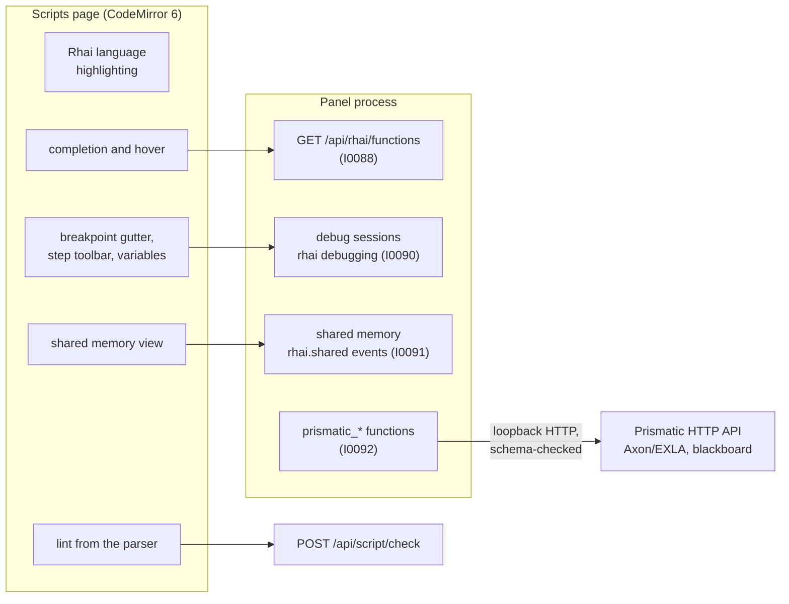

# The Rhai IDE: edit, run, debug and inspect scripts in the panel

**RESEARCH-ONLY.** Milestone `rhai-is-a-live-ide` (issues I0088 to I0093). This page states what
the panel's Scripts page is meant to become and what is built so far. The status table below is the
only place a part is claimed: a part without a passing check there is not built.

## What exists before this milestone

The Scripts page (`/scripts`, [`static/scripts.js`](../tools/research/mcp-panel/static/scripts.js),
[`src/panel_scripts.rs`](../tools/research/mcp-rhai/src/panel_scripts.rs)) already has:

- a library of every script with its header comment, imports and importers;
- a hand-written editor with its own tokenizer, line numbers, an outline and a live parse check;
- Save (only text that parses), Run once (streamed), and Start/Stop as a background service that
  reloads when its file or a library it imports changes.

Scripts run in the panel's own process, in the engine `mcp-rhai` builds
([`src/main.rs`](../tools/research/mcp-rhai/src/main.rs) `host`), with one function per MCP tool,
console command and OpenAPI operation derived at start ([mechanism](mechanisms/rhai-scripting.md)).

## What the milestone adds

| Issue | Part | How it is proven |
|---|---|---|
| I0088 | `GET /api/rhai/functions`: every function a script can call, with signature and doc, derived from the engine and the library | cargo test; the route check |
| I0089 | CodeMirror 6 editor: Rhai language, lint, completion and hover from I0088 | node tests; `mcp-scripts-check` in a browser |
| I0090 | Debugger: breakpoints, step in/over/out, continue, scope and call stack | cargo tests; `mcp-scripts-check` |
| I0091 | Shared memory between scripts and services, inspectable, on the bus; a session console | cargo tests; the page |
| I0092 | Rhai calls Prismatic over loopback HTTP: Axon/EXLA inference and the blackboard | contract tests on a fixture server; 100% line coverage enforced by `tools/gate.sh change`; a live check |
| I0093 | Documentation, the site, the wiki, and the merge to master | `tools/surfaces/surfaces check` |

## Status

| Issue | Status |
|---|---|
| I0088 | planned |
| I0089 | planned |
| I0090 | planned |
| I0091 | planned |
| I0092 | planned |
| I0093 | planned |

## What Prismatic offers over HTTP today

A read-only survey of `~/dev/prismatic-platform` (2026-11-19; nothing there was changed) found:

| Need | What exists | Usable from Rhai now |
|---|---|---|
| The API itself | `PrismaticApi.Endpoint` on `127.0.0.1:4004` in dev, started only with `START_PRISMATIC_API=true` | yes, when started |
| The OpenTTD decision | `GET /api/openttd/decision?company_id=N`: loopback only, optional bearer `PRISMATIC_OPENTTD_TOKEN`, a Monte Carlo choice of `aggressiveness` | yes |
| MCP tools | `POST /api/mcp/exec` `{"tool", "arguments"}`, `POST /api/mcp/jsonrpc`; loopback guard, optional `PRISMATIC_MCP_TOKEN`; profile `read_only` by default | yes, read-only tools |
| A blackboard | `Prismatic.MCP.Blackboard` through the `blackboard.*` MCP tools (get, put, query, list_frames, ...) | only with `PRISMATIC_MCP_PROFILE=full_access`: every `blackboard.*` tool, reads included, is registered as not read-only |
| `prismatic_blackboard` (the app) | an internal API (`put/get/query` on a named GenServer, atom-keyed frames) | **no**: no JSON route can carry its arguments |
| Axon/EXLA inference | `Prismatic3NL.L2Learning.NeuralEngine` (`predict/2`, `load_model/2`), `ValuationModel`, `AxonBridge`: internal only | **no**: no route; `three_nl.analyze_l2` returns a hardcoded fallback |

So I0092 has two halves (owner's answer 5 below): Rhai functions over what exists (the decision,
MCP tools, the `blackboard.*` tools), and new loopback routes in prismatic-platform for
`NeuralEngine` predict and load and for `prismatic_blackboard` put, get and query, done as their
own task in that repository with its own tests. Until those routes exist, a `prismatic_*` call
that needs them fails with a typed error naming the missing route, never with invented data.

Beside this milestone, the AI battle already runs Axon on EXLA locally:
`research/battle-brain.md` (on master, not yet on this branch) trains a small ensemble on the battle's records
with prismatic-platform's compiled Nx/EXLA/Axon, and `prismatic_tune.rhai` applies its best
settings through approval-gated tools. Its output, `brain.json`, is a second source a Rhai
function can read.

## Constraints

- **Nothing reaches the game outside its commands.** The debugger pauses a script, never the game;
  a script still changes the game only through approval-gated tools (rule
  `project.game-state-mutates-only-through-commands`).
- **Loopback only.** The debug routes, the shared memory and the Prismatic client bind to and call
  loopback addresses, as the rest of the panel does.
- **Derived, not listed.** Completion and the docs read I0088's catalogue; no function name is
  typed into the page (rule `project.mcp-surfaces-are-derived`).
- **CodeMirror comes from the panel's `node_modules`** through the allow-listed `/vendor/npm`
  route: no CDN and no committed copy, as for ECharts, three.js and D3.
- **prismatic-platform changes only in its own task.** If Prismatic lacks an HTTP route the
  integration needs, the route is added in that repository as its own task, with its own tests
  and commits (owner's answer 5), never from this tree.
- **Rust builds run on lundra** while this Mac is under its disk floor (knowledge
  `a-rust-build-goes-to-lundra-when-this-mac-is-over-its-limits`).

## The owner's answers

Asked with AskUserQuestion on 2026-11-19, in the session that opened this milestone. Answers are
quoted verbatim.

1. *"exla, axon, shared memory, blackboard" for the Rhai integration: EXLA and Axon are Elixir Nx
   and live only in prismatic-platform (apps prismatic_mycelial_nx, prismatic_blackboard); this
   repo has none of them. What should Rhai get?* Options: Rhai calls Prismatic over HTTP
   (recommended); local primitives only; both.
   Answer: **"option 1, but the integration must be rock-solid, fully tested, enforced,
   integraded, 100 % test covered"**.
2. *Which editor for the web Rhai IDE?* Options: CodeMirror 6 (recommended); Monaco; extend the
   current one. Answer: **"CodeMirror 6 (Recommended)"**.
3. *This Mac has 30 GiB free (the floor for heavy builds is 35), and the Rust work needs cargo
   builds. How do I build?* Options: offload to lundra (recommended); locally after freeing disk;
   locally anyway. Answer: **"Offload to lundra (Recommended)"**.
4. *Push from this machine is blocked: the repository's mesh is enabled with trust policy
   deny_unknown, and this machine's key (946e8aa5…) is not in trust.allow, so the pre-push finish
   --check refuses every task. Should I enrol this machine (`majordomus mesh enrol`, commit the
   change to .ai/repo/mesh)?* Options: enrol this machine (recommended); don't enrol.
   Answer: **"Enrol this machine (Recommended)"**.
5. *The prismatic-platform survey (read only): prismatic_api has NO working route for Axon/EXLA
   inference (three_nl.analyze_l2 returns a hardcoded fallback; NeuralEngine.predict and the
   others have no HTTP route). Its blackboard (prismatic_blackboard) has no usable HTTP surface;
   only Prismatic.MCP.Blackboard is reachable through POST /api/mcp/exec, and only with
   PRISMATIC_MCP_PROFILE=full_access. What scope should I0092 have?* Options: what exists plus
   routes in Prismatic (recommended); only what exists; pause I0092.
   Answer: **"What exists + routes in Prismatic (Recommended)"**.
