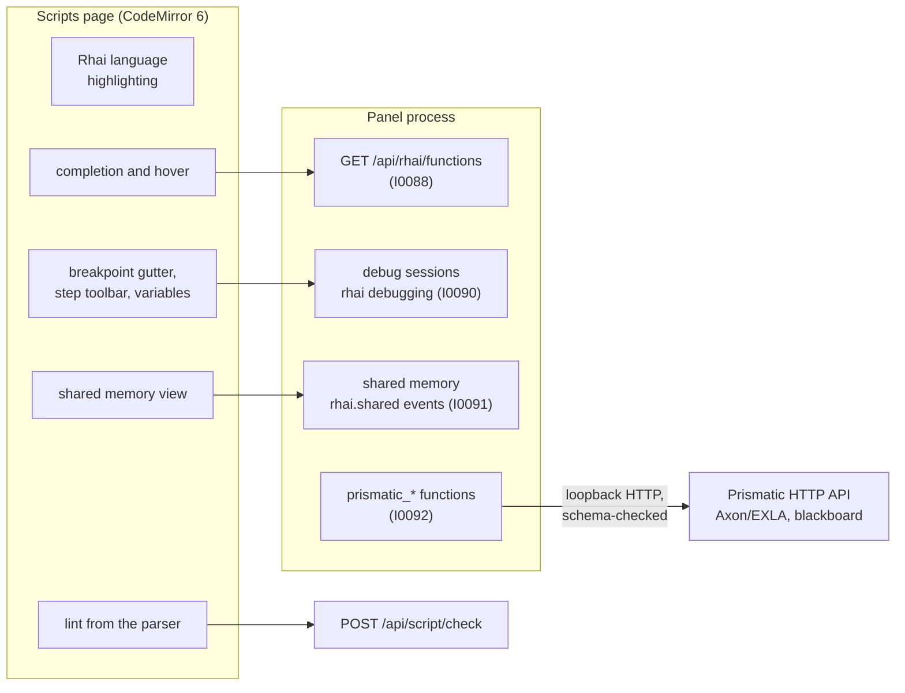

# The Rhai IDE: edit, run, debug and inspect scripts in the panel

**RESEARCH-ONLY.** Milestone `rhai-is-a-live-ide` (issues I0088 to I0093). This page states what
the panel's Scripts page is meant to become and what is built so far. The status table below is the
only place a part is claimed: a part without a passing check there is not built.

## What exists before this milestone

The Scripts page (`/scripts`, [`static/scripts.js`](../tools/research/mcp-panel/static/scripts.js),
[`src/panel_scripts.rs`](../tools/research/mcp-rhai/src/panel_scripts.rs)) already has:

- a library of every script with its header comment, imports and importers;
- a hand-written editor with its own tokenizer, line numbers, an outline and a live parse check;
- Save (only text that parses), Run once (streamed), and Start/Stop as a background service that
  reloads when its file or a library it imports changes.

Scripts run in the panel's own process, in the engine `mcp-rhai` builds
([`src/main.rs`](../tools/research/mcp-rhai/src/main.rs) `host`), with one function per MCP tool,
console command and OpenAPI operation derived at start ([mechanism](mechanisms/rhai-scripting.md)).

## What the milestone adds

| Issue | Part | How it is proven |
|---|---|---|
| I0088 | `GET /api/rhai/functions`: every function a script can call, with signature and doc, derived from the engine and the library | cargo test; the route check |
| I0089 | CodeMirror 6 editor: Rhai language, lint, completion and hover from I0088 | node tests; `mcp-scripts-check` in a browser |
| I0090 | Debugger: breakpoints, step in/over/out, continue, scope and call stack | cargo tests; `mcp-scripts-check` |
| I0091 | Shared memory between scripts and services, inspectable, on the bus; a session console | cargo tests; the page |
| I0092 | Rhai calls Prismatic over loopback HTTP: Axon/EXLA inference and the blackboard | contract tests on a fixture server; 100% line coverage enforced by `tools/gate.sh change`; a live check |
| I0093 | Documentation, the site, the wiki, and the merge to master | `tools/surfaces/surfaces check` |

## Status

| Issue | Status |
|---|---|
| I0088 | planned |
| I0089 | planned |
| I0090 | planned |
| I0091 | planned |
| I0092 | planned |
| I0093 | planned |

## Constraints

- **Nothing reaches the game outside its commands.** The debugger pauses a script, never the game;
  a script still changes the game only through approval-gated tools (rule
  `project.game-state-mutates-only-through-commands`).
- **Loopback only.** The debug routes, the shared memory and the Prismatic client bind to and call
  loopback addresses, as the rest of the panel does.
- **Derived, not listed.** Completion and the docs read I0088's catalogue; no function name is
  typed into the page (rule `project.mcp-surfaces-are-derived`).
- **CodeMirror comes from the panel's `node_modules`** through the allow-listed `/vendor/npm`
  route: no CDN and no committed copy, as for ECharts, three.js and D3.
- **prismatic-platform is never modified from here.** If Prismatic lacks an HTTP route the
  integration needs, that is recorded as a gap, not patched in its tree.
- **Rust builds run on lundra** while this Mac is under its disk floor (knowledge
  `a-rust-build-goes-to-lundra-when-this-mac-is-over-its-limits`).

## The owner's answers

Asked with AskUserQuestion on 2026-11-19, in the session that opened this milestone. Answers are
quoted verbatim.

1. *"exla, axon, shared memory, blackboard" for the Rhai integration: EXLA and Axon are Elixir Nx
   and live only in prismatic-platform (apps prismatic_mycelial_nx, prismatic_blackboard); this
   repo has none of them. What should Rhai get?* Options: Rhai calls Prismatic over HTTP
   (recommended); local primitives only; both.
   Answer: **"option 1, but the integration must be rock-solid, fully tested, enforced,
   integraded, 100 % test covered"**.
2. *Which editor for the web Rhai IDE?* Options: CodeMirror 6 (recommended); Monaco; extend the
   current one. Answer: **"CodeMirror 6 (Recommended)"**.
3. *This Mac has 30 GiB free (the floor for heavy builds is 35), and the Rust work needs cargo
   builds. How do I build?* Options: offload to lundra (recommended); locally after freeing disk;
   locally anyway. Answer: **"Offload to lundra (Recommended)"**.
