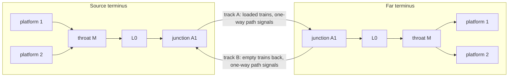

# PrismaticAI: the owner's company AI

**RESEARCH-ONLY.** A Squirrel company AI that the owner's planner and the Rhai scripts steer from
outside the game. It builds bus, intercity road, air, freight rail and passenger rail routes from
its settings. It now lives here, beside the panel, planner and scripts that drive it. Until
2026-11-18 it lived in the bridge repository (`~/dev/openttd-prismatic-bridge/ai/PrismaticAI`,
moved at that repository's `19c2cbe`, whose history keeps the earlier commits).

It is content, not engine code: OpenTTD loads it from the `ai/` folder of its personal directory,
like any AI from BaNaNaS. No CMake option builds or ships it, so no default or release build
contains it (rule `project.research-code-is-gated-and-labelled`). It also stays out of `bin/ai/`,
the folder upstream ships with every build.

## Install

```bash
tools/research/prismatic-ai/install          # ~/Documents/OpenTTD/ai/PrismaticAI -> this checkout
tools/research/prismatic-ai/install --check  # exit 0 when the game loads this checkout's bot
```

The personal folder gets a symlink, never a copy, so the next `start_ai PrismaticAI` loads an
edit made here. A real folder found there is moved aside to `ai-backup/PrismaticAI.<time>`, outside
`ai/`, because the game scans every folder of `ai/` and a backup left there is a second PrismaticAI. Run the
script from another worktree to point the game at that worktree's bot. `--personal DIR` covers
another personal directory: Linux uses `$XDG_DATA_HOME/openttd`, and a test run can use a scratch
`HOME`.

## Files

| File | What it does |
|---|---|
| `info.nut` | Name, API version and every setting. All settings are `CONFIG_INGAME`, so a running bot takes a change at once (`openttd.ai.set_setting`, gated by the owner's approval) |
| `main.nut` | The heartbeat: the planner's air, freight and passenger lines first, then the bot's own lines, buses, fleet, line reconciliation and loan |
| `rail.nut` | Rail lines: termini with a throat, the A* line search, laying, the walk check, depots, trains, platform length; the opt-in double track (`BuildDoubleRailLineAndTrain`: a junction at each terminus, two one-way tracks, one-way path signals) |
| `lines.nut` | Rail lines as desired state: line slots, the record the Rhai steward reads (with station ids), and the reconciliation of its targets; closing removes only what the line owns |
| `fleet.nut` | Road and air capacity follows waiting cargo and the link graph's planned flow; vehicles that lose money are sold |
| `catchment.nut`, `statues.nut` | Mechanisms learned from AAAHogEx: joined drive-through stops that ring each airport to collect the whole town, and statues in the towns of our stations; each behind its setting, off by default |
| `autopilot.nut` | Autopilot's own air routes for a bot without a plan: the best big-town pairs, built first on borrowed money with a real budget check; a half-built route takes its airport down again |
| `steward.nut` | The in-bot steward behind `self_steward=1`: the Rhai steward's line policy for lines with no external target, and reinvestment of idle money in more own lines; on a double-track line, a train more while half a trainload waits and no train loads at the source |
| `roadstop.nut`, `intercity.nut`, `air.nut` | Bus stops and depots facing their road, intercity roads tile by tile, airports and aircraft |

## Rail lines a train can always run

Full rationale: [`research/rail-steward.md`](../../../research/rail-steward.md), knowledge
`rail-lines-a-train-can-turn-on`.

- **No 90-degree turn anywhere.** `pf.forbid_90_deg` is on by default (`src/table/settings/pathfinding_settings.ini`).
  `Turns90` rejects two corners in a row that turn the same way: in the search, on the first tile
  beyond each throat, on the last tile into it, and across a re-plan. The line also runs straight
  through each throat's first tile: the second platform joins by a sideways move, so a corner
  there would be a 90-degree turn on its route only.
- **Termini with two platforms** (`rail_platforms`, default 2). A two-tile throat merges the
  platforms into the single line, with a path signal on each platform's exit. A train leaves only
  when it can reserve its way into a free platform at the other end, so up to `trains_max`
  trains share one track without a passing loop.
- **The laid line is walked** (`VerifyRailLine`) before any train is bought. A missing piece is
  laid again, and a line that stays broken gets no train.
- **Every wagon is checked.** A wagon the game will not refit or couple (a NewGRF rule) is sold
  again (`AddWagon`), and a train that would carry nothing is not started.
- **The depot stands behind a platform's dead end.** If that fails, it goes beside a straight
  piece of the line, never on a corner.
- **Length follows demand** (`PlatformPlan`). Platform length and wagons come from the line's
  monthly supply, its distance and the locomotive's speed. They are capped by
  `vehicle.max_train_length` and `station.station_spread`, unless `rail_len` or `rail_wagons`
  override them.

## Double track (`rail_double=1`, opt-in)

After AAAHogEx, whose rail scales by double track while a single-track line here holds two
trains. With `rail_double=1` each new own freight line gets a junction at both termini and two
tracks, one each way (`rail.nut` `BuildDoubleRailLineAndTrain`):



- **One A\* search, twice.** Track A is `FindRailPath` between the junctions. Track B is the
  same search with track A's tiles left out. Both are walked (`VerifyRailLine`, `VerifyJunction`)
  before a train is bought. L0 is straight, so no route through the junction turns 90 degrees.
- **One-way path signals** every `RAIL_SIGNAL_SPACING` tiles, plus one on the last tile before
  each far junction, so an arriving train waits on its own track.
- **The throat's path signals face departing trains**, unlike a single-track throat.
  `AIRail.BuildSignal(tile, front)` signals trains that come *from* `front` (`script_rail.cpp`
  `_possible_trackdirs`). A signal facing arrivals let an arriving train wait on M, the tile every
  departure needs, and the first build deadlocked there.
- **`trains_max`** is the platforms plus the signal blocks of the shorter track: half of what
  both tracks and all four platforms hold.
- **Growth.** The in-bot steward adds a train while half a trainload waits and no train of the
  line is loading at the source (AAAHogEx's rule). It adds at most one a game month.
- **Fallback.** When track B cannot be found, laid or walked, the junction's spur is removed and
  the line runs single track with `trains_max` = platforms. On hilly maps this is common: track A
  takes the only bridge site across a valley.
- **Not ported.** AAAHogEx's third source platform, signals at the top of slopes, and cloning
  without the steward's monthly rhythm.

The measured effect is in `research/ai-battle/README.md` (section *Double track*).

## Steering from outside

| Setting | Set by | Meaning |
|---|---|---|
| `rail_a`, `rail_b`; `fr_*` … `fr16_*`; `air_a`, `air_b` | the panel, from the planner's portfolio | the lines to build |
| `own_lines`, `line_budget`, `rail_after`, `own_fail_pause` | the panel | how far the bot plans on its own, and when; `own_fail_pause` stops trying own lines for the game year after that many failed in a row (0, default: never) |
| `rail_platforms`, `rail_len`, `rail_wagons` | the owner, a duel's `--bot-settings` | the shape of new rail lines (0: derive) |
| `disclose_name` | the owner, for a real game against people | 1 appends " (AI)" to the company's name ([`research/real-game.md`](../../../research/real-game.md)) |
| `line<N>_trains`, `line<N>_wagons` (24 slots) | `tools/research/mcp-panel/rhai/rail_steward.rhai` | the target of rail line N: trains (0 closes it), wagons per train |
| `autopilot` | default 1; the owner (0 restores the duels' old unplanned rival) | a bot started without a plan (no planner line, air or rail pair) grows on its own: in-bot steward, at least 8 own freight lines, intercity roads, up to 30 routes, a 5000 reserve (`main.nut:Behaviour`, rule `project.prismatic-ai-is-never-last`) |
| `air_routes_max`, `air_towns`, `air_min_tiles`, `air_max_tiles`, `air_level_max`, `air_keep_last`, `air_reuse`, `air_grow_money`, `air_level_once`, `foreign_airports` | the owner, any surface: tilde console `bot set <company> <name> <value>`, MCP `openttd.ai.set_setting`, Rhai `api_botSetting`, the panel, a battle settings string, the battle's genetic algorithm | the autopilot's air routes: how many, from how many of the biggest towns, at what distance, and when a town is skipped because other companies already fly from it (`autopilot.nut`), and how much levelling one airport site may cost, in thousands (`air.nut`; 35 by default since the levelling rectangle was fixed on 2026-11-20), and whether the fleet seller keeps the last plane of an air route (`fleet.nut`; on by default, and pinned on in the battle: a bug fix is not a gene); `air_reuse` lets new routes fly from our airports (hubs) once no fresh pair is left, and `air_grow_money` allows one more route per that much idle money, and `air_level_once` stops a search levelling after a levelled site was refused anyway (all off by default, GA genes) |
| `invest_min`, `invest_ppv_div`, `invest_road_cap`, `invest_air_cap`, `reinvest_budgets` | the same surfaces | when idle money buys vehicles and how far a route grows (`fleet.nut` InvestSurplus), and how many line budgets in the bank fund own lines beyond `own_lines` (`steward.nut`) |
| `catchment_stops`, `catchment_spacing`, `statue_money`, `air_full_load`, `invest_borrow` | the same surfaces; genes of the battle's GA | mechanisms learned from AAAHogEx's source, each off by default because one recorded ablation (`research/results/ablation-20261119T062938-seed930967890.md`) did not favour turning it on: joined road-stop rings around airports (`catchment.nut`), statues (`statues.nut`), full load at both airports, borrowing for vehicles that pay back |
| `air_add_waiting`, `rail_twin_max` | the same surfaces; GA genes | a plane more while both airports have passengers waiting; twin rail lines for saturated lines. Both off by default, see the recorded ablations `research/results/ablation-20261119T06*` |
| `rail_double` | the owner, any surface above | 1: the bot's own new freight lines are double track, see below; 0 (default): single track, unchanged |
| `autopilot` with a plan | the panel | since 2026-11-19 a plan no longer switches growth off: the planner's lines come first, and then the in-bot steward, the autopilot's own air routes and InvestSurplus run on top (`main.nut` `grows`) |
| `self_steward` | the owner, e.g. the headless LAN AI battle ([`research/ai-battle/README.md`](../../../research/ai-battle/README.md)) | 1: lines without a steward's target follow the Rhai steward's policy inside the bot, and idle money funds own lines beyond `own_lines` (`steward.nut`); 0 (default): unchanged |

Every finished line logs a record once at build time and again every game month:

```text
PrismaticAI: rail line 3: label=COAL A Mine - B Power Station|a=26106|b=53365|st_a=0|st_b=1|cargo=1|platforms=2|len=3|depot=26109|trains_max=2|wagons_fit=5|tiles=233|state=open
```

`tools/research/mcp-panel/rhai/rail_lib.rhai` (`parse_record`) reads it. The steward and the
monitor share that reading.

## Checks

- `tools/research/mcp-duel --months 12 --seed 4242` plays a game with this bot. Run it against a
  scratch `HOME` whose `ai/PrismaticAI` points here, so other sessions' games keep their bot.
- `cargo test` in `tools/research/mcp-rhai` runs the Rhai side offline (`rail_*` tests).
